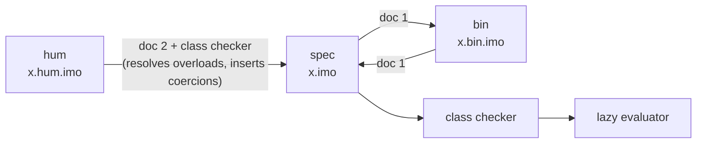
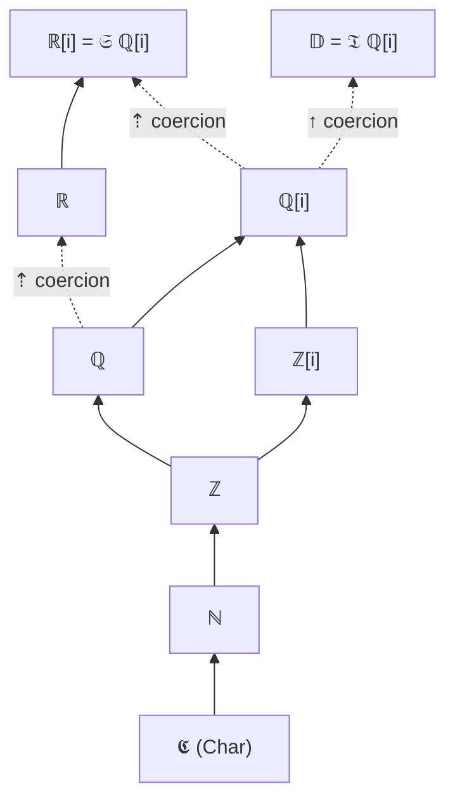
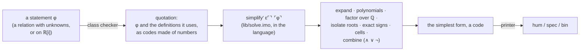
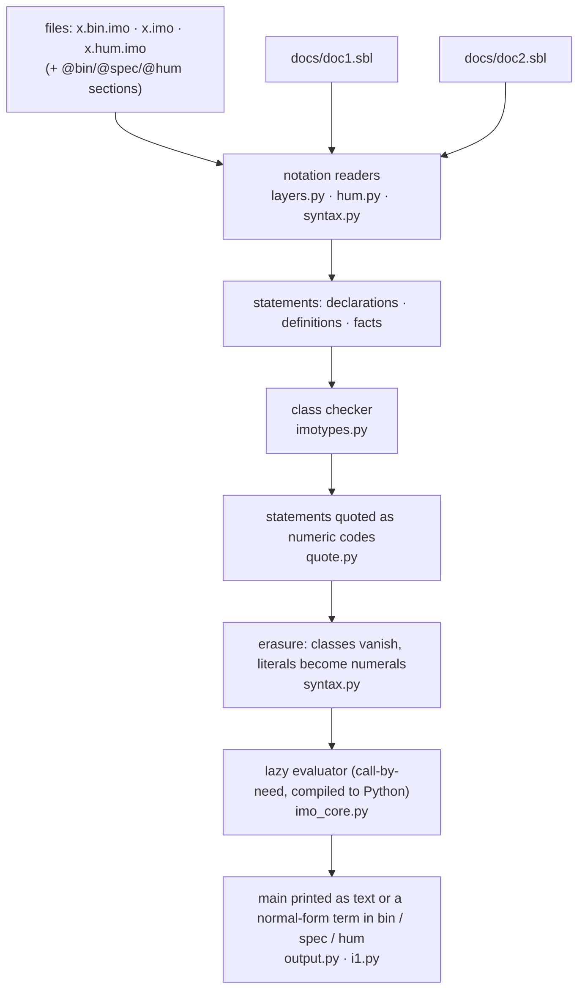

# i-1  (`.imo`)

**A small, lazy, class-checked mathematical language whose foundation is the Gaussian integers ℤ[i], written in base i − 1.  The Gaussian rationals ℚ[i] and the real numbers are constructed from them.**

```
π + e·i   is defined, exactly and in three lines, as

    pi in \RR := sum(2, k in \QQ |-> k / (2 * k + 1))
    e  in \RR := sum(1, k in \QQ |-> 1 / k)
    z  in \R  := pi + e * i
```

*i-1* (file extension `.imo`) is a language for writing mathematics down so that it can be **run**: every number is an exact element of ℚ[i], real and complex numbers are lazy streams of such elements, higher-dimensional algebras are built with the Cayley–Dickson construction (and are never collapsed back down), and function spaces of any dimension — including infinite — are ordinary values.  The language has **three interchangeable notations** (binary, specific/unicode and human), connected by two system documents.  A program has an entry point, `main`, and prints its result in any of the three notations; a statement that contains a predicate — a relation between real or complex numbers, which no evaluation can decide, or a relation about an *unknown* — is **simplified by logic, from the definitions**, to its simplest form: `true`, `false`, or its solution set; and the library covers complex analysis, linear algebra, number theory, polynomials, groups, rings, fields and Galois theory, all computed in the language.

```
4 * atan(1) == pi                        true      (the same series, written twice)
exp(i/2) == cos(1/2) + i * sin(1/2)      true      (Euler's formula, proved, not computed)
pi lt 22/7                               true      (certified error bounds)
```

> **License.**  Free for non-commercial use under the [i-1 License](LICENSE) (attribution required, strong copyleft); commercial use needs a paid license from the author, with the attribution duty waived and the copyleft kept ([§22](#22-license), [`COMMERCIAL.md`](COMMERCIAL.md)).

> **Status.**  i-1 is defined by what its three interpreters share — the `.imo` files, the `.md` documents and the test suite — and has three parallel interpreters, the cores: **Pymo**, written in Python, **Haskimo**, written in Haskell, and **Rustimo**, written in Rust.  None is the reference ([§2.1](#21-three-interpreters-pymo-haskimo-and-rustimo)).  Everything marked ✅ in [§17 Status](#17-status-limits-and-roadmap) is implemented and covered by the test-suite; everything else is explicitly listed there as a limitation or as roadmap.  Nothing in this README describes behaviour that is not either tested or labelled.

---

## Contents

1. [At a glance](#1-at-a-glance)
2. [Quick start](#2-quick-start)
3. [Design principles](#3-design-principles)
4. [The three notation systems](#4-the-three-notation-systems)
5. [The system documents (doc 1 and doc 2)](#5-the-system-documents-doc-1-and-doc-2)
6. [Numbers: base i-1, the Gaussian integers, and the Gaussian rationals built from them](#6-numbers-base-i-1-the-gaussian-integers-and-the-gaussian-rationals-built-from-them)
7. [Classes: every symbol is declared first](#7-classes-every-symbol-is-declared-first)
8. [Characters and strings](#8-characters-and-strings)
9. [Evaluation model](#9-evaluation-model)
10. [Lazy complex numbers, series, the Cayley–Dickson tower, function spaces](#10-lazy-complex-numbers-series-the-cayleydickson-tower-function-spaces)
11. [The axioms of ℚ[i]: complete in every sense a computable system can be](#11-the-axioms-of-qi-complete-in-every-sense-a-computable-system-can-be)
12. [Programs: `main` and the output notations](#12-programs-main-and-the-output-notations)
13. [Predicates: relations simplified to their simplest form](#13-predicates-relations-simplified-to-their-simplest-form)
14. [Standard library reference](#14-standard-library-reference)
15. [Worked examples](#15-worked-examples)
16. [Implementation and tests](#16-implementation-and-tests)
17. [Status, limits and roadmap](#17-status-limits-and-roadmap)
18. [Extending the language](#18-extending-the-language)
19. [FAQ](#19-faq) · [Glossary](#20-glossary) · [Repository layout](#21-repository-layout) · [License](#22-license)

---

## 1. At a glance

| Property | What it means in i-1 |
|:--|:--|
| **Foundation** | **ℤ[i], the Gaussian integers**, as binary strings: the digits of a Gaussian integer in base i − 1.  A Gaussian rational ℚ[i] is a pair (numerator, denominator) of Gaussian integers (a numeral such as `1100` is the Gaussian integer 2, held as a rational with denominator 1), a real or complex number is a stream of such rationals.  An ordered pair of integers is a Gaussian integer, **a + b·i := (a, b)**. |
| **Types are decoding keys** | A type tells how to read a binary string and never changes the string: `110101` is 1 − 6i in ℤ[i], the pair (1, −6) in ℤ², the fraction −1/6; a pair of strings, `("Hello, world!", "Welcome to i - 1!")`, is one binary string read as `String²` ([§6.6](#66-types-are-decoding-keys)). |
| **Number system** | Base **i − 1**, digits `0` and `1`.  Every Gaussian integer has a unique finite expansion, so ℤ[i] needs no sign and no separate real/imaginary parts.  `11` is *i*, `1100` is 2, `11101` is −1. |
| **ℝ[i] is lazy** | A real or complex number is an infinite stream of ℚ[i] elements (its approximants).  Nothing is computed until an element is demanded. |
| **Dimension only goes up** | Cayley–Dickson trees: complex numbers → quaternions → octonions → sedenions → … of unbounded depth.  Lower-depth values are lifted by *a ↦ (a, 0)*; no operation ever trims a tree, so a zero of depth 3 stays a zero of depth 3. |
| **Infinite dimensions** | `𝔉 A` is the algebra of all functions ℚ[i] → A, with pointwise operations; inner products are streams of partial sums. |
| **Classes first** | Every value, variant and function must be declared with its class (domain → codomain) before it is defined.  Classes form a lattice (ℕ ⊆ ℤ ⊆ ℚ ⊆ ℚ[i] …) with a few explicit widening coercions. |
| **Everything from ℚ[i]** | Booleans are digits, `Char` is a natural number (a code point), `String` is a list of `Char`, lists and pairs are lambda terms over numerals. |
| **Three notations** | **bin** (only `1 0 . space ( ) newline`), **spec** (unicode glyphs), **hum** (ASCII / TeX-like).  Two system documents map between them: *doc 1* `[spec sbl] := [bin sbl]`, *doc 2* `[hum sbl] := [spec sbl] or [bin sbl]`. |
| **Evaluation** | Lazy (call-by-need).  Infinite streams and function spaces are ordinary values. |
| **ℚ[i] is complete** | Division is total (x ÷ 0 = 0), every closed equation and inequation is decided, every element has one canonical form `⊜` — the axioms are audited in [§11](#11-the-axioms-of-qi-complete-in-every-sense-a-computable-system-can-be) and `docs/axioms.md`. |
| **Programs** | `main` is the entry point: `i1.py run x.hum.imo` (or just `i1.py x.hum.imo`).  A `String` main is its own output; any other value is printed as a normal-form term in bin, spec or hum — by default in the notation `main` is written in. |
| **Predicates** | A statement with a predicate is simplified when it is evaluated: `true` if it holds for every value of its unknowns, `false` if for none, otherwise its simplest equivalent form (`x^2 + 1 == 0` over ℂ is `x == -i or x == i`, over ℝ it is `false`).  Closed relations on ℝ[i] are decided from the definitions (expansion, ring normal forms, isomorphism of series, certified bounds) — true, false, or *undetermined*, never a guess. |
| **Mathematical library** | More than 400 named functions in the language itself: complex functions (Γ, ζ, erf, Bessel J and I, elliptic integrals, all inverse trigonometric and hyperbolic functions with cmath's branch cuts …), linear algebra, number theory, polynomials over ℚ and GF(p), groups, rings and Gröbner bases, finite and number fields, Galois groups of low-degree polynomials ([§14](#14-standard-library-reference)). |
| **One system** | ⊤/⊥ are the digits 1/0: a truth value is a number (`1 + true` is 2), and `+`, `or`, `max`, `union` are one family of operations. |

### The target, π + e·i, in all three notations

The three programs below are the *same program*: the human text is compiled to the spec text by the class checker (overloads are resolved by class), and the spec text is re-spelled into the binary text by doc 1.  All three are loaded by the test-suite and produce identical streams.

**human** — `examples/target.hum.imo`

```text
pi in \RR := sum(2, k in \QQ |-> k / (2 * k + 1))
e in \RR := sum(1, k in \QQ |-> 1 / k)
z in \R := pi + e * i
```

**spec** — `examples/target.spec.imo`  (class declaration first, then the definition)

```text
π ∶ ℝ
π ≔ (Σ 1100 (ξ ∶ ℚ ↦ (÷ ξ (⊞ (⊠ 1100 ξ) 1))))
𝕖 ∶ ℝ
𝕖 ≔ (Σ 1 (ξ ∶ ℚ ↦ (÷ 1 ξ)))
𝕫 ∶ ℝ[i]
𝕫 ≔ (⊕ π (⊛ 𝕖 (⇡ 11)))
```

**bin** — `examples/target.bin.imo`  (the whole file uses only `1 0 . space ( )` and newline; `.B.` is a symbol, `.` = `↦`, `..` = `≔`, `...` = `∶`, a bare bit string is a ℚ[i] numeral)

```text
.1010100010. ... .1101.
.1010100010. .. (.1100010. 1100 (.11011. ... .1100. . (.111110. .11011. (.111010. (.111011. 1100 .11011.) 1))))
.101101100001. ... .1101.
.101101100001. .. (.1100010. 1 (.11011. ... .1100. . (.111110. 1 .11011.)))
.101101100010. ... .10000.
.101101100010. .. (.1011011. .1010100010. (.1011100. .101101100001. (.1011010. 11)))
```

The binary program refers to the prelude (the standard library), which itself ships in all-binary form as `lib/prelude.bin.imo` (**1,307,269 characters**).  The symbol table for the three program-local names is `examples/target.sbl`.

---

## 2. Quick start

The commands below run Pymo, the Python core, which needs Python 3.11 or newer (the test-suites pass on 3.11 and 3.13, the example commands also ran on 3.12; older versions are untested) and nothing else: there is nothing to install, it uses only the standard library.  Haskimo, the Haskell core, needs GHC instead and no Python at all, and takes the same commands ([§2.1](#21-three-interpreters-pymo-haskimo-and-rustimo)).

```bash
# run a program: evaluate its main and print it
python3 pymo/i1.py examples/main.hum.imo
python3 pymo/i1.py examples/prove.hum.imo                  # relations on ℝ[i], decided by logic
python3 pymo/i1.py examples/predicates.hum.imo              # statements with unknowns, simplified to their simplest form
python3 pymo/i1.py examples/decode.hum.imo                  # one binary string, several decoding keys (about 40 s)
python3 pymo/i1.py run examples/main.hum.imo --out spec     # the output notation: bin | spec | hum

# check a program: load the prelude + your file, run the class checker
python3 pymo/i1.py check     examples/target.hum.imo

# evaluate one symbol: stream element 14 of  z = π + e·i
python3 pymo/i1.py eval      examples/target.hum.imo z 14
#   element 14 of the stream:  457311809536/145568097675 + 47395032961/17435658240 i   (≈ 3.14156615934 + 2.71828182846 i)

# re-spell a program in another notation
python3 pymo/i1.py translate examples/target.hum.imo --to spec
python3 pymo/i1.py translate examples/target.hum.imo --to bin

# run the test-suites (each prints PASS/FAIL lines; together a few minutes).  Nineteen of them also run on Haskimo and Rustimo: add  --core haskimo  or  --core rustimo
# (all of them on every core they support:  python3 tests/run_suites.py)
python3 tests/test_layers.py       # notations, docs, class checker, Char/String, order, quantifiers, analysis
python3 tests/test_algebra.py      # ℤ[i], ℚ[i], Cayley–Dickson tower, lazy ℝ[i], function spaces
python3 tests/test_axioms.py       # the axiom audit of ℚ[i]: field, meadow, order, conjugation, canonical forms
python3 tests/test_classes.py      # the class system: lattice, overload sets, human operators (all three cores agree)
python3 tests/test_lists.py        # lists: folds, scans, sorting, searching, combinatorics (against Python)
python3 tests/test_strings.py      # characters and strings: case, splitting, bases, Roman numerals, edit distance
python3 tests/test_dict.py         # dictionaries, sets, multisets, heaps, queues (tries over the digits)
python3 tests/test_theory.py       # theories: packages of axioms, and the decision of statements (true / false / undetermined)
python3 tests/test_library.py      # the library: arithmetic, lists, analysis, linear algebra, sets (from the human notation)
python3 tests/test_output.py       # main, the three output notations, round trips
python3 tests/test_prove.py       # predicates: relations on ℝ[i] decided by logic
python3 tests/test_predicates.py   # statements: unknowns, the class Prop, the printer in three notations
python3 tests/test_solve.py        # the simplifier: simplest forms for every domain, against exact arithmetic
python3 tests/test_poly.py         # polynomials: gcd, resultants, Sturm, real roots, factorisation over ℚ
python3 tests/test_numtheory.py    # number theory: primes, factoring, congruences, arithmetic functions, partitions
python3 tests/test_group.py        # permutations, finite groups, subgroups, actions, Burnside
python3 tests/test_linalg.py       # exact linear algebra over ℚ[i]
python3 tests/test_complex.py      # functions of a complex variable (about 25 minutes; --first: 40 seconds)
python3 tests/test_ring.py         # Z/n, ideals, quotient rings, multivariate polynomials, Gröbner bases
python3 tests/test_field.py        # GF(p), GF(p^n), number fields, algebraic numbers
python3 tests/test_galois.py       # Galois groups of low-degree polynomials, cyclotomy, Frobenius
python3 tests/test_codec.py        # types as decoding keys: 110101 as 1 - 6i, (1, -6), -1/6; pairs of strings
python3 tests/test_readme.py       # the hand-written numbers and messages of this README
```

`eval` (an inspection command of the interpreters) prints a value according to its **declared class**: a ℚ[i] value as an exact fraction, a stream element (`N` defaults to 10), a Cayley–Dickson tree as `⟨a, b⟩`, a `String` as text, a `Bool` as `true` / `false`.

Files choose their notation by extension — `x.hum.imo` human, `x.bin.imo` binary, `x.imo` / `x.spec.imo` spec — or by `@hum`, `@spec`, `@bin` section headers inside one file (see [§4.5](#45-files-extensions-and-mixing-notations)).

### 2.1 Three interpreters: Pymo, Haskimo and Rustimo

i-1 has three **interpreters**: a program is read, class-checked and evaluated every time it runs ([§9](#9-evaluation-model) says what the evaluator does inside); a fourth program, **Compimo** ([§2.2](#22-compimo-the-compiler)), translates a program to C and compiles it.  The language is defined by what the repository **shares**: the `.imo` files (the standard library `lib/`, the examples, and the two system documents `docs/doc1.sbl` and `docs/doc2.sbl`), the `.md` files (this README and `docs/`) and the test suite (`tests/`).  Everything else is one of three **parallel cores**, three interpreters of that one specification, which read the same files and print the same bytes.  They are peers: none is the reference, and a core is right when the shared test suite passes on it.

```text
lib/  examples/  docs/*.sbl               the language: the .imo files and the system documents                          shared
README.md  readme/  docs/*.md             the documentation                                                              shared
tests/                                    the test suite (tests/conformance and 19 of the 23 suites run on all cores)    shared
pymo/                                     Pymo, the Python core, with the scripts that write the generated files         parallel
haskimo/                                  Haskimo, the Haskell core                                                      parallel
rustimo/                                  Rustimo, the Rust core                                                         parallel
i1  install.sh  Makefile  haskimo.cabal   choose, install and build any of the cores
```

| | **Pymo** | **Haskimo** | **Rustimo** |
|:--|:--|:--|:--|
| written in | Python | Haskell | Rust |
| source | `pymo/` | `haskimo/`, package `haskimo.cabal` | `rustimo/`, package `rustimo/Cargo.toml` |
| needs | Python 3.11+, standard library only | GHC 9.x and its boot libraries only (`base`, `containers`, `mtl`, `template-haskell`, `directory`); nothing from Hackage | `cargo` and `rustc` 1.70+; no crates at all (the standard library only) |
| program | `python3 pymo/i1.py` (installed as `pymo`) | `haskimo`: one self-contained executable — the standard library is compiled into it, so it runs from any directory and needs no Python | `rustimo`: one self-contained executable of about 2 MB, the standard library compiled into it, no Python and no runtime |
| evaluator | lambda terms compiled to Python | closures built with Haskell's own laziness (a generational garbage collector) | flat closures on an explicit stack with update frames (reference counting); depth of recursion limited by memory only |
| commands | `run` `check` `translate` `eval` `text` | the same commands, options and output | the same commands, options and output |

Install any of them or all, then choose one per command:

```bash
./install.sh                           # every interpreter whose compiler is found (python3, ghc, cargo), into ~/.local
./install.sh --prefix /usr/local       # elsewhere (PREFIX/bin/{i1,pymo,haskimo,rustimo}, PREFIX/share/i1/)
./install.sh --pymo-only               # or --haskimo-only, or --rustimo-only
./install.sh --default haskimo         # what `i1` uses when you do not say: pymo | haskimo | rustimo | auto (auto = rustimo, else haskimo, else pymo)
./install.sh --uninstall

i1 run examples/main.hum.imo                   # the default interpreter
i1 --impl pymo    run examples/main.hum.imo    # Pymo     (also  I1_IMPL=pymo i1 run …     or   pymo run …)
i1 --impl haskimo run examples/main.hum.imo    # Haskimo  (also  I1_IMPL=haskimo i1 run …  or   haskimo run …)
i1 --impl rustimo run examples/main.hum.imo    # Rustimo  (also  I1_IMPL=rustimo i1 run …  or   rustimo run …)
i1 --impl all     run examples/main.hum.imo    # all of them at the same time: the output is printed once if they agree; if not, exit status 3 and a diff
```

`py`, `hs` and `rs` are accepted for `pymo`, `haskimo` and `rustimo` (`--impl rs`, `--default py`).  From a checkout, without installing: `make` builds `build/haskimo` and `build/rustimo` (`make rustimo`, or `./rustimo/build.sh`, for the Rust one alone), and `./i1 --impl rustimo run examples/main.hum.imo` works in place.  `cabal install exe:haskimo` installs Haskimo alone.  `i1` takes the commands and options of `pymo/i1.py` unchanged.  How the three interpreters are kept identical — one interpreter-neutral test that all of them must pass, `tests/conformance/run.py` — is described in [§16.5](#165-the-three-cores-and-the-shared-test-suite).


### 2.2 Compimo, the compiler

**Compimo** is the compiled version of i-1 (`compimo/`, Rust and C, no Python; [`docs/compimo.md`](docs/compimo.md)).  It uses the front end of Rustimo (readers, class checker, printer), translates the
program to C, compiles it together with the prelude (compiled once and cached) and a small run-time system, and runs it; it prints the same bytes as the interpreters (all the cases of
`tests/conformance`).  Its speed comes from three things: constructors and pattern matches become data objects and switches, small functions are inlined, and the arithmetic on digit strings —
almost all that i-1 does — is done on arrays of digits by native versions that return *the same lists* as the definitions (`compimo selftest` checks it on random strings).

```bash
make compimo                       # needs cargo, a C compiler and libgc-dev; build/compimo
build/compimo prelude              # once: compile the prelude (about 3 minutes)
build/compimo run examples/prove.hum.imo
i1 --impl compimo run examples/prove.hum.imo       # it is chosen by name only (not part of auto, both or all)
```

---

## 3. Design principles

1. **One foundation, everything else defined.**  The Gaussian integers ℤ[i] (binary strings in base i − 1) are the only native domain.  ℚ[i] (pairs of Gaussian integers), ℝ[i] (streams of them), ℕ, ℤ, ℚ, ℝ, `Char`, `String`, lists, pairs, algebras and function spaces are *classes over* ℤ[i], not additional primitives; a class is a decoding key for a binary string ([§6.6](#66-types-are-decoding-keys)).
2. **Base i − 1.**  Writing numbers in base i − 1 makes the Gaussian integers a free monoid on two digits.  Addition needs a carry that is itself a numeral ([§6.3](#63-addition-with-a-numeral-as-carry)); multiplication by the base is *prepending the digit 0*.
3. **Laziness instead of limits; logic instead of evaluation.**  A real number is the stream of its approximants, computed on demand.  A relation between reals — or about an unknown — is never decided by evaluating streams: it is simplified by logic, from the definitions ([§13](#13-predicates-relations-simplified-to-their-simplest-form)), and when no rule decides it the answer is *undetermined*.
4. **Dimension is monotone.**  The Cayley–Dickson construction only adds dimensions.  The only conversion between depths is the inclusion *a ↦ (a, 0)*.
5. **Declare first, then define.**  A symbol without a class declaration cannot be defined or used.  Classes are written as terms in the language itself, and the same line may be repeated to give a symbol several classes (an *overload set*).
6. **Three notations, one meaning.**  Notation is a *spelling layer*.  Doc 1 and doc 2 are plain data files; translators between notations are mechanical and are tested for exact round trips.
7. **Keep the systems apart.**  Mixing notations in one section of code does not break anything — the reader supports `@bin` / `@spec` / `@hum` section headers — but it is **strongly discouraged**: keep one notation per file and let the translators produce the others.
8. **Honest scope.**  The prelude's class signatures are *trusted declarations* (they are tested, not proved).  User programs are fully checked against them.  Limits are listed in [§17](#17-status-limits-and-roadmap), not hidden.
9. **Purity at level i − 1.**  Everything is a function and every computation goes through the base-(i−1) digits: arithmetic, gcd, decimal text, the canonical forms printed as output, and the proofs of the predicates all run *in the language* — the all-binary programs give the same answers.  The host only reads digits back (the isomorphism digit string ↔ Gaussian integer) and spells them.
10. **One system.**  The digits are the truth values, so a relation's answer is a number, and the joins of the different structures — `+` on truth values, `or`, `max`, `union` — are one operation in different places ([§13.5](#135-one-system)).

### 2.3 More interpreters: OCamimo, Schimo, Cimo and Rimo

**OCamimo** (`ocamimo/`, OCaml, standard library only; [`docs/ocamimo.md`](docs/ocamimo.md)) is a fourth interpreter, a peer of Pymo, Haskimo and Rustimo: it reads the same files and prints the same
bytes for every command (`python3 tests/conformance/run.py --impl ocamimo`: all the cases conform).  Build it with `make ocamimo` and choose it by name, `./i1 --impl ocamimo run program.hum.imo`; it is not part of `auto`, `both` or `all`.

**Schimo** (`schimo/`, Racket, a Scheme; [`docs/schimo.md`](docs/schimo.md)) is a fifth one: `make schimo`, `./i1 --impl schimo run program.hum.imo`, and all the cases conform too.

**Cimo** (`cimo/`, C with the Boehm collector; [`docs/cimo.md`](docs/cimo.md)) is a sixth one: `make cimo`, `./i1 --impl cimo run program.hum.imo`, and all the cases conform too.  (It interprets; the compiler of i-1 to C is Compimo, §2.2.)

**Rimo** (`rimo/`, R with the package gmp; [`docs/rimo.md`](docs/rimo.md)) is a seventh one: `make rimo`, `./i1 --impl rimo run program.hum.imo`.  It is two to three orders of magnitude slower than Rustimo (R is not made for this), so it
was run on the conformance cases that are not slow, with one in twelve of the library sweep (726 cases, all conform), and on the self-checking `.imo` tests of `tests/imo/small` (33 files, 4057 checks, all pass; [`docs/rimo.md`](docs/rimo.md) says what was run and how long it takes).

---

## 4. The three notation systems

i-1 has **three notation systems**.  They are spellings of one language: a program written in one can be mechanically re-spelled in another, and all three are loaded by the same reader.

| | **bin** (binary) | **spec** (specific) | **hum** (human) |
|:--|:--|:--|:--|
| Alphabet | exactly `1` `0` `.` space `(` `)` newline | unicode glyphs; one glyph per notion (`⊞`, `ℚ[i]`, `Σ`, `𝕛`, …) | ASCII / TeX-like words and macros (`+`, `geq`, `\Q`, `sum`, …) |
| Symbols | `.B.`, where B is a bit string | any name | any identifier or `\macro` |
| Purpose | the *axiomic* layer: what the language is | the layer the prelude is written in; precise, compact | the layer people write |
| Defined by | doc 1 `[spec sbl] := [bin sbl]` | — (reference notation) | doc 2 `[hum sbl] := [spec sbl] or [bin sbl]` |
| Types | explicit declarations (`...`) | explicit declarations (`∶`) | declared with `in`; overloads resolved by the class checker |
| File | `x.bin.imo` | `x.imo`, `x.spec.imo` | `x.hum.imo` |



The arrow from bin back to spec is exact: `spec → bin → spec` reproduces every statement of the prelude and the examples (tested).  hum → spec needs the class checker, because the class of the arguments decides which overload a human symbol means; there is deliberately no spec → hum direction.

### 4.1 Statements

A program is a sequence of *logical lines* (a newline inside parentheses does not end a line).  There are three kinds of statement, in every notation:

| Statement | spec | bin | hum |
|:--|:--|:--|:--|
| **declaration** — give a symbol a class | `name ∶ class` | `.name. ... class` | `name in Class := …` (declaration + definition together) |
| **definition** — give it a value | `name x y ≔ term` | `.name. .x. .y. .. term` | the right side of `:=` |
| **fact** — a statement about classes | `(⊆ A B)`, `(≣ A B)`, `(↪ f)` | the same, as an application of symbols | `A subseteq B` |

A definition is only accepted after a declaration of the same symbol ([§7](#7-classes-every-symbol-is-declared-first)).

### 4.2 Binary notation

**Characters.**  `1`  `0`  `.`  space  `(`  `)`  newline — nothing else.

**Tokens.**  A maximal run of `1 0 .` is one token; its shape decides what it is:

| Shape of the run | Token | Meaning |
|:--|:--|:--|
| bits, no point — `1011` | numeral | the Gaussian integer with these base-(i−1) digits (most significant first), as the ℚ[i] element *n / 1* |
| bits with one point — `1.01`, `.1` | numeral | `a.b` is the digits `ab` divided by (i − 1)^len(b): `0.1` = 1/(i − 1) |
| `.` alone | marker | `↦` (separates binders from the body of a lambda) |
| `..` alone | marker | `≔` (separates a definition's head from its body) |
| `...` alone | marker | `∶` (separates a symbol or binder from its class) |
| `.B.` — a point, one or more bits, a point | **symbol** | the symbol whose code is B, as assigned by [doc 1](#51-doc-1--spec-sbl--bin-sbl) |

Runs with other shapes (for example `..1..10.`) are errors, so tokens are always separated by a space or a parenthesis.

**Grammar.**

```ebnf
program     = { statement NEWLINE } ;
statement   = definition | declaration | fact ;
definition  = symbol { symbol } ".." term ;
declaration = symbol "..." class ;
fact        = "(" symbol { term } ")" ;
term        = numeral | symbol
            | "(" term { term } ")"                      (* application, curried *)
            | "(" binder { binder } "." term ")" ;       (* lambda *)
binder      = symbol [ "..." class ] ;
class       = symbol | "(" symbol class { class } ")" ;
numeral     = bits | bits "." bits | "." bits ;
symbol      = "." bits "." ;
bits        = ( "0" | "1" ) { "0" | "1" } ;
```

**Example.**  Logical negation and the first two definitions of the prelude, in spec and in bin (the bin lines are the real contents of `lib/prelude.bin.imo`):

**spec**

```text
⊤ ∶ 𝔹
⊤ ≔ (ξ η ↦ ξ)
⊥ ∶ 𝔹
⊥ ≔ (ξ η ↦ η)
¬ ∶ (→ 𝔹 𝔹)
¬ ξ ≔ (ξ ⊥ ⊤)
```

**bin** (the same statements, as they stand in `lib/prelude.bin.imo`)

```text
.11001. ... .1.
.11001. .. (.11011. .11100. . .11011.)
.11010. ... .1.
.11010. .. (.11011. .11100. . .11100.)
.11101. ... (.101. .1. .1.)
.11101. .11011. .. (.11011. .11010. .11001.)
```

### 4.3 Spec notation

Spec is bin with readable glyphs, plus three conveniences that the translator removes:

* **names**: any maximal run of characters other than whitespace, `(`, `)`, `0`, `1`, `.`, `'` and `"` — so `ℚ[i]`, `⊞ᶻ`, `𝔸ℝ[i]`, `κ′`, `exp` are names, while `x1` is the name `x` followed by the numeral `1`;
* **class arrows**: `A → B → C` is `(→ A (→ B C))`;
* **literals**: `'λ'` is a `Char`, `"text"` a `String` ([§8](#8-characters-and-strings)); escapes `\n \t \\ \" \'`;
* **comments**: everything after the name `⍝` up to the end of the line.

The reserved glyphs are `≔` (definition), `↦` (lambda), `∶` (class).  Class variables are `α β γ δ ε`.  Lambda binders **must** carry a class: `(ξ ∶ ℚ ↦ ÷ ξ 1100)`; definition parameters take their classes from the declaration.

### 4.4 Human notation

The human notation is the one examples are written in.  Its symbols are defined by doc 2 ([§5.2](#52-doc-2--hum-sbl--spec-sbl-or-bin-sbl)); its grammar is built into the reader.

**Statements**

```text
name in Class := expr                    -- declaration and definition together; `--` starts a comment
name(x, y) in A -> B -> C := expr        -- parameters take their classes from the declaration
A subseteq B                             -- subclass fact
```

**Expressions**

| Form | Example | Notes |
|:--|:--|:--|
| literals | `12`, `0.25`, `"text"`, `'c'`, `i` | decimal numbers are converted to base-(i−1) numerals (`0.25` is the fraction 25 / 100); `i` is the bin numeral `11` |
| application | `sum(1, k in \QQ \|-> 1 / k)` | `f(a, b)` is the curried application `(f a b)` |
| infix | `a + b`, `a - b`, `a * b`, `a / b`, `a ^ n`, `a div b`, `a mod b`, `a == b`, `a != b`, `a geq b`, `a leq b`, `a gt b`, `a lt b`, `a and b`, `a or b`, `p implies q`, `p iff q`, `s ++ t` | precedences are in the table below (they come from doc 2); `==`, `!=`, `lt` … between real or complex numbers are predicates, decided by logic ([§13](#13-predicates-relations-simplified-to-their-simplest-form)) |
| list | `[1, 2, 3]`, `[]` | `[a, b]` is `cons(a, cons(b, nil))` — so a printed list reads back |
| prefix | `-a`, `not p` | |
| lambda | `x in \Q \|-> x * x` | the binder's class is mandatory |
| ascription | `(e in \QQ)` | a *static* check that `e` is in the class (a widening coercion is inserted if needed); it is not a Boolean test |
| parentheses | `(a + b) * c` | |

**Classes** are written with doc 2's class names: `\NN \ZZ \QQ \RR \Z \Q \R \CC \D`, `Bool`, `Char`, `String`, `Digits`, and the constructors `List(A)`, `Stream(A)`, `Tree(A)`, `Alg(A)`, `Pair(A, B)`, `A -> B`.  Single-letter macros are the *[i]-extended* classes (`\Q` = ℚ[i], `\R` = ℝ[i] = `\CC`, `\Z` = ℤ[i]); doubled letters are the classical ones (`\QQ` = real rationals, `\RR`, `\NN`, `\ZZ`).

**Overloads.**  A human operator names a *set* of spec symbols.  `+` is `⊞ | ⊕ | ⊞𝔻 | ∨ | ∪` (numbers, lazy numbers, Cayley–Dickson trees, truth values, sets).  For `pi + e * i` the checker finds that `pi` and `e` are in ℝ and that `i` is the Gaussian integer 11, so it chooses `⊛` for `*` (inserting the coercion `⇡` on `i`) and `⊕` for `+`: exactly the spec line `z ≔ (⊕ π (⊛ 𝕖 (⇡ 11)))`.  The rule is: among the declarations that accept the arguments (allowing widening coercions), take the one with the fewest coercions, and among those the most specific; if no unique one exists the program is rejected with the list of candidates.

A selection of human statements and what they compile to (generated by running the compiler):

| human | spec (after overload resolution and coercions) |
|:--|:--|
| `a in \QQ := 1 + 2 * 3 - 4 / 2` | `a ∶ ℚ`<br>`a ≔ (⊟ (⊞ 1 (⊠ 1100 1101)) (÷ 111010000 1100))` |
| `b in \QQ := 0.5 + 0.25` | `b ∶ ℚ`<br>`b ≔ (⊞ (÷ 111010001 111001100) (÷ 110011000001 11101110111010000))` |
| `c in \ZZ := -3 + 1` | `c ∶ ℤ`<br>`c ≔ (⊞ (⊖ 1101) 1)` |
| `w in \Q := (1 + 2 * i) * (3 - i)` | `w ∶ ℚ[i]`<br>`w ≔ (⊠ (⊞ 1 (⊠ 1100 11)) (⊟ 1101 11))` |
| `v in Bool := 1 geq 2 and not (3 lt 2)` | `v ∶ 𝔹`<br>`v ≔ (∧ (⩾ 1 1100) (¬ (≺ 1101 1100)))` |
| `sq(x) in \Q -> \Q := x * x + 1` | `sq ∶ (→ ℚ[i] ℚ[i])`<br>`sq x ≔ (⊞ (⊠ x x) 1)` |
| `y in \Q := sq(1 + i)` | `y ∶ ℚ[i]`<br>`y ≔ (sq (⊞ 1 11))` |
| `u in \R := pi + e` | `u ∶ ℝ[i]`<br>`u ≔ (⊕ π 𝕖)` |
| `u2 in \R := pi + e * i` | `u2 ∶ ℝ[i]`<br>`u2 ≔ (⊕ π (⊛ 𝕖 (⇡ 11)))` |
| `q in \D := j * j` | `q ∶ 𝔻`<br>`q ≔ (⊠𝔻 𝕛 𝕛)` |
| `r in \D := j * k + 1` | `r ∶ 𝔻`<br>`r ≔ (⊞𝔻 (⊠𝔻 𝕛 𝕜) (↑ 1))` |
| `t in String := "ab" ++ "c"` | `t ∶ 𝕊`<br>`t ≔ (⧺ "ab" "c")` |
| `n in \NN := length("héllo")` | `n ∶ ℕ`<br>`n ≔ (ℓ "héllo")` |
| `all in Bool := forall(k in \NN \|-> k geq 0, range(5))` | `all ∶ 𝔹`<br>`all ≔ (∀ₗ (k ∶ ℕ ↦ (⩾ k 0)) (⍳ 111010001))` |
| `ex in \R := exp(i / 2)` | `ex ∶ ℝ[i]`<br>`ex ≔ (exp (÷ 11 1100))` |
| `h in \ZZ := 2 ^ 10 div 3` | `h ∶ ℤ`<br>`h ≔ (div (^ 1100 111001100) 1101)` |
| `z0 in \Q := 1 / 0` | `z0 ∶ ℚ[i]`<br>`z0 ≔ (÷ 1 0)` |
| `l in List(\NN) := sort([3, 1, 2])` | `l ∶ (𝔏 ℕ)`<br>`l ≔ (sort (∷ 1101 (∷ 1 (∷ 1100 ⊘))))` |
| `o in Bool := true + false` | `o ∶ 𝔹`<br>`o ≔ (∨ ⊤ ⊥)` |
| `s in \NN := 1 + true` | `s ∶ ℕ`<br>`s ≔ (⊞ 1 (ι ⊤))` |

### 4.5 Files, extensions and mixing notations

| Extension | Default notation |
|:--|:--|
| `x.bin.imo` | bin |
| `x.hum.imo` | hum |
| `x.imo`, `x.spec.imo` | spec |
| `x.sbl` | program-local symbol table for a bin program (same line format as doc 1) |

A line consisting of `@bin`, `@spec` or `@hum` switches the notation for the lines that follow it (and a line `@out bin|spec|hum` chooses the output notation, [§12](#12-programs-main-and-the-output-notations)).  This is supported — and tested — but **not recommended**: a file that mixes systems is harder to read and to translate.  Keep one notation per file.

```text
@spec
π ∶ ℝ
π ≔ (Σ 1100 (k ∶ ℚ ↦ (÷ k (⊞ (⊠ 1100 k) 1))))
@hum
e in \RR := sum(1, k in \QQ |-> 1 / k)
z in \R := pi + e * i
```

Bin programs may use symbols that are not in doc 1 (names of your own definitions).  `i1.py translate … --to bin` allocates the next free codes and prints the *local table*, which you keep next to the program as `x.sbl`; the reader picks it up automatically.  Local codes never reuse a doc 1 code.

---

## 5. The system documents (doc 1 and doc 2)

The notations are connected by two plain-text *system documents* in `docs/`.  They are data, not code: the reader, the translators and the generated reference tables in this README are all driven by them.

```text
doc 1   [spec sbl] := [bin sbl]                     docs/doc1.sbl
doc 2   [hum sbl]  := [spec sbl] or [bin sbl]       docs/doc2.sbl
```

It is fine for a notion — even a common one — to have no specific symbol: its human symbol then points straight at a binary symbol or numeral in doc 2 (this is how `i := 11` is written: the imaginary unit is *the numeral 11*, it needs no definition and no glyph).  The goal is that most notions an undergraduate meets have a human notation; [§14](#14-standard-library-reference) lists what the prelude covers today.

### 5.1 Doc 1 — `[spec sbl] := [bin sbl]`

One line per spec symbol:

```text
⍝ doc 1   [spec sbl] := [bin sbl]
⍝ every symbol of the prelude (lib/*.imo) has one binary symbol  .B.  where B is an ordinal, in binary.
⍝ reserved tokens (not listed):   ↦ = .      ≔ = ..      ∶ = ...
⍝ append-only: a released code is never reassigned; new symbols get the next ordinal (pymo/mkdoc1.py).
⍝ retired, code kept and unused: reduce, reduce′ (a relation is simplified whenever it is evaluated; nothing asks for it).
𝔹 := .1.
𝒦 := .10.
𝔇 := .11.
𝔓 := .100.
→ := .101.
𝔏 := .110.
𝔖 := .111.
𝔗 := .1000.
𝔄 := .1001.
…
```

* **Bijection.**  Every spec symbol has exactly one binary symbol and vice versa.  Class names (`ℕ`, `ℚ[i]`, `𝔏`), statement formers (`⊆`, `≣`, `↪`), library symbols and even the bound-variable names used inside the prelude (`ξ`, `η`, …) are all listed — a binary program has no other way to name them.
* **Codes are ordinals.**  The code of the *n*-th symbol is *n* written in binary: `.1.`, `.10.`, `.11.`, `.100.`, … (2912 symbols at the moment).
* **Append-only.**  A released code is never reassigned; new symbols get the next ordinal.  `pymo/mkdoc1.py` reads the existing doc 1 first and only appends, so a symbol keeps its code wherever in the prelude it is used first (the 129 codes of the first release are unchanged).  One entry, `main`, is not a prelude symbol: it is the entry point, listed so that a bin program can name it without a local table.
* **Reserved tokens** are not listed: `↦` = `.`, `≔` = `..`, `∶` = `...`.
* **Program-local symbols.**  Names introduced by a user program (`π`, `𝕖`, `𝕫` in the target) are *not* in doc 1; their codes live in the program's own `.sbl` file, in the same line format, always above the highest doc 1 code.

### 5.2 Doc 2 — `[hum sbl] := [spec sbl] or [bin sbl]`

```text
<human symbol> := <rhs> | <rhs> | …  ; <role> [precedence]        ⍝ comment
```

* **rhs** — a spec symbol, a bin numeral (`11`), or a bin symbol (`.B.`, which stands for the spec symbol doc 1 gives that code).
* **Several right-hand sides** form an **overload set**: the human symbol means *whichever* of them the class checker finds applicable to the arguments ([§4.4](#44-human-notation)).
* **role**

| Role | Meaning |
|:--|:--|
| `class` | the symbol is a class (`\NN`, `String`, `List`, …); class constructors take arguments in parentheses |
| `value` | a constant or function (`pi`, `sum`, `conj`, …); also the *name under which a user definition is stored* — defining `pi` in a human program defines the spec symbol `π` |
| `literal` | a constant that is a bin numeral (`i := 11`) |
| `infixl P`, `infixr P`, `infix P` | binary operator of precedence P (left-, right- or non-associative; non-associative is parsed as left) |
| `prefix P` | prefix operator of precedence P |
| `syntax` | a word of the human reader's built-in grammar, listed so that the document is complete (`:=`, `in`, `subseteq`, `\|->`, `->`) |

The whole of doc 2 as it stands, generated from `docs/doc2.sbl`:

| human | resolves to (overload set) | role | precedence |
|:--|:--|:--|:--:|
| `:=` | `≔` | syntax |  |
| `in` | `∶` | syntax |  |
| `subseteq` | `⊆` | syntax |  |
| `\|->` | `↦` | syntax |  |
| `->` | `→` | syntax |  |
| `\NN` | `ℕ` | class |  |
| `\ZZ` | `ℤ` | class |  |
| `\QQ` | `ℚ` | class |  |
| `\RR` | `ℝ` | class |  |
| `\Z` | `ℤ[i]` | class |  |
| `\Q` | `ℚ[i]` | class |  |
| `\R` | `ℝ[i]` | class |  |
| `\CC` | `ℝ[i]` | class |  |
| `\D` | `𝔻` | class |  |
| `Bool` | `𝔹` | class |  |
| `Char` | `𝕮` | class |  |
| `String` | `𝕊` | class |  |
| `Digits` | `𝔇` | class |  |
| `List` | `𝔏` | class |  |
| `Stream` | `𝔖` | class |  |
| `Tree` | `𝔗` | class |  |
| `Alg` | `𝔄` | class |  |
| `Pair` | `𝔓` | class |  |
| `alpha` | `α` | class |  |
| `beta` | `β` | class |  |
| `gamma` | `γ` | class |  |
| `i` | `11` | literal |  |
| `true` | `⊤` | value |  |
| `false` | `⊥` | value |  |
| `nil` | `⊘` | value |  |
| `pi` | `π` | value |  |
| `e` | `𝕖` | value |  |
| `j` | `𝕛` | value |  |
| `k` | `𝕜` | value |  |
| `+` | `⊞` \| `⊕` \| `⊞𝔻` \| `∨` \| `∪` \| `∨Ω` \| `madd` \| `addz2` | infixl | 6 |
| `-` | `⊟` \| `⊟ᴿ` \| `⊟𝔻` \| `msub` \| `subz2` | infixl | 6 |
| `*` | `⊠` \| `⊛` \| `⊠𝔻` \| `∧` \| `∩` \| `∧Ω` \| `mmul` \| `mvec` \| `mscale` \| `scalez2` | infixl | 7 |
| `/` | `÷` \| `÷ᴿ` | infixl | 7 |
| `-` | `⊖` \| `⊖ᴿ` \| `⊖𝔻` \| `mneg` \| `negz2` | prefix | 8 |
| `==` | `≐` \| `≐ˢ` \| `≐ᴿ` \| `eqz2` | infix | 4 |
| `!=` | `≠` \| `≠ᴿ` | infix | 4 |
| `geq` | `⩾` \| `⩾ᴿ` | infix | 4 |
| `leq` | `⩽` \| `⩽ᴿ` | infix | 4 |
| `gt` | `≻` \| `≻ᴿ` | infix | 4 |
| `lt` | `≺` \| `≺ᴿ` | infix | 4 |
| `and` | `∧` \| `∩` \| `∧Ω` | infixr | 3 |
| `or` | `∨` \| `∪` \| `∨Ω` | infixr | 2 |
| `not` | `¬` \| `¬Ω` | prefix | 4 |
| `++` | `⧺` | infixr | 5 |
| `^` | `^` \| `^ᴿ` \| `mpow` | infixr | 9 |
| `div` | `div` | infixl | 7 |
| `mod` | `mod` | infixl | 7 |
| `implies` | `⇒` \| `⇒Ω` | infixr | 1 |
| `iff` | `⇔` \| `⇔Ω` | infix | 1 |
| `sum` | `Σ` | value |  |
| `conj` | `∗` \| `∗ᴿ` \| `∗𝔻` | value |  |
| `embed` | `⇡` \| `↑` | value |  |
| `length` | `ℓ` | value |  |
| `ord` | `ord` | value |  |
| `map` | `⫶` | value |  |
| `cons` | `∷` | value |  |
| `if` | `⁇` | value |  |
| `inner` | `⟨⟩` | value |  |
| `delta` | `δ` | value |  |
| `forall` | `∀ₗ` | value |  |
| `exists` | `∃ₗ` | value |  |
| `range` | `⍳` | value |  |
| `exp` | `exp` \| `expᴿ` | value |  |
| `sin` | `sin` \| `sinᴿ` | value |  |
| `cos` | `cos` \| `cosᴿ` | value |  |
| `algQ` | `𝔸ℚ[i]` | value |  |
| `algR` | `𝔸ℝ[i]` | value |  |
| `xor` | `⊻` | value |  |
| `floor` | `⌊` | value |  |
| `ceil` | `⌈` | value |  |
| `round` | `round` | value |  |
| `gcd` | `gcd` | value |  |
| `lcm` | `lcm` | value |  |
| `quo` | `quo` | value |  |
| `rem` | `rem` | value |  |
| `factorial` | `fact` | value |  |
| `choose` | `choose` | value |  |
| `isqrt` | `isqrt` | value |  |
| `abs` | `abs` \| `absᴿ` \| `absc` | value |  |
| `sgn` | `sgn` | value |  |
| `max` | `max` \| `∨` \| `∪` \| `∨Ω` | value |  |
| `min` | `min` \| `∧` \| `∩` \| `∧Ω` | value |  |
| `re` | `ℜ` \| `ℜᴿ` | value |  |
| `im` | `ℑ` \| `ℑᴿ` | value |  |
| `norm` | `𝒩` | value |  |
| `canon` | `⊜` | value |  |
| `numer` | `numer` | value |  |
| `denom` | `denom` | value |  |
| `compare` | `⋚` | value |  |
| `less` | `⋖` | value |  |
| `same` | `≖` | value |  |
| `greater` | `⋗` | value |  |
| `Ordering` | `𝔒` | class |  |
| `head` | `hd` | value |  |
| `tail` | `⌄` | value |  |
| `isnil` | `∅` | value |  |
| `foldr` | `foldr` | value |  |
| `foldl` | `foldl` | value |  |
| `filter` | `filter` | value |  |
| `take` | `take` | value |  |
| `drop` | `drop` | value |  |
| `nth` | `nth` | value |  |
| `last` | `last` | value |  |
| `reverse` | `reverse` | value |  |
| `concat` | `concat` | value |  |
| `zip` | `zip` | value |  |
| `zipwith` | `zipwith` | value |  |
| `replicate` | `replicate` | value |  |
| `iterate` | `iterate` | value |  |
| `seq` | `tabulate` | value |  |
| `sumof` | `sumof` | value |  |
| `prodof` | `prodof` | value |  |
| `elem` | `elem` | value |  |
| `upto` | `upto` | value |  |
| `sort` | `sort` | value |  |
| `eqlist` | `eqlist` | value |  |
| `band` | `band` | value |  |
| `bor` | `bor` | value |  |
| `bxor` | `bxor` | value |  |
| `shl` | `shl` | value |  |
| `shr` | `shr` | value |  |
| `ndigits` | `ndigits` | value |  |
| `digit` | `digit` | value |  |
| `chr` | `chr` | value |  |
| `sqrt` | `√` \| `√ᴿ` | value |  |
| `log` | `log` \| `logᴿ` \| `logcᴿ` | value |  |
| `atan` | `atan` \| `atanᴿ` \| `atanc` \| `atancᴿ` | value |  |
| `sinh` | `sinh` \| `sinhᴿ` | value |  |
| `cosh` | `cosh` \| `coshᴿ` | value |  |
| `tan` | `tan` \| `tanᴿ` | value |  |
| `tanh` | `tanh` \| `tanhᴿ` | value |  |
| `diag` | `⟐` | value |  |
| `deriv` | `∂` | value |  |
| `integral` | `∫` | value |  |
| `vadd` | `vadd` | value |  |
| `vscale` | `vscale` | value |  |
| `dot` | `dot` | value |  |
| `madd` | `madd` | value |  |
| `transpose` | `transpose` | value |  |
| `mmul` | `mmul` | value |  |
| `mvec` | `mvec` | value |  |
| `unitv` | `unitv` | value |  |
| `identity` | `idm` | value |  |
| `det` | `det` | value |  |
| `solve` | `solve` | value |  |
| `inverse` | `inverse` | value |  |
| `member` | `∈` | value |  |
| `emptyset` | `∅ˢ` | value |  |
| `univ` | `𝕌` | value |  |
| `union` | `∪` | value |  |
| `inter` | `∩` | value |  |
| `setminus` | `∖` | value |  |
| `compl` | `∁` | value |  |
| `setof` | `setof` | value |  |
| `members` | `members` | value |  |
| `pair` | `⊗` | value |  |
| `fst` | `◀` | value |  |
| `snd` | `▶` | value |  |
| `leaf` | `❀` | value |  |
| `node` | `❁` | value |  |
| `str` | `dec` \| `showq` \| `showc` \| `showb` | value |  |
| `bits` | `bits` | value |  |
| `decimals` | `decimals` | value |  |
| `unlines` | `unlines` | value |  |
| `join` | `join` | value |  |
| `iverson` | `ι` | value |  |
| `supp` | `supp` | value |  |
| `Prop` | `Ω` | class |  |
| `prop` | `prop` | value |  |
| `decide` | `decide` | value |  |
| `Poly` | `ℚ[i][x]` | class |  |
| `poly` | `poly` | value |  |
| `deg` | `deg` | value |  |
| `lc` | `lc` | value |  |
| `coeff` | `coeff` | value |  |
| `polyx` | `polyx` | value |  |
| `monomial` | `monomial` | value |  |
| `polyadd` | `polyadd` | value |  |
| `polysub` | `polysub` | value |  |
| `polyneg` | `polyneg` | value |  |
| `polyscale` | `polyscale` | value |  |
| `polymul` | `polymul` | value |  |
| `polypow` | `polypow` | value |  |
| `polydivmod` | `polydivmod` | value |  |
| `polyquo` | `polyquo` | value |  |
| `polyrem` | `polyrem` | value |  |
| `polypowmod` | `polypowmod` | value |  |
| `polyeq` | `polyeq` | value |  |
| `polyeval` | `polyeval` | value |  |
| `polyevalmany` | `polyevalmany` | value |  |
| `polyevalR` | `polyevalR` | value |  |
| `polycompose` | `polycompose` | value |  |
| `polyshift` | `polyshift` | value |  |
| `polyderiv` | `polyderiv` | value |  |
| `polyinteg` | `polyinteg` | value |  |
| `polyconj` | `polyconj` | value |  |
| `polymonic` | `polymonic` | value |  |
| `polygcd` | `polygcd` | value |  |
| `polyegcd` | `polyegcd` | value |  |
| `polylcm` | `polylcm` | value |  |
| `polycontent` | `polycontent` | value |  |
| `polyprimitive` | `polyprimitive` | value |  |
| `sqfree` | `sqfree` | value |  |
| `sqfreefactor` | `sqfreefactor` | value |  |
| `resultant` | `resultant` | value |  |
| `sturm` | `sturm` | value |  |
| `nrealroots` | `nrealroots` | value |  |
| `countroots` | `countroots` | value |  |
| `isolate` | `isolate` | value |  |
| `refine` | `refine` | value |  |
| `root` | `root` | value |  |
| `realroots` | `realroots` | value |  |
| `signat` | `signat` | value |  |
| `disc` | `discriminant` | value |  |
| `ratroots` | `ratroots` | value |  |
| `polyfactor` | `polyfactor` | value |  |
| `isirreducible` | `isirreducible` | value |  |
| `interpolate` | `interpolate` | value |  |
| `polyfromroots` | `polyfromroots` | value |  |
| `cyclotomic` | `cyclotomic` | value |  |
| `chebyshevT` | `chebyshevT` | value |  |
| `chebyshevU` | `chebyshevU` | value |  |
| `legendreP` | `legendreP` | value |  |
| `hermiteH` | `hermiteH` | value |  |
| `laguerreL` | `laguerreL` | value |  |
| `companion` | `companion` | value |  |
| `polystr` | `polystr` | value |  |
| `croots` | `croots` | value |  |
| `Pi` | `𝜋` | value |  |
| `E` | `ℯ` | value |  |
| `EulerGamma` | `𝛾` | value |  |
| `Catalan` | `Catalan` | value |  |
| `Log` | `logc` \| `logcᴿ` | value |  |
| `logb` | `logb` | value |  |
| `log1p` | `log₁p` \| `log₁pᴿ` | value |  |
| `expm1` | `expm₁` \| `expm₁ᴿ` | value |  |
| `pow` | `pow` \| `powᴿ` | value |  |
| `cbrt` | `cbrt` \| `cbrtᴿ` | value |  |
| `nthroot` | `nthroot` | value |  |
| `rootsofunity` | `rootsofunity` | value |  |
| `arg` | `arg` \| `argᴿ` | value |  |
| `atan2` | `atan2` | value |  |
| `cis` | `cis` \| `cisᴿ` | value |  |
| `polar` | `polar` | value |  |
| `csgn` | `csgn` \| `csgnᴿ` | value |  |
| `hypot` | `hypot` | value |  |
| `cot` | `cot` \| `cotᴿ` | value |  |
| `sec` | `sec` \| `secᴿ` | value |  |
| `csc` | `csc` \| `cscᴿ` | value |  |
| `coth` | `coth` \| `cothᴿ` | value |  |
| `sech` | `sech` \| `sechᴿ` | value |  |
| `csch` | `csch` \| `cschᴿ` | value |  |
| `sinc` | `sinc` \| `sincᴿ` | value |  |
| `asin` | `asin` \| `asinᴿ` | value |  |
| `acos` | `acos` \| `acosᴿ` | value |  |
| `acot` | `acot` \| `acotᴿ` | value |  |
| `asec` | `asec` \| `asecᴿ` | value |  |
| `acsc` | `acsc` \| `acscᴿ` | value |  |
| `asinh` | `asinh` \| `asinhᴿ` | value |  |
| `acosh` | `acosh` \| `acoshᴿ` | value |  |
| `atanh` | `atanh` \| `atanhᴿ` | value |  |
| `acoth` | `acoth` \| `acothᴿ` | value |  |
| `asech` | `asech` \| `asechᴿ` | value |  |
| `acsch` | `acsch` \| `acschᴿ` | value |  |
| `gamma` | `Γ` \| `Γᴿ` | value |  |
| `lgamma` | `lgamma` | value |  |
| `digamma` | `digamma` | value |  |
| `beta` | `beta` | value |  |
| `erf` | `erf` \| `erfᴿ` | value |  |
| `erfc` | `erfc` \| `erfcᴿ` | value |  |
| `zeta` | `zeta` | value |  |
| `polylog` | `polylog` | value |  |
| `lambertw` | `lambertw` \| `lambertwᴿ` | value |  |
| `besselj` | `besselj` | value |  |
| `besseli` | `besseli` | value |  |
| `erfi` | `erfi` | value |  |
| `agm` | `agm` | value |  |
| `ellipk` | `ellipk` | value |  |
| `ellipe` | `ellipe` | value |  |
| `expint` | `Ei` | value |  |
| `li` | `li` | value |  |
| `Si` | `Si` \| `Siᴿ` | value |  |
| `Ci` | `Ci` | value |  |
| `Shi` | `Shi` | value |  |
| `Chi` | `Chi` | value |  |
| `dawson` | `dawson` | value |  |
| `egcd` | `egcd` | value |  |
| `modinv` | `modinv` | value |  |
| `powmod` | `powmod` | value |  |
| `isprime` | `isprime` | value |  |
| `nextprime` | `nextprime` | value |  |
| `prevprime` | `prevprime` | value |  |
| `factor` | `factor` | value |  |
| `primefactors` | `primefactors` | value |  |
| `divisors` | `divisors` | value |  |
| `numdivisors` | `numdivisors` | value |  |
| `sigma` | `sigma` | value |  |
| `totient` | `totient` | value |  |
| `carmichael` | `carmichael` | value |  |
| `mobius` | `mobius` | value |  |
| `liouville` | `liouville` | value |  |
| `omega` | `omega` | value |  |
| `bigomega` | `bigomega` | value |  |
| `radical` | `radical` | value |  |
| `issquarefree` | `issquarefree` | value |  |
| `isperfect` | `isperfect` | value |  |
| `jacobi` | `jacobi` | value |  |
| `legendre` | `legendre` | value |  |
| `kronecker` | `kronecker` | value |  |
| `eulercriterion` | `eulercriterion` | value |  |
| `sqrtmod` | `sqrtmod` | value |  |
| `crt` | `crt` | value |  |
| `ordmod` | `ordmod` | value |  |
| `primroot` | `primroot` | value |  |
| `dlog` | `dlog` | value |  |
| `quadresidues` | `quadresidues` | value |  |
| `primes` | `primes` | value |  |
| `primepi` | `primepi` | value |  |
| `nthprime` | `nthprime` | value |  |
| `fib` | `fib` | value |  |
| `lucas` | `lucas` | value |  |
| `catalan` | `catalan` | value |  |
| `bell` | `bell` | value |  |
| `partitions` | `partitions` | value |  |
| `bernoulli` | `bernoulli` | value |  |
| `zetaeven` | `zetaeven` | value |  |
| `harmonic` | `harmonic` | value |  |
| `digitsum` | `digitsum` | value |  |
| `iroot` | `iroot` | value |  |
| `ispower` | `ispower` | value |  |
| `contfrac` | `contfrac` | value |  |
| `convergents` | `convergents` | value |  |
| `cfsqrt` | `cfsqrt` | value |  |
| `pell` | `pell` | value |  |
| `stirling1` | `stirling₁` | value |  |
| `stirling2` | `stirling₂` | value |  |
| `gaussfactor` | `gaussfactor` | value |  |
| `isgaussprime` | `isgaussprime` | value |  |
| `sumtwosquares` | `sumtwosquares` | value |  |
| `gaussprimes` | `gaussprimes` | value |  |
| `islucasprp` | `islucasprp` | value |  |
| `gcdlist` | `gcdlist` | value |  |
| `lcmlist` | `lcmlist` | value |  |
| `issquare` | `issquare` | value |  |
| `isprimepower` | `isprimepower` | value |  |
| `iscoprime` | `iscoprime` | value |  |
| `totatives` | `totatives` | value |  |
| `primitiveroots` | `primitiveroots` | value |  |
| `ramanujansum` | `ramanujansum` | value |  |
| `wilson` | `wilson` | value |  |
| `nextgaussprime` | `nextgaussprime` | value |  |
| `isgausspower` | `isgausspower` | value |  |
| `vsub` | `vsub` | value |  |
| `vneg` | `vneg` | value |  |
| `outer` | `outer` | value |  |
| `hdot` | `hdot` | value |  |
| `vnorm2` | `vnorm2` | value |  |
| `vnorm` | `vnorm` | value |  |
| `proj` | `proj` | value |  |
| `cross` | `cross` | value |  |
| `msub` | `msub` | value |  |
| `mneg` | `mneg` | value |  |
| `mscale` | `mscale` | value |  |
| `hadamard` | `hadamard` | value |  |
| `htranspose` | `htranspose` | value |  |
| `kron` | `kron` | value |  |
| `blockdiag` | `blockdiag` | value |  |
| `zeros` | `zeros` | value |  |
| `trace` | `trace` | value |  |
| `mdiag` | `mdiag` | value |  |
| `diagm` | `diagm` | value |  |
| `mpow` | `mpow` | value |  |
| `issymmetric` | `issymmetric` | value |  |
| `ishermitian` | `ishermitian` | value |  |
| `isunitary` | `isunitary` | value |  |
| `isdiagonal` | `isdiagonal` | value |  |
| `isupper` | `isupper` | value |  |
| `islower` | `islower` | value |  |
| `isinvertible` | `isinvertible` | value |  |
| `rref` | `rref` | value |  |
| `rank` | `rank` | value |  |
| `rowspace` | `rowspace` | value |  |
| `colspace` | `colspace` | value |  |
| `nullspace` | `nullspace` | value |  |
| `minor` | `minor` | value |  |
| `cofactor` | `cofactor` | value |  |
| `adjugate` | `adjugate` | value |  |
| `charpoly` | `charpoly` | value |  |
| `eigenvals` | `eigenvals` | value |  |
| `eigvecs` | `eigvecs` | value |  |
| `minpoly` | `minpoly` | value |  |
| `linsolve` | `linsolve` | value |  |
| `lu` | `lu` | value |  |
| `gramschmidt` | `gramschmidt` | value |  |
| `pinv` | `pinv` | value |  |
| `lstsq` | `lstsq` | value |  |
| `smith` | `smith` | value |  |
| `matexp` | `matexp` | value |  |
| `eigvals` | `eigvalsR` | value |  |
| `MPoly` | `ℚ[i][𝐱]` | class |  |
| `addmod` | `addmod` | value |  |
| `submod` | `submod` | value |  |
| `mulmod` | `mulmod` | value |  |
| `negmod` | `negmod` | value |  |
| `zunits` | `zunits` | value |  |
| `zzerodivisors` | `zzerodivisors` | value |  |
| `znilpotents` | `znilpotents` | value |  |
| `zidempotents` | `zidempotents` | value |  |
| `zideal` | `zideal` | value |  |
| `zideals` | `zideals` | value |  |
| `zmaxideals` | `zmaxideals` | value |  |
| `zprimeideals` | `zprimeideals` | value |  |
| `idealsum` | `idealsum` | value |  |
| `idealintersect` | `idealintersect` | value |  |
| `idealproduct` | `idealproduct` | value |  |
| `idealcontains` | `idealcontains` | value |  |
| `idealradical` | `idealradical` | value |  |
| `polyidealsum` | `polyidealsum` | value |  |
| `polyidealintersect` | `polyidealintersect` | value |  |
| `polyidealproduct` | `polyidealproduct` | value |  |
| `polyidealcontains` | `polyidealcontains` | value |  |
| `polyidealradical` | `polyidealradical` | value |  |
| `polyidealgen` | `polyidealgen` | value |  |
| `polyidealmember` | `polyidealmember` | value |  |
| `qrreduce` | `qrreduce` | value |  |
| `qradd` | `qradd` | value |  |
| `qrsub` | `qrsub` | value |  |
| `qrneg` | `qrneg` | value |  |
| `qrmul` | `qrmul` | value |  |
| `qrinv` | `qrinv` | value |  |
| `qrisunit` | `qrisunit` | value |  |
| `qrpow` | `qrpow` | value |  |
| `qrdimension` | `qrdimension` | value |  |
| `qrisfield` | `qrisfield` | value |  |
| `polycrt` | `polycrt` | value |  |
| `mpoly` | `mpoly` | value |  |
| `mpadd` | `mpadd` | value |  |
| `mpsub` | `mpsub` | value |  |
| `mpneg` | `mpneg` | value |  |
| `mpscale` | `mpscale` | value |  |
| `mpmul` | `mpmul` | value |  |
| `mppow` | `mppow` | value |  |
| `mpeval` | `mpeval` | value |  |
| `mpdegree` | `mpdegree` | value |  |
| `mpderiv` | `mpderiv` | value |  |
| `mpsubst` | `mpsubst` | value |  |
| `mplc` | `mplc` | value |  |
| `mplm` | `mplm` | value |  |
| `mpdivide` | `mpdivide` | value |  |
| `mpreduce` | `mpreduce` | value |  |
| `spoly` | `spoly` | value |  |
| `groebner` | `groebner` | value |  |
| `reducedgroebner` | `reducedgroebner` | value |  |
| `idealmember` | `idealmember` | value |  |
| `idealequal` | `idealequal` | value |  |
| `isgroebner` | `isgroebner` | value |  |
| `eliminate` | `eliminate` | value |  |
| `mpstr` | `mpstr` | value |  |
| `fpoly` | `fpoly` | value |  |
| `fpadd` | `fpadd` | value |  |
| `fpneg` | `fpneg` | value |  |
| `fpsub` | `fpsub` | value |  |
| `fpscale` | `fpscale` | value |  |
| `fpmul` | `fpmul` | value |  |
| `fpdegree` | `fpdegree` | value |  |
| `fpmonic` | `fpmonic` | value |  |
| `fpdivmod` | `fpdivmod` | value |  |
| `fpquo` | `fpquo` | value |  |
| `fprem` | `fprem` | value |  |
| `fpgcd` | `fpgcd` | value |  |
| `fpegcd` | `fpegcd` | value |  |
| `fppowmod` | `fppowmod` | value |  |
| `fpderiv` | `fpderiv` | value |  |
| `fpeval` | `fpeval` | value |  |
| `fproots` | `fproots` | value |  |
| `fpirreducible` | `fpirreducible` | value |  |
| `fpfactor` | `fpfactor` | value |  |
| `numirreducible` | `numirreducible` | value |  |
| `irreduciblepoly` | `irreduciblepoly` | value |  |
| `isprimitivepoly` | `isprimitivepoly` | value |  |
| `primitivepoly` | `primitivepoly` | value |  |
| `gf` | `gf` | value |  |
| `gfchar` | `gfchar` | value |  |
| `gfmodulus` | `gfmodulus` | value |  |
| `gfdegree` | `gfdegree` | value |  |
| `gfsize` | `gfsize` | value |  |
| `gfelement` | `gfelement` | value |  |
| `gfadd` | `gfadd` | value |  |
| `gfsub` | `gfsub` | value |  |
| `gfneg` | `gfneg` | value |  |
| `gfmul` | `gfmul` | value |  |
| `gfinv` | `gfinv` | value |  |
| `gfdiv` | `gfdiv` | value |  |
| `gfpow` | `gfpow` | value |  |
| `gfelements` | `gfelements` | value |  |
| `gforder` | `gforder` | value |  |
| `gfisprimitive` | `gfisprimitive` | value |  |
| `gfprimitive` | `gfprimitive` | value |  |
| `gflog` | `gflog` | value |  |
| `gffrob` | `gffrob` | value |  |
| `gftrace` | `gftrace` | value |  |
| `gfnorm` | `gfnorm` | value |  |
| `gfconjugates` | `gfconjugates` | value |  |
| `gfminpoly` | `gfminpoly` | value |  |
| `gfsqrt` | `gfsqrt` | value |  |
| `gfissquare` | `gfissquare` | value |  |
| `gfroots` | `gfroots` | value |  |
| `gfsubfields` | `gfsubfields` | value |  |
| `nfmatrix` | `nfmatrix` | value |  |
| `nfcharpoly` | `nfcharpoly` | value |  |
| `nfminpoly` | `nfminpoly` | value |  |
| `nfdegree` | `nfdegree` | value |  |
| `nftrace` | `nftrace` | value |  |
| `nfnorm` | `nfnorm` | value |  |
| `nfisintegral` | `nfisintegral` | value |  |
| `nfdiscriminant` | `nfdiscriminant` | value |  |
| `algsum` | `algsum` | value |  |
| `algneg` | `algneg` | value |  |
| `algdiff` | `algdiff` | value |  |
| `algprod` | `algprod` | value |  |
| `alginv` | `alginv` | value |  |
| `algquot` | `algquot` | value |  |
| `algpow` | `algpow` | value |  |
| `algroot` | `algroot` | value |  |
| `pid` | `pid` | value |  |
| `isperm` | `isperm` | value |  |
| `pcompose` | `pcompose` | value |  |
| `pinverse` | `pinverse` | value |  |
| `papply` | `papply` | value |  |
| `porder` | `porder` | value |  |
| `ppow` | `ppow` | value |  |
| `pcycles` | `pcycles` | value |  |
| `fromcycles` | `fromcycles` | value |  |
| `psign` | `psign` | value |  |
| `iseven` | `iseven` | value |  |
| `cycletype` | `cycletype` | value |  |
| `pconj` | `pconj` | value |  |
| `generate` | `generate` | value |  |
| `symgroup` | `symgroup` | value |  |
| `altgroup` | `altgroup` | value |  |
| `cyclicgroup` | `cyclicgroup` | value |  |
| `kleingroup` | `kleingroup` | value |  |
| `dihedralgroup` | `dihedralgroup` | value |  |
| `quaterniongroup` | `quaterniongroup` | value |  |
| `regular` | `regular` \| `regular𝔻` \| `regularᵖ` \| `regularᵐ` | value |  |
| `grouporder` | `grouporder` | value |  |
| `isgroup` | `isgroup` | value |  |
| `issubgroup` | `issubgroup` | value |  |
| `isnormal` | `isnormal` | value |  |
| `leftcosets` | `leftcosets` | value |  |
| `rightcosets` | `rightcosets` | value |  |
| `index` | `index` | value |  |
| `conjclasses` | `conjclasses` | value |  |
| `center` | `center` | value |  |
| `centralizer` | `centralizer` | value |  |
| `normalizer` | `normalizer` | value |  |
| `commutatorsubgroup` | `commutatorsubgroup` | value |  |
| `issolvable` | `issolvable` | value |  |
| `isabelian` | `isabelian` | value |  |
| `iscyclic` | `iscyclic` | value |  |
| `elementorders` | `elementorders` | value |  |
| `exponent` | `exponent` | value |  |
| `orbit` | `orbit` | value |  |
| `orbits` | `orbits` | value |  |
| `stabilizer` | `stabilizer` | value |  |
| `burnside` | `burnside` | value |  |
| `cayleytable` | `cayleytable` | value |  |
| `directproduct` | `directproduct` | value |  |
| `sylow` | `sylow` | value |  |
| `subgroups` | `subgroups` | value |  |
| `sameinvariants` | `sameinvariants` | value |  |
| `isomorphic` | `isomorphic` | value |  |
| `abelianinvariants` | `abelianinvariants` | value |  |
| `colorings` | `colorings` | value |  |
| `necklaces` | `necklaces` | value |  |
| `bracelets` | `bracelets` | value |  |
| `semidirect` | `semidirect` | value |  |
| `unitgroup` | `unitgroup` | value |  |
| `galoiscyclotomic` | `galoiscyclotomic` | value |  |
| `cyclotomicfactors` | `cyclotomicfactors` | value |  |
| `gfgalois` | `gfgalois` | value |  |
| `isgoodprime` | `isgoodprime` | value |  |
| `frobeniuspattern` | `frobeniuspattern` | value |  |
| `frobeniuscensus` | `frobeniuscensus` | value |  |
| `eisensteinprime` | `eisensteinprime` | value |  |
| `iseisenstein` | `iseisenstein` | value |  |
| `isdiscsquare` | `isdiscsquare` | value |  |
| `resolventcubic` | `resolventcubic` | value |  |
| `galoisgroup` | `galoisgroup` | value |  |
| `galoisname` | `galoisname` | value |  |
| `galoisorder` | `galoisorder` | value |  |
| `intermediatefielddegrees` | `intermediatefielddegrees` | value |  |
| `Z2` | `ℤ²` | class |  |
| `String2` | `𝕊²` | class |  |
| `pairz` | `pairz` | value |  |
| `fstz` | `fstz` | value |  |
| `sndz` | `sndz` | value |  |
| `gaussian` | `gaussian` | value |  |
| `fracz` | `fracz` | value |  |
| `qpair` | `qpair` | value |  |
| `strnat` | `strnat` | value |  |
| `natstr` | `natstr` | value |  |
| `strpair` | `strpair` | value |  |
| `strfst` | `strfst` | value |  |
| `strsnd` | `strsnd` | value |  |
| `parsebits` | `parsebits` | value |  |
| `decode` | `showz` \| `showc` \| `showz2` \| `showstr2` | value |  |
| `ident` | `ident` | value |  |
| `const` | `const` | value |  |
| `flip` | `flip` | value |  |
| `compose` | `compose` | value |  |
| `curry` | `curry` | value |  |
| `uncurry` | `uncurry` | value |  |
| `swap` | `swap` | value |  |
| `bimap` | `bimap` | value |  |
| `until` | `until` | value |  |
| `applyn` | `applyn` | value |  |
| `init` | `init` | value |  |
| `takewhile` | `takewhile` | value |  |
| `dropwhile` | `dropwhile` | value |  |
| `span` | `span` | value |  |
| `partition` | `partition` | value |  |
| `splitat` | `splitat` | value |  |
| `tails` | `tails` | value |  |
| `inits` | `inits` | value |  |
| `rotate` | `rotate` | value |  |
| `chunks` | `chunks` | value |  |
| `windows` | `windows` | value |  |
| `foldl1` | `foldl₁` | value |  |
| `foldr1` | `foldr₁` | value |  |
| `scanl` | `scanl` | value |  |
| `scanl1` | `scanl₁` | value |  |
| `scanr` | `scanr` | value |  |
| `unfoldr` | `unfoldr` | value |  |
| `concatmap` | `concatmap` | value |  |
| `intersperse` | `intersperse` | value |  |
| `intercalate` | `intercalate` | value |  |
| `count` | `count` | value |  |
| `zipwith3` | `zipwith3` | value |  |
| `zip3` | `zip3` | value |  |
| `unzip` | `unzip` | value |  |
| `transposel` | `transposel` | value |  |
| `cartesian` | `cartesian` | value |  |
| `lookupby` | `lookupby` | value |  |
| `lookup` | `lookup` | value |  |
| `elemby` | `elemby` | value |  |
| `findindex` | `findindex` | value |  |
| `find` | `find` | value |  |
| `nubby` | `nubby` | value |  |
| `deleteby` | `deleteby` | value |  |
| `unionby` | `unionby` | value |  |
| `intersectby` | `intersectby` | value |  |
| `diffby` | `diffby` | value |  |
| `groupby` | `groupby` | value |  |
| `isprefixby` | `isprefixby` | value |  |
| `issuffixby` | `issuffixby` | value |  |
| `isinfixby` | `isinfixby` | value |  |
| `mergeby` | `mergeby` | value |  |
| `sortby` | `sortby` | value |  |
| `insertby` | `insertby` | value |  |
| `maximumby` | `maximumby` | value |  |
| `minimumby` | `minimumby` | value |  |
| `maximum` | `maximum` | value |  |
| `minimum` | `minimum` | value |  |
| `subsequences` | `subsequences` | value |  |
| `permutations` | `permutations` | value |  |
| `combinations` | `combinations` | value |  |
| `cycle` | `cycle` | value |  |
| `sumsq` | `sumsq` | value |  |
| `dotl` | `dotl` | value |  |
| `mean` | `mean` | value |  |
| `tally` | `tally` | value |  |
| `isdigit` | `isdigit` | value |  |
| `isuppercase` | `isuppercase` | value |  |
| `islowercase` | `islowercase` | value |  |
| `isalpha` | `isalpha` | value |  |
| `isalnum` | `isalnum` | value |  |
| `isspace` | `isspace` | value |  |
| `ispunct` | `ispunct` | value |  |
| `upper` | `upper` | value |  |
| `lower` | `lower` | value |  |
| `toupper` | `toupper` | value |  |
| `tolower` | `tolower` | value |  |
| `capitalize` | `capitalize` | value |  |
| `ltrim` | `ltrim` | value |  |
| `rtrim` | `rtrim` | value |  |
| `trim` | `trim` | value |  |
| `startswith` | `startswith` | value |  |
| `endswith` | `endswith` | value |  |
| `contains` | `contains` | value |  |
| `indexof` | `indexof` | value |  |
| `replace` | `replace` | value |  |
| `split` | `split` | value |  |
| `splitstr` | `splitstr` | value |  |
| `words` | `words` | value |  |
| `unwords` | `unwords` | value |  |
| `lines` | `lines` | value |  |
| `padleft` | `padleft` | value |  |
| `padright` | `padright` | value |  |
| `padcenter` | `padcenter` | value |  |
| `repeatstr` | `repeatstr` | value |  |
| `ispalindrome` | `ispalindrome` | value |  |
| `isanagram` | `isanagram` | value |  |
| `caesar` | `caesar` | value |  |
| `digitchar` | `digitchar` | value |  |
| `showbase` | `showbase` | value |  |
| `hex` | `hex` | value |  |
| `octal` | `octal` | value |  |
| `binary` | `binary` | value |  |
| `digitval` | `digitval` | value |  |
| `readbase` | `readbase` | value |  |
| `readnat` | `readnat` | value |  |
| `readint` | `readint` | value |  |
| `romantable` | `romantable` | value |  |
| `roman` | `roman` | value |  |
| `fromroman` | `fromroman` | value |  |
| `levenshtein` | `levenshtein` | value |  |
| `rle` | `rle` | value |  |
| `unrle` | `unrle` | value |  |
| `Dict` | `Dict` | class |  |
| `FSet` | `FSet` | class |  |
| `Bag` | `Bag` | class |  |
| `Heap` | `Heap` | class |  |
| `Queue` | `Queue` | class |  |
| `emptydict` | `emptydict` | value |  |
| `dput` | `dput` | value |  |
| `dget` | `dget` | value |  |
| `dgetd` | `dgetd` | value |  |
| `dhas` | `dhas` | value |  |
| `ddel` | `ddel` | value |  |
| `dsize` | `dsize` | value |  |
| `disempty` | `disempty` | value |  |
| `ditems` | `ditems` | value |  |
| `dkeys` | `dkeys` | value |  |
| `dvals` | `dvals` | value |  |
| `dfromlist` | `dfromlist` | value |  |
| `dmap` | `dmap` | value |  |
| `dfilter` | `dfilter` | value |  |
| `dfoldr` | `dfoldr` | value |  |
| `dwith` | `dwith` | value |  |
| `dupdate` | `dupdate` | value |  |
| `dunion` | `dunion` | value |  |
| `dunionwith` | `dunionwith` | value |  |
| `dinter` | `dinter` | value |  |
| `ddiff` | `ddiff` | value |  |
| `deq` | `deq` | value |  |
| `dfromvals` | `dfromvals` | value |  |
| `dtovals` | `dtovals` | value |  |
| `dputs` | `dputs` | value |  |
| `dgets` | `dgets` | value |  |
| `dhass` | `dhass` | value |  |
| `ddels` | `ddels` | value |  |
| `dkeyss` | `dkeyss` | value |  |
| `emptyfset` | `emptyfset` | value |  |
| `fsadd` | `fsadd` | value |  |
| `fsdel` | `fsdel` | value |  |
| `fshas` | `fshas` | value |  |
| `fssize` | `fssize` | value |  |
| `fsempty` | `fsempty` | value |  |
| `fselems` | `fselems` | value |  |
| `fsfromlist` | `fsfromlist` | value |  |
| `fsunion` | `fsunion` | value |  |
| `fsinter` | `fsinter` | value |  |
| `fsdiff` | `fsdiff` | value |  |
| `fssubset` | `fssubset` | value |  |
| `fseq` | `fseq` | value |  |
| `fsfilter` | `fsfilter` | value |  |
| `fsmap` | `fsmap` | value |  |
| `fspowerset` | `fspowerset` | value |  |
| `emptybag` | `emptybag` | value |  |
| `bagadd` | `bagadd` | value |  |
| `bagcount` | `bagcount` | value |  |
| `bagsize` | `bagsize` | value |  |
| `bagfromlist` | `bagfromlist` | value |  |
| `bagitems` | `bagitems` | value |  |
| `bagunion` | `bagunion` | value |  |
| `bagdel` | `bagdel` | value |  |
| `emptyheap` | `emptyheap` | value |  |
| `hpush` | `hpush` | value |  |
| `hpeek` | `hpeek` | value |  |
| `hpop` | `hpop` | value |  |
| `hsize` | `hsize` | value |  |
| `hempty` | `hempty` | value |  |
| `hfromlist` | `hfromlist` | value |  |
| `htolist` | `htolist` | value |  |
| `emptyqueue` | `emptyqueue` | value |  |
| `qpush` | `qpush` | value |  |
| `qpeek` | `qpeek` | value |  |
| `qpop` | `qpop` | value |  |
| `qsize` | `qsize` | value |  |
| `qempty` | `qempty` | value |  |
| `qtolist` | `qtolist` | value |  |
| `qfromlist` | `qfromlist` | value |  |
| `Term` | `Term` | class |  |
| `Sig` | `Sig` | class |  |
| `symid` | `symid` | value |  |
| `symname` | `symname` | value |  |
| `teq` | `teq` | value |  |
| `tlt` | `tlt` | value |  |
| `tsize` | `tsize` | value |  |
| `tvars` | `tvars` | value |  |
| `tground` | `tground` | value |  |
| `tokenize` | `tokenize` | value |  |
| `mksig` | `mksig` | value |  |
| `sigmerge` | `sigmerge` | value |  |
| `parseterm` | `parseterm` | value |  |
| `tprint` | `tprint` | value |  |
| `readnum` | `readnum` | value |  |
| `Env` | `Env` | class |  |
| `mkenv` | `mkenv` | value |  |
| `normalize` | `normalize` | value |  |
| `mkrule` | `mkrule` | value |  |
| `mkrules` | `mkrules` | value |  |
| `symprops` | `symprops` | value |  |
| `BDD` | `BDD` | class |  |
| `bcanon` | `bcanon` | value |  |
| `bdecide` | `bdecide` | value |  |
| `boolpass` | `boolpass` | value |  |
| `bnorm` | `bnorm` | value |  |
| `Theory` | `Theory` | class |  |
| `simp` | `simp` | value |  |
| `simpe` | `simpe` | value |  |
| `holds` | `holds` | value |  |
| `holdse` | `holdse` | value |  |
| `holdsv` | `holdsv` | value |  |
| `use` | `use` | value |  |
| `unuse` | `unuse` | value |  |
| `usetheories` | `usetheories` | value |  |
| `envwith` | `envwith` | value |  |
| `defaultenv` | `defaultenv` | value |  |
| `activetheories` | `activetheories` | value |  |
| `isactive` | `isactive` | value |  |
| `theorynames` | `theorynames` | value |  |
| `axiomsof` | `axiomsof` | value |  |
| `theoremsof` | `theoremsof` | value |  |
| `describe` | `describe` | value |  |
| `checktheory` | `checktheory` | value |  |
| `simplifyt` | `simplifyt` | value |  |
| `isleap` | `isleap` | value |  |
| `yearlen` | `yearlen` | value |  |
| `monthlen` | `monthlen` | value |  |
| `daysbefore` | `daysbefore` | value |  |
| `isvalid` | `isvalid` | value |  |
| `dayofyear` | `dayofyear` | value |  |
| `daynumber` | `daynumber` | value |  |
| `fromdaynumber` | `fromdaynumber` | value |  |
| `weekday` | `weekday` | value |  |
| `weekdayof` | `weekdayof` | value |  |
| `datediff` | `datediff` | value |  |
| `adddays` | `adddays` | value |  |
| `isoyear` | `isoyear` | value |  |
| `isoweek` | `isoweek` | value |  |
| `easter` | `easter` | value |  |
| `monthname` | `monthname` | value |  |
| `dayname` | `dayname` | value |  |
| `isodate` | `isodate` | value |  |
| `parseisodate` | `parseisodate` | value |  |
| `digraph` | `digraph` | value |  |
| `ugraph` | `ugraph` | value |  |
| `neighbors` | `neighbors` | value |  |
| `vertices` | `vertices` | value |  |
| `degree` | `degree` | value |  |
| `edges` | `edges` | value |  |
| `reversed` | `reversed` | value |  |
| `bfs` | `bfs` | value |  |
| `dfs` | `dfs` | value |  |
| `reachable` | `reachable` | value |  |
| `components` | `components` | value |  |
| `distances` | `distances` | value |  |
| `shortestpath` | `shortestpath` | value |  |
| `toposort` | `toposort` | value |  |
| `isacyclic` | `isacyclic` | value |  |
| `isbipartite` | `isbipartite` | value |  |
| `isconnected` | `isconnected` | value |  |
| `wdigraph` | `wdigraph` | value |  |
| `wugraph` | `wugraph` | value |  |
| `dijkstra` | `dijkstra` | value |  |
| `kruskal` | `kruskal` | value |  |
| `mstweight` | `mstweight` | value |  |
| `total` | `total` | value |  |
| `average` | `average` | value |  |
| `spread` | `spread` | value |  |
| `median` | `median` | value |  |
| `modes` | `modes` | value |  |
| `variance` | `variance` | value |  |
| `svariance` | `svariance` | value |  |
| `quantile` | `quantile` | value |  |
| `iqr` | `iqr` | value |  |
| `covariance` | `covariance` | value |  |
| `correlation2` | `correlation2` | value |  |
| `linreg` | `linreg` | value |  |
| `cumsum` | `cumsum` | value |  |
| `movingavg` | `movingavg` | value |  |
| `weightedmean` | `weightedmean` | value |  |
| `ranks` | `ranks` | value |  |
| `ptx` | `ptx` | value |  |
| `pty` | `pty` | value |  |
| `vsub2` | `vsub2` | value |  |
| `vadd2` | `vadd2` | value |  |
| `vscale2` | `vscale2` | value |  |
| `dotp` | `dotp` | value |  |
| `crossp` | `crossp` | value |  |
| `dist2` | `dist2` | value |  |
| `cross3` | `cross3` | value |  |
| `orient` | `orient` | value |  |
| `triarea2` | `triarea2` | value |  |
| `iscollinear` | `iscollinear` | value |  |
| `midpoint` | `midpoint` | value |  |
| `centroid` | `centroid` | value |  |
| `bbox` | `bbox` | value |  |
| `onsegment` | `onsegment` | value |  |
| `segmentsintersect` | `segmentsintersect` | value |  |
| `lineintersection` | `lineintersection` | value |  |
| `circumcenter` | `circumcenter` | value |  |
| `polyarea2` | `polyarea2` | value |  |
| `polyarea` | `polyarea` | value |  |
| `signedarea2` | `signedarea2` | value |  |
| `polyperimeter2` | `polyperimeter2` | value |  |
| `inpolygon` | `inpolygon` | value |  |
| `isconvex` | `isconvex` | value |  |
| `convexhull` | `convexhull` | value |  |
| `closestpair2` | `closestpair2` | value |  |
| `rxempty` | `rxempty` | value |  |
| `rxeps` | `rxeps` | value |  |
| `rxchar` | `rxchar` | value |  |
| `rxrange` | `rxrange` | value |  |
| `rxclass` | `rxclass` | value |  |
| `rxany` | `rxany` | value |  |
| `rxcat` | `rxcat` | value |  |
| `rxalt` | `rxalt` | value |  |
| `rxstar` | `rxstar` | value |  |
| `rxnullable` | `rxnullable` | value |  |
| `rxderiv` | `rxderiv` | value |  |
| `rxderivs` | `rxderivs` | value |  |
| `rxmatches` | `rxmatches` | value |  |
| `rxparse` | `rxparse` | value |  |
| `rxfull` | `rxfull` | value |  |
| `rxprefix` | `rxprefix` | value |  |
| `rxsearch` | `rxsearch` | value |  |
| `rxfindall` | `rxfindall` | value |  |
| `rxreplace` | `rxreplace` | value |  |
| `rxsplit` | `rxsplit` | value |  |
| `binand` | `binand` | value |  |
| `binor` | `binor` | value |  |
| `binxor` | `binxor` | value |  |
| `binshl` | `binshl` | value |  |
| `binshr` | `binshr` | value |  |
| `graycode` | `graycode` | value |  |
| `fromgray` | `fromgray` | value |  |
| `utf8bytes` | `utf8bytes` | value |  |
| `utf8string` | `utf8string` | value |  |
| `hexencode` | `hexencode` | value |  |
| `hexdecode` | `hexdecode` | value |  |
| `base64encode` | `base64encode` | value |  |
| `base64decode` | `base64decode` | value |  |
| `percentencode` | `percentencode` | value |  |
| `percentdecode` | `percentdecode` | value |  |
| `adler32` | `adler32` | value |  |
| `crc32` | `crc32` | value |  |
| `luhncheck` | `luhncheck` | value |  |
| `luhndigit` | `luhndigit` | value |  |
| `numwords` | `numwords` | value |  |
| `vigenere` | `vigenere` | value |  |
| `unvigenere` | `unvigenere` | value |  |
| `minstd` | `minstd` | value |  |
| `lcgansi` | `lcgansi` | value |  |
| `lcgmmix` | `lcgmmix` | value |  |
| `xorshift32` | `xorshift32` | value |  |
| `xorshift64` | `xorshift64` | value |  |
| `prngstream` | `prngstream` | value |  |
| `prngbelow` | `prngbelow` | value |  |
| `shuffle` | `shuffle` | value |  |
| `sample` | `sample` | value |  |
| `choice` | `choice` | value |  |
| `vandercorput` | `vandercorput` | value |  |
| `halton` | `halton` | value |  |
| `fnvhash32` | `fnvhash32` | value |  |
| `fnvhash64` | `fnvhash64` | value |  |
| `djbhash` | `djbhash` | value |  |
| `pascalrow` | `pascalrow` | value |  |
| `pascaltriangle` | `pascaltriangle` | value |  |
| `multinomial` | `multinomial` | value |  |
| `multichoose` | `multichoose` | value |  |
| `fallingfactorial` | `fallingfactorial` | value |  |
| `risingfactorial` | `risingfactorial` | value |  |
| `derangements` | `derangements` | value |  |
| `rencontres` | `rencontres` | value |  |
| `eulerianrow` | `eulerianrow` | value |  |
| `eulerian` | `eulerian` | value |  |
| `narayana` | `narayana` | value |  |
| `motzkin` | `motzkin` | value |  |
| `schroeder` | `schroeder` | value |  |
| `compositions` | `compositions` | value |  |
| `partitionlist` | `partitionlist` | value |  |
| `dyckpaths` | `dyckpaths` | value |  |
| `lyndonwords` | `lyndonwords` | value |  |
| `lehmer` | `lehmer` | value |  |
| `unlehmer` | `unlehmer` | value |  |
| `permrank` | `permrank` | value |  |
| `permunrank` | `permunrank` | value |  |
| `nextperm` | `nextperm` | value |  |
| `inversions` | `inversions` | value |  |
| `descents` | `descents` | value |  |
| `permsign` | `permsign` | value |  |
| `setpartitions` | `setpartitions` | value |  |

Notes on the table: `\R` and `\CC` are the same class ℝ[i] (`\R == \CC`); `-` appears twice because infix and prefix minus are different symbols; `embed` is the overload set of the two canonical coercions `⇡` (to streams) and `↑` (to the Cayley–Dickson tower); `+ * max min or and` are one overload family across numbers, truth values and sets ([§13.5](#135-one-system)); `==`, `!=`, `lt`, `leq`, `gt`, `geq` include the relations on ℝ[i] that the prover decides.

### 5.3 What is checked

The test-suite asserts that doc 1 is a bijection with ordinal codes and covers every prelude symbol; that `spec → bin → spec` reproduces every statement of the prelude and of the examples; that the all-binary prelude and target use only `1 0 . ( )` space and newline; that human programs compile to exactly the expected spec text; and that a doc 2 line whose right side is a bare binary symbol resolves through doc 1.

---

## 6. Numbers: base i-1, the Gaussian integers, and the Gaussian rationals built from them

### 6.1 The base

The base is **b = i − 1**, with digits `0` and `1`.  A numeral `d_n … d_1 d_0` has the value Σ d_k · bᵏ.  The first powers are

```text
b⁰ = 1     b¹ = −1 + i     b² = −2i     b³ = 2 + 2i     b⁴ = −4     b⁵ = 4 − 4i     b⁶ = 8i     b⁷ = −8 − 8i     b⁸ = 16
```

Every Gaussian integer has **exactly one** finite expansion without leading zeros (the *twindragon* system of Penney and Knuth); zero is the empty expansion, written `0`.  There is therefore no sign and no pair (real, imaginary): `−1` and `i` are ordinary numerals.

| number | numeral | number | numeral | number | numeral |
|:--|:--|:--|:--|:--|:--|
| 0 | `0` | 1 | `1` | *i* | `11` |
| 2 | `1100` | 3 | `1101` | 4 | `111010000` |
| −1 | `11101` | −2 | `11100` | −3 | `10001` |
| −1 − *i* | `110` | 1 + *i* | `1110` | 1 − *i* | `111010` |
| 2 + 3*i* | `1011` | 2*i* | `1110100` | 10 | `111001100` |

*How to compute a numeral* (this is the division algorithm the language's tests use): for z = x + y·i take the digit d = (x + y) mod 2, then continue with z′ = (z − d) / (i − 1) until z = 0.  Multiplying by the base **prepends the digit 0** (`𝕓`).

### 6.2 ℚ[i]: constructed from the Gaussian integers

Inside the language a Gaussian integer is a lazy list of digits, **least significant first**.  The Gaussian integers are the foundation; **the Gaussian rationals are built from them**: an element of ℚ[i] is a pair (numerator, denominator) of Gaussian integers.  Every *numeral you write* is a Gaussian integer or, with a radix point, a Gaussian integer over a power of the base; the reader holds it as an element of ℚ[i] (an integer with denominator 1), so that one set of operations serves integers and fractions.

| You write | Reader produces | Value |
|:--|:--|:--|
| `1100` | `(1100)/(1)` | 2 |
| `a.b` | `(ab)/(10^len(b))` — digits `ab`, divided by bˡᵉⁿ⁽ᵇ⁾ | `0.1` = 1/(i − 1) = (−1 − i)/2 |
| `.1` | same as `0.1` | |

| numeral | value in ℚ[i] | class the checker gives it |
|:--|:--|:--|
| `0` | 0 | `ℕ` |
| `1` | 1 | `ℕ` |
| `10` | −1 + i | `ℤ[i]` |
| `11` | i | `ℤ[i]` |
| `110` | −1 − i | `ℤ[i]` |
| `1100` | 2 | `ℕ` |
| `1101` | 3 | `ℕ` |
| `11101` | −1 | `ℤ` |
| `10001` | −3 | `ℤ` |
| `111010000` | 4 | `ℕ` |
| `.1` | −1/2 − 1/2 i | `ℚ[i]` |
| `0.1` | −1/2 − 1/2 i | `ℚ[i]` |
| `1.1` | 1/2 − 1/2 i | `ℚ[i]` |
| `11.1` | −1/2 + 1/2 i | `ℚ[i]` |
| `1100.1` | 3/2 − 1/2 i | `ℚ[i]` |

Arithmetic does **not** reduce fractions as it goes (that would cost a gcd per operation); numerators and denominators grow as
streams are advanced — see [§16](#16-implementation-and-tests) for sizes.  Equality of ℚ[i] elements is **cross-multiplication**
(`≐`: p/q = r/s ⇔ p·s = r·q, digit strings compared up to trailing zeros), never comparison of representations.

**Division is total.**  ℚ[i] with `x ÷ 0 = 0` is a *meadow* (Bergstra and Tucker): every operation is defined everywhere, `≐` is a
congruence, and the field axioms hold together with `x · x⁻¹ · x = x` and `0⁻¹ = 0` ([`docs/axioms.md`](docs/axioms.md)).  There is
no fraction with denominator 0 any more, so `0/0` cannot be "equal" to everything.

**Canonical form.**  `⊜ x` (`canon`) writes x = p/q as z/m with m the least natural number such that m·x ∈ ℤ[i]: with
g = gcd(Re pq̄, Im pq̄, N(q)) it is z = pq̄/g and m = N(q)/g.  Equal values have identical canonical forms, `numer`, `denom`, the
decimal printer and the `main` printer use it.  The gcd is Stein's binary gcd on the digit strings ("even" is "last digit 0"),
the divisions are exact Hensel divisions read off from the low end, and division with remainder of naturals is long division in
base 4 = `111010000` — nothing searches over values.

### 6.3 Addition with a numeral as carry

In base 2 a carry is one bit; in base i − 1 a carry is a **numeral** (a small Gaussian integer).  Addition is a left-to-right transducer over the digit lists.  At each position, with input digits x and y and carry numeral c = (d : t) (head digit d, tail t):

```text
output digit   o = x ⊕ y ⊕ d                         (⊕ = exclusive or)
m              = majority(x, y, d)                    (1 if at least two of them are 1)
next carry     = t           if m = 0
               = t + 110     if m = 1                 (110 is −1 − i; the sum is a table lookup)
```

The tails t that can occur form a finite set, so `t + 110` is a ten-entry table `κ` in the prelude:

```text
 t:    0    1    10     11     111       1110   11101      111010  1110100  1110101
 t+110: 110  111  11100  11101  11101001  0      11101011   100     10       11
```

The reachable carries are 15 numerals (`0`, `1`, `10`, `11`, `100`, `110`, `111`, `1110`, `11101`, `111010`, `1110100`, `1110101`, `11100`, `11101001`, `11101011`); once both inputs are exhausted the carry flushes in at most eight more steps.  The adder is checked against Gaussian-integer arithmetic **on every pair of digit strings of length ≤ 4 in the language itself**, and on every pair of total length ≤ 12 in its Python twin (`pymo/base_b.py`), in addition to random cases.

The table is not typed in by hand: `pymo/mkcarry.py` computes the carries that can occur, starting from carry 0, and compiles
each table into a **decision tree** on the low digits of the tail (`⌕′`), so a lookup is a few digit tests.  **Subtraction** has its
own transducer of the same shape — o = x ⊕ y ⊕ d, s = (x − y + d − o)/2 ∈ {−1, 0, 1}, next carry t + s·110 — with 47 carry numerals
and two trees `⌕⁺`, `⌕⁻`; negation is 0 − x.  Each step takes the three lists apart once, and a missing input digit is 0.

> A tempting alternative — a carry-save adder that XORs digits and shifts the majority bits — does **not** work in this base: the popcount is invariant and it does not terminate when the sums cancel (try 1 + 11101).  That is why the carry is a numeral.

**Multiplication** is shift-and-add: ξ · (d₀ + b·η′) = d₀·ξ + b·(ξ · η′), i.e. add ξ if the digit is 1 and prepend a 0 for the next digit.  **Conjugation** uses that b̄ = −1 − i = `110`: if z = d₀ + b·z′ then z̄ = d₀ + 110 · z̄′.

### 6.4 Order

The order is defined on the **real** rationals (class `ℚ`; so also ℕ and ℤ).  For x = p/q and y = r/s, sign(x − y) is the sign of
the real Gaussian integer Re((p·s − r·q) · conj(q·s)), and that sign is **read off the digits in one pass**: since b⁴ = −4, a
numeral is Σ cⱼ b⁴ʲ with 4-digit blocks cⱼ, and Re z = Σ rⱼ (−4)ʲ with rⱼ = d₀ − d₁ + 2d₃ ∈ {−1 … 3}.  The blocks below J add up to
at most 4ᴶ − 1 in absolute value, so sign(Re z) = sign(r_J)·(−1)ᴶ for the highest J with r_J ≠ 0 — a three-state automaton
(`⋚ʳ`, result `⋖ ≖ ⋗` in the class 𝔒).  `⋚` is the three-way comparison, `⩾ ⩽ ≻ ≺ max min abs sgn ⌊ ⌈ round` are derived.
Real and imaginary parts (`ℜᶻ`, `ℑᶻ`) and conjugation (`∗ᶻ z = ℜᶻ z + (−i)·ℑᶻ z`) are linear too: each block's part is a short
numeral, the even blocks and the odd blocks are laid side by side, and one addition joins them.

There is **no evaluated order on ℝ**: two lazy reals cannot be compared by evaluation.  Relations between them are decided from
their definitions, by logic ([§13](#13-predicates-relations-simplified-to-their-simplest-form)).

### 6.5 Which class does a numeral have?

The checker gives a literal the smallest class containing its *value*: ℕ if it is a non-negative integer, ℤ if an integer, ℤ[i] if a Gaussian integer, ℚ if a real fraction, otherwise ℚ[i].  So `1100` is a ℕ, `11101` a ℤ, `11` (= *i*) a ℤ[i], and `0.1` a ℚ[i]; the widening ℕ ⊆ ℤ ⊆ ℚ ⊆ ℚ[i] is automatic ([§7](#7-classes-every-symbol-is-declared-first)).

### 6.6 Types are decoding keys

A value is stored as a **binary string** — the digits of a Gaussian integer in base i − 1 — and a type is the **key that decodes it**.  The string
never changes (classes are erased at run time); a different class selects a different decoding algorithm.  The class of a bare number is the
smallest one containing its value (§6.5); an *ascription* `(x in Z2)` assigns another key.  `110101` is 1 − 6i:

| key | decodes `110101` as |
|:--|:--|
| ℤ[i] (the default) | the Gaussian integer 1 − 6i |
| ℤ² (`Z2`) | the ordered pair (1, −6) — an ordered pair of integers **is** the Gaussian integer, **a + b·i := (a, b)**, and its operations (`+ - k*`, `==`) are those of the Gaussian integers |
| a fraction (`fracz` of the pair) | 1/(−6) = −1/6 |
| `String²` | the pair of strings coded by 1 and 6 |

A pair of strings is one binary string too: a string is coded as a natural number (bijective numeration over the code points), and the pair of
naturals (a, b) is the Gaussian integer a + b·i.  The pair `("Hello, world!", "Welcome to i - 1!")` is a binary string of 658 digits, and the key
`String2` reads it back.  `examples/decode.hum.imo` (about 40 seconds: the numbers have hundreds of digits):

```text
-- types are decoding keys (docs/lib-codec.md): one binary string, several keys.
--   python3 pymo/i1.py examples/decode.hum.imo        (about 40 seconds: the strings are numbers of hundreds of digits)
-- `s` is the string 110101 (base i - 1).  A bare number decodes as a Gaussian integer; the ascription `(s in Z2)` makes it a pair of integers,
-- a + b*i := (a, b); `fracz` reads that pair as the fraction a/b; `(s in String2)` reads it as a pair of strings.
s in \Z := parsebits("110101")
p in String2 := strpair("Hello, world!", "Welcome to i - 1!")
main in List(String) := [
  decode(s),
  decode((s in Z2)),
  decode(fracz((s in Z2))),
  decode(pairz(3, 4) + pairz(1, -2)),
  bits(gaussian(p)),
  decode(p)]
```

```text
$ python3 pymo/i1.py examples/decode.hum.imo
1 - 6*i
(1, -6)
-1/6
(4, 2)
1100000100010000000111010001110111011100110000001100110100011100110011001101000100001100000100010000110111001100110100000001110100010001000011001100110000000011101111110010000010010011111110001011010110101101100111101001101111000000110011111010110110111010000001000101111011010010001111011100010100100000101000010110010001100010100110000100010000111110000000010011011111101000000010010101111110101011001000001011010011001010111001100101100000011011111000110110001110010100010110100111110111011011010001001111101010100001111011111010111011011101100011111011010111101101111010001001110001000111100000000001101101101000100110010100000000000000000000100000001000
("Hello, world!", "Welcome to i - 1!")
```

The checker keeps the keys apart (`fstz(strpair("a", "b"))` is a class error; `gaussian` changes the key without changing the string).  The
functions are in [`docs/lib-codec.md`](docs/lib-codec.md).  Ordered pairs of *arbitrary* values remain lambda terms (`pair`, [§9](#9-evaluation-model)):
the Gaussian integer holds a pair of integers.

---

## 7. Classes: every symbol is declared first

> **The rule.**  Every value, variant and function must have its *class* (its domain → codomain) declared **before** it is defined or used.  A definition of an undeclared symbol, a use of an undeclared symbol, and a lambda binder without a class are all errors.

### 7.1 Declaring

| Notation | Declaration | Definition |
|:--|:--|:--|
| spec | `ϝ ∶ ℚ[i] → ℚ[i]` | `ϝ ξ ≔ (÷ 1 (⊞ ξ 1))` |
| hum | `f(n) in \Q -> \Q := 1 / (n + 1)` — one statement declares *and* defines | |
| bin | `.B. ... class` | `.B. .x. .. term` |

The same function in all three notations (generated by the translator; in the bin text the first line is the declaration, the second the definition):

**hum**

```text
f(n) in \Q -> \Q := 1 / (n + 1)
```

**spec**

```text
f ∶ (→ ℚ[i] ℚ[i])
f n ≔ (÷ 1 (⊞ n 1))
```

**bin**

```text
.10101001101. ... (.101. .1111. .1111.)
.10101001101. .10100011111. .. (.111110. 1 (.111010. .10100011111. 1))
```

The parameters of a definition get their classes from the arrows of its declaration; a definition may have fewer parameters than the declaration has arrows (the rest of the class is the class of the body).  Lambda binders carry their own class: `(ξ ∶ ℚ ↦ ÷ 1 ξ)` / `k in \QQ |-> 1 / k`.

### 7.2 The class language

Classes are *terms of the language itself*: atoms, and constructors applied to classes.  They are declared with the two built-in sorts `𝒦` (the sort of classes) and `𝒮` (the sort of statements):

```text
ℕ ∶ 𝒦            a class
𝔏 ∶ 𝒦 → 𝒦        a class constructor of one argument
→ ∶ 𝒦 → 𝒦 → 𝒦    the function class  A → B  (right associative)
⊆ ∶ 𝒦 → 𝒦 → 𝒮    a statement former
```

| Class | Meaning | Human |
|:--|:--|:--|
| `ℕ` `ℤ` `ℚ` `ℝ` | naturals, integers, real rationals, real numbers | `\NN` `\ZZ` `\QQ` `\RR` |
| `ℤ[i]` `ℚ[i]` `ℝ[i]` | Gaussian integers (**the foundation**), Gaussian rationals (pairs of Gaussian integers), lazy complex numbers | `\Z` `\Q` `\R` (= `\CC`) |
| `ℤ²` `𝕊²` | decoding keys for a binary string: an ordered pair of integers (the Gaussian integer a + b·i), a pair of strings (§6.6); a `ℤ[i]` becomes either by an automatic coercion that is the identity on the string | `Z2` `String2` |
| `𝔻` | the Cayley–Dickson tower over ℚ[i] | `\D` |
| `𝔹` `𝕮` `𝕊` | Booleans, characters, strings | `Bool` `Char` `String` |
| `𝔇` | digit strings (the representation of ℤ[i]) | `Digits` |
| `𝔏 A` `𝔖 A` `𝔗 A` `𝔄 A` `𝔓 A B` `A → B` | lists, streams, Cayley–Dickson trees, algebra records, pairs, functions | `List(A)` `Stream(A)` `Tree(A)` `Alg(A)` `Pair(A, B)` `A -> B` |

Class variables are `α β γ δ ε` (human: `alpha beta gamma`; the human `delta` is the function δ, so `δ` and `ε` are written in spec only); in a declaration they are universally quantified, in the *body* of a definition they are rigid.

### 7.3 The class lattice



Solid arrows are **subclass facts** `(⊆ A B)`: a value of class A may be used wherever B is expected, at no cost.  Dotted arrows are **canonical coercions** `(↪ f)`: a declared function that is inserted automatically when it makes an argument fit.  Coercions only ever *widen*; there is no implicit narrowing (`𝔻 → ℚ[i]` and `ℝ[i] → ℝ` are errors), which is the class-level counterpart of "dimension never reduces".

Seven **class equations** `(≣ A B)` are used: `𝔇 ≣ 𝔏 𝔹`, `𝕊 ≣ 𝔏 𝕮`, `ℝ[i] ≣ 𝔖 ℚ[i]`, `ℝ ≣ 𝔖 ℚ`, `𝔻 ≣ 𝔗 ℚ[i]`, and the two polynomial classes `ℚ[i][x] ≣ 𝔏 ℚ[i]`, `ℚ[i][𝐱] ≣ 𝔏 (𝔓 ℚ[i] (𝔏 ℕ))` (so a `String` *is* a list of characters, and ℝ[i] *is* the class of streams over ℚ[i]).  Error messages show classes with equations expanded, e.g. `(𝔖 ℚ[i])` for ℝ[i].  Besides the subclass facts of the figure there are seven canonical coercions: `⇡` (ℚ → ℝ, ℚ[i] → ℝ[i]), `↑` (ℚ[i] → 𝔻), `asz2` and `asstr2` (ℤ[i] → ℤ², ℤ[i] → 𝕊², §6.6), `ι` (𝔹 → ℕ), `prop` (𝔹 → Ω) and `decide` (Ω → 𝔹, cost 2).  The three checkers are tested against each other and against a model written from this section only (`tests/test_classes.py`): every pair of 137 classes fits or does not fit identically, and so does every overload set of the prelude.

Subclassing between compound classes: `A → B` is contravariant in A and covariant in B; `𝔏`, `𝔖`, `𝔗`, `𝔓` are covariant; `𝔄` is invariant.

### 7.4 Overloading and coercions

A symbol may be declared several times; the declarations form an **overload set** (an intersection of classes).  The prelude declares `⊞` five times — on ℕ, ℤ, ℚ, ℤ[i], ℚ[i] — so that `1 + 1100` is a ℕ, `-3 + 1` a ℤ and `(1 + 2*i) * (3 - i)` a ℤ[i].  To resolve an application `(f a₁ … aₙ)` the checker

1. synthesises the class of every argument;
2. keeps the declarations whose parameter classes accept the arguments, where an argument may be widened by subclassing (free) or by one coercion (cost 1);
3. keeps those of minimal total cost, then those that are *most specific* (parameter classes below all other candidates');
4. fails with the candidate list if no unique declaration is left.

A human operator is an overload set across *symbols* (`+` ↦ `⊞`, `⊕`, `⊞𝔻`, `∨`, `∪`); the rule is the same.  Overloaded symbols must appear applied to arguments; as a bare value they are ambiguous and rejected.

### 7.5 What is checked and what is trusted

* **User programs** (everything outside `lib/`) are fully checked: every definition's body is synthesised and must fit its declared class; every identifier must be declared; every binder annotated; coercions are inserted where declared.
* **The prelude** (`lib/*.imo`, `lib/prelude.bin.imo`) is loaded **trusted**: its declarations are recorded as the classes of the standard symbols, but its *bodies are not type-checked* — they are untyped lambda terms (Church booleans, Scott lists, pairs as selectors) that no simple class system can express.  The signatures are therefore **assertions**, validated by the test-suites ([§16](#16-implementation-and-tests)), not proofs.
* The checker proves *class* correctness only.  It does not prove that a series converges or that a stream declared `ℝ` really has imaginary part 0 — see [§17](#17-status-limits-and-roadmap).

### 7.6 Error messages (as the checker prints them)

| Program | Message |
|:--|:--|
| `foo ≔ 1` | `foo is defined before it is declared:  write  foo ∶ <class>  first` |
| `bad ∶ ℕ` / `bad ≔ (⊞ 1 (⊖ 1))` | `bad: the body has class ℤ but ℕ was declared` |
| `x ∶ ℝ` / `x ≔ (⇡ 11)` | `x: the body has class (𝔖 ℚ[i]) but ℝ was declared` |
| `f ∶ ℚ → ℚ` / `f ≔ (ξ ↦ ξ)` | `f: binder ξ has no class: write (ξ ∶ class ↦ …)` |
| `n ∶ ℕ` / `n ≔ (⊞ 1 "a")` | `no declaration of ⊞ accepts (ℕ, 𝕊);  candidates: ⊞ ∶ ℕ → ℕ → ℕ, ⊞ ∶ ℤ → ℤ → ℤ, ⊞ ∶ ℚ → ℚ → ℚ, ⊞ ∶ ℤ[i] → ℤ[i] → ℤ[i], ⊞ ∶ ℚ[i] → ℚ[i] → ℚ[i]` |
| `q ∶ ℚ[i]` / `q ≔ 𝕛` | `q: the body has class 𝔻 but ℚ[i] was declared` |
| `b in \NN := 1 - 2` | `b: the body has class ℤ but ℕ was declared` |
| `g ∶ ℕ` / `g ξ ≔ 1` | `g has 1 parameters but its class ℕ has only 0` |

### 7.7 Your own classes

In spec (or bin) a program may declare new classes and facts:

```text
Foo ∶ 𝒦            ⍝ a new class
(⊆ Foo ℕ)          ⍝ every Foo is a natural number
foo ∶ Foo          ⍝ a (declared) constant of that class
bar ∶ ℕ
bar ≔ foo          ⍝ accepted: Foo widens to ℕ;   (foo ≔ 1100) would be rejected: ℕ is not a Foo
```

The human notation can state subclass facts between existing classes (`\NN subseteq \QQ`) but cannot yet declare a new class.

---

## 8. Characters and strings

`Char` and `String` are not primitives; like everything else they are built from ℚ[i].

| | Representation | Class facts |
|:--|:--|:--|
| **Char** `𝕮` | the Unicode **code point as a natural numeral** — `'A'` is 65, `'λ'` is 955 | `(⊆ 𝕮 ℕ)`: a `Char` widens to ℕ (and so to ℤ, ℚ, ℚ[i]); `ord ∶ 𝕮 → ℕ` |
| **String** `𝕊` | a lazy list of `Char`: `"hi"` = `(∷ 'h' (∷ 'i' ⊘))` | `(≣ 𝕊 (𝔏 𝕮))`: all list operations apply |

* **Literals** exist in spec and hum: `'λ'` (exactly one code point), `"text"`; escapes `\n \t \\ \" \'`.  A backslash before any other character stands for that character (`"\r"` is the letter r, `"\x41"` is x41): there are no escapes for other control characters, so such a character is typed itself.  A source file is UTF-8 and is read exactly as it is — a carriage return is white space between tokens and a character inside a literal, a file with CRLF line ends reads like one with LF, and a file that is not valid UTF-8 is an error (status 1), never a text with replacement characters — and the printer writes every character but `\ \n \t` and the quote of the literal as it is.  Strings are sequences of *code points*, not UTF-8 bytes.  In the binary notation a literal is **expanded** to `(𝕔 numeral)` (`'A'` → `𝕔` of the numeral of 65, in base i − 1; `𝕔 ∶ ℕ → 𝕮` keeps the class) or to nested `∷` applications ending in `⊘`.
* **Operations in the prelude**: `⧺` (`++`) append, `ℓ` (`length`) → ℕ, `⫶` (`map`), `ord`; comparison of characters with `==` (via ℚ[i]).
* A `String` can be infinite (it is a lazy list); `length` of an infinite string does not terminate.
* `chr ∶ ℕ → 𝕮` is total: a number that is not a Unicode scalar value (above U+10FFFF, or a surrogate) gives U+FFFD.  `dec`, `showq`, `showc`, `decimals`, `unlines`, `join` turn numbers and lists into text ([§14](#14-standard-library-reference)).

The same string in the three notations (generated by the translator):

**hum**

```text
greeting in String := "Hello, " ++ "λ"
```

**spec**

```text
greeting ∶ 𝕊
greeting ≔ (⧺ "Hello, " "λ")
```

**bin**

```text
.101101100001. ... .10011.
.101101100001. .. (.110000. (.101000. (.11111000. 11101000111000000) (.101000. (.11111000. 11101110111010001) (.101000. (.11111000. 11101110100010000) (.101000. (.11111000. 11101110100010000) (.101000. (.11111000. 11101110100011101) (.101000. (.11111000. 110100010000) (.101000. (.11111000. 110000000000) .101010.))))))) (.101000. (.11111000. 1110100000001000011001101) .101010.))
```

program-local symbols the bin text introduced (same line format as doc 1; this is the `.sbl` file that goes with it):

```text
greeting := .101101100001.
```
`i1.py eval examples/hello.hum.imo greeting` prints `Hello, i-1 — λ`.

---

## 9. Evaluation model

The core of the language is an **untyped lambda calculus evaluated by need** (call-by-need: an argument is evaluated at most once, and only if it is used).  Classes, notations and literals all disappear before evaluation.

| Notion | Encoding |
|:--|:--|
| Boolean / digit | `⊤ = λx y. x`, `⊥ = λx y. y` — the digits `1` and `0` |
| pair | `⊗ a b = λz. z a b`; `◀`, `▶` apply the pair to `⊤`, `⊥` |
| list | Scott encoding: `∷ h t = λc n. c h t`, the empty list `⊘ = ⊥ = λc n. n` |
| Gaussian integer (`𝔇`, `ℤ[i]` digits) | a list of digits, least significant first; the empty list is 0 |
| ℚ[i] element | a pair of Gaussian integers (numerator, denominator) |
| numeral | the reader's expansion into the above (`1100` = `(⊗ (∷ ⊥ (∷ ⊥ (∷ ⊤ (∷ ⊤ ⊘)))) (∷ ⊤ ⊘))`) |
| algebra record | `⌘ add mul neg conj zero one`, a function that hands its six fields to a selector (`Ⓐ Ⓜ Ⓝ Ⓒ Ⓩ Ⓞ`) |
| stream | a list that never ends |

* **Definitions** are global and may be recursive; a global is evaluated at most once.  A definition `f x y ≔ t` abbreviates `f ≔ (x y ↦ t)`.
* **Application is curried**: `(f a b)` is `((f a) b)`.
* **Laziness is what makes ℝ[i] possible**: a stream such as `π` exists as a value although it has infinitely many elements; `stream_nth` / `i1.py eval … N` forces exactly the first N + 1 of them.
* **No runtime errors, no runtime classes.**  Classes are erased.  A user program that passes the checker cannot misuse the prelude's declared classes, and the operations it can reach are total (`x ÷ 0 = 0`, `x div 0 = 0`, `chr` of a non-character is U+FFFD).  The one exception is deliberate: a predicate may be *undetermined*, as a truth value it is `⍰`, and the printer reports that instead of printing a truth value ([§13](#13-predicates-relations-simplified-to-their-simplest-form)).
* **i-1 is interpreted.**  All three interpreters (Pymo, Haskimo and Rustimo, [§2.1](#21-three-interpreters-pymo-haskimo-and-rustimo)) take the source of a program every time it runs, check its classes, erase them, and evaluate the resulting lambda terms; no command produces an executable, a bytecode file or machine code for an i-1 program (`translate` only re-spells a program in another notation).  Inside, each interpreter first turns the lambda terms into something its host language runs directly — Python source, Haskell closures, code for a small abstract machine — so that nothing re-reads the terms while they run — an implementation technique, not a compiler for i-1.
* Pymo turns terms into Python source (one function per definition, saturated calls uncurried, closed sub-terms floated out as constants evaluated once) with memoised thunks, run in a thread with a very large stack (the recursion is deep: a numeral of n digits is a list n cells long).  One step on one digit costs about 10 µs.  Haskimo builds Haskell closures from the terms, lazily, one global at a time; call-by-need is Haskell's own laziness, closed sub-terms are floated out in the same way, and it is several times faster ([§16.5](#165-the-three-cores-and-the-shared-test-suite)).

---

## 10. Lazy complex numbers, series, the Cayley–Dickson tower, function spaces

### 10.1 ℝ[i], lazily

A real or complex number is a **stream of ℚ[i] elements** — its approximants.  The class is `ℝ[i] ≣ 𝔖 ℚ[i]`; the class of real numbers is `ℝ ≣ 𝔖 ℚ`, streams of real rationals, so `ℝ ⊆ ℝ[i]` follows from `ℚ ⊆ ℚ[i]`, and `Σ`, `exp`, `sin`, `cos`, `√`, `log`, `atan`, `⊕`, … with real arguments give an `ℝ`.

```text
𝕃 ∶ 𝔄 α → 𝔄 (𝔖 α)       lift an algebra to streams (all operations pointwise)
𝔸ℝ[i] = 𝕃 𝔸ℚ[i]          the algebra of lazy complex numbers
⇡ ∶ ℚ[i] → ℝ[i]          the constant stream  x, x, x, …           (↪ canonical coercion)
⊕ ⊛ ⊖ᴿ ∗ᴿ ⊟ᴿ            addition, multiplication, negation, conjugation, subtraction on ℝ and ℝ[i]
```

What a stream *means* is its limit when it converges.  The language **does not carry a Cauchy modulus**, so:

* it can say what the N-th approximant is, exactly, as a fraction;
* evaluating streams cannot decide whether two of them denote the same real number — so `==` and the order on ℝ[i] are not evaluated: they are decided from the *definitions* of the two sides by logic ([§13](#13-predicates-relations-simplified-to-their-simplest-form));
* convergence is an obligation of the author of the series (for π and e it is Euler's theorem, below).

### 10.2 Series, π and e

`Σ t₀ ρ` is the stream of partial sums of the series with terms `t₀`, `t₀·ρ(1)`, `t₀·ρ(1)·ρ(2)`, … — i.e. `t_k = t_{k−1} · ρ(k)`.  The partial sums are computed **exactly** with a common denominator (so no fraction is ever reduced or re-added from scratch).

```text
Σ ∶ ℚ → (ℚ → ℚ) → ℝ                 Σ ∶ ℚ[i] → (ℚ[i] → ℚ[i]) → ℝ[i]
```

The target uses two classical theorems:

| Theorem | Series | `t₀`, `ρ(k)` |
|:--|:--|:--|
| Euler's transformation of the Leibniz series | π/2 = Σₖ≥₀ k! / (2k+1)!! = 1 + 1/3 + 2/15 + … | for π: `t₀ = 2`, `ρ(k) = k / (2k + 1)` |
| the exponential series at 1 | e = Σₖ≥₀ 1/k! | `t₀ = 1`, `ρ(k) = 1 / k` |

and `π + e·i` is the pointwise sum of the π stream and the product of the e stream with the constant stream `⇡ 11` (*i* is the numeral `11`).  The test-suite checks that for N = 0 … 16 the N-th element equals the exact partial sum π_N + i·e_N (as fractions), and the CLI shows the convergence:

| N | Re z_N (→ π = 3.14159265359…) | Im z_N (→ e = 2.71828182846…) |
|--:|:--|:--|
| 4 | 3.0984126984 | 2.7083333333 |
| 8 | 3.1394696806 | 2.7182787698 |
| 12 | 3.1414796490 | 2.7182818283 |
| 16 | 3.1415863960 | 2.7182818285 |
| 30 | 3.1415926533 | 2.71828182846 |

The same driver gives the first analytic functions, each a one-line definition: `exp x = Σ 1 (k ↦ x / k)`, `sin x = Σ x (k ↦ −x² / ((2k)(2k+1)))`, `cos x = Σ 1 (k ↦ −x² / ((2k−1)(2k)))`, for real *and* Gaussian-rational arguments.  The tests compare their partial sums with exact fractions and with floating-point `sin(½)`, `cos(½)`; `exp(i/2)` computed in ℝ[i] lands on cos ½ + i sin ½ (0.87758256189 + 0.479425538604 i at N = 14), as Euler's formula says.  Numerically that is an illustration; `exp(i/2) == cos(1/2) + i*sin(1/2)` is **proved** by the prover ([§13](#13-predicates-relations-simplified-to-their-simplest-form)).  Further analytic functions (`√ log atan sinh cosh tan tanh`, a derivative `∂` and an integral `∫` as streams) are in [§14](#14-standard-library-reference).

### 10.3 The Cayley–Dickson tower

For any algebra `A` (a record with add, multiply, negate, conjugate, zero, one), `𝕋 A` is the algebra of **Cayley–Dickson trees** over `A`:

```text
leaf  ❀ a                 a tree of depth 0 — an element of A
node  ❁ a b  =  (a, b)    two trees; depth = 1 + max(depth a, depth b)

(a, b) + (c, d)  =  (a + c, b + d)
(a, b) · (c, d)  =  (a·c − d*·b ,  d·a + b·c*)
(a, b)*          =  (a*, −b)
```

* **Lifting is the only conversion between depths**: a tree that is too shallow is replaced by `(a, 0)` (`↥`), recursively.  Nothing in the language ever replaces `(a, 0)` by `a`: **a zero of depth 3 stays a zero of depth 3**, `x + (−x)` has the depth of `x`, and `1 + 0₂` has depth 2.  Values of different depths can be mixed freely (`j * k + 1`).
* **Over ℚ[i]** (the class `𝔻 = 𝔗 ℚ[i]`): depth 0 is ℚ[i], depth 1 the rational quaternions ℚ[i] ⊕ ℚ[i]·j (`𝕛 = (0, 1)`, `𝕜 = i·j = (0, i)`), depth 2 the octonions, depth 3 the sedenions, and so on without bound.  The dimension over ℚ is 2^(depth+1).
* **The algebraic properties that change with depth are visible, and tested in the language**:
  * depth 1 — associative but not commutative: `j² = −1`, `ij = k = −ji`, `k² = −1`;
  * depth 2 — not associative (`(e₁e₂)e₄ ≠ e₁(e₂e₄)`) but alternative (`(xx)y = x(xy)`), and no zero divisors among the sums `(eₐ ± e_b)(e_c ± e_d)`;
  * depth 3 — **zero divisors**: with the basis e₀ = 1, e₁ = *i*, e₂ = *j*, e₃ = *ij*, …, e_{2^d + n} = (0, eₙ), the product `(e₁ + e₁₀)(e₄ − e₁₅)` is `0` although both factors have norm² 2.  So the norm is not multiplicative from depth 3 on.
* **Names and notation.**  The whole tower is one class, `𝔻` (human `\D`; `𝔗 A` is the same construction over any class `A`), and its algebras are named by depth, not by letters: ℍ and 𝕆 are not symbols of the language, and the letter 𝕊 that mathematics uses for the sedenions is the class of strings here ([§8](#8-characters-and-strings)) — this document says *sedenions*.  A tree is written `node(a, b)` and `leaf(x)` in human notation (a number where a tree is expected becomes a leaf, so `node(i, 0)` is `node(leaf(i), leaf(0))`), `(❁ a b)` and `(❀ x)` in spec, and with the doc 1 codes of `❁` and `❀` in bin; the printer writes the same three spellings and what it prints reads back, and `eval` shows a tree as `⟨a, b⟩`.  There is no `==` on trees in the human notation yet (`≐ᵀ` is spec only): a zero is recognised by its printed form (the example below).
* **`𝕋` is generic**: `𝕋 𝔸ℝ[i]` is trees of lazy reals (a quaternion `(z, π)·(e, z)` is computed stream-wise and agrees with the exact partial sums), `𝕋 (𝔉 A)` is trees of functions, and `𝕋 (𝕋 A)` is a tower of towers.
* Equality of trees is `≐ᵀ` (up to lifting) given an equality on the base.

The sedenions in human notation, [`examples/sedenion.hum.imo`](examples/sedenion.hum.imo): the factors `x = e₁ + e₁₀` and `y = e₄ − e₁₅` have norm² 2 (`eval examples/sedenion.hum.imo x` shows them), and their product is the zero of depth 3.

```text
$ python3 pymo/i1.py examples/sedenion.hum.imo
node(node(node(leaf(0), leaf(0)), node(leaf(0), leaf(0))), node(node(leaf(0), leaf(0)), node(leaf(0), leaf(0))))
```

```text
-- the sedenions: Cayley-Dickson trees of depth 3 over Q[i]  (16 dimensions over Q);  python3 pymo/i1.py examples/sedenion.hum.imo
-- basis e0 = 1, e1 = i, e2 = j, e3 = k, ..., e(8+n) = (0, en); a number where a tree is expected becomes a leaf
z1 in \D := node(0, 0)                                 -- the zero of depth 1
z2 in \D := node(z1, z1)                               -- the zero of depth 2
e1 in \D := node(node(node(i, 0), z1), z2)
e4 in \D := node(node(z1, node(1, 0)), z2)
e10 in \D := node(z2, node(node(0, 1), z1))
e15 in \D := node(z2, node(z1, node(0, i)))
x in \D := e1 + e10                                    -- |x|^2 = 2, so x is not zero
y in \D := e4 - e15                                    -- |y|^2 = 2, so y is not zero
main in \D := x * y                                    -- but x * y is the zero of depth 3: sedenions have zero divisors (octonions have none)
```

### 10.4 Function spaces, including infinite-dimensional ones

```text
𝔉 ∶ 𝔄 α → 𝔄 (ℚ[i] → α)        the algebra of all functions ℚ[i] → A with pointwise operations
⟨⟩ ∶ 𝔄 α → (ℚ[i] → α) → (ℚ[i] → α) → 𝔖 α      ⟨f, g⟩_N = Σ_{n<N} conj(f n) · g n,  as the stream of partial sums
δ  ∶ 𝔄 α → ℚ[i] → ℚ[i] → α      standard basis vector:  δₘ(n) = 1 if n = m, else 0
```

* `𝔉 A` is an algebra record, so it can be used wherever an algebra is expected — as the base of `𝕋`, of `𝕃`, of another `𝔉`.
* It is **infinite-dimensional**: the vectors δ₀, δ₁, δ₂, … are orthonormal for ⟨ , ⟩ (tested for δ₂, δ₃).
* The inner product is a *stream*: its limit, if it exists, is the inner product of the ℓ² space.  Tests: for `ϝ(n) = 1/(n+1)` and `ϛ(n) = 1/(n+2)`, `⟨ϝ, ϛ⟩_N = N/(N+1)` exactly; `‖ϝ‖²_N = Σ_{n<N} 1/(n+1)²`, whose limit is π²/6.
* Coefficients may themselves be towers: the inner product of two quaternion-valued sequences is tested against an independent reference, as is the Cayley–Dickson product over `𝔉 𝔸ℚ[i]` (trees whose leaves are sequences).
* **Not encoded**: completeness (membership in ℓ²), norms as numbers, integration and measures, function domains other than ℚ[i].

---

## 11. The axioms of Q[i]: complete in every sense a computable system can be

"Complete" has four reasonable meanings.  [`docs/axioms.md`](docs/axioms.md) states and proves the answer for each, and
`tests/test_axioms.py` evaluates every law **in the language**.

| sense | question | answer |
|:--|:--|:--|
| **totality** | does every closed term denote an element? | **yes** — division is total (x ÷ 0 = 0) and every operation terminates |
| **closed decidability** | is every closed equation `s == t` (ℚ[i]) and inequation `s lt t` (ℚ) decided? | **yes** — by evaluation, in time polynomial in the number of digits |
| **normal forms** | does every element have exactly one representative? | **yes** — `⊜` (`canon`) gives the canonical z/m |
| **first-order completeness** | is every sentence *with quantifiers* decided? | **no — and no computable axiom system can do it** |

The last line is a theorem, not a missing feature: ℤ is definable in the first-order theory of ℚ (Julia Robinson, 1949) and of
every number field, ℚ(i) included (1959), so Gödel's incompleteness theorem applies; Hilbert's tenth problem is undecidable over
the ring ℤ[i] (Denef, 1975) and open over the field ℚ(i).  So ℚ[i] is complete in the strongest sense a computable system can
be: every closed sentence is decided and every element has one normal form.

The audit found six gaps and closed them:

| # | before | why it mattered | now |
|:--|:--|:--|:--|
| 1 | `÷` by 0 built a fraction with denominator 0 | `≐` was not an equivalence: 0/0 ≐ 1 and 0/0 ≐ 2 | **total division**, x ÷ 0 = 0 (a meadow, [§6.2](#6-numbers-base-i-1-the-gaussian-integers-and-the-gaussian-rationals-built-from-them)) |
| 2 | the order searched m = 0, 1, −1, 2, … | exponential in the number of digits (`4096 ⩾ 0`: 42 s) | the **sign automaton**, one pass ([§6.4](#64-order)): 0.01 s |
| 3 | conjugation recursed digit by digit | quadratic (11 s for 193 digits) | linear Re / Im by blocks of four digits |
| 4 | no exact division, gcd, remainder, floor | no canonical form: a value had many representations | `lib/arith.imo`: Hensel division, binary gcd, base-4 long division, Gaussian Euclid, `⊜` |
| 5 | the carry table was searched | slow | a generated decision tree (`pymo/mkcarry.py`) |
| 6 | subtraction was addition of a negation (5 additions) | slow | a serial subtractor with its own carries |

What *is* decidable beyond closed sentences — polynomial identities, linear systems, one equation in one unknown — is exactly what a
decision procedure can be written for, and that is how the prover ([§13](#13-predicates-relations-simplified-to-their-simplest-form)) is built: a
collection of rules for fragments, each sound, never one algorithm that claims to decide everything.

---

## 12. Programs: `main` and the output notations

### 12.1 The entry point

A file that defines **`main`** is a program; a file without one is a library.  `main` is an ordinary symbol (doc 1 gives it a code,
so a binary program has a `main` too), declared with its class like every other:

```text
$ python3 pymo/i1.py examples/main.hum.imo          (the same as  i1.py run examples/main.hum.imo)
x        = 1/10 + 7/10*i
|x|^2    = 1/2
x in base i-1: numerator 1111010, denominator 111001100
pi_20    = 4301236281540608/1369126185872445
         ~ 3.141592298740
sqrt 2   ~ 1.414213562372
100!     = 93326215443944152681699238856266700490715968264381621468592963895217599993229915608941463976156518286253697920827223758251185210916864000000000000000000000000
gcd(84, 36) = 12,  2^64 = 18446744073709551616
```

`examples/main.hum.imo`:

```text
-- a program with an entry point:  python3 pymo/i1.py examples/main.hum.imo
pi in \RR := sum(2, k in \QQ |-> k / (2 * k + 1))
x in \Q := (1 + 2 * i) / (3 - i)
main in String := unlines([
  "x        = " ++ str(x),
  "|x|^2    = " ++ str(norm(x)),
  "x in base i-1: numerator " ++ bits(numer(x)) ++ ", denominator " ++ bits(denom(x)),
  "pi_20    = " ++ str(nth(pi, 20)),
  "         ~ " ++ decimals(nth(pi, 20), 12),
  "sqrt 2   ~ " ++ decimals(nth(sqrt(2), 40), 12),
  "100!     = " ++ str(factorial(100)),
  "gcd(84, 36) = " ++ str(gcd(84, 36)) ++ ",  2^64 = " ++ str(2 ^ 64)])
```

No instruction is given to the implementation: what is printed is decided by the **class of `main`** —

| class of `main` | output |
|:--|:--|
| `String` (𝕊) | the text itself — the program formats its own output with `str`, `decimals`, `bits`, `unlines`, `join` (`lib/text.imo`) |
| `List(String)`, `Stream(String)` | one line per element (a stream: as many lines as `--n`) |
| anything else | the value as a **normal-form term** in the output notation, and a newline |

### 12.2 Normal forms, computed in the language

A printed value is a term that can be read back, in the same notation, as a term with the same value.  The normal forms are computed
**inside the language**: the canonical form `⊜` for bin and spec numbers, `showq` / `showc` (reduced real and imaginary parts, in
decimal) for hum, `decimals` for approximations.  Decimal digits are produced without any division: a numeral is read in blocks of 8
base-(i−1) digits (b⁸ = 16) and accumulated by Horner's rule on lists of decimal digits (`lib/text.imo`, tables generated by
`pymo/mkdec.py`).  The host only spells the digit strings it is handed.

### 12.3 The output notation, and the default

| priority | how | example |
|:--|:--|:--|
| 1 | command line | `i1.py run x.hum.imo --out spec` |
| 2 | a line `@out bin`, `@out spec` or `@out hum` in the program | |
| 3 | **default: the notation in which `main` is written** | a `.hum.imo` program prints hum, a `.bin.imo` program prints bin |

The default keeps every program closed under its own notation: what it prints can be pasted back into it.  The same value in the
three notations (`examples/point.hum.imo`):

```text
-- one value, printed in each of the three notations:   python3 pymo/i1.py examples/point.hum.imo --out hum|spec|bin
x in \Q := (1 + 2 * i) / (3 - i)
main in List(\Q) := [x, conj(x), x * conj(x), 2 / 4]
```

```text
$ python3 pymo/i1.py examples/point.hum.imo
[1/10 + 7/10*i, 1/10 - 7/10*i, 1/2, 1/2]
$ python3 pymo/i1.py examples/point.hum.imo --out spec
(∷ (÷ 1111010 111001100) (∷ (÷ 11101001110 111001100) (∷ (÷ 1 1100) (∷ (÷ 1 1100) ⊘))))
$ python3 pymo/i1.py examples/point.hum.imo --out bin
(.101000. (.111110. 1111010 111001100) (.101000. (.111110. 11101001110 111001100) (.101000. (.111110. 1 1100) (.101000. (.111110. 1 1100) .101010.))))
```

`(÷ 1111010 111001100)` is (1 + 7i)/10 in canonical form z/m: m = 10 is the least natural number that clears the denominator.  A Boolean prints as `true` / `false` (hum), `⊤` / `⊥` (spec), `.11001.` / `.11010.` (bin); a tree, a pair or a list prints
part by part.  If a Boolean that has to be printed is *undetermined* (§13.4), nothing is printed for it: `i1.py` reports it and exits
with status 1.

---

## 13. Predicates: relations simplified to their simplest form

A **predicate** is a function whose value is **true**, **false** or **undetermined**: the relations (`==  !=  lt  leq  gt  geq`), the
connectives (`and or not implies iff`) and every function a program declares with the codomain `Bool` or `Prop` are predicates.  Nothing
has to be asked for.  The output of the system is exactly the evaluated function or value, and a relation is **simplified to its simplest
form whenever it is evaluated** — an output request included — recursively, with operations on base-(i−1) numbers, until it cannot be
simplified any further.  The simplest forms include `true` and `false`: if the relation holds for every value of its unknowns (a
tautology) its value is **`true`**; if it holds for none (a contradiction) **`false`**; otherwise it is **undetermined** — it depends on
its unknowns, or no rule decides it — and what is output is the **simplest equivalent statement**, for one unknown its solution set
written out.  A relation between closed elements of ℚ[i] needs no simplifier: it is decided by evaluation (§11).  A relation that
involves ℝ[i] ∖ ℚ[i] (series, `exp`, π …) or an unknown is decided by logic, from the definitions.  There is no `reduce`: evaluating a
relation already simplifies it, so the operator was removed from the language (a program that writes it is rejected with *undeclared
symbol reduce*).

```text
$ python3 pymo/i1.py examples/predicates.hum.imo
[x lt -sqrt(7) or (sqrt(7) lt x and x lt 3), false, false, y == -i or y == i, y == -1/2 - 1/2*sqrt(-3) or y == -1/2 + 1/2*sqrt(-3), x leq -sqrt(2) or sqrt(2) leq x, x == root([-2, 0, 0, 1], 1), -3 leq n and n leq 3, true]
```

The program is [`examples/predicates.hum.imo`](examples/predicates.hum.imo):

```text
-- predicates: a statement is simplified to its simplest form when it is evaluated (docs/predicates.md)
--   python3 pymo/i1.py examples/predicates.hum.imo                (also --out spec, --out bin: every answer reads back)
-- x, z, y, n are UNKNOWNS: declared, never defined.  A relation about an unknown, or between elements of R[i], is a statement
-- (class Prop): true if it holds for every value of its unknowns, false if for none, otherwise its simplest equivalent form.
x in \RR
z in \CC
y in \CC
n in \ZZ
pi in \RR := sum(2, k in \QQ |-> k / (2 * k + 1))
e in \RR := sum(1, k in \QQ |-> 1 / k)
main in List(Prop) := [
  x^2 gt 7 and x^3 lt 27,
  z * conj(z) + 1 == 0,
  x^2 + 1 == 0,
  y^2 + 1 == 0,
  y^2 + y + 1 == 0,
  x^2 - 2 geq 0,
  x^3 == 2,
  n^2 lt 10,
  pi + e - pi == e]
```

(`x^2 > 7 and x^3 < 27` is *not* the interval (−√7, √7): that is where x² < 7.  The statement holds for x < −√7, where x³ < −18 < 27,
and for √7 < x < 3.)  The same program prints in spec and in bin notation (`--out spec`, `--out bin`); every printed answer reads back in
the notation it is printed in.  The full account is [`docs/predicates.md`](docs/predicates.md); the engine is described in
[`docs/lib-solve.md`](docs/lib-solve.md); the rules for relations between closed real numbers are [`docs/prove.md`](docs/prove.md).

### 13.1 Unknowns, statements, simplest forms

* **Unknowns.**  A symbol that is declared and never defined is an *unknown*, and its class is its domain: `x in \RR` (no `:=`) declares
  x an unknown real.  The domains are ℂ (`\CC`, `\R`), ℝ (`\RR`), ℚ(i) (`\Q`), ℚ (`\QQ`), ℤ[i] (`\Z`), ℤ (`\ZZ`), ℕ (`\NN`).  An unknown has
  no value: a definition may mention it, but evaluating it as a number is a run-time error.
* **Statements** are the values of predicates, the class `Prop` (spec `Ω`).  A relation (`==  !=  lt  leq  gt  geq`) with an unknown on either side, or between
  elements of ℝ[i], has class `Prop`; `and or not implies iff` with a `Prop` operand combine into one statement (simplified together).
  A relation between closed ℚ[i] values stays a `Bool`, evaluated.  `Bool` ⊆ `Prop` through a canonical coercion (`prop`); where a
  `Bool` is required a statement becomes one by `decide` (true → ⊤, false → ⊥, anything else → undetermined).
* **Simplest forms.**  One unknown and polynomial relations with ℚ[i] coefficients: the *solution set*.  Over ℂ, ℚ(i), ℤ[i]: `x == a or
  x == b …` (sorted by (Re, Im)); over ℝ and ℚ: a union of points and intervals (`x lt a`, `a lt x and x lt b`, merged); over ℤ and
  ℕ: integer bounds (`-3 leq n and n leq 3`).  Roots are written exactly: a numeral in ℚ(i), `u + v*sqrt(d)` for a quadratic factor,
  `root(p, k)` — the k-th real root of the irreducible factor p, a coefficient list — for higher degrees.  Several unknowns: linear
  systems are solved by elimination, sums of squares decided (`x^2 + y^2 + 1 gt 0` is `true`, `x^2 + y^2 == 0` is `x == 0 and y == 0`),
  a complex unknown under `conj` is split into real and imaginary parts (`z*conj(z) + 1 == 0` is `false`); what remains is left as a
  relation `P rel c` in a normal form.  Connectives are flattened and absorbed (`not (x == a)` is `x != a`).

### 13.2 How it works



A term is quoted as **data made of numbers**: five constructors (a value, a symbol, an application, a λ, a bound variable), and a
symbol is named by its **doc 1 code** read as a base-(i−1) numeral — `⊕` is the number whose digits are its `.B.` code.  The
compiler only spells: a statement φ becomes `(simplify′ ε⌜⌝ ⌜φ⌝)`, where `ε⌜⌝` is one table of `(code, ⌜definition⌝)` for the symbols the
statement mentions (an unknown's entry is `⌜𝔲 k⌝`, k its domain).  Everything after that — expansion, terms as multivariate polynomials,
factorisation over ℚ, isolation of the real roots by Sturm sequences, exact signs of the other polynomials at the roots, the cells of
the line, merging — is `lib/solve.imo`, written in the language on top of `lib/poly.imo`; the host only reads digits back.  The printer
spells a code in the human notation (reverse doc 2, precedences) and, for spec and bin, reads that text again in the program's context.

### 13.3 The rules for relations between closed elements of ℝ[i]

| rule | what it does | why it is sound |
|:--|:--|:--|
| logical expansion | a defined symbol is replaced by its definition; λ-applications are β-reduced (bounded fuel, so recursion stops) | definitional |
| ring normal form | `+ − ·` and conjugation give a polynomial over *atoms*, with ℚ[i] coefficients; distinct atoms are independent unknowns | the operations are pointwise, so a polynomial identity holds at every index |
| isomorphism of series | Σ(t₀, ρ) = t₀·Σ(1, ρ); Σ(1, ρ₁) and Σ(1, ρ₂) are the same atom when ρ₁(k) = ρ₂(k) for all k ≥ 1 — a polynomial identity of their rational forms, plus direct checks below Cauchy's root bound | induction on k: equal ratios give the same stream |
| exponentials | Σ(1, c/k) is exp c; the sinh/cosh shapes are recognised (sin, cos via exp of i·x); exp a · exp b = exp(a + b), exp 0 = 1 | the power series of exp and its functional equation |
| roots | exact roots in ℚ(i); (√c)² = c; √a·√b = √(ab) for a, b ≥ 0 | properties of the principal root |
| certified discs | a series whose ratio tends to \|L\| < 1 lies in a disc around its partial sum, of radius from the ratio test; discs are added and multiplied (ball arithmetic, rounded outward) | the ratio test |
| decision | x = y is **proved** when the normal form of x − y is 0, **refuted** when a disc of x − y excludes 0; x < y likewise from a disc of y − x | the rules above |
| logic | three values false < undetermined < true; `and` = min, `or` = max, `not` reverses | Kleene's strong three-valued logic: a decided answer never depends on an undecided part |

For a statement with unknowns the rules above are applied to the closed part, and the unknowns are handled by the algebra of
§13.1: factorisation of the polynomial relations over ℚ (`polyfactor`: square-free decomposition, Zassenhaus with Hensel lifting),
**exact isolation** of the real roots (Sturm sequences, bisection), **exact signs** of every other polynomial at each root (a root of
the gcd with the square-free part, or a bisection until the sign is certain), the sign on each cell between roots by its own
evaluation, and the integer domains by floor and ceiling of the real solution.  Nothing in it is approximated.

### 13.4 True, false — or undetermined, never a guess

The value of a predicate is **true** (proved), **false** (refuted) or **undetermined**.  For a relation between closed elements of ℝ[i]
the third value is what is left when no rule decides it; as a truth value it is `⍰`, which absorbs whatever it is applied to, so an `if`
on it is undetermined too, and the printer reports it instead of printing true or false (`i1.py` exits with status 1).  For example
`sqrt(8) == 2 * sqrt(2)` is true but undetermined today: no rule extracts square factors yet.  A statement about unknowns that is
neither a tautology nor a contradiction is undetermined as well, but it is not left blank: its value is its simplest form (the solution
set), and only `decide` — the conversion to a `Bool` — turns it into `⍰`.

The third outcome of the closed relations cannot be removed: equality of computable reals is undecidable (a stream that is 0 until some
machine stops is 0 exactly when the machine never stops).  What can grow is the set of rules — each is an algorithm with its own proof,
and adding one shrinks the undetermined cases without ever making an answer wrong ([`docs/prove.md`](docs/prove.md) §6 shows how to add one).

### 13.5 One system

The digits are the truth values: `⊤ = λx y. x` is the digit 1 and `⊥ = λx y. y` the digit 0.  So a relation's answer is a number,
and the operations that join coincide:

| map | what it does | laws (all evaluated in the language by `tests/test_prove.py`) |
|:--|:--|:--|
| `iverson` (`ι`), the coercion 𝔹 → ℕ | ⊤ ↦ 1, ⊥ ↦ 0 | ι(a or b) = max(ι a, ι b);  ι(a and b) = ι a · ι b = min(ι a, ι b) |
| `supp` ℕ → 𝔹 | n ↦ (n ≠ 0) | supp(m + n) = supp m or supp n;  supp(m · n) = supp m and supp n |
| sets `α → 𝔹` | a set is its membership test | (A ∪ B)(x) = A x or B x |

The human notation spells them alike: `+` is `⊞ | ⊕ | ⊞𝔻 | ∨ | ∪`, `*` is `⊠ | ⊛ | ⊠𝔻 | ∧ | ∩`, `max` is `max | ∨ | ∪`, `min` is
`min | ∧ | ∩`.  On two truth values `+` is *or* (`true + true` is `true`: the Boolean semiring); next to a number a truth value is the
number 1 or 0 (`1 + true` is `2`).  Inside the prover, *and* and *or* are literally min and max.

### 13.6 Limits

* **Unknowns.**  The solution set is written out for one unknown and for the cases of §13.1 with several; a general system of
  polynomial relations in several unknowns is left as a relation `P rel c` (no Gröbner-based elimination in the simplifier; the
  Gröbner machinery of `lib/ring.imo` is a library, see §14).  Non-real roots of an irreducible factor of degree ≥ 3 are not written
  out: the factor's equation `p(x) == 0` stays.  Relations that are not polynomial in the unknown (`exp(x) == 1`, `sin(x) lt x`) stay.
* **Closed relations.**  Atoms that are not series with a rational ratio, roots or exponentials (`tan`, pointwise `÷ᴿ`, user streams
  built with `iterate`, derivatives, integrals) take part in the ring normal form but have no error bound, so a relation that needs their
  value is undetermined.  `log 2 + log 3 == log 6` is undetermined: the log rule is the next one to write.
* There is no general induction over user-defined recursive streams and no quantifier over ℕ inside a statement yet.
* Pymo is slow: a statement of the kinds above takes a fraction of a second to a few seconds (the program above
  prints in a few seconds), a certified separation of closed reals a few seconds, and an undetermined answer can take most of a minute.

---

## 14. Standard library reference

The prelude is twenty-four spec files in `lib/`, listed in `lib/MANIFEST` (the one list every core reads) and loaded in this order — `logic` (classes, Booleans, pairs, lists), `number` (base-(i−1) arithmetic, ℚ[i], order), `algebra` (algebras, lazy ℝ[i], series, Cayley–Dickson, function spaces), `bounded` (bounded quantifiers), `analysis` (exp, sin, cos), `arith` (exact division, gcd, canonical form, floor, powers, factorial, integer roots), `list` (list functions, sorting, digit-wise operations, characters), `real` (√, log, atan, hyperbolic functions, tan, derivative, integral), `linalg` (vectors, matrices, determinant, solving, inverse — and §14.1), `set` (sets as membership tests), `text` (decimal output), `poly`, `complex`, `numtheory`, `ring`, `field`, `group`, `galois` (§14.1), `prove` (§13), `solve` (the simplifier of §13), `codec` (§6.6), `lists` (folds, scans, sorting, searching, combinatorics), `strings` (characters, case, splitting, bases, Roman numerals, edit distance) and `dict` (dictionaries, finite sets, multisets, heaps, queues as tries over the digits of the keys) — and their all-binary form `lib/prelude.bin.imo`.  The tables below are **generated** from doc 1, doc 2 and the declared classes (`pymo/mkref.py`), so they cannot drift from the implementation.  *Class* lists every declaration of the symbol (an overload set has several); *human* lists the human symbols that can resolve to it; *bin* is its doc 1 code.

### 14.1 The mathematical library by area

Everything below is written in the language (spec notation, in `lib/`) and runs on base-(i−1) digit strings; the Python host only parses,
checks classes and spells digits.  Each area has a document with the representation, every function with its class and algorithm, the
limits, and the tests.  "Any operation with an output is a function": predicates return `Bool`, constructions return lists, groups and
fields are values (a group is the sorted list of its permutations, `GF(pⁿ)` the pair `(p, m)`).

| area | file | document | what it computes |
|:--|:--|:--|:--|
| complex functions | `lib/complex.imo` | [`docs/lib-complex.md`](docs/lib-complex.md) | π, e, γ, Catalan; `Log`, `pow`, `nthroot`, `arg`, `atan2`, `cis`; the reciprocal, inverse circular and inverse hyperbolic families with `cmath`'s branch cuts; Γ, `lgamma`, ψ, B, `erf`, ζ, polylogarithms, Lambert W, Bessel J, AGM, complete elliptic integrals, `Ei`, `li`, `Si`, `Ci`.  Exact argument in, lazy complex number out (element n within 2⁻ⁿ) |
| linear algebra | `lib/linalg.imo` | [`docs/lib-linalg.md`](docs/lib-linalg.md) | exact over ℚ[i]: operators on matrices, `rref`, `rank`, subspaces, `det`, adjugate, `charpoly`, `minpoly`, eigenvalues (exact in ℚ(i), numerical, eigenvectors), `linsolve`, `lu`, Gram–Schmidt, `pinv`, `lstsq`, Smith normal form, `matexp` |
| polynomials | `lib/poly.imo` | [`docs/lib-poly.md`](docs/lib-poly.md) | arithmetic, gcd, resultants, discriminants, Sturm sequences, isolated real roots, exact roots in ℚ(i), numerical complex roots, factorisation over ℚ, interpolation, cyclotomic and orthogonal polynomials |
| number theory | `lib/numtheory.imo` | [`docs/lib-numtheory.md`](docs/lib-numtheory.md) | primality, factoring, congruences and CRT, primitive roots, quadratic residues, arithmetic functions, continued fractions and Pell, Fibonacci/Bernoulli/partition numbers, Gaussian primes and sums of two squares |
| group theory | `lib/group.imo` | [`docs/lib-group.md`](docs/lib-group.md) | permutations, generated groups, symmetric/alternating/dihedral/quaternion groups, products, cosets, normality, conjugacy classes, centre, Sylow subgroups, subgroup lattice, isomorphism, actions, Burnside, necklaces |
| ring theory | `lib/ring.imo` | [`docs/lib-ring.md`](docs/lib-ring.md) | ℤ/n (units, zero divisors, nilpotents, idempotents, ideals), principal ideals, ℚ[x]/(f), polynomial CRT, multivariate polynomials, the division algorithm, **Gröbner bases** (Buchberger, reduced bases, membership, elimination) |
| field theory | `lib/field.imo` | [`docs/lib-field.md`](docs/lib-field.md) | polynomials over GF(p) and their factorisation (Yun, Cantor–Zassenhaus), irreducible and primitive polynomials, GF(pⁿ) (order, primitive element, logarithm, Frobenius, trace, norm, minimal polynomial), number fields ℚ(α), minimal polynomials of α+β, αβ, αᵏ, α^(1/k) |
| types as decoding keys | `lib/codec.imo` | [`docs/lib-codec.md`](docs/lib-codec.md) | ordered pairs of integers as Gaussian integers (**a + b·i := (a, b)**, with `+ - * ==`), fractions as pairs, strings as natural numbers (bijective numeration), pairs of strings as one Gaussian integer; `decode` reads one binary string by the key its class names ([§6.6](#66-types-are-decoding-keys)) |
| Galois theory | `lib/galois.imo` | [`docs/lib-galois.md`](docs/lib-galois.md) | Galois groups of polynomials of degree ≤ 4 over ℚ (as permutation groups, with the subfield degrees), Gal(ℚ(ζₙ)/ℚ) = (ℤ/n)×, Gal(GF(pⁿ)/GF(p)), Frobenius patterns (Dedekind), Eisenstein |
| lists, more | `lib/lists.imo` | [`docs/lib-lists.md`](docs/lib-lists.md) | folds, scans, unfolds, zips and transposes, searching with a given equality, stable merge sort on any order, subsequences, permutations, combinations, combinators |
| characters and strings | `lib/strings.imo` | [`docs/lib-strings.md`](docs/lib-strings.md) | classes of characters and case (ASCII, Latin-1, Greek, Cyrillic), trim, split, words, lines, replace, search, padding, numbers in bases 2–36, Roman numerals, Levenshtein distance, run lengths |
| theories | `lib/term.imo` … `lib/th_topo.imo` | [`docs/lib-theory.md`](docs/lib-theory.md) | 23 packages of axioms (logic, arithmetic, Peano, groups, monoids, sets, lattices, topology, ZFC, ETCS, Kolmogorov, piecewise functions, Euclidean, Hilbert, hyperbolic and elliptic geometry) that are switched on and off, with their conflicts, and the fast decision of a statement as true / false / undetermined or its simplest form: diagrams, polynomial normal forms, Fourier–Motzkin, positive semidefiniteness of quadratics, G4ip |
| containers | `lib/dict.imo` | [`docs/lib-dict.md`](docs/lib-dict.md) | dictionaries, finite sets, multisets, leftist heaps, queues — persistent binary tries over the base-(i − 1) digits of the keys, covariant classes `(↗ Dict)` |
| the calendar | `lib/calendar.imo` | [`docs/lib-calendar.md`](docs/lib-calendar.md) | the proleptic Gregorian calendar: leap years, month lengths, day numbers (`date.toordinal`) and their inverse, weekdays, differences, the ISO year and week, Easter, month and day names, ISO date strings |
| graphs | `lib/graph.imo` | [`docs/lib-graph.md`](docs/lib-graph.md) | directed and undirected graphs as dictionaries of neighbour lists: breadth- and depth-first search, distances, shortest paths, components, topological order, bipartiteness, Dijkstra, Kruskal |
| statistics | `lib/stats.imo` | [`docs/lib-stats.md`](docs/lib-stats.md) | exact descriptive statistics on lists of rationals: median, modes, variance, quantiles, covariance, least-squares line, ranks, moving averages |
| plane geometry | `lib/geom.imo` | [`docs/lib-geom.md`](docs/lib-geom.md) | exact plane geometry on rational points: orientation, segment and line intersection, circumcentres, polygon areas, point in polygon, convex hulls, closest pair (no square roots: squared distances) |
| regular expressions | `lib/regex.imo` | [`docs/lib-regex.md`](docs/lib-regex.md) | regular expressions by Brzozowski derivatives, with a parser for the usual notation: full match, longest prefix, leftmost-longest search, find all, replace, split |
| encodings and checksums | `lib/encode.imo` | [`docs/lib-encode.md`](docs/lib-encode.md) | UTF-8, hexadecimal, Base 64 and percent-encoding, binary and Gray-code operations on naturals, Adler-32, CRC-32, Luhn, English names of numbers, the Vigenère cipher |
| pseudo-random numbers | `lib/prng.imo` | [`docs/lib-prng.md`](docs/lib-prng.md) | generators as functions of an explicit state (minstd, LCG, xorshift), streams, shuffle, sample, choice, exact Van der Corput and Halton sequences, FNV-1a and djb2 hashes |
| enumerative combinatorics | `lib/combin.imo` | [`docs/lib-combin.md`](docs/lib-combin.md) | Pascal, Eulerian, Narayana, Motzkin and Schröder numbers, derangements, lists of compositions, partitions, Dyck words, Lyndon words and set partitions, Lehmer codes and the rank and unrank of permutations |

### Classes

| spec | bin | human | class | meaning |
|:--:|:--|:--|:--|:--|
| `𝔹` | `.1.` | `Bool` | class | Booleans ⊤ ⊥ (also the digits 1 and 0) |
| `𝔇` | `.11.` | `Digits` | class | digit strings = Gaussian integers in base i−1 (representation of ℤ[i]); ≣ 𝔏 𝔹 |
| `ℕ` | `.1010.` | `\NN` | class | natural numbers |
| `ℤ` | `.1011.` | `\ZZ` | class | integers |
| `ℚ` | `.1100.` | `\QQ` | class | real rationals |
| `ℝ` | `.1101.` | `\RR` | class | real numbers (lazy streams of ℚ[i] with imaginary part 0) |
| `ℤ[i]` | `.1110.` | `\Z` | class | **the foundation**: Gaussian integers, binary strings in base i − 1 |
| `ℚ[i]` | `.1111.` | `\Q` | class | Gaussian rationals: pairs (numerator, denominator) of Gaussian integers |
| `ℝ[i]` | `.10000.` | `\R`, `\CC` | class | lazy complex numbers = streams over ℚ[i]  (= ℂ, \R, \CC);  ≣ 𝔖 ℚ[i] |
| `𝔻` | `.10001.` | `\D` | class | Cayley–Dickson tower over ℚ[i]  (complex numbers → quaternions → octonions → sedenions → …, depth unbounded);  ≣ 𝔗 ℚ[i] |
| `𝕮` | `.10010.` | `Char` | class | characters (a code point, as a natural numeral) |
| `𝕊` | `.10011.` | `String` | class | strings;  ≣ 𝔏 𝕮 |
| `→` | `.101.` | `->` | class | function class  A → B |
| `𝔏` | `.110.` | `List` | class | lazy lists |
| `𝔖` | `.111.` | `Stream` | class | infinite streams |
| `𝔗` | `.1000.` | `Tree` | class | Cayley–Dickson trees over a class |
| `𝔄` | `.1001.` | `Alg` | class | algebra records over a class (+ × neg conj 0 1) |
| `𝔓` | `.100.` | `Pair` | class | pairs |

### Logic, pairs, lists, text

| spec | bin | human | class | meaning |
|:--:|:--|:--|:--|:--|
| `⊤` | `.11001.` | `true` | `𝔹` | true |
| `⊥` | `.11010.` | `false` | `𝔹` | false |
| `¬` | `.11101.` | `not (prefix)` | `𝔹 → 𝔹` | not |
| `∧` | `.11110.` | `*`, `and`, `min` | `𝔹 → 𝔹 → 𝔹` | and |
| `∨` | `.11111.` | `+`, `or`, `max` | `𝔹 → 𝔹 → 𝔹` | or |
| `⊻` | `.100000.` | `xor` | `𝔹 → 𝔹 → 𝔹` | xor |
| `⁇` | `.100011.` | `if` | `𝔹 → α → α → α` | if b then x else y |
| `⊗` | `.100100.` | `pair` | `α → β → (𝔓 α β)` | pair |
| `◀` | `.100110.` | `fst` | `(𝔓 α β) → α` | first component |
| `▶` | `.100111.` | `snd` | `(𝔓 α β) → β` | second component |
| `∷` | `.101000.` | `cons` | `α → (𝔏 α) → (𝔏 α)` | cons |
| `⊘` | `.101010.` | `nil` | `(𝔏 α)` | empty list |
| `⌃` | `.101011.` |  | `(𝔏 𝔹) → 𝔹` | head digit |
| `⌄` | `.101100.` | `tail` | `(𝔏 α) → (𝔏 α)` | tail |
| `∅` | `.101101.` | `isnil` | `(𝔏 α) → 𝔹` | is the list empty? |
| `≡` | `.101110.` |  | `𝔇 → 𝔇 → 𝔹` | digit strings equal (trailing zeros ignored) |
| `𝕓` | `.101111.` |  | `𝔇 → 𝔇` | multiply by (i−1): prepend the digit 0 |
| `⧺` | `.110000.` | `++` | `(𝔏 α) → (𝔏 α) → (𝔏 α)` | append |
| `⫶` | `.110001.` | `map` | `(α → β) → (𝔏 α) → (𝔏 β)`<br>`(α → β) → (𝔖 α) → (𝔖 β)` | map |
| `ℓ` | `.1000101.` | `length` | `(𝔏 α) → ℕ` | length |
| `ord` | `.1000100.` | `ord` | `𝕮 → ℕ` | code point of a Char |

### Numbers: ℤ[i] digit arithmetic and the field ℚ[i]

| spec | bin | human | class | meaning |
|:--:|:--|:--|:--|:--|
| `⊞ᶻ` | `.110111.` |  | `𝔇 → 𝔇 → 𝔇` | ℤ[i] addition on digit strings |
| `⊠ᶻ` | `.111000.` |  | `𝔇 → 𝔇 → 𝔇` | ℤ[i] multiplication (shift-and-add) |
| `∗ᶻ` | `.111001.` |  | `𝔇 → 𝔇` | ℤ[i] conjugation  z̄ = d₀ + 110·conj(z′) |
| `⊞` | `.111010.` | `+` | `ℕ → ℕ → ℕ`<br>`ℤ → ℤ → ℤ`<br>`ℚ → ℚ → ℚ`<br>`ℤ[i] → ℤ[i] → ℤ[i]`<br>`ℚ[i] → ℚ[i] → ℚ[i]` | addition |
| `⊟` | `.1001001.` | `-` | `ℤ → ℤ → ℤ`<br>`ℚ → ℚ → ℚ`<br>`ℤ[i] → ℤ[i] → ℤ[i]`<br>`ℚ[i] → ℚ[i] → ℚ[i]` | subtraction |
| `⊠` | `.111011.` | `*` | `ℕ → ℕ → ℕ`<br>`ℤ → ℤ → ℤ`<br>`ℚ → ℚ → ℚ`<br>`ℤ[i] → ℤ[i] → ℤ[i]`<br>`ℚ[i] → ℚ[i] → ℚ[i]` | multiplication |
| `⊖` | `.111100.` | `- (prefix)` | `ℤ → ℤ`<br>`ℚ → ℚ`<br>`ℤ[i] → ℤ[i]`<br>`ℚ[i] → ℚ[i]` | negation |
| `∗` | `.111101.` | `conj` | `ℕ → ℕ`<br>`ℤ → ℤ`<br>`ℚ → ℚ`<br>`ℤ[i] → ℤ[i]`<br>`ℚ[i] → ℚ[i]` | complex conjugation |
| `÷` | `.111110.` | `/` | `ℚ → ℚ → ℚ`<br>`ℚ[i] → ℚ[i] → ℚ[i]` | division (denominator must be non-zero) |
| `≐` | `.111111.` | `==` | `ℚ[i] → ℚ[i] → 𝔹` | equality of ℚ[i] elements (cross-multiplied) |
| `⩾` | `.1000010.` | `geq` | `ℚ → ℚ → 𝔹` | x ≥ y on ℚ |
| `⩽` | `.1000110.` | `leq` | `ℚ → ℚ → 𝔹` | x ≤ y |
| `≻` | `.1000111.` | `gt` | `ℚ → ℚ → 𝔹` | x > y |
| `≺` | `.1001000.` | `lt` | `ℚ → ℚ → 𝔹` | x < y |

### Algebras, lazy ℝ[i], series

| spec | bin | human | class | meaning |
|:--:|:--|:--|:--|:--|
| `⌘` | `.1001010.` |  | `(α → α → α) → (α → α → α) → (α → α) → (α → α) → α → α → (𝔄 α)` | build an algebra record |
| `Ⓐ` | `.1001100.` |  | `(𝔄 α) → α → α → α` | record: add |
| `Ⓜ` | `.1001101.` |  | `(𝔄 α) → α → α → α` | record: multiply |
| `Ⓝ` | `.1001110.` |  | `(𝔄 α) → α → α` | record: negate |
| `Ⓒ` | `.1001111.` |  | `(𝔄 α) → α → α` | record: conjugate |
| `Ⓩ` | `.1010000.` |  | `(𝔄 α) → α` | record: zero |
| `Ⓞ` | `.1010001.` |  | `(𝔄 α) → α` | record: one |
| `𝔸ℚ[i]` | `.1010010.` | `algQ` | `(𝔄 ℚ[i])` | the algebra ℚ[i] |
| `𝕃` | `.1011000.` |  | `(𝔄 α) → (𝔄 (𝔖 α))` | algebra of lazy streams over an algebra (pointwise) |
| `𝔸ℝ[i]` | `.1011001.` | `algR` | `(𝔄 ℝ[i])` | the algebra ℝ[i] = 𝕃 𝔸ℚ[i] |
| `⇡` | `.1011010.` | `embed` | `ℚ → ℝ`<br>`ℚ[i] → ℝ[i]` | embed a constant into streams (ℚ[i] → ℝ[i]) |
| `⊕` | `.1011011.` | `+` | `ℝ → ℝ → ℝ`<br>`ℝ[i] → ℝ[i] → ℝ[i]` | ℝ[i] addition |
| `⊟ᴿ` | `.1111000.` | `-` | `ℝ → ℝ → ℝ`<br>`ℝ[i] → ℝ[i] → ℝ[i]` | ℝ[i] subtraction |
| `⊛` | `.1011100.` | `*` | `ℝ → ℝ → ℝ`<br>`ℝ[i] → ℝ[i] → ℝ[i]` | ℝ[i] multiplication |
| `⊖ᴿ` | `.1011101.` | `- (prefix)` | `ℝ → ℝ`<br>`ℝ[i] → ℝ[i]` | ℝ[i] negation |
| `∗ᴿ` | `.1011110.` | `conj` | `ℝ → ℝ`<br>`ℝ[i] → ℝ[i]` | ℝ[i] conjugation |
| `Σ` | `.1100010.` | `sum` | `ℚ → (ℚ → ℚ) → ℝ`<br>`ℚ[i] → (ℚ[i] → ℚ[i]) → ℝ[i]` | exact series: Σ first-term ratio  gives the stream of partial sums t₀, t₀(1+ρ₁), … |

### Cayley–Dickson tower

| spec | bin | human | class | meaning |
|:--:|:--|:--|:--|:--|
| `❀` | `.1100011.` | `leaf` | `α → (𝔗 α)` | Cayley–Dickson leaf |
| `❁` | `.1100100.` | `node` | `(𝔗 α) → (𝔗 α) → (𝔗 α)` | Cayley–Dickson node (a, b) |
| `↑` | `.1101101.` | `embed` | `ℚ[i] → 𝔻` | ℚ[i] → 𝔻  (a ↦ leaf a) |
| `∔` | `.1100110.` |  | `(𝔄 α) → (𝔗 α) → (𝔗 α) → (𝔗 α)` | tower addition |
| `⊠ᵀ` | `.1101001.` |  | `(𝔄 α) → (𝔗 α) → (𝔗 α) → (𝔗 α)` | tower product (a,b)(c,d) = (ac − d*b, da + bc*) |
| `⊖ᵀ` | `.1100111.` |  | `(𝔄 α) → (𝔗 α) → (𝔗 α)` | tower negation |
| `∗ᵀ` | `.1101000.` |  | `(𝔄 α) → (𝔗 α) → (𝔗 α)` | tower conjugation (a,b)* = (a*, −b) |
| `≐ᵀ` | `.1101011.` |  | `(𝔄 α) → (α → α → 𝔹) → (𝔗 α) → (𝔗 α) → 𝔹` | tower equality (up to lifting) given an equality on the base |
| `𝕋` | `.1101010.` |  | `(𝔄 α) → (𝔄 (𝔗 α))` | algebra of Cayley–Dickson trees over an algebra |
| `⊞𝔻` | `.1101110.` | `+` | `𝔻 → 𝔻 → 𝔻` | 𝔻 addition |
| `⊟𝔻` | `.1111001.` | `-` | `𝔻 → 𝔻 → 𝔻` | 𝔻 subtraction |
| `⊠𝔻` | `.1101111.` | `*` | `𝔻 → 𝔻 → 𝔻` | 𝔻 multiplication |
| `⊖𝔻` | `.1110000.` | `- (prefix)` | `𝔻 → 𝔻` | 𝔻 negation |
| `∗𝔻` | `.1110001.` | `conj` | `𝔻 → 𝔻` | 𝔻 conjugation |
| `𝕛` | `.1110010.` | `j` | `𝔻` | the generator (0, 1):  j² = −1 |
| `𝕜` | `.1110011.` | `k` | `𝔻` | i·j |

### Function spaces

| spec | bin | human | class | meaning |
|:--:|:--|:--|:--|:--|
| `𝔉` | `.1110100.` |  | `(𝔄 α) → (𝔄 (ℚ[i] → α))` | function-space algebra  ℚ[i] → A  (pointwise, infinite-dimensional) |
| `⟨⟩` | `.1110110.` | `inner` | `(𝔄 α) → (ℚ[i] → α) → (ℚ[i] → α) → (𝔖 α)` | inner product ⟨f,g⟩ = Σ conj(f n)·g n  as a stream of partial sums |
| `δ` | `.1110111.` | `delta` | `(𝔄 α) → ℚ[i] → ℚ[i] → α` | standard basis vector δₘ(n) = 1 if n = m else 0 |

### Bounded quantifiers and ranges

| spec | bin | human | class | meaning |
|:--:|:--|:--|:--|:--|
| `∀ₗ` | `.1111010.` | `forall` | `(α → 𝔹) → (𝔏 α) → 𝔹` |  |
| `∃ₗ` | `.1111011.` | `exists` | `(α → 𝔹) → (𝔏 α) → 𝔹` |  |
| `⍳` | `.1111101.` | `range` | `ℕ → (𝔏 ℕ)` |  |

### Analysis (power series)

| spec | bin | human | class | meaning |
|:--:|:--|:--|:--|:--|
| `exp` | `.1111110.` | `exp` | `ℚ → ℝ`<br>`ℚ[i] → ℝ[i]` |  |
| `sin` | `.10000000.` | `sin` | `ℚ → ℝ`<br>`ℚ[i] → ℝ[i]` |  |
| `cos` | `.10000001.` | `cos` | `ℚ → ℝ`<br>`ℚ[i] → ℝ[i]` |  |

### Comparisons and exact arithmetic on ℚ[i]

| spec | bin | human | class | meaning |
|:--:|:--|:--|:--|:--|
| `𝔒` | `.10010100.` | `Ordering` | class | comparisons: ⋖ less, ≖ same, ⋗ greater (also the three values of a predicate: false, undetermined, true) |
| `⋖` | `.10010101.` | `less` | `𝔒` | less |
| `≖` | `.10010110.` | `same` | `𝔒` | same |
| `⋗` | `.10010111.` | `greater` | `𝔒` | greater |
| `⋚` | `.10011110.` | `compare` | `ℚ → ℚ → 𝔒` | three-way comparison on ℚ (one pass over the digits) |
| `⊜` | `.10101111.` | `canon` | `ℕ → ℕ`<br>`ℤ → ℤ`<br>`ℚ → ℚ`<br>`ℤ[i] → ℤ[i]`<br>`ℚ[i] → ℚ[i]` | canonical form z/m: m the least natural with m·x ∈ ℤ[i]; equal values have identical forms |
| `numer` | `.10110001.` | `numer` | `ℚ → ℤ`<br>`ℚ[i] → ℤ[i]` | z of the canonical form |
| `denom` | `.10110010.` | `denom` | `ℚ[i] → ℕ` | m of the canonical form |
| `ℜ` | `.10110011.` | `re` | `ℚ[i] → ℚ` | real part |
| `ℑ` | `.10110100.` | `im` | `ℚ[i] → ℚ` | imaginary part |
| `𝒩` | `.10110101.` | `norm` | `ℚ[i] → ℚ` | norm x·x̄ = |x|² |
| `⌊` | `.10110110.` | `floor` | `ℚ → ℤ` | floor |
| `⌈` | `.10110111.` | `ceil` | `ℚ → ℤ` | ceiling |
| `round` | `.10111000.` | `round` | `ℚ → ℤ` | nearest integer (halves up) |
| `div` | `.10111001.` | `div` | `ℕ → ℕ → ℕ`<br>`ℤ → ℤ → ℤ` | integer division (floor; x div 0 = 0) |
| `mod` | `.10111010.` | `mod` | `ℕ → ℕ → ℕ`<br>`ℤ → ℤ → ℤ` | remainder (floor; x mod 0 = x) |
| `abs` | `.10111011.` | `abs` | `ℕ → ℕ`<br>`ℤ → ℕ`<br>`ℚ → ℚ` | absolute value |
| `sgn` | `.10111100.` | `sgn` | `ℚ → ℤ` | sign −1, 0, 1 |
| `max` | `.10111101.` | `max` | `ℕ → ℕ → ℕ`<br>`ℤ → ℤ → ℤ`<br>`ℚ → ℚ → ℚ` | maximum |
| `min` | `.10111110.` | `min` | `ℕ → ℕ → ℕ`<br>`ℤ → ℤ → ℤ`<br>`ℚ → ℚ → ℚ` | minimum |
| `gcd` | `.11000100.` | `gcd` | `ℕ → ℕ → ℕ`<br>`ℤ → ℤ → ℕ`<br>`ℤ[i] → ℤ[i] → ℤ[i]` | gcd (binary gcd on ℤ; Gaussian Euclid on ℤ[i], normalised Re > 0, Im ≥ 0) |
| `lcm` | `.11000101.` | `lcm` | `ℕ → ℕ → ℕ`<br>`ℤ → ℤ → ℕ` | lcm |
| `quo` | `.11000110.` | `quo` | `ℤ[i] → ℤ[i] → ℤ[i]` | Gaussian quotient (nearest) |
| `rem` | `.11000111.` | `rem` | `ℤ[i] → ℤ[i] → ℤ[i]` | Gaussian remainder, N(r) ≤ N(b)/2 |
| `^` | `.11001001.` | `^` | `ℕ → ℕ → ℕ`<br>`ℤ → ℕ → ℤ`<br>`ℚ → ℕ → ℚ`<br>`ℤ[i] → ℕ → ℤ[i]`<br>`ℚ[i] → ℕ → ℚ[i]`<br>`ℚ → ℤ → ℚ`<br>`ℚ[i] → ℤ → ℚ[i]` | power (square-and-multiply on the exponent digits; negative exponents on ℚ, ℚ[i]) |
| `fact` | `.11001011.` | `factorial` | `ℕ → ℕ` | factorial |
| `choose` | `.11001101.` | `choose` | `ℕ → ℕ → ℕ` | binomial coefficient |
| `isqrt` | `.11010010.` | `isqrt` | `ℕ → ℕ` | ⌊√n⌋ (Newton) |

### Lists, streams, Booleans, digits, characters

| spec | bin | human | class | meaning |
|:--:|:--|:--|:--|:--|
| `⇒` | `.11010011.` | `implies` | `𝔹 → 𝔹 → 𝔹` | implies |
| `⇔` | `.11010100.` | `iff` | `𝔹 → 𝔹 → 𝔹` | iff |
| `hd` | `.11010101.` | `head` | `(𝔏 α) → α` | head (⊥ for the empty list) |
| `foldr` | `.11010110.` | `foldr` | `(α → β → β) → β → (𝔏 α) → β` | right fold |
| `foldl` | `.11010111.` | `foldl` | `(β → α → β) → β → (𝔏 α) → β` | left fold |
| `filter` | `.11011000.` | `filter` | `(α → 𝔹) → (𝔏 α) → (𝔏 α)` | filter |
| `take` | `.11011010.` | `take` | `ℕ → (𝔏 α) → (𝔏 α)`<br>`ℕ → (𝔖 α) → (𝔏 α)` | first n elements |
| `drop` | `.11011100.` | `drop` | `ℕ → (𝔏 α) → (𝔏 α)`<br>`ℕ → (𝔖 α) → (𝔖 α)` | all but the first n |
| `nth` | `.11011101.` | `nth` | `(𝔏 α) → ℕ → α`<br>`(𝔖 α) → ℕ → α` | element n (from 0) |
| `last` | `.11011110.` | `last` | `(𝔏 α) → α` | last element |
| `reverse` | `.11011111.` | `reverse` | `(𝔏 α) → (𝔏 α)` | reverse |
| `concat` | `.11100000.` | `concat` | `(𝔏 (𝔏 α)) → (𝔏 α)` | concatenation of a list of lists |
| `zip` | `.11100001.` | `zip` | `(𝔏 α) → (𝔏 β) → (𝔏 (𝔓 α β))` | pairs |
| `zipwith` | `.11100010.` | `zipwith` | `(α → β → γ) → (𝔏 α) → (𝔏 β) → (𝔏 γ)`<br>`(α → β → γ) → (𝔖 α) → (𝔖 β) → (𝔖 γ)` | zip with a function |
| `replicate` | `.11100011.` | `replicate` | `ℕ → α → (𝔏 α)` | n copies |
| `iterate` | `.11100100.` | `iterate` | `(α → α) → α → (𝔖 α)` | x, f x, f (f x), … |
| `tabulate` | `.11100101.` | `seq` | `(ℕ → α) → (𝔖 α)` | the stream f(0), f(1), … |
| `sumof` | `.11100110.` | `sumof` | `(𝔏 ℕ) → ℕ`<br>`(𝔏 ℤ) → ℤ`<br>`(𝔏 ℚ) → ℚ`<br>`(𝔏 ℚ[i]) → ℚ[i]` | sum of a list |
| `prodof` | `.11100111.` | `prodof` | `(𝔏 ℕ) → ℕ`<br>`(𝔏 ℤ) → ℤ`<br>`(𝔏 ℚ) → ℚ`<br>`(𝔏 ℚ[i]) → ℚ[i]` | product of a list |
| `elem` | `.11101000.` | `elem` | `ℚ[i] → (𝔏 ℚ[i]) → 𝔹` | membership in a list (≐) |
| `upto` | `.11101001.` | `upto` | `ℕ → ℕ → (𝔏 ℕ)`<br>`ℤ → ℤ → (𝔏 ℤ)` | a, a+1, …, b |
| `sort` | `.11101011.` | `sort` | `(𝔏 ℕ) → (𝔏 ℕ)`<br>`(𝔏 ℤ) → (𝔏 ℤ)`<br>`(𝔏 ℚ) → (𝔏 ℚ)` | insertion sort on ℚ |
| `eqlist` | `.11101100.` | `eqlist` | `(α → α → 𝔹) → (𝔏 α) → (𝔏 α) → 𝔹` | equality of lists given an equality of elements |
| `≐ˢ` | `.11101101.` | `==` | `𝕊 → 𝕊 → 𝔹` | equality of strings |
| `band` | `.11110001.` | `band` | `ℤ[i] → ℤ[i] → ℤ[i]` | digit-wise and of base-(i−1) expansions |
| `bor` | `.11110010.` | `bor` | `ℤ[i] → ℤ[i] → ℤ[i]` | digit-wise or |
| `bxor` | `.11110011.` | `bxor` | `ℤ[i] → ℤ[i] → ℤ[i]` | digit-wise xor |
| `shl` | `.11110100.` | `shl` | `ℤ[i] → ℕ → ℤ[i]` | z·bⁿ (prepend n zero digits) |
| `shr` | `.11110101.` | `shr` | `ℤ[i] → ℕ → ℤ[i]` | drop the n lowest digits |
| `ndigits` | `.11110110.` | `ndigits` | `ℤ[i] → ℕ` | number of digits of the expansion |
| `digit` | `.11110111.` | `digit` | `ℤ[i] → ℕ → 𝔹` | digit n of the expansion |
| `𝕔` | `.11111000.` |  | `ℕ → 𝕮` | the Char with a code point (unchecked; how bin writes a Char literal) |
| `chr` | `.11111001.` | `chr` | `ℕ → 𝕮` | the Char with a code point (U+FFFD outside Unicode) |

### Analysis on the lazy ℝ[i]

| spec | bin | human | class | meaning |
|:--:|:--|:--|:--|:--|
| `÷ᴿ` | `.11111010.` | `/` | `ℝ → ℝ → ℝ`<br>`ℝ[i] → ℝ[i] → ℝ[i]` | pointwise division of streams |
| `ℜᴿ` | `.11111011.` | `re` | `ℝ[i] → ℝ` | real part of a lazy complex number |
| `ℑᴿ` | `.11111100.` | `im` | `ℝ[i] → ℝ` | imaginary part |
| `⟐` | `.11111110.` | `diag` | `(α → (𝔖 β)) → (𝔖 α) → (𝔖 β)` | diagonal: element n of f(xₙ) — extends a function to lazy arguments |
| `√` | `.100000100.` | `sqrt` | `ℚ → ℝ`<br>`ℚ[i] → ℝ[i]` | square root: element n is ⌊√(x·4ⁿ)⌋/2ⁿ (within 2⁻ⁿ); principal root on ℚ[i] |
| `log` | `.100000101.` | `log` | `ℚ → ℝ`<br>`ℚ[i] → ℝ[i]` | logarithm (artanh series), x > 0 / Re z > 0 |
| `atan` | `.100000110.` | `atan` | `ℚ → ℝ` | arctangent (Euler's series, every real x) |
| `sinh` | `.100000111.` | `sinh` | `ℚ → ℝ`<br>`ℚ[i] → ℝ[i]` | hyperbolic sine |
| `cosh` | `.100001000.` | `cosh` | `ℚ → ℝ`<br>`ℚ[i] → ℝ[i]` | hyperbolic cosine |
| `tan` | `.100001001.` | `tan` | `ℚ → ℝ`<br>`ℚ[i] → ℝ[i]` | tangent (pointwise sin/cos) |
| `tanh` | `.100001010.` | `tanh` | `ℚ → ℝ`<br>`ℚ[i] → ℝ[i]` | hyperbolic tangent |
| `expᴿ` | `.100001011.` | `exp` | `ℝ → ℝ`<br>`ℝ[i] → ℝ[i]` | exp of a lazy argument |
| `sinᴿ` | `.100001100.` | `sin` | `ℝ → ℝ`<br>`ℝ[i] → ℝ[i]` | sin of a lazy argument |
| `cosᴿ` | `.100001101.` | `cos` | `ℝ → ℝ`<br>`ℝ[i] → ℝ[i]` | cos of a lazy argument |
| `√ᴿ` | `.100001110.` | `sqrt` | `ℝ → ℝ`<br>`ℝ[i] → ℝ[i]` | √ of a lazy argument |
| `logᴿ` | `.100001111.` | `log` | `ℝ → ℝ` | log of a lazy argument |
| `atanᴿ` | `.100010000.` | `atan` | `ℝ → ℝ` | atan of a lazy argument |
| `absᴿ` | `.100010001.` | `abs` | `ℝ[i] → ℝ` | |z| of a lazy complex number |
| `∂` | `.100010100.` | `deriv` | `(ℚ → ℚ) → ℚ → ℝ`<br>`(ℚ[i] → ℚ[i]) → ℚ[i] → ℝ[i]` | derivative: central differences with h = 2⁻ⁿ |
| `∫` | `.100010110.` | `integral` | `(ℚ → ℚ) → ℚ → ℚ → ℝ` | integral: midpoint rule with n + 1 parts |

### Linear algebra (exact)

| spec | bin | human | class | meaning |
|:--:|:--|:--|:--|:--|
| `vadd` | `.100010111.` | `vadd` | `(𝔏 ℚ[i]) → (𝔏 ℚ[i]) → (𝔏 ℚ[i])` | vector sum |
| `vscale` | `.100011000.` | `vscale` | `ℚ[i] → (𝔏 ℚ[i]) → (𝔏 ℚ[i])` | scalar times vector |
| `dot` | `.100011001.` | `dot` | `(𝔏 ℚ[i]) → (𝔏 ℚ[i]) → ℚ[i]` | dot product |
| `madd` | `.100011010.` | `+`, `madd` | `(𝔏 (𝔏 ℚ[i])) → (𝔏 (𝔏 ℚ[i])) → (𝔏 (𝔏 ℚ[i]))` | matrix sum |
| `transpose` | `.100011011.` | `transpose` | `(𝔏 (𝔏 α)) → (𝔏 (𝔏 α))` | transpose |
| `mmul` | `.100011100.` | `*`, `mmul` | `(𝔏 (𝔏 ℚ[i])) → (𝔏 (𝔏 ℚ[i])) → (𝔏 (𝔏 ℚ[i]))` | matrix product |
| `mvec` | `.100011101.` | `*`, `mvec` | `(𝔏 (𝔏 ℚ[i])) → (𝔏 ℚ[i]) → (𝔏 ℚ[i])` | matrix times vector |
| `unitv` | `.100011110.` | `unitv` | `ℕ → ℕ → (𝔏 ℚ[i])` | unit vector |
| `idm` | `.100011111.` | `identity` | `ℕ → (𝔏 (𝔏 ℚ[i]))` | identity matrix |
| `det` | `.100100010.` | `det` | `(𝔏 (𝔏 ℚ[i])) → ℚ[i]` | determinant (exact elimination) |
| `solve` | `.100100101.` | `solve` | `(𝔏 (𝔏 ℚ[i])) → (𝔏 ℚ[i]) → (𝔏 ℚ[i])` | solution of A x = b (A invertible) |
| `inverse` | `.100100111.` | `inverse` | `(𝔏 (𝔏 ℚ[i])) → (𝔏 (𝔏 ℚ[i]))` | inverse matrix |

### Sets as characteristic functions

| spec | bin | human | class | meaning |
|:--:|:--|:--|:--|:--|
| `∈` | `.100101000.` | `member` | `α → (α → 𝔹) → 𝔹` | membership (a set is its test) |
| `∅ˢ` | `.100101001.` | `emptyset` | `α → 𝔹` | the empty set |
| `𝕌` | `.100101010.` | `univ` | `α → 𝔹` | the universal set |
| `∪` | `.100101011.` | `+`, `or`, `max`, `union` | `(α → 𝔹) → (α → 𝔹) → α → 𝔹` | union |
| `∩` | `.100101100.` | `*`, `and`, `min`, `inter` | `(α → 𝔹) → (α → 𝔹) → α → 𝔹` | intersection |
| `∖` | `.100101101.` | `setminus` | `(α → 𝔹) → (α → 𝔹) → α → 𝔹` | difference |
| `∁` | `.100101110.` | `compl` | `(α → 𝔹) → α → 𝔹` | complement |
| `setof` | `.100101111.` | `setof` | `(𝔏 ℚ[i]) → ℚ[i] → 𝔹` | the set of the elements of a list |
| `members` | `.100110000.` | `members` | `(α → 𝔹) → (𝔏 α) → (𝔏 α)` | the members of a set among a list |

### Text

| spec | bin | human | class | meaning |
|:--:|:--|:--|:--|:--|
| `dec` | `.101001111.` | `str` | `ℤ → 𝕊` | an integer in decimal (Horner on decimal digits, no division) |
| `bits` | `.101010000.` | `bits` | `ℤ[i] → 𝕊` | a Gaussian integer in base i − 1 |
| `showq` | `.101010001.` | `str` | `ℚ → 𝕊` | a real rational as text |
| `showc` | `.101010011.` | `str`, `decode` | `ℚ[i] → 𝕊` | a Gaussian rational as human-notation text |
| `showb` | `.101010100.` | `str` | `𝔹 → 𝕊` | true / false |
| `decimals` | `.101010101.` | `decimals` | `ℚ → ℕ → 𝕊` | x rounded to k decimal places |
| `unlines` | `.101010110.` | `unlines` | `(𝔏 𝕊) → 𝕊` | join lines |
| `join` | `.101010111.` | `join` | `𝕊 → (𝔏 𝕊) → 𝕊` | join with a separator |

### Predicates on ℝ[i]: relations decided by logic (lib/prove.imo)

| spec | bin | human | class | meaning |
|:--:|:--|:--|:--|:--|
| `≐ᴿ` | `.101110100.` | `==` | `ℝ[i] → ℝ[i] → Ω` | equality of elements of ℝ[i]: a predicate (true, false or undetermined) |
| `≠ᴿ` | `.101110101.` | `!=` | `ℝ[i] → ℝ[i] → Ω` | ≠ on ℝ[i]: a predicate |
| `≺ᴿ` | `.101110110.` | `lt` | `ℝ → ℝ → Ω` | < on ℝ: a predicate |
| `⩽ᴿ` | `.101110111.` | `leq` | `ℝ → ℝ → Ω` | ≤ on ℝ |
| `≻ᴿ` | `.101111000.` | `gt` | `ℝ → ℝ → Ω` | > on ℝ |
| `⩾ᴿ` | `.101111001.` | `geq` | `ℝ → ℝ → Ω` | ≥ on ℝ |
| `≠` | `.101111010.` | `!=` | `ℚ[i] → ℚ[i] → 𝔹` | ≠ on ℚ[i] |
| `⍰` | `.101100011.` |  | `𝔹` | undetermined: absorbs its arguments; reported by the host, never printed as true or false |
| `ι` | `.110011.` | `iverson` | `𝔹 → ℕ` | Iverson bracket ⊤ ↦ 1, ⊥ ↦ 0 (canonical coercion 𝔹 → ℕ) |
| `supp` | `.101100111.` | `supp` | `ℕ → 𝔹` | support: n ↦ (n ≠ 0) |
| `𝔔` | `.101011000.` |  | class | codes of terms (terms written with numbers) |
| `𝔮ⁿ` | `.101011001.` |  | `α → 𝔔` | code of a value |
| `𝔮ˢ` | `.101011010.` |  | `𝔇 → 𝔔` | code of a symbol (its doc 1 code) |
| `𝔮ᵃ` | `.101011011.` |  | `𝔔 → 𝔔 → 𝔔` | code of an application |
| `𝔮ˡ` | `.101011100.` |  | `𝔔 → 𝔔` | code of a λ |
| `𝔮ᵛ` | `.101011101.` |  | `𝔇 → 𝔔` | code of a bound variable (de Bruijn) |
| `unfold` | `.101110011.` |  | `(𝔏 (𝔓 𝔇 𝔔)) → 𝔔 → (𝔓 𝔹 𝔔)` | logical expansion (definitions, β-reduction) |
| `normR` | `.111010110.` |  | `(𝔏 (𝔓 𝔇 𝔔)) → 𝔇 → 𝔔 → (𝔏 α)` | ring normal form of an ℝ[i] code |
| `evQ` | `.110011010.` |  | `(𝔏 (𝔓 𝔇 𝔔)) → 𝔇 → (𝔏 ℚ[i]) → 𝔔 → (𝔓 𝔹 ℚ[i])` | evaluation of a ℚ[i] code |
| `ratQ` | `.110110001.` |  | `(𝔏 (𝔓 𝔇 𝔔)) → 𝔇 → 𝔔 → (𝔓 𝔹 (𝔓 (𝔏 ℚ[i]) (𝔓 (𝔏 ℚ[i]) (𝔏 ℚ[i]))))` | rational form of a ratio k ↦ ρ(k) |
| `recog` | `.111010011.` |  | `𝔔 → (𝔓 (𝔏 ℚ[i]) (𝔓 (𝔏 ℚ[i]) (𝔏 ℚ[i]))) → (𝔏 α)` | proof rules: exp, sinh/cosh (sine, cosine) series as exponentials |
| `≡ˢ` | `.110111001.` |  | `(𝔓 𝔔 (𝔓 (𝔏 ℚ[i]) (𝔓 (𝔏 ℚ[i]) (𝔏 ℚ[i])))) → (𝔓 𝔔 (𝔓 (𝔏 ℚ[i]) (𝔓 (𝔏 ℚ[i]) (𝔏 ℚ[i])))) → 𝔹` | isomorphism of two series |
| `certs` | `.111100001.` |  | `(𝔏 ℚ[i]) → (𝔏 ℚ[i]) → (𝔏 ℚ[i]) → (𝔏 (𝔓 𝔹 (𝔓 ℚ[i] ℚ)))` | certified discs of a series (ratio test) |
| `eqᴾ` | `.111100111.` |  | `(𝔏 α) → 𝔒` | decide x = 0 |
| `sgnᴾ` | `.111101000.` |  | `(𝔏 α) → 𝔒` | decide the sign of x |
| `fo` | `.111101001.` |  | `(𝔏 (𝔓 𝔇 𝔔)) → 𝔇 → 𝔔 → 𝔒` | three-valued logic over relations |

### More of analysis on the lazy ℝ[i] (`lib/real.imo`)

| spec | bin | human | class | meaning |
|:--:|:--|:--|:--|:--|
| `^ᴿ` | `.111101111.` | `^` | `ℝ → ℤ → ℝ`<br>`ℝ[i] → ℤ → ℝ[i]` | pointwise integer power of a lazy number |

### Vectors and matrices over ℚ[i], exactly (`lib/linalg.imo`)

| spec | bin | human | class | meaning |
|:--:|:--|:--|:--|:--|
| `vsub` | `.10111101011.` | `vsub` | `(𝔏 ℚ[i]) → (𝔏 ℚ[i]) → (𝔏 ℚ[i])` | difference of two vectors |
| `vneg` | `.10111101100.` | `vneg` | `(𝔏 ℚ[i]) → (𝔏 ℚ[i])` | negated vector |
| `outer` | `.10111101101.` | `outer` | `(𝔏 ℚ[i]) → (𝔏 ℚ[i]) → (𝔏 (𝔏 ℚ[i]))` | outer product u vᵀ (rows indexed by u) |
| `hdot` | `.10111101110.` | `hdot` | `(𝔏 ℚ[i]) → (𝔏 ℚ[i]) → ℚ[i]` | Hermitian inner product ⟨u, v⟩ = Σ conj(uₖ)·vₖ |
| `vnorm2` | `.10111101111.` | `vnorm2` | `(𝔏 ℚ[i]) → ℚ` | squared Hermitian norm Σ |vₖ|² (exact) |
| `vnorm` | `.10111110000.` | `vnorm` | `(𝔏 ℚ[i]) → ℝ` | Hermitian norm √(Σ |vₖ|²) as a lazy real |
| `proj` | `.10111110001.` | `proj` | `(𝔏 ℚ[i]) → (𝔏 ℚ[i]) → (𝔏 ℚ[i])` | proj(u, v): the orthogonal projection of u onto v (0 when v is 0) |
| `cross` | `.10111110010.` | `cross` | `(𝔏 ℚ[i]) → (𝔏 ℚ[i]) → (𝔏 ℚ[i])` | cross product of two vectors of length 3 |
| `msub` | `.10111110011.` | `-`, `msub` | `(𝔏 (𝔏 ℚ[i])) → (𝔏 (𝔏 ℚ[i])) → (𝔏 (𝔏 ℚ[i]))` | difference of two matrices |
| `mneg` | `.10111110100.` | `- (prefix)`, `mneg` | `(𝔏 (𝔏 ℚ[i])) → (𝔏 (𝔏 ℚ[i]))` | negated matrix |
| `mscale` | `.10111110101.` | `*`, `mscale` | `ℚ[i] → (𝔏 (𝔏 ℚ[i])) → (𝔏 (𝔏 ℚ[i]))` | scalar times matrix |
| `hadamard` | `.10111110110.` | `hadamard` | `(𝔏 (𝔏 ℚ[i])) → (𝔏 (𝔏 ℚ[i])) → (𝔏 (𝔏 ℚ[i]))` | entrywise (Hadamard) product |
| `htranspose` | `.10111110111.` | `htranspose` | `(𝔏 (𝔏 ℚ[i])) → (𝔏 (𝔏 ℚ[i]))` | conjugate transpose |
| `kron` | `.10111111000.` | `kron` | `(𝔏 (𝔏 ℚ[i])) → (𝔏 (𝔏 ℚ[i])) → (𝔏 (𝔏 ℚ[i]))` | Kronecker product |
| `blockdiag` | `.10111111101.` | `blockdiag` | `(𝔏 (𝔏 ℚ[i])) → (𝔏 (𝔏 ℚ[i])) → (𝔏 (𝔏 ℚ[i]))` | block diagonal matrix diag(A, B) |
| `zeros` | `.10111111110.` | `zeros` | `ℕ → ℕ → (𝔏 (𝔏 ℚ[i]))` | the m × n zero matrix |
| `trace` | `.10111111111.` | `trace` | `(𝔏 (𝔏 ℚ[i])) → ℚ[i]` | trace (sum of the diagonal) |
| `mdiag` | `.11000000000.` | `mdiag` | `(𝔏 (𝔏 ℚ[i])) → (𝔏 ℚ[i])` | the diagonal of a matrix as a vector |
| `diagm` | `.11000000001.` | `diagm` | `(𝔏 ℚ[i]) → (𝔏 (𝔏 ℚ[i]))` | the diagonal matrix with the given diagonal |
| `mpow` | `.11000000010.` | `^`, `mpow` | `(𝔏 (𝔏 ℚ[i])) → ℤ → (𝔏 (𝔏 ℚ[i]))` | A^n for a square matrix (n < 0: a power of the inverse; singular A gives garbage for n < 0) |
| `issymmetric` | `.11000000100.` | `issymmetric` | `(𝔏 (𝔏 ℚ[i])) → 𝔹` | A = Aᵀ |
| `ishermitian` | `.11000000110.` | `ishermitian` | `(𝔏 (𝔏 ℚ[i])) → 𝔹` | A = Aᴴ |
| `isunitary` | `.11000000111.` | `isunitary` | `(𝔏 (𝔏 ℚ[i])) → 𝔹` | Aᴴ A = I |
| `isdiagonal` | `.11000001000.` | `isdiagonal` | `(𝔏 (𝔏 ℚ[i])) → 𝔹` | every off-diagonal entry is 0 |
| `isupper` | `.11000001001.` | `isupper` | `(𝔏 (𝔏 ℚ[i])) → 𝔹` | every entry below the diagonal is 0 |
| `islower` | `.11000001010.` | `islower` | `(𝔏 (𝔏 ℚ[i])) → 𝔹` | every entry above the diagonal is 0 |
| `isinvertible` | `.11000001011.` | `isinvertible` | `(𝔏 (𝔏 ℚ[i])) → 𝔹` | det A ≠ 0 |
| `rref` | `.11000001111.` | `rref` | `(𝔏 (𝔏 ℚ[i])) → (𝔏 (𝔏 ℚ[i]))` | reduced row echelon form (pivots 1, zero rows last) |
| `rank` | `.11000010100.` | `rank` | `(𝔏 (𝔏 ℚ[i])) → ℕ` | rank (number of pivots) |
| `rowspace` | `.11000010101.` | `rowspace` | `(𝔏 (𝔏 ℚ[i])) → (𝔏 (𝔏 ℚ[i]))` | a basis of the row space (the non-zero rows of the reduced echelon form) |
| `colspace` | `.11000010110.` | `colspace` | `(𝔏 (𝔏 ℚ[i])) → (𝔏 (𝔏 ℚ[i]))` | a basis of the column space (the pivot columns of A, as vectors) |
| `nullspace` | `.11000011000.` | `nullspace` | `(𝔏 (𝔏 ℚ[i])) → (𝔏 (𝔏 ℚ[i]))` | a basis of the kernel {x : A x = 0} (one vector per free column) |
| `minor` | `.11000011100.` | `minor` | `(𝔏 (𝔏 ℚ[i])) → ℕ → ℕ → ℚ[i]` | minor(A, i, j): the determinant of A without row i and column j (rows and columns count from 0) |
| `cofactor` | `.11000011101.` | `cofactor` | `(𝔏 (𝔏 ℚ[i])) → ℕ → ℕ → ℚ[i]` | cofactor(A, i, j) = (−1)^(i+j)·minor(A, i, j) |
| `adjugate` | `.11000011110.` | `adjugate` | `(𝔏 (𝔏 ℚ[i])) → (𝔏 (𝔏 ℚ[i]))` | the adjugate (transpose of the cofactor matrix): A·adj(A) = det(A)·I |
| `charpoly` | `.11000100000.` | `charpoly` | `(𝔏 (𝔏 ℚ[i])) → (𝔏 ℚ[i])` | the characteristic polynomial det(xI − A) as a coefficient list, lowest degree first (monic) |
| `eigenvals` | `.11000100010.` | `eigenvals` | `(𝔏 (𝔏 ℚ[i])) → (𝔏 (𝔓 ℚ[i] ℕ))` | the eigenvalues that lie in ℚ(i), each with its algebraic multiplicity: pairs (λ, m), sorted by (Re, Im) |
| `eigvalsR` | `.11000100011.` | `eigvals` | `(𝔏 (𝔏 ℚ[i])) → (𝔏 ℝ[i])` | all eigenvalues, with multiplicity, as lazy complex numbers (element n within 2⁻ⁿ; numerical, from croots) |
| `eigvecs` | `.11000100100.` | `eigvecs` | `(𝔏 (𝔏 ℚ[i])) → ℚ[i] → (𝔏 (𝔏 ℚ[i]))` | eigvecs(A, λ): a basis of the eigenspace {x : A x = λ x} |
| `minpoly` | `.11000101001.` | `minpoly` | `(𝔏 (𝔏 ℚ[i])) → (𝔏 ℚ[i])` | the minimal polynomial (monic, lowest degree first): the least-degree monic p with p(A) = 0 (Krylov on the powers of A) |
| `linsolve` | `.11000101000.` | `linsolve` | `(𝔏 (𝔏 ℚ[i])) → (𝔏 ℚ[i]) → (𝔓 𝔹 (𝔓 (𝔏 ℚ[i]) (𝔏 (𝔏 ℚ[i]))))` | linsolve(A, b): all solutions of A x = b as (consistent?, (a particular solution, a basis of the kernel)); the solutions are x₀ + Σ cₖ nₖ |
| `lu` | `.11000101010.` | `lu` | `(𝔏 (𝔏 ℚ[i])) → (𝔓 (𝔏 (𝔏 ℚ[i])) (𝔓 (𝔏 (𝔏 ℚ[i])) (𝔏 (𝔏 ℚ[i]))))` |  |
| `gramschmidt` | `.11000110100.` | `gramschmidt` | `(𝔏 (𝔏 ℚ[i])) → (𝔏 (𝔏 ℚ[i]))` |  |
| `pinv` | `.11000110101.` | `pinv` | `(𝔏 (𝔏 ℚ[i])) → (𝔏 (𝔏 ℚ[i]))` | the Moore–Penrose pseudo-inverse of any matrix (exact) |
| `lstsq` | `.11000110111.` | `lstsq` | `(𝔏 (𝔏 ℚ[i])) → (𝔏 ℚ[i]) → (𝔏 ℚ[i])` | lstsq(A, b): the least-squares solution of minimal norm, A⁺ b |
| `smith` | `.11000111010.` | `smith` | `(𝔏 (𝔏 ℤ)) → (𝔏 ℕ)` | the invariant factors of an integer matrix (Smith normal form diagonal, without the zeros); exponential in the size: small matrices only |
| `matexp` | `.11000111110.` | `matexp` | `(𝔏 (𝔏 ℚ[i])) → (𝔖 (𝔏 (𝔏 ℚ[i])))` | the matrix exponential e^A: element n is the partial sum Σ_(j ≤ n) Aʲ/j! (entries exact) |

### Polynomials in one indeterminate over ℚ[i] (coefficient lists, lowest degree first) (`lib/poly.imo`)

| spec | bin | human | class | meaning |
|:--:|:--|:--|:--|:--|
| `poly` | `.1000001001.` | `poly` | `(𝔏 ℤ) → (𝔏 ℤ)`<br>`(𝔏 ℚ) → (𝔏 ℚ)`<br>`(𝔏 ℤ[i]) → (𝔏 ℤ[i])`<br>`ℚ[i][x] → ℚ[i][x]` | the canonical form of a polynomial: every coefficient canonical (⊜), trailing zeros removed |
| `deg` | `.1000100101.` | `deg` | `ℚ[i][x] → ℤ` | the degree (the zero polynomial has degree −1) |
| `lc` | `.1000100110.` | `lc` | `(𝔏 ℤ) → ℤ`<br>`(𝔏 ℚ) → ℚ`<br>`(𝔏 ℤ[i]) → ℤ[i]`<br>`ℚ[i][x] → ℚ[i]` | the leading coefficient (0 for the zero polynomial) |
| `coeff` | `.1000100111.` | `coeff` | `(𝔏 ℤ) → ℕ → ℤ`<br>`(𝔏 ℚ) → ℕ → ℚ`<br>`(𝔏 ℤ[i]) → ℕ → ℤ[i]`<br>`ℚ[i][x] → ℕ → ℚ[i]` | coeff(p, k): the coefficient of xᵏ (0 beyond the degree) |
| `polyx` | `.1000101000.` | `polyx` | `(𝔏 ℤ)` | the polynomial x |
| `monomial` | `.1000101001.` | `monomial` | `ℤ → ℕ → (𝔏 ℤ)`<br>`ℚ → ℕ → (𝔏 ℚ)`<br>`ℤ[i] → ℕ → (𝔏 ℤ[i])`<br>`ℚ[i] → ℕ → ℚ[i][x]` | monomial(c, n) = c·xⁿ |
| `polyadd` | `.1000101010.` | `polyadd` | `(𝔏 ℤ) → (𝔏 ℤ) → (𝔏 ℤ)`<br>`(𝔏 ℚ) → (𝔏 ℚ) → (𝔏 ℚ)`<br>`(𝔏 ℤ[i]) → (𝔏 ℤ[i]) → (𝔏 ℤ[i])`<br>`ℚ[i][x] → ℚ[i][x] → ℚ[i][x]` | sum of two polynomials |
| `polysub` | `.1000101011.` | `polysub` | `(𝔏 ℤ) → (𝔏 ℤ) → (𝔏 ℤ)`<br>`(𝔏 ℚ) → (𝔏 ℚ) → (𝔏 ℚ)`<br>`(𝔏 ℤ[i]) → (𝔏 ℤ[i]) → (𝔏 ℤ[i])`<br>`ℚ[i][x] → ℚ[i][x] → ℚ[i][x]` | difference of two polynomials |
| `polyneg` | `.1000101100.` | `polyneg` | `(𝔏 ℤ) → (𝔏 ℤ)`<br>`(𝔏 ℚ) → (𝔏 ℚ)`<br>`(𝔏 ℤ[i]) → (𝔏 ℤ[i])`<br>`ℚ[i][x] → ℚ[i][x]` | negated polynomial |
| `polyscale` | `.1000101101.` | `polyscale` | `ℤ → (𝔏 ℤ) → (𝔏 ℤ)`<br>`ℚ → (𝔏 ℚ) → (𝔏 ℚ)`<br>`ℤ[i] → (𝔏 ℤ[i]) → (𝔏 ℤ[i])`<br>`ℚ[i] → ℚ[i][x] → ℚ[i][x]` | polyscale(c, p) = c·p |
| `polymul` | `.1000101110.` | `polymul` | `(𝔏 ℤ) → (𝔏 ℤ) → (𝔏 ℤ)`<br>`(𝔏 ℚ) → (𝔏 ℚ) → (𝔏 ℚ)`<br>`(𝔏 ℤ[i]) → (𝔏 ℤ[i]) → (𝔏 ℤ[i])`<br>`ℚ[i][x] → ℚ[i][x] → ℚ[i][x]` | product of two polynomials (schoolbook, one reduction per coefficient) |
| `polypow` | `.1000101111.` | `polypow` | `(𝔏 ℤ) → ℕ → (𝔏 ℤ)`<br>`(𝔏 ℚ) → ℕ → (𝔏 ℚ)`<br>`(𝔏 ℤ[i]) → ℕ → (𝔏 ℤ[i])`<br>`ℚ[i][x] → ℕ → ℚ[i][x]` | polypow(p, n) = pⁿ (by squaring; p⁰ = 1) |
| `polydivmod` | `.1000110000.` | `polydivmod` | `(𝔏 ℚ) → (𝔏 ℚ) → (𝔓 (𝔏 ℚ) (𝔏 ℚ))`<br>`ℚ[i][x] → ℚ[i][x] → (𝔓 ℚ[i][x] ℚ[i][x])` | polydivmod(p, q) = (quotient, remainder), deg r < deg q;  polydivmod(p, 0) = (0, p) |
| `polyquo` | `.1000110001.` | `polyquo` | `(𝔏 ℚ) → (𝔏 ℚ) → (𝔏 ℚ)`<br>`ℚ[i][x] → ℚ[i][x] → ℚ[i][x]` | quotient of the division with remainder (0 for division by 0) |
| `polyrem` | `.1000110010.` | `polyrem` | `(𝔏 ℚ) → (𝔏 ℚ) → (𝔏 ℚ)`<br>`ℚ[i][x] → ℚ[i][x] → ℚ[i][x]` | remainder of the division with remainder (p itself for division by 0) |
| `polypowmod` | `.1000110011.` | `polypowmod` | `(𝔏 ℚ) → ℕ → (𝔏 ℚ) → (𝔏 ℚ)`<br>`ℚ[i][x] → ℕ → ℚ[i][x] → ℚ[i][x]` | polypowmod(p, n, m) = pⁿ mod m (squaring, reduced at every step; m = 0: pⁿ) |
| `polyeq` | `.1000110100.` | `polyeq` | `ℚ[i][x] → ℚ[i][x] → 𝔹` | equality of polynomials (as values: trailing zeros and non-canonical coefficients do not matter) |
| `polyeval` | `.1000110101.` | `polyeval` | `(𝔏 ℕ) → ℕ → ℕ`<br>`(𝔏 ℤ) → ℤ → ℤ`<br>`(𝔏 ℚ) → ℚ → ℚ`<br>`(𝔏 ℤ[i]) → ℤ[i] → ℤ[i]`<br>`ℚ[i][x] → ℚ[i] → ℚ[i]` | polyeval(p, z) = p(z) by Horner's rule |
| `polyevalmany` | `.1000110110.` | `polyevalmany` | `(𝔏 ℚ) → (𝔏 ℚ) → (𝔏 ℚ)`<br>`ℚ[i][x] → (𝔏 ℚ[i]) → (𝔏 ℚ[i])` | polyevalmany(p, zs) = the list of the values p(z) (Horner at every point) |
| `polyevalR` | `.1000110111.` | `polyevalR` | `(𝔏 ℚ) → ℝ → ℝ`<br>`ℚ[i][x] → ℝ[i] → ℝ[i]` | polyevalR(p, x) for a lazy x: pointwise, element n is p(xₙ) (it converges to p(x); |p(xₙ) − p(x)| ≤ L·|xₙ − x|) |
| `polycompose` | `.1000111000.` | `polycompose` | `(𝔏 ℤ) → (𝔏 ℤ) → (𝔏 ℤ)`<br>`(𝔏 ℚ) → (𝔏 ℚ) → (𝔏 ℚ)`<br>`(𝔏 ℤ[i]) → (𝔏 ℤ[i]) → (𝔏 ℤ[i])`<br>`ℚ[i][x] → ℚ[i][x] → ℚ[i][x]` | polycompose(p, q) = p(q(x)) (Horner in polynomials) |
| `polyshift` | `.1000111001.` | `polyshift` | `(𝔏 ℤ) → ℤ → (𝔏 ℤ)`<br>`(𝔏 ℚ) → ℚ → (𝔏 ℚ)`<br>`(𝔏 ℤ[i]) → ℤ[i] → (𝔏 ℤ[i])`<br>`ℚ[i][x] → ℚ[i] → ℚ[i][x]` | polyshift(p, a) = p(x + a) |
| `polyderiv` | `.1000111010.` | `polyderiv` | `(𝔏 ℤ) → (𝔏 ℤ)`<br>`(𝔏 ℚ) → (𝔏 ℚ)`<br>`(𝔏 ℤ[i]) → (𝔏 ℤ[i])`<br>`ℚ[i][x] → ℚ[i][x]` | the derivative |
| `polyinteg` | `.1000111100.` | `polyinteg` | `(𝔏 ℚ) → (𝔏 ℚ)`<br>`ℚ[i][x] → ℚ[i][x]` | the antiderivative with constant term 0 |
| `polyconj` | `.1000111101.` | `polyconj` | `ℚ[i][x] → ℚ[i][x]` | the polynomial with conjugated coefficients |
| `polymonic` | `.1000111110.` | `polymonic` | `(𝔏 ℚ) → (𝔏 ℚ)`<br>`ℚ[i][x] → ℚ[i][x]` | the monic multiple (leading coefficient 1; 0 stays 0) |
| `polygcd` | `.1000111111.` | `polygcd` | `(𝔏 ℚ) → (𝔏 ℚ) → (𝔏 ℚ)`<br>`ℚ[i][x] → ℚ[i][x] → ℚ[i][x]` | the monic greatest common divisor (fraction-free primitive remainder sequence over ℤ, or over ℤ[i] for non-real coefficients); gcd(0, 0) = 0 |
| `polyegcd` | `.1001000000.` | `polyegcd` | `(𝔏 ℚ) → (𝔏 ℚ) → (𝔓 (𝔏 ℚ) (𝔓 (𝔏 ℚ) (𝔏 ℚ)))`<br>`ℚ[i][x] → ℚ[i][x] → (𝔓 ℚ[i][x] (𝔓 ℚ[i][x] ℚ[i][x]))` | polyegcd(p, q) = (g, (s, t)) with s·p + t·q = g = polygcd(p, q) (fraction-free: the extended subresultant sequence over ℤ or ℤ[i]); (0, (0, 0)) for p = q = 0 |
| `polylcm` | `.1001000010.` | `polylcm` | `(𝔏 ℚ) → (𝔏 ℚ) → (𝔏 ℚ)`<br>`ℚ[i][x] → ℚ[i][x] → ℚ[i][x]` | the monic least common multiple (0 if either is 0) |
| `polycontent` | `.1001001000.` | `polycontent` | `(𝔏 ℚ) → ℚ` | the content: a positive rational c with p = ±c·polyprimitive(p) (0 for the zero polynomial) |
| `polyprimitive` | `.1001001001.` | `polyprimitive` | `(𝔏 ℚ) → (𝔏 ℤ)` | the primitive part: coprime integer coefficients, positive leading coefficient |
| `sqfree` | `.1001101000.` | `sqfree` | `(𝔏 ℚ) → (𝔏 ℚ)`<br>`ℚ[i][x] → ℚ[i][x]` | the square-free part p / gcd(p, p′), monic (0 stays 0) |
| `sqfreefactor` | `.1001101011.` | `sqfreefactor` | `(𝔏 ℚ) → (𝔏 (𝔓 (𝔏 ℚ) ℕ))`<br>`ℚ[i][x] → (𝔏 (𝔓 ℚ[i][x] ℕ))` | Yun's square-free factorisation: pairs (factor, multiplicity), factors monic, square-free, coprime; p = lc·Π fᵏ |
| `resultant` | `.1001101101.` | `resultant` | `(𝔏 ℤ) → (𝔏 ℤ) → ℤ`<br>`(𝔏 ℚ) → (𝔏 ℚ) → ℚ`<br>`(𝔏 ℤ[i]) → (𝔏 ℤ[i]) → ℤ[i]`<br>`ℚ[i][x] → ℚ[i][x] → ℚ[i]` | the resultant Res(p, q) (subresultant algorithm on integer polynomials over ℤ or ℤ[i], fraction-free; 0 if either is 0; Res of two non-zero constants is 1) |
| `discriminant` | `.1001101110.` | `disc` | `(𝔏 ℤ) → ℤ`<br>`(𝔏 ℚ) → ℚ`<br>`(𝔏 ℤ[i]) → ℤ[i]`<br>`ℚ[i][x] → ℚ[i]` | the discriminant (−1)^(n(n−1)/2)·Res(p, p′)/lc(p); 1 for degree 1, 0 for a constant |
| `sturm` | `.1001110111.` | `sturm` | `(𝔏 ℚ) → (𝔏 (𝔏 ℤ))` | the Sturm sequence p, p′, −rem(p, p′), …, each scaled by a positive factor to a primitive integer polynomial |
| `nrealroots` | `.1001111000.` | `nrealroots` | `(𝔏 ℚ) → ℕ` | the number of distinct real roots (Sturm: V(−∞) − V(+∞)); 0 for the zero polynomial |
| `countroots` | `.1001111001.` | `countroots` | `(𝔏 ℚ) → ℚ → ℚ → ℕ` | countroots(p, a, b): the number of distinct real roots in (a, b] (Sturm on the square-free part); 0 if a ≥ b or p = 0 |
| `isolate` | `.1010000011.` | `isolate` | `(𝔏 ℚ) → (𝔏 (𝔓 ℚ ℚ))` | isolating intervals of the distinct real roots, sorted: pairs (a, b), a < b, one root in (a, b), none at b — or (r, r) for a rational root r met exactly |
| `refine` | `.1010000111.` | `refine` | `(𝔏 ℚ) → ℚ → ℚ → ℕ → (𝔓 ℚ ℚ)` | refine(p, a, b, n): bisect the interval (a, b] isolating one real root of p until its width is ≤ 2⁻ⁿ (a root hit exactly gives (r, r)); (a, b) unchanged if (a, b] does not contain exactly one distinct root |
| `root` | `.1010001011.` | `root` | `(𝔏 ℚ) → ℕ → ℝ` | root(p, k): the k-th distinct real root of p in increasing order (k ≥ 1) as a lazy real, element n within 2⁻ⁿ; 0 if there is no such root |
| `realroots` | `.1010001100.` | `realroots` | `(𝔏 ℚ) → (𝔏 ℝ)` | all distinct real roots as lazy reals, in increasing order (element n within 2⁻ⁿ) |
| `signat` | `.1010010000.` | `signat` | `(𝔏 ℚ) → (𝔏 ℚ) → ℚ → ℚ → ℤ` | signat(q, p, a, b): the sign −1/0/1 of q at the root of p isolated by (a, b] (exact: gcd and Sturm counts decide q(root) = 0); a = b stands for the rational root a; 0 if (a, b] does not isolate one root of p (or p(a) ≠ 0 for a = b) |
| `ratroots` | `.1010110001.` | `ratroots` | `ℚ[i][x] → (𝔏 ℚ[i])` | the distinct roots of p in ℚ(i), sorted by (Re, Im): exact (Sturm isolation + aₙ·r ∈ ℤ for the rational ones, positive Kronecker quadratics for the non-real ones; non-real coefficients: the rational root theorem in ℤ[i] over Gaussian divisors of P(0) and lc P); [] for p = 0 |
| `polyfactor` | `.1011011111.` | `polyfactor` | `(𝔏 ℚ) → (𝔓 ℚ (𝔏 (𝔓 (𝔏 ℤ) ℕ)))` | complete factorisation over ℚ: (c, [(f, k)]) with p = c·Π fᵏ, every f irreducible, primitive, with positive leading coefficient (Yun + rational roots + Zassenhaus: distinct-degree factorisation mod three small primes with a degree sieve, Cantor–Zassenhaus splitting, Hensel lifting, recombination of subsets — exponential only in the number of modular factors) |
| `isirreducible` | `.1011100000.` | `isirreducible` | `(𝔏 ℚ) → 𝔹` | irreducible over ℚ (degree ≥ 1 and no factorisation; constants are not irreducible) |
| `interpolate` | `.1011100110.` | `interpolate` | `(𝔏 ℚ) → (𝔏 ℚ) → (𝔏 ℚ)`<br>`(𝔏 ℚ[i]) → (𝔏 ℚ[i]) → ℚ[i][x]` | interpolate(xs, ys): the polynomial of degree < n through the n points (xⱼ, yⱼ) (Newton's divided differences; a repeated node is ignored) |
| `polyfromroots` | `.1011100111.` | `polyfromroots` | `(𝔏 ℤ) → (𝔏 ℤ)`<br>`(𝔏 ℚ) → (𝔏 ℚ)`<br>`(𝔏 ℤ[i]) → (𝔏 ℤ[i])`<br>`(𝔏 ℚ[i]) → ℚ[i][x]` | polyfromroots(rs) = Π (x − r)  (1 for the empty list) |
| `cyclotomic` | `.1011101010.` | `cyclotomic` | `ℕ → (𝔏 ℤ)` | the cyclotomic polynomial Φₙ (cyclotomic(0) = 1) |
| `chebyshevT` | `.1011101101.` | `chebyshevT` | `ℕ → (𝔏 ℤ)` | the Chebyshev polynomial Tₙ (T₀ = 1, T₁ = x, Tₙ₊₁ = 2x·Tₙ − Tₙ₋₁) |
| `chebyshevU` | `.1011101110.` | `chebyshevU` | `ℕ → (𝔏 ℤ)` | the Chebyshev polynomial of the second kind Uₙ (U₀ = 1, U₁ = 2x, same recurrence) |
| `legendreP` | `.1011101111.` | `legendreP` | `ℕ → (𝔏 ℚ)` | the Legendre polynomial Pₙ ((n+1)Pₙ₊₁ = (2n+1)x·Pₙ − n·Pₙ₋₁) |
| `hermiteH` | `.1011110000.` | `hermiteH` | `ℕ → (𝔏 ℤ)` | the (physicists') Hermite polynomial Hₙ (H₀ = 1, H₁ = 2x, Hₙ₊₁ = 2x·Hₙ − 2n·Hₙ₋₁) |
| `laguerreL` | `.1011110001.` | `laguerreL` | `ℕ → (𝔏 ℚ)` | the Laguerre polynomial Lₙ ((n+1)Lₙ₊₁ = (2n+1−x)·Lₙ − n·Lₙ₋₁) |
| `companion` | `.1011110010.` | `companion` | `(𝔏 ℚ) → (𝔏 (𝔏 ℚ))`<br>`ℚ[i][x] → (𝔏 (𝔏 ℚ[i]))` | the companion matrix (list of rows: ones below the diagonal, last column −c₀ … −cₙ₋₁) of the monic multiple of p: its characteristic polynomial is polymonic(p); [] for degree ≤ 0 |
| `polystr` | `.1011110110.` | `polystr` | `ℚ[i][x] → 𝕊` | the polynomial in human notation, highest degree first: "x^2 - 2*x + 1", "(1 + i)*x + 3", "0" |
| `croots` | `.1100000001.` | `croots` | `ℚ[i][x] → (𝔏 ℝ[i])` | all complex roots with multiplicity, as lazy complex numbers (numerical: Weierstrass/Durand–Kerner iteration in fixed point on Yun's square-free factors, simple roots first; element n within about 2⁻ⁿ once converged, see lib/poly.imo) |

### Functions of a complex variable: elementary functions with principal branches, special functions, constants (`lib/complex.imo`)

| spec | bin | human | class | meaning |
|:--:|:--|:--|:--|:--|
| `𝜋` | `.11010110001.` | `Pi` | `ℝ` | π = 3.14159…, by Machin's formula 16·atan(1/5) − 4·atan(1/239); element n is within 2⁻ⁿ |
| `ℯ` | `.11010110010.` | `E` | `ℝ` | Euler's number e = 2.71828…; element n is within 2⁻ⁿ |
| `logc` | `.11010110011.` | `Log` | `ℚ[i] → ℝ[i]` | principal logarithm log z = log|z| + i·arg z, Im in (−π, π] (log(−x) = log x + iπ); log 0 = 0; element n within 2⁻ⁿ |
| `logcᴿ` | `.11010110100.` | `log`, `Log` | `ℝ[i] → ℝ[i]` | principal logarithm of a lazy argument (through the diagonal ⟐; converges off the negative real axis) |
| `logb` | `.11010110101.` | `logb` | `ℚ[i] → ℚ[i] → ℝ[i]` | logarithm to base b: logb(b, z) = log z / log b (principal logs); 0 when b is 0 or 1 |
| `log₁p` | `.11010110110.` | `log1p` | `ℚ[i] → ℝ[i]` | log(1 + z) (principal); 0 at z = −1 |
| `log₁pᴿ` | `.11010110111.` | `log1p` | `ℝ[i] → ℝ[i]` | log(1 + z) of a lazy argument |
| `expm₁` | `.11010111000.` | `expm1` | `ℚ → ℝ`<br>`ℚ[i] → ℝ[i]` | eᶻ − 1 (absolute error: element n is within 2⁻ⁿ) |
| `expm₁ᴿ` | `.11010111001.` | `expm1` | `ℝ → ℝ`<br>`ℝ[i] → ℝ[i]` | eᶻ − 1 of a lazy argument |
| `pow` | `.11010111010.` | `pow` | `ℚ[i] → ℚ[i] → ℝ[i]` | principal power z^w = e^(w·log z); exact (a constant stream) for an integer w; 0^w = 0 for w ≠ 0, 0⁰ = 1 |
| `powᴿ` | `.11010111100.` | `pow` | `ℝ[i] → ℝ[i] → ℝ[i]` | principal power of lazy arguments (element n of pow(xₙ, yₙ)) |
| `nthroot` | `.11010111110.` | `nthroot` | `ℚ[i] → ℤ → ℝ[i]` | principal n-th root z^(1/n) = e^(log z / n) (n may be negative); 0 for z = 0 or n = 0 |
| `cbrt` | `.11010111111.` | `cbrt` | `ℚ → ℝ`<br>`ℚ[i] → ℝ[i]` | cube root: the real root of a real x (cbrt(−8) = −2), the principal root e^(log z / 3) of a non-real z |
| `cbrtᴿ` | `.11011000000.` | `cbrt` | `ℝ → ℝ`<br>`ℝ[i] → ℝ[i]` | cube root of a lazy argument |
| `rootsofunity` | `.11011000010.` | `rootsofunity` | `ℤ → (𝔏 ℝ[i])` | the n-th roots of unity e^(2πik/n), k = 0 … n − 1 (empty for n ≤ 0) |
| `arg` | `.11011000011.` | `arg` | `ℚ[i] → ℝ` | principal argument of z, in (−π, π]; arg 0 = 0 |
| `argᴿ` | `.11011000100.` | `arg` | `ℝ[i] → ℝ` | principal argument of a lazy argument |
| `atan2` | `.11011000101.` | `atan2` | `ℚ → ℚ → ℝ` | atan2(y, x): the angle of the point (x, y), in (−π, π]; atan2(0, 0) = 0 |
| `cis` | `.11011000110.` | `cis` | `ℚ → ℝ[i]`<br>`ℚ[i] → ℝ[i]` | cis t = cos t + i·sin t = e^(it) |
| `cisᴿ` | `.11011000111.` | `cis` | `ℝ[i] → ℝ[i]` | e^(it) of a lazy argument |
| `polar` | `.11011001000.` | `polar` | `ℚ → ℚ → ℝ[i]`<br>`ℚ[i] → ℚ[i] → ℝ[i]` | polar(r, t) = r·e^(it) |
| `csgn` | `.11011001001.` | `csgn` | `ℚ[i] → ℝ[i]` | complex sign z/|z|; 0 at 0 |
| `csgnᴿ` | `.11011001010.` | `csgn` | `ℝ[i] → ℝ[i]` | z/|z| of a lazy argument |
| `hypot` | `.11011001011.` | `hypot` | `ℚ → ℚ → ℝ`<br>`ℚ[i] → ℚ[i] → ℝ` | hypot(x, y) = √(x² + y²) (for complex arguments √(|x|² + |y|²)) |
| `cot` | `.11011001111.` | `cot` | `ℚ → ℝ`<br>`ℚ[i] → ℝ[i]` | cotangent cos z / sin z = i·(e^(2iz) + 1)/(e^(2iz) − 1); cot 0 = 0 (pole) |
| `cotᴿ` | `.11011010000.` | `cot` | `ℝ → ℝ`<br>`ℝ[i] → ℝ[i]` | cotangent of a lazy argument |
| `sec` | `.11011010001.` | `sec` | `ℚ → ℝ`<br>`ℚ[i] → ℝ[i]` | secant 1/cos z |
| `secᴿ` | `.11011010010.` | `sec` | `ℝ → ℝ`<br>`ℝ[i] → ℝ[i]` | secant of a lazy argument |
| `csc` | `.11011010011.` | `csc` | `ℚ → ℝ`<br>`ℚ[i] → ℝ[i]` | cosecant 1/sin z; csc 0 = 0 (pole) |
| `cscᴿ` | `.11011010100.` | `csc` | `ℝ → ℝ`<br>`ℝ[i] → ℝ[i]` | cosecant of a lazy argument |
| `tanᴿ` | `.11011010101.` | `tan` | `ℝ → ℝ`<br>`ℝ[i] → ℝ[i]` | tangent of a lazy argument (the series quotient of lib/real.imo through the diagonal) |
| `coth` | `.11011011000.` | `coth` | `ℚ → ℝ`<br>`ℚ[i] → ℝ[i]` | hyperbolic cotangent cosh z / sinh z = 1 + 2/(e^(2z) − 1); coth 0 = 0 (pole) |
| `cothᴿ` | `.11011011001.` | `coth` | `ℝ → ℝ`<br>`ℝ[i] → ℝ[i]` | hyperbolic cotangent of a lazy argument |
| `sech` | `.11011011010.` | `sech` | `ℚ → ℝ`<br>`ℚ[i] → ℝ[i]` | hyperbolic secant 1/cosh z |
| `sechᴿ` | `.11011011011.` | `sech` | `ℝ → ℝ`<br>`ℝ[i] → ℝ[i]` | hyperbolic secant of a lazy argument |
| `csch` | `.11011011100.` | `csch` | `ℚ → ℝ`<br>`ℚ[i] → ℝ[i]` | hyperbolic cosecant 1/sinh z; csch 0 = 0 (pole) |
| `cschᴿ` | `.11011011101.` | `csch` | `ℝ → ℝ`<br>`ℝ[i] → ℝ[i]` | hyperbolic cosecant of a lazy argument |
| `sinhᴿ` | `.11011011110.` | `sinh` | `ℝ → ℝ`<br>`ℝ[i] → ℝ[i]` | hyperbolic sine of a lazy argument (the series of lib/real.imo through the diagonal) |
| `coshᴿ` | `.11011011111.` | `cosh` | `ℝ → ℝ`<br>`ℝ[i] → ℝ[i]` | hyperbolic cosine of a lazy argument |
| `tanhᴿ` | `.11011100000.` | `tanh` | `ℝ → ℝ`<br>`ℝ[i] → ℝ[i]` | hyperbolic tangent of a lazy argument |
| `sinc` | `.11011100001.` | `sinc` | `ℚ → ℝ`<br>`ℚ[i] → ℝ[i]` | sinc z = sin z / z, sinc 0 = 1 (unnormalised) |
| `sincᴿ` | `.11011100010.` | `sinc` | `ℝ → ℝ`<br>`ℝ[i] → ℝ[i]` | sinc of a lazy argument |
| `asinh` | `.11011101101.` | `asinh` | `ℚ → ℝ`<br>`ℚ[i] → ℝ[i]` | inverse hyperbolic sine (principal; cuts on the imaginary axis beyond ±i, as in cmath) |
| `asinhᴿ` | `.11011101110.` | `asinh` | `ℝ → ℝ`<br>`ℝ[i] → ℝ[i]` | inverse hyperbolic sine of a lazy argument |
| `asin` | `.11011101111.` | `asin` | `ℚ[i] → ℝ[i]` | inverse sine (principal; cuts (−∞, −1) and (1, ∞) as in cmath: asin x = sgn x·π/2 + i·acosh|x| there) |
| `asinᴿ` | `.11011110000.` | `asin` | `ℝ[i] → ℝ[i]` | inverse sine of a lazy argument |
| `acos` | `.11011110001.` | `acos` | `ℚ[i] → ℝ[i]` | inverse cosine (principal; cuts as asin: acos x = −i·acosh x for x > 1, π − i·acosh|x| for x < −1) |
| `acosᴿ` | `.11011110010.` | `acos` | `ℝ[i] → ℝ[i]` | inverse cosine of a lazy argument |
| `atanc` | `.11011110011.` | `atan` | `ℚ[i] → ℝ[i]` | inverse tangent of a complex z (principal; cuts on the imaginary axis beyond ±i, as in cmath); 0 at the poles ±i |
| `atancᴿ` | `.11011110100.` | `atan` | `ℝ[i] → ℝ[i]` | inverse tangent of a lazy complex argument |
| `acot` | `.11011110101.` | `acot` | `ℚ → ℝ`<br>`ℚ[i] → ℝ[i]` | inverse cotangent atan(1/z) (principal; acot 0 = π/2; 0 at the poles ±i) |
| `acotᴿ` | `.11011110110.` | `acot` | `ℝ → ℝ`<br>`ℝ[i] → ℝ[i]` | inverse cotangent of a lazy argument |
| `asec` | `.11011110111.` | `asec` | `ℚ[i] → ℝ[i]` | inverse secant acos(1/z); 0 at z = 0 (pole) |
| `asecᴿ` | `.11011111000.` | `asec` | `ℝ[i] → ℝ[i]` | inverse secant of a lazy argument |
| `acsc` | `.11011111001.` | `acsc` | `ℚ[i] → ℝ[i]` | inverse cosecant asin(1/z); 0 at z = 0 (pole) |
| `acscᴿ` | `.11011111010.` | `acsc` | `ℝ[i] → ℝ[i]` | inverse cosecant of a lazy argument |
| `acosh` | `.11011111011.` | `acosh` | `ℚ[i] → ℝ[i]` | inverse hyperbolic cosine (principal; cut (−∞, 1) as in cmath: acosh x = i·acos x on [−1, 1), acosh|x| + iπ below −1) |
| `acoshᴿ` | `.11011111100.` | `acosh` | `ℝ[i] → ℝ[i]` | inverse hyperbolic cosine of a lazy argument |
| `atanh` | `.11011111101.` | `atanh` | `ℚ[i] → ℝ[i]` | inverse hyperbolic tangent (principal; cuts (−∞, −1) and (1, ∞), value with Im = +π/2 there, as in cmath); 0 at ±1 |
| `atanhᴿ` | `.11011111110.` | `atanh` | `ℝ[i] → ℝ[i]` | inverse hyperbolic tangent of a lazy argument |
| `acoth` | `.11011111111.` | `acoth` | `ℚ[i] → ℝ[i]` | inverse hyperbolic cotangent atanh(1/z) = ¼·log(|z + 1|²/|z − 1|²) + i·½·atan2(−2y, |z|² − 1); acoth 0 = iπ/2; 0 at ±1 |
| `acothᴿ` | `.11100000000.` | `acoth` | `ℝ[i] → ℝ[i]` | inverse hyperbolic cotangent of a lazy argument |
| `asech` | `.11100000001.` | `asech` | `ℚ[i] → ℝ[i]` | inverse hyperbolic secant acosh(1/z); 0 at z = 0 (pole) |
| `asechᴿ` | `.11100000010.` | `asech` | `ℝ[i] → ℝ[i]` | inverse hyperbolic secant of a lazy argument |
| `acsch` | `.11100000011.` | `acsch` | `ℚ → ℝ`<br>`ℚ[i] → ℝ[i]` | inverse hyperbolic cosecant asinh(1/z); 0 at z = 0 (pole) |
| `acschᴿ` | `.11100000100.` | `acsch` | `ℝ → ℝ`<br>`ℝ[i] → ℝ[i]` | inverse hyperbolic cosecant of a lazy argument |
| `𝛾` | `.11100100011.` | `EulerGamma` | `ℝ` | Euler's constant γ = 0.57721…, as −ψ(1) (asymptotic series of the digamma function after a shift); element n is within 2⁻ⁿ |
| `Catalan` | `.11100100100.` | `Catalan` | `ℝ` | Catalan's constant G = Σ (−1)ᵏ/(2k + 1)² = 0.91596…, by Ramanujan's series; element n is within 2⁻ⁿ |
| `absc` | `.11101010011.` | `abs` | `ℚ[i] → ℝ` | modulus |z| = √(x² + y²) of an exact complex number; element n within 2⁻ⁿ |
| `Γ` | `.11101010100.` | `gamma` | `ℚ → ℝ`<br>`ℚ[i] → ℝ[i]` | gamma function Γ(z): Stirling's series (exact Bernoulli numbers, remainder ≤ first omitted term) after the shift Γ(z) = Γ(z + N)/(z(z + 1)⋯(z + N − 1)); 0 at the poles 0, −1, −2, …; element n within 2⁻ⁿ; the cost grows with |z| |
| `Γᴿ` | `.11101010101.` | `gamma` | `ℝ → ℝ`<br>`ℝ[i] → ℝ[i]` | gamma function of a lazy argument (through the diagonal; converges away from the poles) |
| `lgamma` | `.11101010110.` | `lgamma` | `ℚ → ℝ` | log|Γ(x)| of a real x (as C's lgamma): Stirling's series after a shift; 0 at the poles; element n within 2⁻ⁿ |
| `digamma` | `.11101010111.` | `digamma` | `ℚ → ℝ`<br>`ℚ[i] → ℝ[i]` | digamma function ψ(z) = Γ′(z)/Γ(z): asymptotic series after the shift ψ(z) = ψ(z + N) − Σ 1/(z + j); 0 at the poles; element n within 2⁻ⁿ |
| `beta` | `.11101011000.` | `beta` | `ℚ → ℚ → ℝ`<br>`ℚ[i] → ℚ[i] → ℝ[i]` | beta function B(a, b) = Γ(a)Γ(b)/Γ(a + b) = e^(log Γ(a) + log Γ(b) − log Γ(a + b)) (one exponential); 0 when a or b is a pole of Γ, and when a + b is one (1/Γ(a + b) = 0); element n within 2⁻ⁿ |
| `erf` | `.11101011001.` | `erf` | `ℚ → ℝ`<br>`ℚ[i] → ℝ[i]` | error function erf z = (2/√π)·Σ (−1)ᵏ z^(2k+1)/(k!(2k + 1)) (all terms carried at the precision the largest one needs); for real |x| ≥ 1 with x² ≥ 0.7n element n is ±1 (erfc|x| < e^(−x²)); element n within 2⁻ⁿ; the cost grows with |z|² |
| `erfᴿ` | `.11101011010.` | `erf` | `ℝ → ℝ`<br>`ℝ[i] → ℝ[i]` | error function of a lazy argument |
| `erfc` | `.11101011011.` | `erfc` | `ℚ → ℝ`<br>`ℚ[i] → ℝ[i]` | complementary error function 1 − erf z (absolute error: element n within 2⁻ⁿ) |
| `erfcᴿ` | `.11101011100.` | `erfc` | `ℝ → ℝ`<br>`ℝ[i] → ℝ[i]` | complementary error function of a lazy argument |
| `zeta` | `.11101011101.` | `zeta` | `ℚ → ℝ`<br>`ℚ[i] → ℝ[i]` | Riemann zeta function ζ(s): Euler–Maclaurin summation (Re s ≥ −8; exact powers for an integer s), the functional equation below; exact at 0 and the negative integers (−B₍ₙ₊₁₎/(n + 1)); ζ(1) = 0 (pole); element n within 2⁻ⁿ; the cost grows with |s| |
| `polylog` | `.11101011110.` | `polylog` | `ℤ → ℚ[i] → ℝ[i]` | polylogarithm Liₛ(z) for an integer s: the rational function z·Aₜ(z)/(1 − z)^(t+1) for s = −t ≤ 0 (Eulerian polynomials, every z ≠ 1), −log(1 − z) for s = 1 (z ≠ 1), Σ zᵏ/kˢ for s ≥ 2 and |z| < 1, ζ(s) at z = 1 and −(1 − 2^(1−s))·ζ(s) at z = −1; 0 elsewhere (|z| ≥ 1) and at the pole z = 1; element n within 2⁻ⁿ |
| `lambertw` | `.11101011111.` | `lambertw` | `ℚ → ℝ` | Lambert W function, principal branch: W(x)·e^W(x) = x for a real x ≥ −1/e (Newton's method with a certified residual bound); 0 for x < −1/e; element n within 2⁻ⁿ |
| `lambertwᴿ` | `.11101100000.` | `lambertw` | `ℝ → ℝ` | Lambert W function of a lazy argument |
| `besselj` | `.11101100001.` | `besselj` | `ℤ → ℚ → ℝ`<br>`ℤ → ℚ[i] → ℝ[i]` | Bessel function of the first kind Jₙ(z) of integer order n (power series; J₋ₙ = (−1)ⁿJₙ); element n within 2⁻ⁿ; the cost grows with |z| |
| `besseli` | `.100001110000.` | `besseli` | `ℤ → ℚ → ℝ`<br>`ℤ → ℚ[i] → ℝ[i]` | modified Bessel function of the first kind Iₙ(z) of integer order n (power series; I₋ₙ = Iₙ); element n within 2⁻ⁿ; the cost grows with |z| |
| `erfi` | `.100001110001.` | `erfi` | `ℚ → ℝ`<br>`ℚ[i] → ℝ[i]` | imaginary error function erfi z = −i·erf(iz) = (2/√π)·Σ z^(2k+1)/(k!(2k + 1)); element n within 2⁻ⁿ; the cost grows with |z|² |
| `agm` | `.11101100010.` | `agm` | `ℚ → ℚ → ℝ` | arithmetic–geometric mean M(a, b) of reals of one sign (M(−a, −b) = −M(a, b)), with outward rounding; 0 when a·b ≤ 0; element n within 2⁻ⁿ |
| `ellipk` | `.11101100011.` | `ellipk` | `ℚ → ℝ` | complete elliptic integral of the first kind K(m) = ∫₀^(π/2) dθ/√(1 − m·sin²θ) (parameter m < 1) = π/(2·M(1, √(1 − m))); 0 for m ≥ 1 (pole at 1); element n within 2⁻ⁿ |
| `ellipe` | `.11101100100.` | `ellipe` | `ℚ → ℝ` | complete elliptic integral of the second kind E(m) = ∫₀^(π/2) √(1 − m·sin²θ) dθ (m ≤ 1) = K(m)·(1 − Σ 2^(n−1)cₙ²) (Gauss' AGM method, outward rounding); E(1) = 1; 0 for m > 1; element n within 2⁻ⁿ |
| `Ei` | `.11101100101.` | `expint` | `ℚ → ℝ` | exponential integral Ei(x) = γ + log|x| + Σ xᵏ/(k·k!) (principal value for x > 0); 0 at x = 0 (pole); element n within 2⁻ⁿ |
| `li` | `.11101100110.` | `li` | `ℚ → ℝ` | logarithmic integral li(x) = Ei(log x) for x > 0 (principal value for x > 1); 0 at x = 1 (pole) and for x ≤ 0; element n within 2⁻ⁿ |
| `Si` | `.11101100111.` | `Si` | `ℚ → ℝ`<br>`ℚ[i] → ℝ[i]` | sine integral Si(z) = ∫₀ᶻ sin t/t dt (power series); element n within 2⁻ⁿ |
| `Siᴿ` | `.11101101000.` | `Si` | `ℝ → ℝ`<br>`ℝ[i] → ℝ[i]` | sine integral of a lazy argument |
| `Ci` | `.11101101001.` | `Ci` | `ℚ[i] → ℝ[i]` | cosine integral Ci(z) = γ + log z + Σ (−1)ᵏ z^(2k)/(2k(2k)!) (principal log: Ci(−x) = Ci(x) + iπ for x > 0); 0 at z = 0 (pole); element n within 2⁻ⁿ |
| `Shi` | `.100001110100.` | `Shi` | `ℚ → ℝ`<br>`ℚ[i] → ℝ[i]` | hyperbolic sine integral Shi(z) = ∫₀ᶻ sinh t/t dt (power series); element n within 2⁻ⁿ; the cost grows with |z| |
| `Chi` | `.100001110101.` | `Chi` | `ℚ[i] → ℝ[i]` | hyperbolic cosine integral Chi(z) = γ + log z + Σ z^(2k)/(2k(2k)!) (principal log); 0 at z = 0 (pole); element n within 2⁻ⁿ |
| `dawson` | `.100001110111.` | `dawson` | `ℚ → ℝ`<br>`ℚ[i] → ℝ[i]` | Dawson's integral D(z) = e^(−z²)·∫₀ᶻ e^(t²) dt = (√π/2)·e^(−z²)·erfi(z) (power series); element n within 2⁻ⁿ; the cost grows with |z|² |

### Number theory over ℤ and ℤ[i] (`lib/numtheory.imo`)

| spec | bin | human | class | meaning |
|:--:|:--|:--|:--|:--|
| `egcd` | `.1100100000.` | `egcd` | `ℤ → ℤ → (𝔓 ℕ (𝔓 ℤ ℤ))`<br>`ℤ[i] → ℤ[i] → (𝔓 ℤ[i] (𝔓 ℤ[i] ℤ[i]))` | Bézout: (g, (s, t)) with s·a + t·b = g = gcd(a, b) ≥ 0 (extended Euclid; egcd(0, 0) = (0, (0, 0))) |
| `modinv` | `.1100100011.` | `modinv` | `ℕ → ℕ → ℕ`<br>`ℤ → ℕ → ℤ`<br>`ℤ[i] → ℤ[i] → ℤ[i]` | the inverse of a modulo n, in [0, n); 0 when gcd(a, n) ≠ 1 (modulo 0: a itself when a = ±1, else 0); on ℤ[i] reduced by rem (0 when not invertible) |
| `powmod` | `.1100100100.` | `powmod` | `ℕ → ℤ → ℕ → ℕ`<br>`ℤ → ℤ → ℕ → ℤ` | aᵉ mod n in [0, n), square and multiply (Montgomery multiplication in base 4 = −(i−1)⁴ for odd n); e < 0 through modinv(a, n) (so 0 when a is not invertible); modulo 0 it is aᵉ in ℤ |
| `islucasprp` | `.1100110010.` | `islucasprp` | `ℤ → 𝔹` | n passes the strong Lucas probable prime test with Selfridge's parameters (D the first of 5, −7, 9, … with (D/n) = −1, P = 1, Q = (1 − D)/4): every prime does; with Miller–Rabin it is the Baillie–PSW test |
| `isprime` | `.1100111001.` | `isprime` | `ℤ → 𝔹` | n is a prime (negative n: false); trial division below 1849, else a gcd with 2·3·…·41 and Miller–Rabin with the bases 2, 3, 5, …, 41, deterministic below ψ₁₃ ≈ 3.3·10²⁴ (A014233); above, all 13 bases and the strong Lucas test (Baillie–PSW: no counterexample is known); about 20 s at 10¹² |
| `nextprime` | `.1100111100.` | `nextprime` | `ℤ → ℕ` | the least prime > n (odd candidates tested with isprime) |
| `prevprime` | `.1100111111.` | `prevprime` | `ℤ → ℕ` | the greatest prime < n; 0 when n ≤ 2 |
| `factor` | `.1101010100.` | `factor` | `ℤ → (𝔏 (𝔓 ℕ ℕ))` | the prime factorisation of |n|: list of (p, e), p ascending; factor(0) = factor(±1) = []; trial division to 47, Miller–Rabin, Brent–Pollard ρ (practical to about 10¹²: a minute or two for a product of two 6-digit primes) |
| `primefactors` | `.1101010101.` | `primefactors` | `ℤ → (𝔏 ℕ)` | the distinct primes dividing |n|, ascending |
| `divisors` | `.1101011000.` | `divisors` | `ℤ → (𝔏 ℕ)` | the positive divisors of |n|, ascending (divisors(0) = []) |
| `numdivisors` | `.1101011001.` | `numdivisors` | `ℤ → ℕ` | τ(n): the number of divisors of |n|  (τ(0) = 0) |
| `sigma` | `.1101011010.` | `sigma` | `ℕ → ℤ → ℕ` | σₖ(n): the sum of the k-th powers of the divisors of |n|, as Π (1 + pᵏ + … + pᵏᵉ)  (σₖ(0) = 0) |
| `totient` | `.1101011011.` | `totient` | `ℤ → ℕ` | Euler's φ(|n|) = Π pᵉ⁻¹(p − 1)  (φ(0) = 0) |
| `carmichael` | `.1101011101.` | `carmichael` | `ℤ → ℕ` | Carmichael's λ(|n|): the exponent of (ℤ/n)ˣ, the lcm of the λ(pᵉ)  (λ(0) = 0, λ(1) = 1) |
| `mobius` | `.1101011110.` | `mobius` | `ℤ → ℤ` | Möbius μ(|n|): 0 when a square divides n, else (−1)^(number of primes)  (μ(0) = 0) |
| `liouville` | `.1101011111.` | `liouville` | `ℤ → ℤ` | Liouville λ(|n|) = (−1)^Ω(n)  (0 for n = 0) |
| `omega` | `.1101100000.` | `omega` | `ℤ → ℕ` | ω(n): the number of distinct primes dividing |n|  (ω(0) = ω(1) = 0) |
| `bigomega` | `.1101100001.` | `bigomega` | `ℤ → ℕ` | Ω(n): the number of prime factors of |n| with multiplicity  (Ω(0) = 0) |
| `radical` | `.1101100010.` | `radical` | `ℤ → ℕ` | rad(n): the product of the distinct primes dividing |n|  (rad(0) = 0, rad(1) = 1) |
| `issquarefree` | `.1101100011.` | `issquarefree` | `ℤ → 𝔹` | no square > 1 divides n  (false for 0) |
| `isperfect` | `.1101100100.` | `isperfect` | `ℤ → 𝔹` | n > 0 and σ₁(n) = 2n |
| `jacobi` | `.1101101001.` | `jacobi` | `ℤ → ℕ → ℤ` | the Jacobi symbol (a/n) for odd n > 0 (binary algorithm with reciprocity); 0 when n is even or 0 |
| `legendre` | `.1101101010.` | `legendre` | `ℤ → ℕ → ℤ` | the Legendre symbol (a/p) ∈ {−1, 0, 1} for an odd prime p (computed as the Jacobi symbol, which it is for any odd p) |
| `kronecker` | `.1101101011.` | `kronecker` | `ℤ → ℤ → ℤ` | the Kronecker symbol (a/n), the extension of the Jacobi symbol to every integer n |
| `eulercriterion` | `.1101101100.` | `eulercriterion` | `ℤ → ℕ → ℤ` | Euler's criterion a^((p−1)/2) mod p, with the residue p − 1 written −1: the Legendre symbol when p is an odd prime (for any n ≥ 1 it is a^⌊(n−1)/2⌋ mod n; 0 for n = 0) |
| `sqrtmod` | `.1101110101.` | `sqrtmod` | `ℤ → ℕ → ℤ` | the least x ≥ 0 with x² ≡ a (mod n), −1 when there is none; Tonelli–Shanks for an odd prime n, a search over x < n otherwise (O(n)); modulo 0 the exact square root |
| `crt` | `.1101110111.` | `crt` | `(𝔏 ℤ) → (𝔏 ℕ) → (𝔓 𝔹 (𝔓 ℕ ℕ))` | Chinese remainder theorem for any moduli (not necessarily coprime): (true, (x, M)) with x ≡ aₖ mod mₖ, 0 ≤ x < M = lcm(mₖ); (false, (0, 0)) when inconsistent; a modulus 0 asks for equality (M = 0); the lists are paired up to the shorter one |
| `ordmod` | `.1101111100.` | `ordmod` | `ℤ → ℕ → ℕ` | the multiplicative order of a modulo n (least k ≥ 1 with aᵏ ≡ 1), 0 when gcd(a, n) ≠ 1; from Carmichael's λ(n); modulo 0: the order in ℤ (1 for 1, 2 for −1, else 0) |
| `primroot` | `.1110000001.` | `primroot` | `ℕ → ℕ` | the least primitive root modulo n (a generator of (ℤ/n)ˣ), 0 when there is none (n not 1, 2, 4, pᵉ, 2pᵉ; also primroot(0) = primroot(1) = 0) |
| `dlog` | `.1110001110.` | `dlog` | `ℤ → ℤ → ℕ → ℤ` | the discrete logarithm: the least x ≥ 0 with aˣ ≡ b (mod n), −1 when there is none (any n, a not necessarily coprime to n); baby-step giant-step, O(√n) steps and memory |
| `quadresidues` | `.1110010000.` | `quadresidues` | `ℕ → (𝔏 ℕ)` | the quadratic residues modulo n: the distinct values x² mod n, ascending (including 0; [] for n = 0) |
| `primes` | `.1110010111.` | `primes` | `ℤ → (𝔏 ℕ)` | all primes ≤ n, ascending (sieve of Eratosthenes on the odd numbers; about n·π(√n) cheap steps) |
| `primepi` | `.1110011000.` | `primepi` | `ℤ → ℕ` | π(n): the number of primes ≤ n (by the sieve) |
| `nthprime` | `.1110011001.` | `nthprime` | `ℕ → ℕ` | the k-th prime (nthprime(1) = 2; nthprime(0) = 0), by sieving up to k·(L + 3) (L = digits of k), a bound for pₖ |
| `fib` | `.1110011100.` | `fib` | `ℤ → ℤ`<br>`ℕ → ℕ` | the Fibonacci number F(n) (fast doubling); F(−n) = (−1)ⁿ⁺¹F(n) |
| `lucas` | `.1110011101.` | `lucas` | `ℤ → ℤ`<br>`ℕ → ℕ` | the Lucas number L(n) = 2F(n+1) − F(n) (fast doubling); L(−n) = (−1)ⁿL(n) |
| `catalan` | `.1110011110.` | `catalan` | `ℕ → ℕ` | the Catalan number C(n) = (2n choose n)/(n + 1) |
| `bell` | `.1110100001.` | `bell` | `ℕ → ℕ` | the Bell number Bₙ (set partitions of n elements), by the Bell triangle: O(n²) additions |
| `stirling₁` | `.1110100110.` | `stirling1` | `ℕ → ℕ → ℤ` | the signed Stirling number of the first kind s(n, k) (coefficient of xᵏ in x(x−1)…(x−n+1)), by rows: O(n·k) |
| `stirling₂` | `.1110100111.` | `stirling2` | `ℕ → ℕ → ℕ` | the Stirling number of the second kind S(n, k) (partitions of n elements into k blocks), by rows: O(n·k) |
| `partitions` | `.1110101010.` | `partitions` | `ℕ → ℕ` | the partition number p(n), by Euler's pentagonal number recurrence: O(n^1.5) additions |
| `bernoulli` | `.1110110000.` | `bernoulli` | `ℕ → ℚ` | the Bernoulli number Bₙ, exactly, with B₁ = −1/2 (from the integer tangent numbers: O(n²) integer operations) |
| `zetaeven` | `.1110110001.` | `zetaeven` | `ℕ → ℚ` | ζ(2n)/π²ⁿ, an exact rational (ζ(2) = π²/6, ζ(4) = π⁴/90, …; −1/2 for n = 0), from the tangent number Tₙ |
| `harmonic` | `.1110110101.` | `harmonic` | `ℕ → ℚ` | the harmonic number Hₙ = 1 + 1/2 + … + 1/n, exactly, in lowest terms (H₀ = 0) |
| `digitsum` | `.1110110111.` | `digitsum` | `ℤ → ℕ → ℕ` | the sum of the digits of |n| in base b ≥ 2 (base 1: |n|, base 0: 0) |
| `iroot` | `.1110111010.` | `iroot` | `ℕ → ℕ → ℕ` | ⌊n^(1/k)⌋, the integer k-th root (Newton's method from above); iroot(n, 0) = 0 |
| `ispower` | `.1110111100.` | `ispower` | `ℤ → 𝔹` | n = aᵏ for an integer a and some k ≥ 2 (true for 0, 1, −1; a negative n needs an odd k); a k-th root test for every prime k ≤ log₂|n| |
| `contfrac` | `.1110111110.` | `contfrac` | `ℚ → (𝔏 ℤ)` | the continued fraction [a₀; a₁, …, aₖ] of a rational (Euclid with floor quotients; aₖ ≥ 2 unless k = 0) |
| `convergents` | `.1111000001.` | `convergents` | `(𝔏 ℤ) → (𝔏 ℚ)` | the convergents hₖ/kₖ of [a₀; a₁, …] (hₖ = aₖhₖ₋₁ + hₖ₋₂, kₖ = aₖkₖ₋₁ + kₖ₋₂) |
| `cfsqrt` | `.1111000100.` | `cfsqrt` | `ℕ → (𝔓 ℕ (𝔏 ℕ))` | √n = [a₀; a₁, …, aᵣ, a₁, …]: (a₀, the period a₁ … aᵣ); the period is empty when n is a square |
| `pell` | `.1111000101.` | `pell` | `ℕ → (𝔓 ℕ ℕ)` | the fundamental solution (x, y), y > 0 least, of x² − D·y² = 1, from the continued fraction of √D; (1, 0) when D is 0 or a square |
| `gaussfactor` | `.1111001111.` | `gaussfactor` | `ℤ[i] → (𝔓 ℤ[i] (𝔏 (𝔓 ℤ[i] ℕ)))` | z = u·Π πᵉ: (the unit u, the list of (π, e)), π Gaussian primes with Re > 0, Im ≥ 0, by norm then imaginary part; (0, []) for 0. Through the factorisation of N(z) and Gaussian gcds; 1 + i from the trailing zero digits |
| `isgaussprime` | `.1111010010.` | `isgaussprime` | `ℤ[i] → 𝔹` | z is a Gaussian prime: N(z) a prime when Re z·Im z ≠ 0, else |Re z| or |Im z| a prime ≡ 3 (mod 4) |
| `sumtwosquares` | `.1111010111.` | `sumtwosquares` | `ℤ → (𝔏 (𝔓 ℕ ℕ))` | every way to write n = a² + b² with a ≥ b ≥ 0, by increasing b; from the Gaussian factorisation of n ([] when n < 0 or a prime ≡ 3 mod 4 divides n to an odd power) |
| `gaussprimes` | `.1111011001.` | `gaussprimes` | `ℕ → (𝔏 ℤ[i])` | the Gaussian primes of norm ≤ n (normalised: Re > 0, Im ≥ 0), by norm then imaginary part |
| `gcdlist` | `.1111011010.` | `gcdlist` | `(𝔏 ℤ) → ℕ`<br>`(𝔏 ℤ[i]) → ℤ[i]` | the gcd of a list of integers (0 for the empty list); of Gaussian integers, normalised to Re > 0, Im ≥ 0 |
| `lcmlist` | `.1111011100.` | `lcmlist` | `(𝔏 ℤ) → ℕ` | the least common multiple of a list of integers (1 for the empty list, 0 when an element is 0) |
| `issquare` | `.1111011101.` | `issquare` | `ℤ → 𝔹` | n is a perfect square (false for n < 0; through the integer square root) |
| `isprimepower` | `.1111011110.` | `isprimepower` | `ℤ → 𝔹` | n = pᵏ for a prime p and k ≥ 1 (n > 0; from the factorisation) |
| `iscoprime` | `.1111011111.` | `iscoprime` | `ℤ → ℤ → 𝔹`<br>`ℤ[i] → ℤ[i] → 𝔹` | gcd(a, b) = 1; for Gaussian integers: the gcd is a unit |
| `totatives` | `.1111100000.` | `totatives` | `ℕ → (𝔏 ℕ)` | the k in 1 … n with gcd(k, n) = 1, ascending (φ(n) of them; [] for n = 0) |
| `primitiveroots` | `.1111100010.` | `primitiveroots` | `ℕ → (𝔏 ℕ)` | all primitive roots modulo n, ascending: gᵏ mod n for the k ≤ φ(n) prime to φ(n), g = primroot(n); [] when there is none (O(n) products) |
| `ramanujansum` | `.1111100011.` | `ramanujansum` | `ℕ → ℤ → ℤ` | Ramanujan's sum c_q(n) = Σ μ(q/d)·d over the divisors d of gcd(q, n): the sum of the n-th powers of the primitive q-th roots of unity (c₀(n) = 0) |
| `wilson` | `.1111100101.` | `wilson` | `ℤ → 𝔹` | Wilson's theorem as a primality test: n ≥ 2 and (n − 1)! ≡ −1 (mod n), true exactly for the primes (O(n) modular products: a demonstration, not a fast test) |
| `nextgaussprime` | `.1111101000.` | `nextgaussprime` | `ℤ[i] → ℤ[i]` | the next Gaussian prime after z in the order of gaussprimes: the normalised (Re > 0, Im ≥ 0) π with (N(π), Im π) > (N(z), Im z) least |
| `isgausspower` | `.1111101001.` | `isgausspower` | `ℤ[i] → 𝔹` | z = wᵏ for a Gaussian integer w and some k ≥ 2 (true for 0 and the units): with z = u·Π πᵉ, g = gcd of the e has an odd prime factor, or g is even and u = ±1 |

### Rings: ℤ/n, ideals, quotient rings, generic ring algorithms, multivariate polynomials and Gröbner bases (`lib/ring.imo`)

| spec | bin | human | class | meaning |
|:--:|:--|:--|:--|:--|
| `addmod` | `.11101101010.` | `addmod` | `ℤ → ℤ → ℕ → ℕ` | (a + b) mod n, in [0, n)  (n ≥ 1) |
| `submod` | `.11101101011.` | `submod` | `ℤ → ℤ → ℕ → ℕ` | (a − b) mod n, in [0, n) |
| `mulmod` | `.11101101100.` | `mulmod` | `ℤ → ℤ → ℕ → ℕ` | (a · b) mod n, in [0, n) |
| `negmod` | `.11101101101.` | `negmod` | `ℤ → ℕ → ℕ` | (−a) mod n, in [0, n) |
| `zunits` | `.11101101110.` | `zunits` | `ℕ → (𝔏 ℕ)` | the units of ℤ/n: the a in [0, n) with gcd(a, n) = 1, ascending (ℤ/1 is the zero ring: its unit is 0) |
| `zzerodivisors` | `.11101101111.` | `zzerodivisors` | `ℕ → (𝔏 ℕ)` | the zero divisors of ℤ/n: the a in [1, n) with gcd(a, n) > 1, ascending |
| `znilpotents` | `.11101110000.` | `znilpotents` | `ℕ → (𝔏 ℕ)` | the nilpotent elements of ℤ/n: the multiples of rad(n) in [0, n), ascending (the nilradical) |
| `zidempotents` | `.11101110001.` | `zidempotents` | `ℕ → (𝔏 ℕ)` | the idempotents of ℤ/n: the a in [0, n) with a² ≡ a, ascending (2ᵏ of them for k distinct primes) |
| `zideal` | `.11101110010.` | `zideal` | `ℕ → (𝔏 ℤ) → (𝔏 ℕ)` | the ideal of ℤ/n generated by a list of integers: its elements, ascending (the multiples of d = gcd(n, generators)) |
| `zideals` | `.11101110011.` | `zideals` | `ℕ → (𝔏 (𝔏 ℕ))` | all ideals of ℤ/n, one per divisor d of n (the ideal (d)), by increasing d |
| `zmaxideals` | `.11101110100.` | `zmaxideals` | `ℕ → (𝔏 (𝔏 ℕ))` | the maximal ideals of ℤ/n (= the prime ideals): (p) for every prime p dividing n, by increasing p |
| `zprimeideals` | `.11101110101.` | `zprimeideals` | `ℕ → (𝔏 (𝔏 ℕ))` | the prime ideals of ℤ/n: the same as the maximal ideals, as ℤ/n is finite |
| `idealsum` | `.11101110110.` | `idealsum` | `ℤ → ℤ → ℕ` | (a) + (b) = (gcd(a, b)), the ideals of ℤ given by generators |
| `idealintersect` | `.11101110111.` | `idealintersect` | `ℤ → ℤ → ℕ` | (a) ∩ (b) = (lcm(a, b)) |
| `idealproduct` | `.11101111000.` | `idealproduct` | `ℤ → ℤ → ℕ` | (a)(b) = (|ab|) |
| `idealcontains` | `.11101111001.` | `idealcontains` | `ℤ → ℤ → 𝔹` | (a) ⊇ (b), that is a | b  (0 divides only 0) |
| `idealradical` | `.11101111010.` | `idealradical` | `ℤ → ℕ` | the radical of the ideal (n) of ℤ: (rad n) |
| `polyidealsum` | `.11101111011.` | `polyidealsum` | `ℚ[i][x] → ℚ[i][x] → ℚ[i][x]` | (f) + (g) in ℚ[i][x]: the monic gcd (a zero generator is ignored) |
| `polyidealintersect` | `.11101111100.` | `polyidealintersect` | `ℚ[i][x] → ℚ[i][x] → ℚ[i][x]` | (f) ∩ (g): the monic lcm |
| `polyidealproduct` | `.11101111101.` | `polyidealproduct` | `ℚ[i][x] → ℚ[i][x] → ℚ[i][x]` | (f)(g): the monic product |
| `polyidealcontains` | `.11101111110.` | `polyidealcontains` | `ℚ[i][x] → ℚ[i][x] → 𝔹` | (f) ⊇ (g), that is f divides g  (the zero polynomial divides only itself) |
| `polyidealradical` | `.11101111111.` | `polyidealradical` | `ℚ[i][x] → ℚ[i][x]` | the radical of the ideal (f): the square-free part, monic |
| `polyidealgen` | `.11110000000.` | `polyidealgen` | `(𝔏 ℚ[i][x]) → ℚ[i][x]` | the monic generator of the ideal of ℚ[i][x] generated by the polynomials of the list ([] for the zero ideal) |
| `polyidealmember` | `.11110000001.` | `polyidealmember` | `ℚ[i][x] → (𝔏 ℚ[i][x]) → 𝔹` | does p lie in the ideal generated by the polynomials of the list? |
| `qrreduce` | `.11110000010.` | `qrreduce` | `ℚ[i][x] → ℚ[i][x] → ℚ[i][x]` | qrreduce(f, a) = a mod f, the representative of a in ℚ[i][x]/(f) |
| `qradd` | `.11110000011.` | `qradd` | `ℚ[i][x] → ℚ[i][x] → ℚ[i][x] → ℚ[i][x]` | qradd(f, a, b) = a + b in ℚ[i][x]/(f) |
| `qrsub` | `.11110000100.` | `qrsub` | `ℚ[i][x] → ℚ[i][x] → ℚ[i][x] → ℚ[i][x]` | a − b in ℚ[i][x]/(f) |
| `qrneg` | `.11110000101.` | `qrneg` | `ℚ[i][x] → ℚ[i][x] → ℚ[i][x]` | −a in ℚ[i][x]/(f) |
| `qrmul` | `.11110000110.` | `qrmul` | `ℚ[i][x] → ℚ[i][x] → ℚ[i][x] → ℚ[i][x]` | a · b in ℚ[i][x]/(f) |
| `qrinv` | `.11110000111.` | `qrinv` | `ℚ[i][x] → ℚ[i][x] → ℚ[i][x]` | the inverse of a in ℚ[i][x]/(f), [] when a is not a unit (gcd(a, f) is not constant) or a = 0 |
| `qrisunit` | `.11110001000.` | `qrisunit` | `ℚ[i][x] → ℚ[i][x] → 𝔹` | is a a unit of ℚ[i][x]/(f)?  (gcd(a, f) = 1) |
| `qrpow` | `.11110001001.` | `qrpow` | `ℚ[i][x] → ℚ[i][x] → ℤ → ℚ[i][x]` | aⁿ in ℚ[i][x]/(f) by squaring (n < 0: the power of the inverse; [] if a is not a unit) |
| `qrdimension` | `.11110001010.` | `qrdimension` | `ℚ[i][x] → ℕ` | the dimension of ℚ[i][x]/(f) over ℚ[i]: deg f |
| `qrisfield` | `.11110001011.` | `qrisfield` | `(𝔏 ℚ) → 𝔹` | is ℚ[x]/(f) a field?  (f irreducible over ℚ) |
| `polycrt` | `.11110001100.` | `polycrt` | `(𝔏 ℚ[i][x]) → (𝔏 ℚ[i][x]) → ℚ[i][x]` | polycrt(rs, ms): p ≡ rₖ (mod mₖ) for all k, of degree < Σ deg mₖ ([] if the moduli are not pairwise coprime) |
| `mpoly` | `.11110011110.` | `mpoly` | `ℕ → ℚ[i][𝐱] → ℚ[i][𝐱]` | mpoly(o, p): the canonical form of a list of terms in the monomial order o (0 lex, 1 grlex, 2 grevlex): sorted decreasingly, like terms merged, zero terms dropped, exponent lists padded |
| `mpadd` | `.11110100110.` | `mpadd` | `ℕ → ℚ[i][𝐱] → ℚ[i][𝐱] → ℚ[i][𝐱]` | p + q in the monomial order o |
| `mpsub` | `.11110100111.` | `mpsub` | `ℕ → ℚ[i][𝐱] → ℚ[i][𝐱] → ℚ[i][𝐱]` | p − q |
| `mpneg` | `.11110101000.` | `mpneg` | `ℕ → ℚ[i][𝐱] → ℚ[i][𝐱]` | −p |
| `mpscale` | `.11110101001.` | `mpscale` | `ℕ → ℚ[i] → ℚ[i][𝐱] → ℚ[i][𝐱]` | c·p |
| `mpmul` | `.11110101010.` | `mpmul` | `ℕ → ℚ[i][𝐱] → ℚ[i][𝐱] → ℚ[i][𝐱]` | p · q |
| `mppow` | `.11110101011.` | `mppow` | `ℕ → ℚ[i][𝐱] → ℕ → ℚ[i][𝐱]` | pⁿ (p⁰ = 1) |
| `mpeval` | `.11110101100.` | `mpeval` | `ℚ[i][𝐱] → (𝔏 ℚ[i]) → ℚ[i]` | the value of p at a point (a list of values for the variables) |
| `mpdegree` | `.11110101101.` | `mpdegree` | `ℚ[i][𝐱] → ℤ` | the total degree of p (−1 for the zero polynomial) |
| `mpderiv` | `.11110101110.` | `mpderiv` | `ℕ → ℚ[i][𝐱] → ℕ → ℚ[i][𝐱]` | the partial derivative of p with respect to variable j (0-based) |
| `mpsubst` | `.11110101111.` | `mpsubst` | `ℕ → ℚ[i][𝐱] → ℕ → ℚ[i][𝐱] → ℚ[i][𝐱]` | mpsubst(o, p, j, q): p with the variable j replaced by the polynomial q |
| `mplc` | `.11110110000.` | `mplc` | `ℕ → ℚ[i][𝐱] → ℚ[i]` | the leading coefficient of p in the order o (0 for the zero polynomial) |
| `mplm` | `.11110110001.` | `mplm` | `ℕ → ℚ[i][𝐱] → (𝔏 ℕ)` | the exponent list of the leading monomial of p in the order o ([] for the zero polynomial) |
| `mpdivide` | `.11110110111.` | `mpdivide` | `ℕ → ℚ[i][𝐱] → (𝔏 ℚ[i][𝐱]) → (𝔓 (𝔏 ℚ[i][𝐱]) ℚ[i][𝐱])` | mpdivide(o, p, F): (quotients, remainder) with p = Σ qₖ·fₖ + r, no term of r divisible by a leading monomial of F, lm(qₖ fₖ) ≤ lm(p) (the division algorithm: the divisors in the order given; a zero divisor never divides) |
| `mpreduce` | `.11110111000.` | `mpreduce` | `ℕ → ℚ[i][𝐱] → (𝔏 ℚ[i][𝐱]) → ℚ[i][𝐱]` | the remainder of p on division by the list F |
| `spoly` | `.11110111010.` | `spoly` | `ℕ → ℚ[i][𝐱] → ℚ[i][𝐱] → ℚ[i][𝐱]` | the S-polynomial of two polynomials: (m/lt f)·f − (m/lt g)·g, m the lcm of the leading monomials ([] if either is zero) |
| `groebner` | `.11111000001.` | `groebner` | `ℕ → (𝔏 ℚ[i][𝐱]) → (𝔏 ℚ[i][𝐱])` | a Gröbner basis of the ideal generated by the polynomials, in the monomial order o (Buchberger's algorithm, product criterion; monic elements, in the order found; not minimal in general — use reducedgroebner for the canonical basis) |
| `reducedgroebner` | `.11111000110.` | `reducedgroebner` | `ℕ → (𝔏 ℚ[i][𝐱]) → (𝔏 ℚ[i][𝐱])` | the reduced Gröbner basis of the ideal in the monomial order o: monic, minimal, every term of every element reduced by the others, sorted by increasing leading monomial — unique for the ideal and the order ([] for the zero ideal, [1] for the unit ideal) |
| `idealmember` | `.11111000111.` | `idealmember` | `ℕ → ℚ[i][𝐱] → (𝔏 ℚ[i][𝐱]) → 𝔹` | does p lie in the ideal generated by the polynomials (its remainder on a Gröbner basis is zero)? |
| `idealequal` | `.11111001000.` | `idealequal` | `ℕ → (𝔏 ℚ[i][𝐱]) → (𝔏 ℚ[i][𝐱]) → 𝔹` | do two lists of polynomials generate the same ideal? (equal reduced Gröbner bases) |
| `isgroebner` | `.11111001001.` | `isgroebner` | `ℕ → (𝔏 ℚ[i][𝐱]) → 𝔹` | is the list a Gröbner basis of the ideal it generates? (every S-polynomial reduces to zero) |
| `eliminate` | `.11111001010.` | `eliminate` | `ℕ → (𝔏 ℚ[i][𝐱]) → (𝔏 ℚ[i][𝐱])` | eliminate(k, F): a basis of the polynomials of the ideal generated by F that do not involve the first k variables (the elements free of x₀ … xₖ₋₁ of the reduced lexicographic Gröbner basis) |
| `mpstr` | `.11111010000.` | `mpstr` | `ℕ → ℚ[i][𝐱] → 𝕊` | the polynomial in human notation in the order o, leading term first: "x^2*y - 3*z + 1/2", "0" |

### Fields: finite fields GF(p) and GF(pⁿ), number fields ℚ(α), algebraic numbers (`lib/field.imo`)

| spec | bin | human | class | meaning |
|:--:|:--|:--|:--|:--|
| `fpoly` | `.11111100011.` | `fpoly` | `ℕ → (𝔏 ℤ) → (𝔏 ℕ)` | fpoly(p, f): the coefficients reduced modulo p, trailing zeros removed — the canonical form over GF(p) |
| `fpadd` | `.11111100100.` | `fpadd` | `ℕ → (𝔏 ℤ) → (𝔏 ℤ) → (𝔏 ℕ)` | f + g over GF(p) |
| `fpneg` | `.11111100101.` | `fpneg` | `ℕ → (𝔏 ℤ) → (𝔏 ℕ)` | −f over GF(p) |
| `fpsub` | `.11111100110.` | `fpsub` | `ℕ → (𝔏 ℤ) → (𝔏 ℤ) → (𝔏 ℕ)` | f − g over GF(p) |
| `fpscale` | `.11111100111.` | `fpscale` | `ℕ → ℤ → (𝔏 ℤ) → (𝔏 ℕ)` | c·f over GF(p) |
| `fpmul` | `.11111101000.` | `fpmul` | `ℕ → (𝔏 ℤ) → (𝔏 ℤ) → (𝔏 ℕ)` | f · g over GF(p) |
| `fpdegree` | `.11111100000.` | `fpdegree` | `(𝔏 ℕ) → ℤ` | the degree of a polynomial in canonical form (−1 for the zero polynomial) |
| `fpmonic` | `.11111101001.` | `fpmonic` | `ℕ → (𝔏 ℤ) → (𝔏 ℕ)` | the monic multiple of f over GF(p) (the zero polynomial stays) |
| `fpdivmod` | `.11111101010.` | `fpdivmod` | `ℕ → (𝔏 ℤ) → (𝔏 ℤ) → (𝔓 (𝔏 ℕ) (𝔏 ℕ))` | fpdivmod(p, f, g): (quotient, remainder) with f = q·g + r, deg r < deg g; (0, f) for g = 0 |
| `fpquo` | `.11111101011.` | `fpquo` | `ℕ → (𝔏 ℤ) → (𝔏 ℤ) → (𝔏 ℕ)` | the quotient of f by g over GF(p) |
| `fprem` | `.11111101100.` | `fprem` | `ℕ → (𝔏 ℤ) → (𝔏 ℤ) → (𝔏 ℕ)` | the remainder of f modulo g over GF(p) |
| `fpgcd` | `.11111101110.` | `fpgcd` | `ℕ → (𝔏 ℤ) → (𝔏 ℤ) → (𝔏 ℕ)` | the monic gcd over GF(p) (gcd(0, 0) = 0) |
| `fpegcd` | `.11111110111.` | `fpegcd` | `ℕ → (𝔏 ℤ) → (𝔏 ℤ) → (𝔓 (𝔏 ℕ) (𝔓 (𝔏 ℕ) (𝔏 ℕ)))` | fpegcd(p, f, g): (d, (s, t)) with s·f + t·g = d = gcd(f, g) monic |
| `fppowmod` | `.11111111001.` | `fppowmod` | `ℕ → (𝔏 ℤ) → ℕ → (𝔏 ℤ) → (𝔏 ℕ)` | fppowmod(p, f, n, m): fⁿ mod m over GF(p) by squaring (m = 0: fⁿ itself is not computed — the result is []) |
| `fpderiv` | `.11111111010.` | `fpderiv` | `ℕ → (𝔏 ℤ) → (𝔏 ℕ)` | the derivative f′ over GF(p) |
| `fpeval` | `.11111111011.` | `fpeval` | `ℕ → (𝔏 ℤ) → ℤ → ℕ` | f(a) over GF(p) |
| `fproots` | `.11111111100.` | `fproots` | `ℕ → (𝔏 ℤ) → (𝔏 ℕ)` | the roots of f in GF(p), ascending (every element for f = 0) |
| `fpirreducible` | `.11111111111.` | `fpirreducible` | `ℕ → (𝔏 ℤ) → 𝔹` | is f irreducible over GF(p)? (degree ≥ 1; Ben-Or's test) |
| `fpfactor` | `.100000010011.` | `fpfactor` | `ℕ → (𝔏 ℤ) → (𝔓 ℕ (𝔏 (𝔓 (𝔏 ℕ) ℕ)))` | fpfactor(p, f): the complete factorisation over GF(p): (c, [(g, k)]) with f = c·Π gᵏ, c the leading coefficient, every g monic and irreducible, sorted by degree then coefficients; (0, []) for f = 0, (c, []) for a constant |
| `numirreducible` | `.100000010100.` | `numirreducible` | `ℕ → ℕ → ℕ` | the number of monic irreducible polynomials of degree n over GF(p): (1/n)·Σ_(d | n) μ(d) p^(n/d) |
| `irreduciblepoly` | `.100000010111.` | `irreduciblepoly` | `ℕ → ℕ → (𝔏 ℕ)` | irreduciblepoly(p, n): the first monic irreducible polynomial of degree n ≥ 1 over GF(p), the candidates xⁿ + Σ aⱼxʲ taken in the order of Σ aⱼpʲ (x² + x + 1 over GF(2), x³ + x + 1, x⁴ + x + 1, …) |
| `isprimitivepoly` | `.100000011001.` | `isprimitivepoly` | `ℕ → (𝔏 ℤ) → 𝔹` | is f a primitive polynomial over GF(p) — monic, irreducible, and x generates the multiplicative group of GF(p)[x]/(f)? |
| `primitivepoly` | `.100000011010.` | `primitivepoly` | `ℕ → ℕ → (𝔏 ℕ)` | primitivepoly(p, n): the first monic primitive polynomial of degree n ≥ 1 over GF(p), in the order of irreduciblepoly (x² + x + 1 and x³ + x + 1 over GF(2); for n = 1 the first x + a whose root −a is a primitive root modulo p) |
| `gf` | `.10101010000.` | `gf` | `ℕ → ℕ → (𝔓 ℕ (𝔏 ℕ))` | gf(p, n): the field GF(pⁿ) as the pair (p, m), m = primitivepoly(p, n) (so that x is a generator of the multiplicative group); another irreducible modulus m can be used as the pair (p, m) |
| `gfchar` | `.100000011011.` | `gfchar` | `(𝔓 ℕ (𝔏 ℕ)) → ℕ` | the characteristic p of the field |
| `gfmodulus` | `.100000011100.` | `gfmodulus` | `(𝔓 ℕ (𝔏 ℕ)) → (𝔏 ℕ)` | the defining polynomial m of the field |
| `gfdegree` | `.100000011101.` | `gfdegree` | `(𝔓 ℕ (𝔏 ℕ)) → ℕ` | the degree n of the field over GF(p) |
| `gfsize` | `.100000011110.` | `gfsize` | `(𝔓 ℕ (𝔏 ℕ)) → ℕ` | the number of elements pⁿ |
| `gfelement` | `.100000011111.` | `gfelement` | `(𝔓 ℕ (𝔏 ℕ)) → (𝔏 ℤ) → (𝔏 ℕ)` | the element of the field represented by a polynomial over GF(p) (reduced modulo p and m) |
| `gfadd` | `.100000100000.` | `gfadd` | `(𝔓 ℕ (𝔏 ℕ)) → (𝔏 ℤ) → (𝔏 ℤ) → (𝔏 ℕ)` | a + b in GF(pⁿ) |
| `gfsub` | `.100000100001.` | `gfsub` | `(𝔓 ℕ (𝔏 ℕ)) → (𝔏 ℤ) → (𝔏 ℤ) → (𝔏 ℕ)` | a − b in GF(pⁿ) |
| `gfneg` | `.100000100010.` | `gfneg` | `(𝔓 ℕ (𝔏 ℕ)) → (𝔏 ℤ) → (𝔏 ℕ)` | −a in GF(pⁿ) |
| `gfmul` | `.100000100011.` | `gfmul` | `(𝔓 ℕ (𝔏 ℕ)) → (𝔏 ℤ) → (𝔏 ℤ) → (𝔏 ℕ)` | a · b in GF(pⁿ) |
| `gfinv` | `.100000100100.` | `gfinv` | `(𝔓 ℕ (𝔏 ℕ)) → (𝔏 ℤ) → (𝔏 ℕ)` | the inverse of a in GF(pⁿ) (extended Euclid with the modulus); [] for a = 0 |
| `gfdiv` | `.100000100101.` | `gfdiv` | `(𝔓 ℕ (𝔏 ℕ)) → (𝔏 ℤ) → (𝔏 ℤ) → (𝔏 ℕ)` | a / b in GF(pⁿ) ([] for b = 0) |
| `gfpow` | `.100000100110.` | `gfpow` | `(𝔓 ℕ (𝔏 ℕ)) → (𝔏 ℤ) → ℤ → (𝔏 ℕ)` | aᵉ in GF(pⁿ) by squaring (e < 0: a power of the inverse; 0⁰ = 1) |
| `gfelements` | `.100000100111.` | `gfelements` | `(𝔓 ℕ (𝔏 ℕ)) → (𝔏 (𝔏 ℕ))` | all pⁿ elements, in the order of Σ aⱼpʲ (0 = [] first) |
| `gforder` | `.100000101001.` | `gforder` | `(𝔓 ℕ (𝔏 ℕ)) → (𝔏 ℤ) → ℕ` | the multiplicative order of a in GF(pⁿ) (0 for a = 0) |
| `gfisprimitive` | `.100000101010.` | `gfisprimitive` | `(𝔓 ℕ (𝔏 ℕ)) → (𝔏 ℤ) → 𝔹` | does a generate the multiplicative group of GF(pⁿ)? |
| `gfprimitive` | `.100000101011.` | `gfprimitive` | `(𝔓 ℕ (𝔏 ℕ)) → (𝔏 ℕ)` | the first primitive element of GF(pⁿ) in the order of gfelements |
| `gflog` | `.100000101110.` | `gflog` | `(𝔓 ℕ (𝔏 ℕ)) → (𝔏 ℤ) → (𝔏 ℤ) → ℤ` | gflog(F, g, a): the least k ≥ 0 with gᵏ = a (the discrete logarithm by repeated multiplication), −1 if there is none |
| `gffrob` | `.100000101111.` | `gffrob` | `(𝔓 ℕ (𝔏 ℕ)) → (𝔏 ℤ) → (𝔏 ℕ)` | the Frobenius map a ↦ aᵖ |
| `gftrace` | `.100000110001.` | `gftrace` | `(𝔓 ℕ (𝔏 ℕ)) → (𝔏 ℤ) → ℕ` | Tr(a) = a + aᵖ + … + aᵖ^(n−1), an element of GF(p) |
| `gfnorm` | `.100000110010.` | `gfnorm` | `(𝔓 ℕ (𝔏 ℕ)) → (𝔏 ℤ) → ℕ` | N(a) = a·aᵖ·…·aᵖ^(n−1) = a^((pⁿ − 1)/(p − 1)), an element of GF(p) |
| `gfconjugates` | `.100000110011.` | `gfconjugates` | `(𝔓 ℕ (𝔏 ℕ)) → (𝔏 ℤ) → (𝔏 (𝔏 ℕ))` | the distinct conjugates of a over GF(p): a, aᵖ, … until a repeats |
| `gfminpoly` | `.100000110101.` | `gfminpoly` | `(𝔓 ℕ (𝔏 ℕ)) → (𝔏 ℤ) → (𝔏 ℕ)` | the minimal polynomial of a over GF(p) — monic, irreducible, of degree dividing n: Π (y − c) over the conjugates c of a |
| `gfsqrt` | `.100000110110.` | `gfsqrt` | `(𝔓 ℕ (𝔏 ℕ)) → (𝔏 ℤ) → (𝔏 (𝔏 ℕ))` | all square roots of a in GF(pⁿ): [] if a is a non-square, [0] for 0, two roots (±r) otherwise, one in characteristic 2 |
| `gfissquare` | `.100000110111.` | `gfissquare` | `(𝔓 ℕ (𝔏 ℕ)) → (𝔏 ℤ) → 𝔹` | is a a square in GF(pⁿ)? (Euler's criterion a^((q−1)/2) = 1 for odd characteristic; every element in characteristic 2) |
| `gfroots` | `.100000111000.` | `gfroots` | `(𝔓 ℕ (𝔏 ℕ)) → (𝔏 (𝔏 ℤ)) → (𝔏 (𝔏 ℕ))` | the roots in GF(pⁿ) of a polynomial whose coefficients are elements of the field (lowest degree first), in the order of gfelements |
| `gfsubfields` | `.100000111001.` | `gfsubfields` | `ℕ → (𝔏 ℕ)` | the degrees of the subfields of GF(pⁿ) over GF(p): the divisors of n (one subfield of each such degree) |
| `nfmatrix` | `.100000111010.` | `nfmatrix` | `(𝔏 ℚ) → (𝔏 ℚ) → (𝔏 (𝔏 ℚ))` | nfmatrix(f, a): the matrix of the multiplication by a in ℚ[x]/(f) in the basis 1, x, …, xⁿ⁻¹ (column j: the coordinates of a·xʲ) |
| `nfcharpoly` | `.100000111011.` | `nfcharpoly` | `(𝔏 ℚ) → (𝔏 ℚ) → (𝔏 ℚ)` | the characteristic polynomial of a over ℚ (degree n; a power of the minimal polynomial) |
| `nfminpoly` | `.100000111100.` | `nfminpoly` | `(𝔏 ℚ) → (𝔏 ℚ) → (𝔏 ℚ)` | the minimal polynomial of a over ℚ (monic; of degree dividing n) |
| `nfdegree` | `.100000111101.` | `nfdegree` | `(𝔏 ℚ) → (𝔏 ℚ) → ℕ` | the degree [ℚ(a) : ℚ] of the element a (the degree of its minimal polynomial) |
| `nftrace` | `.100000111110.` | `nftrace` | `(𝔏 ℚ) → (𝔏 ℚ) → ℚ` | the trace Tr(a) of a ∈ ℚ(α) over ℚ (the trace of the multiplication matrix: the sum of the conjugates of a) |
| `nfnorm` | `.100000111111.` | `nfnorm` | `(𝔏 ℚ) → (𝔏 ℚ) → ℚ` | the norm N(a) of a ∈ ℚ(α) over ℚ (the determinant of the multiplication matrix: the product of the conjugates of a) |
| `nfisintegral` | `.100001000000.` | `nfisintegral` | `(𝔏 ℚ) → (𝔏 ℚ) → 𝔹` | is a an algebraic integer? (its minimal polynomial has integer coefficients) |
| `nfdiscriminant` | `.100001000001.` | `nfdiscriminant` | `(𝔏 ℚ) → ℚ` | the discriminant of the polynomial f — the discriminant of the basis 1, α, …, αⁿ⁻¹ of ℚ(α) (the field discriminant divides it) |
| `algsum` | `.100001000110.` | `algsum` | `(𝔏 ℚ) → (𝔏 ℚ) → (𝔏 (𝔏 ℚ))` | algsum(f, g): the irreducible factors of the polynomial with the roots α + β (α a root of f, β of g); f, g non-constant |
| `algneg` | `.100001000111.` | `algneg` | `(𝔏 ℚ) → (𝔏 (𝔏 ℚ))` | algneg(f): the irreducible factors of the polynomial with the roots −α |
| `algdiff` | `.100001001000.` | `algdiff` | `(𝔏 ℚ) → (𝔏 ℚ) → (𝔏 (𝔏 ℚ))` | algdiff(f, g): the polynomial with the roots α − β |
| `algprod` | `.100001001001.` | `algprod` | `(𝔏 ℚ) → (𝔏 ℚ) → (𝔏 (𝔏 ℚ))` | algprod(f, g): the irreducible factors of the polynomial with the roots α·β; [x] when f or g has the root 0 (f(0) = 0 or g(0) = 0: take f, g without the factor x) |
| `alginv` | `.100001001010.` | `alginv` | `(𝔏 ℚ) → (𝔏 (𝔏 ℚ))` | alginv(f): the irreducible factors of the polynomial with the roots 1/α (the reversed polynomial; the root 0 is dropped) |
| `algquot` | `.100001001011.` | `algquot` | `(𝔏 ℚ) → (𝔏 ℚ) → (𝔏 (𝔏 ℚ))` | algquot(f, g): the polynomial with the roots α/β |
| `algpow` | `.100001001100.` | `algpow` | `(𝔏 ℚ) → ℕ → (𝔏 (𝔏 ℚ))` | algpow(f, k): the polynomial with the roots αᵏ (k ≥ 1) |
| `algroot` | `.100001001101.` | `algroot` | `(𝔏 ℚ) → ℕ → (𝔏 (𝔏 ℚ))` | algroot(f, k): the irreducible factors of f(xᵏ), the polynomials with the roots α^(1/k) (k ≥ 1) |

### Groups: permutations, finite groups as sorted lists, subgroups, cosets, conjugacy, actions (`lib/group.imo`)

| spec | bin | human | class | meaning |
|:--:|:--|:--|:--|:--|
| `pid` | `.10000101000.` | `pid` | `ℕ → (𝔏 ℕ)` | the identity permutation of n points [0, 1, …, n − 1] |
| `isperm` | `.10000101001.` | `isperm` | `(𝔏 ℕ) → 𝔹` | is the list a permutation of {0, …, n − 1} (n its length)? |
| `pcompose` | `.10000101010.` | `pcompose` | `(𝔏 ℕ) → (𝔏 ℕ) → (𝔏 ℕ)` | composition (p ∘ q)(i) = p(q(i)); the shorter permutation is extended by fixed points |
| `pinverse` | `.10000101011.` | `pinverse` | `(𝔏 ℕ) → (𝔏 ℕ)` | the inverse permutation p⁻¹ |
| `papply` | `.10000101100.` | `papply` | `(𝔏 ℕ) → ℕ → ℕ` | the image p(i) of a point (a point beyond the list is fixed) |
| `porder` | `.10000101101.` | `porder` | `(𝔏 ℕ) → ℕ` | the order of a permutation: the lcm of its cycle lengths |
| `ppow` | `.10000101110.` | `ppow` | `(𝔏 ℕ) → ℤ → (𝔏 ℕ)` | the power pᵏ, k ∈ ℤ (k is reduced modulo the order, then square and multiply) |
| `pcycles` | `.10000101111.` | `pcycles` | `(𝔏 ℕ) → (𝔏 (𝔏 ℕ))` | the cycles of length ≥ 2, each starting at its least point, sorted by that point |
| `fromcycles` | `.10000110010.` | `fromcycles` | `ℕ → (𝔏 (𝔏 ℕ)) → (𝔏 ℕ)` | the permutation of max(n, 1 + largest point) points with the given cycles; cycles that overlap are composed, the first one last applied: c₁ ∘ c₂ ∘ … |
| `psign` | `.10000110011.` | `psign` | `(𝔏 ℕ) → ℤ` | the sign of a permutation: 1 (even) or −1 (odd) |
| `iseven` | `.10000110100.` | `iseven` | `(𝔏 ℕ) → 𝔹` | is the permutation even (a product of an even number of transpositions)? |
| `cycletype` | `.10000110101.` | `cycletype` | `(𝔏 ℕ) → (𝔏 ℕ)` | the cycle type: the lengths of all cycles, fixed points included, in decreasing order (a partition of n) |
| `pconj` | `.10000110110.` | `pconj` | `(𝔏 ℕ) → (𝔏 ℕ) → (𝔏 ℕ)` | the conjugate q p q⁻¹ of p by q |
| `generate` | `.10000110111.` | `generate` | `(𝔏 (𝔏 ℕ)) → (𝔏 (𝔏 ℕ))` | the group generated by a list of permutations: all its elements, sorted lexicographically (closure by search) |
| `symgroup` | `.10000111001.` | `symgroup` | `ℕ → (𝔏 (𝔏 ℕ))` | the symmetric group Sₙ: all n! permutations of n points, sorted (S₀ = [[]]) |
| `altgroup` | `.10000111010.` | `altgroup` | `ℕ → (𝔏 (𝔏 ℕ))` | the alternating group Aₙ: the even permutations of n points, sorted |
| `cyclicgroup` | `.10001000001.` | `cyclicgroup` | `ℕ → (𝔏 (𝔏 ℕ))` | the cyclic group Cₙ: the n rotations of n points, sorted (C₀ is the trivial group [[]]) |
| `kleingroup` | `.10001000010.` | `kleingroup` | `(𝔏 (𝔏 ℕ))` | the Klein four-group V₄ = {id, (0 1)(2 3), (0 2)(1 3), (0 3)(1 2)} on 4 points |
| `dihedralgroup` | `.10001000011.` | `dihedralgroup` | `ℕ → (𝔏 (𝔏 ℕ))` | the dihedral group of order 2n: the symmetries of the n-gon on its n vertices (n ≥ 3); D₁ = C₂ on 2 points, D₂ = V₄ on 4 points, D₀ = [[]] |
| `regular` | `.10001001100.` | `regular` | `(𝔏 ℕ) → (ℕ → ℕ → ℕ) → (𝔏 (𝔏 ℕ))`<br>`(𝔏 ℤ) → (ℤ → ℤ → ℤ) → (𝔏 (𝔏 ℕ))`<br>`(𝔏 ℚ) → (ℚ → ℚ → ℚ) → (𝔏 (𝔏 ℕ))`<br>`(𝔏 ℤ[i]) → (ℤ[i] → ℤ[i] → ℤ[i]) → (𝔏 (𝔏 ℕ))`<br>`(𝔏 ℚ[i]) → (ℚ[i] → ℚ[i] → ℚ[i]) → (𝔏 (𝔏 ℕ))` | Cayley's theorem: the group of the left multiplications x ↦ g·x, as permutations of the positions of the (distinct) elements; [] unless the elements form a group under the operation (closed, every x ↦ g·x a bijection, g ↦ (x ↦ g·x) injective, associative; O(n⁴) checks, small n) |
| `regular𝔻` | `.10001001101.` | `regular` | `(𝔏 𝔻) → (𝔻 → 𝔻 → 𝔻) → (𝔏 (𝔏 ℕ))` | Cayley's theorem for elements of the Cayley–Dickson tower (e.g. the quaternion units under ⊠𝔻) |
| `regularᵖ` | `.10001001110.` | `regular` | `(𝔏 (𝔏 ℕ)) → ((𝔏 ℕ) → (𝔏 ℕ) → (𝔏 ℕ)) → (𝔏 (𝔏 ℕ))` | Cayley's theorem for elements that are lists (e.g. permutations under pcompose; compared entry by entry) |
| `regularᵐ` | `.10001001111.` | `regular` | `(𝔏 (𝔏 (𝔏 ℚ[i]))) → ((𝔏 (𝔏 ℚ[i])) → (𝔏 (𝔏 ℚ[i])) → (𝔏 (𝔏 ℚ[i]))) → (𝔏 (𝔏 ℕ))` | Cayley's theorem for matrices (e.g. under mmul) |
| `quaterniongroup` | `.10001010000.` | `quaterniongroup` | `(𝔏 (𝔏 ℕ))` | the quaternion group Q₈ = {±1, ±i, ±j, ±k} of the Cayley–Dickson tower, by Cayley's theorem on 8 points (1, −1, i, −i, j, −j, k, −k) |
| `grouporder` | `.10010001111.` | `grouporder` | `(𝔏 (𝔏 ℕ)) → ℕ` | the order |G|: the number of distinct elements of the list |
| `isgroup` | `.10010010000.` | `isgroup` | `(𝔏 (𝔏 ℕ)) → 𝔹` | is the list a group: non-empty, permutations (padded to one degree), closed under composition? |
| `issubgroup` | `.10010010001.` | `issubgroup` | `(𝔏 (𝔏 ℕ)) → (𝔏 (𝔏 ℕ)) → 𝔹` | is H a subgroup of G (G a group, H ⊆ G non-empty and closed)? |
| `isnormal` | `.10010010010.` | `isnormal` | `(𝔏 (𝔏 ℕ)) → (𝔏 (𝔏 ℕ)) → 𝔹` | is H a normal subgroup of the group G (g H g⁻¹ = H for every g ∈ G)? |
| `leftcosets` | `.10010010011.` | `leftcosets` | `(𝔏 (𝔏 ℕ)) → (𝔏 (𝔏 ℕ)) → (𝔏 (𝔏 (𝔏 ℕ)))` | the left cosets gH of the subgroup H in G, each sorted, in order of their least element; [] unless H is a subgroup of the group G |
| `rightcosets` | `.10010010100.` | `rightcosets` | `(𝔏 (𝔏 ℕ)) → (𝔏 (𝔏 ℕ)) → (𝔏 (𝔏 (𝔏 ℕ)))` | the right cosets Hg of the subgroup H in G, each sorted, in order of their least element; [] unless H is a subgroup of the group G |
| `index` | `.10010010101.` | `index` | `(𝔏 (𝔏 ℕ)) → (𝔏 (𝔏 ℕ)) → ℕ` | the index [G : H] = |G| / |H| of the subgroup H; 0 unless H is a subgroup of the group G |
| `conjclasses` | `.10010010110.` | `conjclasses` | `(𝔏 (𝔏 ℕ)) → (𝔏 (𝔏 (𝔏 ℕ)))` | the conjugacy classes {x g x⁻¹} of the group G, each sorted, in order of their least element; [] unless G is a group |
| `center` | `.10010010111.` | `center` | `(𝔏 (𝔏 ℕ)) → (𝔏 (𝔏 ℕ))` | the centre Z(G): the elements that commute with every element (sorted) |
| `centralizer` | `.10010011000.` | `centralizer` | `(𝔏 ℕ) → (𝔏 (𝔏 ℕ)) → (𝔏 (𝔏 ℕ))` | the centralizer C_G(x): the elements of G that commute with x (sorted; x and G padded to one degree) |
| `normalizer` | `.10010011001.` | `normalizer` | `(𝔏 (𝔏 ℕ)) → (𝔏 (𝔏 ℕ)) → (𝔏 (𝔏 ℕ))` | the normalizer N_G(H): the elements g of G with g H g⁻¹ = H (H any set of permutations; sorted) |
| `commutatorsubgroup` | `.10010011010.` | `commutatorsubgroup` | `(𝔏 (𝔏 ℕ)) → (𝔏 (𝔏 ℕ))` | the derived subgroup G′ = [G, G], generated by the commutators a b a⁻¹ b⁻¹ (sorted); [] unless G is a group |
| `issolvable` | `.10010011011.` | `issolvable` | `(𝔏 (𝔏 ℕ)) → 𝔹` | is the group solvable (its derived series G ⊇ G′ ⊇ G″ ⊇ … reaches the trivial group)? ⊥ unless G is a group |
| `isabelian` | `.10010011100.` | `isabelian` | `(𝔏 (𝔏 ℕ)) → 𝔹` | is G an abelian group (a b = b a for all elements)? ⊥ unless G is a group |
| `iscyclic` | `.10010011101.` | `iscyclic` | `(𝔏 (𝔏 ℕ)) → 𝔹` | is G a cyclic group (it has an element of order |G|)? ⊥ unless G is a group |
| `elementorders` | `.10010011110.` | `elementorders` | `(𝔏 (𝔏 ℕ)) → (𝔏 (𝔓 ℕ ℕ))` | the element-order statistics: the pairs (order, number of elements of that order), by increasing order; [] unless G is a group |
| `exponent` | `.10010011111.` | `exponent` | `(𝔏 (𝔏 ℕ)) → ℕ` | the exponent of G: the lcm of the orders of its elements; 0 unless G is a group |
| `orbit` | `.10010100000.` | `orbit` | `(𝔏 (𝔏 ℕ)) → ℕ → (𝔏 ℕ)` | the orbit of the point i under the group generated by the list (a group or generators), sorted; [i] for a point beyond the degree |
| `orbits` | `.10010100001.` | `orbits` | `(𝔏 (𝔏 ℕ)) → (𝔏 (𝔏 ℕ))` | the orbits on 0 … n − 1 (n the degree) of the group generated by the list, each sorted, in order of their least point |
| `stabilizer` | `.10010100010.` | `stabilizer` | `(𝔏 (𝔏 ℕ)) → ℕ → (𝔏 (𝔏 ℕ))` | the stabilizer of the point i: the elements g with g(i) = i (sorted; all of G for a point beyond the degree) |
| `burnside` | `.10010100011.` | `burnside` | `(𝔏 (𝔏 ℕ)) → ℕ` | the number of orbits of the group on its points 0 … n − 1, by Burnside's lemma (the mean number of fixed points); 0 unless G is a group |
| `cayleytable` | `.10010100100.` | `cayleytable` | `(𝔏 (𝔏 ℕ)) → (𝔏 (𝔏 ℕ))` | the Cayley table: entry (i, j) is the position k of gᵢ∘gⱼ = g_k in the sorted element list; [] unless G is a group |
| `directproduct` | `.10010100101.` | `directproduct` | `(𝔏 (𝔏 ℕ)) → (𝔏 (𝔏 ℕ)) → (𝔏 (𝔏 ℕ))` | the direct product G × H acting on disjoint points: (g, h) acts as g on 0 … n − 1 and as h on n, n + 1, … (sorted) |
| `sylow` | `.10010100110.` | `sylow` | `(𝔏 (𝔏 ℕ)) → ℕ → (𝔏 (𝔏 ℕ))` | a Sylow p-subgroup of G (order the largest power of p dividing |G|; sorted), grown inside normalizers; the trivial subgroup when p is not a prime or does not divide |G|; [] unless G is a group |
| `subgroups` | `.10010100111.` | `subgroups` | `(𝔏 (𝔏 ℕ)) → (𝔏 (𝔏 (𝔏 ℕ)))` | all subgroups of G, by increasing order then lexicographically (cyclic subgroups joined until closure; small groups: S₄ ~3 s, order 48 ~1 min); [] unless G is a group |
| `sameinvariants` | `.10010101001.` | `sameinvariants` | `(𝔏 (𝔏 ℕ)) → (𝔏 (𝔏 ℕ)) → 𝔹` | do the groups agree in order, element-order statistics, centre size, and being abelian, cyclic, solvable? A necessary condition for isomorphism, NOT a proof of it (⊥ unless both are groups) |
| `isomorphic` | `.10010101010.` | `isomorphic` | `(𝔏 (𝔏 ℕ)) → (𝔏 (𝔏 ℕ)) → 𝔹` | are the groups isomorphic? A real test: images of a generating list of G (same orders) are searched for a map that respects every edge of the Cayley graph and is injective; exponential in the number of generators (small groups, order ≲ 32) |
| `abelianinvariants` | `.10010101011.` | `abelianinvariants` | `(𝔏 (𝔏 ℕ)) → (𝔏 ℕ)` | the invariant factors d₁ | d₂ | … (all > 1) of the abelianization G/G′ ≅ ℤ/d₁ × ℤ/d₂ × … (of G itself when G is abelian), by a Smith normal form of the Cayley-graph relations; [] for a perfect group or a list that is not a group |
| `colorings` | `.10010101100.` | `colorings` | `(𝔏 (𝔏 ℕ)) → ℕ → ℕ` | the number of colourings of the n points with k colours up to the group (orbits on the kⁿ colourings, by Burnside: the mean of k^(number of cycles)); 0 unless G is a group |
| `necklaces` | `.10010101101.` | `necklaces` | `ℕ → ℕ → ℕ` | the number of necklaces of n beads in k colours (colourings up to rotation) |
| `bracelets` | `.10010101110.` | `bracelets` | `ℕ → ℕ → ℕ` | the number of bracelets of n beads in k colours (colourings up to rotation and reflection) |
| `semidirect` | `.10010101111.` | `semidirect` | `ℕ → ℕ → ℕ → (𝔏 (𝔏 ℕ))` | the semidirect product ℤ/m ⋊ ℤ/n, the generator of ℤ/n acting by x ↦ a x, as its regular permutation group on m n points ((b, j) is the point b + m j, (b, j)(b′, j′) = (b + aʲ b′, j + j′)); [] unless m, n ≥ 1, gcd(a, m) = 1 and aⁿ ≡ 1 (mod m) |

### Galois theory: Galois groups of polynomials over ℚ, cyclotomy, Frobenius (`lib/galois.imo`)

| spec | bin | human | class | meaning |
|:--:|:--|:--|:--|:--|
| `unitgroup` | `.100001001110.` | `unitgroup` | `ℕ → (𝔏 (𝔏 ℕ))` | the group (ℤ/n)× of the units of ℤ/n under multiplication, as a permutation group (Cayley's regular representation of the units of zunits(n)); it is also the Galois group of ℚ(ζₙ) over ℚ |
| `galoiscyclotomic` | `.100001001111.` | `galoiscyclotomic` | `ℕ → (𝔏 (𝔏 ℕ))` | the Galois group Gal(ℚ(ζₙ)/ℚ) ≅ (ℤ/n)×, of order φ(n): σₐ(ζ) = ζᵃ for a coprime to n, acting regularly on the primitive n-th roots of unity (the points of the group are the units of ℤ/n in increasing order) |
| `cyclotomicfactors` | `.100001010000.` | `cyclotomicfactors` | `ℕ → ℕ → (𝔏 (𝔏 ℕ))` | cyclotomicfactors(p, n): the irreducible factors of the cyclotomic polynomial Φₙ over GF(p) (p ∤ n): φ(n)/ord_n(p) factors, all of degree ord_n(p) — the order of the Frobenius of p in Gal(ℚ(ζₙ)/ℚ); sorted |
| `gfgalois` | `.100001010001.` | `gfgalois` | `(𝔓 ℕ (𝔏 ℕ)) → (𝔏 (𝔏 ℕ))` | the Galois group Gal(GF(pⁿ)/GF(p)) as a permutation group of the elements of gfelements(F) (the points are positions in that list): the cyclic group of order n generated by the Frobenius a ↦ aᵖ |
| `isgoodprime` | `.100001010010.` | `isgoodprime` | `(𝔏 ℤ) → ℕ → 𝔹` | isgoodprime(f, p): p is a prime that divides neither the leading coefficient nor the discriminant of f (f ∈ ℤ[x] of degree ≥ 1): the factorisation mod p is then square-free and describes the Frobenius element |
| `frobeniuspattern` | `.100001010011.` | `frobeniuspattern` | `(𝔏 ℤ) → ℕ → (𝔏 ℕ)` | frobeniuspattern(f, p): the degrees of the irreducible factors of f modulo p, with multiplicity, ascending — the cycle type of the Frobenius at p when p is a good prime |
| `frobeniuscensus` | `.100001010110.` | `frobeniuscensus` | `(𝔏 ℤ) → ℕ → (𝔏 (𝔏 ℕ))` | frobeniuscensus(f, B): the distinct cycle types met by the Frobenius elements at the good primes p ≤ B, sorted. Every pattern listed is the cycle type of an element of the Galois group; by Chebotarev's density theorem every type of the group occurs for a positive proportion of primes (a lower bound for the group, and an upper bound on the elements: the pattern of a good prime is never outside the group) |
| `eisensteinprime` | `.100001010111.` | `eisensteinprime` | `(𝔏 ℤ) → ℕ` | a prime p for which Eisenstein's criterion applies to the integer polynomial f (p divides every coefficient but the leading one, p ∤ the leading coefficient, p² ∤ the constant term), so that f is irreducible over ℚ; 0 if there is none (the polynomial may still be irreducible) |
| `iseisenstein` | `.100001011000.` | `iseisenstein` | `(𝔏 ℤ) → 𝔹` | does Eisenstein's criterion apply for some prime? |
| `isdiscsquare` | `.100001011001.` | `isdiscsquare` | `(𝔏 ℚ) → 𝔹` | is the discriminant of f a square of a rational number? (then the Galois group of f is contained in the alternating group Aₙ; false when the discriminant is 0 or negative) |
| `resolventcubic` | `.100001011011.` | `resolventcubic` | `(𝔏 ℚ) → (𝔏 ℚ)` | the resolvent cubic of a quartic: for the monic x⁴ + a x³ + b x² + c x + d it is y³ − b y² + (ac − 4d) y − (a²d − 4bd + c²), whose roots are α₁α₂ + α₃α₄, α₁α₃ + α₂α₄, α₁α₄ + α₂α₃ and which has the same discriminant as the quartic; [] unless the degree is 4 |
| `galoisgroup` | `.100001101001.` | `galoisgroup` | `(𝔏 ℚ) → (𝔏 (𝔏 ℕ))` | the Galois group of the splitting field of f over ℚ (f of degree ≤ 4; repeated roots are ignored) as a permutation group of its roots, up to relabelling of the roots: S₄, A₄, V₄, D₄, C₄ for an irreducible quartic (discriminant and resolvent cubic; D₄ against C₄ by Kappe–Warren), S₃ or C₃ for an irreducible cubic, C₂ for a quadratic, and for a reducible polynomial the group of the product of its factors (two quadratics with the same quadratic field give C₂, otherwise V₄ = C₂ × C₂); [] for degree ≥ 5 and for the zero polynomial |
| `galoisname` | `.100001101100.` | `galoisname` | `(𝔏 ℚ) → 𝕊` | the isomorphism type of the Galois group of f (degree ≤ 4): "1", "C2", "C3", "S3", "V4" (the Klein four-group), "C4", "D4" (the dihedral group of order 8), "A4", "S4"; "" outside the cases handled |
| `galoisorder` | `.100001101101.` | `galoisorder` | `(𝔏 ℚ) → ℕ` | the order of the Galois group of f (degree ≤ 4) — the degree [K : ℚ] of the splitting field K of f over ℚ; 0 outside the cases handled |
| `intermediatefielddegrees` | `.100001101110.` | `intermediatefielddegrees` | `(𝔏 ℚ) → (𝔏 ℕ)` | the degrees [F : ℚ] of the intermediate fields ℚ ⊆ F ⊆ K of the splitting field K of f (degree ≤ 4), one for each subgroup H of the Galois group G (the Galois correspondence: [F : ℚ] = |G|/|H|), ascending |

### The predicates on ℝ[i] — relations decided by logic (true, false, undetermined) (`lib/prove.imo`)

| spec | bin | human | class | meaning |
|:--:|:--|:--|:--|:--|
| `truth_rd` | `.10010110001.` |  | `Ω → 𝔒` | the truth of a statement in simplest form: ⋗ true, ⋖ false, ≖ neither (helper) |
| `prop` | `.10010110010.` | `prop` | `𝔹 → Ω` | a truth value as a statement: ⊤ is the statement true, ⊥ the statement false (canonical coercion 𝔹 → Ω) |
| `decide` | `.10010110011.` | `decide` | `Ω → 𝔹` | a statement as a truth value: ⊤ if it is true, ⊥ if it is false, ⍰ (undetermined) otherwise (canonical coercion Ω → 𝔹) |
| `∧Ω` | `.10010110100.` | `*`, `and`, `min` | `Ω → Ω → Ω` | and of two statements (simplified together) |
| `∨Ω` | `.10010110101.` | `+`, `or`, `max` | `Ω → Ω → Ω` | or of two statements (simplified together) |
| `¬Ω` | `.10010110110.` | `not (prefix)` | `Ω → Ω` | negation of a statement (simplified) |
| `⇒Ω` | `.10010110111.` | `implies` | `Ω → Ω → Ω` | implication between statements (simplified together) |
| `⇔Ω` | `.10010111000.` | `iff` | `Ω → Ω → Ω` | equivalence of statements (simplified together) |
| `code_rd` | `.10010111001.` |  | `Ω → 𝔔` | the code of a statement (a statement is its code; helper of the compiler) |

### The simplifier — every statement reduced to its simplest form (`lib/solve.imo`)

| spec | bin | human | class | meaning |
|:--:|:--|:--|:--|:--|
| `simplify′` | `.111110001.` |  | `(𝔏 (𝔓 𝔇 𝔔)) → 𝔔 → Ω` | the simplest form of the statement ξ (a code), given the table ε of the definitions it uses |

### Types as decoding keys (`lib/codec.imo`)

| spec | bin | human | class | meaning |
|:--:|:--|:--|:--|:--|
| `asz2` | `.100010001110.` |  | `ℤ[i] → ℤ²` | the key ℤ²: a Gaussian integer a + b·i read as the pair (a, b) — the identity on the string (an automatic coercion, cost 1) |
| `asstr2` | `.100010001111.` |  | `ℤ[i] → 𝕊²` | the key String²: a Gaussian integer read as a pair of strings — the identity on the string (an automatic coercion, cost 1) |
| `pairz` | `.100001111010.` | `pairz` | `ℤ → ℤ → ℤ²` | pairz(a, b): the ordered pair (a, b) of integers, stored as the Gaussian integer a + b·i |
| `fstz` | `.100001111011.` | `fstz` | `ℤ² → ℤ` | the first component a of the pair (a, b) = a + b·i: the real part |
| `sndz` | `.100001111100.` | `sndz` | `ℤ² → ℤ` | the second component b: the imaginary part |
| `addz2` | `.100001111101.` | `+` | `ℤ² → ℤ² → ℤ²` | (a, b) + (c, d) = (a + c, b + d): the sum of the Gaussian integers |
| `subz2` | `.100001111110.` | `-` | `ℤ² → ℤ² → ℤ²` | (a, b) − (c, d) |
| `negz2` | `.100001111111.` | `- (prefix)` | `ℤ² → ℤ²` | −(a, b) |
| `scalez2` | `.100010000000.` | `*` | `ℤ → ℤ² → ℤ²` | k·(a, b) = (k a, k b): an integer times the Gaussian integer |
| `eqz2` | `.100010000001.` | `==` | `ℤ² → ℤ² → 𝔹` | (a, b) = (c, d) |
| `gaussian` | `.100010000010.` | `gaussian` | `ℤ² → ℤ[i]`<br>`𝕊² → ℤ[i]` | the same binary string read as the Gaussian integer (the identity: the key changes, the string does not) |
| `fracz` | `.100010000011.` | `fracz` | `ℤ² → ℚ` | the pair (a, b) decoded as the fraction a/b (0 for b = 0, as x ÷ 0 = 0) |
| `qpair` | `.100010000100.` | `qpair` | `ℚ → ℤ²` | the rational p/q in lowest terms with q > 0 encoded as the pair (p, q); fracz (qpair x) = x |
| `strnat` | `.100010000101.` | `strnat` | `𝕊 → ℕ` | the natural number that codes a string (bijective base 1114112; "" is 0) |
| `natstr` | `.100010000110.` | `natstr` | `ℕ → 𝕊` | the string coded by a natural number (the inverse of strnat); the absolute value of an integer is taken first by strfst / strsnd |
| `strpair` | `.100010000111.` | `strpair` | `𝕊 → 𝕊 → 𝕊²` | strpair(s, t): the pair of strings (s, t) stored as one binary string, the Gaussian integer strnat(s) + strnat(t)·i |
| `strfst` | `.100010001000.` | `strfst` | `𝕊² → 𝕊` | the first string of a pair: the string coded by |real part| |
| `strsnd` | `.100010001001.` | `strsnd` | `𝕊² → 𝕊` | the second string of a pair: the string coded by |imaginary part| |
| `showz` | `.100010001010.` | `decode` | `ℤ[i] → 𝕊` | the default key: a Gaussian integer as text, 1 - 6*i (an unascribed binary string is a Gaussian integer) |
| `showz2` | `.100010001011.` | `decode` | `ℤ² → 𝕊` | the pair as text:  (1, -6) |
| `showstr2` | `.100010001100.` | `decode` | `𝕊² → 𝕊` | a pair of strings as text, each in double quotes (no escapes):  ("Hello, world!", "Welcome to i - 1!") |
| `parsebits` | `.100010001101.` | `parsebits` | `𝕊 → ℤ[i]` | the Gaussian integer written by a string of 1 and 0 (most significant digit first; `bits` is the inverse): "110101" is 1 − 6i |

### Lists, more: folds, scans, searching, sorting, combinatorics, combinators (`lib/lists.imo`)

| spec | bin | human | class | meaning |
|:--:|:--|:--|:--|:--|
| `ident` | `.100010010000.` | `ident` | `α → α` | the identity function |
| `const` | `.100010010001.` | `const` | `α → β → α` | const x y = x |
| `flip` | `.100010010010.` | `flip` | `(α → β → γ) → β → α → γ` | flip f x y = f y x |
| `compose` | `.100010010011.` | `compose` | `(β → γ) → (α → β) → α → γ` | compose f g x = f (g x) |
| `curry` | `.100010010100.` | `curry` | `((𝔓 α β) → γ) → α → β → γ` | curry f x y = f (pair x y) |
| `uncurry` | `.100010010101.` | `uncurry` | `(α → β → γ) → (𝔓 α β) → γ` | uncurry f p = f (fst p) (snd p) |
| `swap` | `.100010010110.` | `swap` | `(𝔓 α β) → (𝔓 β α)` | swap (a, b) = (b, a) |
| `bimap` | `.100010010111.` | `bimap` | `(α → γ) → (β → δ) → (𝔓 α β) → (𝔓 γ δ)` | bimap f g (a, b) = (f a, g b) |
| `until` | `.100010011000.` | `until` | `(α → 𝔹) → (α → α) → α → α` | the first of x, f x, f (f x), … for which p holds |
| `applyn` | `.100010011010.` | `applyn` | `ℕ → (α → α) → α → α` | applyn n f x = f (f (… x)) with n applications |
| `init` | `.100010011011.` | `init` | `(𝔏 α) → (𝔏 α)` | all but the last element |
| `takewhile` | `.100010011100.` | `takewhile` | `(α → 𝔹) → (𝔏 α) → (𝔏 α)` | the longest prefix whose elements satisfy p |
| `dropwhile` | `.100010011101.` | `dropwhile` | `(α → 𝔹) → (𝔏 α) → (𝔏 α)` | the rest after takewhile |
| `span` | `.100010011110.` | `span` | `(α → 𝔹) → (𝔏 α) → (𝔓 (𝔏 α) (𝔏 α))` | span p xs = (takewhile p xs, dropwhile p xs) |
| `partition` | `.100010011111.` | `partition` | `(α → 𝔹) → (𝔏 α) → (𝔓 (𝔏 α) (𝔏 α))` | (the elements that satisfy p, the others), each in order |
| `splitat` | `.100010100001.` | `splitat` | `ℕ → (𝔏 α) → (𝔓 (𝔏 α) (𝔏 α))` | splitat n xs = (take n xs, drop n xs), computed in one pass |
| `tails` | `.100010100010.` | `tails` | `(𝔏 α) → (𝔏 (𝔏 α))` | the suffixes: [1,2] → [[1,2],[2],[]] |
| `inits` | `.100010100011.` | `inits` | `(𝔏 α) → (𝔏 (𝔏 α))` | the prefixes: [1,2] → [[],[1],[1,2]] |
| `rotate` | `.100010100100.` | `rotate` | `ℕ → (𝔏 α) → (𝔏 α)` | rotate left by n places (n mod length) |
| `chunks` | `.100010100110.` | `chunks` | `ℕ → (𝔏 α) → (𝔏 (𝔏 α))` | consecutive pieces of n elements (the last may be shorter); n = 0 gives [] |
| `windows` | `.100010100111.` | `windows` | `ℕ → (𝔏 α) → (𝔏 (𝔏 α))` | the sublists of n consecutive elements |
| `foldl₁` | `.100010101000.` | `foldl1` | `(α → α → α) → (𝔏 α) → α` | foldl without a start value (⊥ for the empty list) |
| `foldr₁` | `.100010101001.` | `foldr1` | `(α → α → α) → (𝔏 α) → α` | foldr without a start value (⊥ for the empty list) |
| `scanl` | `.100010101010.` | `scanl` | `(β → α → β) → β → (𝔏 α) → (𝔏 β)` | the running folds from the left: scanl f z [a,b] = [z, f z a, f (f z a) b] |
| `scanl₁` | `.100010101011.` | `scanl1` | `(α → α → α) → (𝔏 α) → (𝔏 α)` | scanl without a start value |
| `scanr` | `.100010101100.` | `scanr` | `(α → β → β) → β → (𝔏 α) → (𝔏 β)` | the running folds from the right |
| `unfoldr` | `.100010101101.` | `unfoldr` | `(β → (𝔏 (𝔓 α β))) → β → (𝔏 α)` | unfoldr f s: f s is [] (stop) or [pair(x, s′)] (emit x, go on from s′) |
| `concatmap` | `.100010101110.` | `concatmap` | `(α → (𝔏 β)) → (𝔏 α) → (𝔏 β)` | map then concatenate |
| `intersperse` | `.100010101111.` | `intersperse` | `α → (𝔏 α) → (𝔏 α)` | put x between the elements |
| `intercalate` | `.100010110000.` | `intercalate` | `(𝔏 α) → (𝔏 (𝔏 α)) → (𝔏 α)` | join lists with a separator list |
| `count` | `.100010110001.` | `count` | `(α → 𝔹) → (𝔏 α) → ℕ` | the number of elements that satisfy p |
| `zipwith3` | `.100010110010.` | `zipwith3` | `(α → β → γ → δ) → (𝔏 α) → (𝔏 β) → (𝔏 γ) → (𝔏 δ)` | zipwith with three lists |
| `zip3` | `.100010110011.` | `zip3` | `(𝔏 α) → (𝔏 β) → (𝔏 γ) → (𝔏 (𝔓 α (𝔓 β γ)))` | zip with three lists: pair(a, pair(b, c)) |
| `unzip` | `.100010110100.` | `unzip` | `(𝔏 (𝔓 α β)) → (𝔓 (𝔏 α) (𝔏 β))` | a list of pairs as a pair of lists |
| `transposel` | `.100010110111.` | `transposel` | `(𝔏 (𝔏 α)) → (𝔏 (𝔏 α))` | the transposed rows, rows may differ in length (as in Haskell) |
| `cartesian` | `.100010111000.` | `cartesian` | `(𝔏 α) → (𝔏 β) → (𝔏 (𝔓 α β))` | all pairs (a, b), a from the first list, in order |
| `lookupby` | `.100010111001.` | `lookupby` | `(α → α → 𝔹) → α → (𝔏 (𝔓 α β)) → (𝔏 β)` | the value of the first pair whose key is equal (the given equality) to x, as a list of at most one element |
| `lookup` | `.100010111010.` | `lookup` | `ℚ[i] → (𝔏 (𝔓 ℚ[i] β)) → (𝔏 β)` | lookup with ≐: the value for the key x as a list of at most one element |
| `elemby` | `.100010111011.` | `elemby` | `(α → α → 𝔹) → α → (𝔏 α) → 𝔹` | membership with a given equality |
| `findindex` | `.100010111101.` | `findindex` | `(α → 𝔹) → (𝔏 α) → (𝔏 ℕ)` | the index of the first element that satisfies p, as a list of at most one element |
| `find` | `.100010111110.` | `find` | `(α → 𝔹) → (𝔏 α) → (𝔏 α)` | the first element that satisfies p, as a list of at most one element |
| `nubby` | `.100010111111.` | `nubby` | `(α → α → 𝔹) → (𝔏 α) → (𝔏 α)` | drop repeated elements (the given equality), keeping the first of each |
| `deleteby` | `.100011000000.` | `deleteby` | `(α → α → 𝔹) → α → (𝔏 α) → (𝔏 α)` | delete the first element equal to x |
| `unionby` | `.100011000001.` | `unionby` | `(α → α → 𝔹) → (𝔏 α) → (𝔏 α) → (𝔏 α)` | the first list, then what is new in the second |
| `intersectby` | `.100011000010.` | `intersectby` | `(α → α → 𝔹) → (𝔏 α) → (𝔏 α) → (𝔏 α)` | the elements of the first list that occur in the second |
| `diffby` | `.100011000011.` | `diffby` | `(α → α → 𝔹) → (𝔏 α) → (𝔏 α) → (𝔏 α)` | the elements of the first list that do not occur in the second |
| `groupby` | `.100011000100.` | `groupby` | `(α → α → 𝔹) → (𝔏 α) → (𝔏 (𝔏 α))` | group adjacent elements that are equal to the first of the group |
| `isprefixby` | `.100011000101.` | `isprefixby` | `(α → α → 𝔹) → (𝔏 α) → (𝔏 α) → 𝔹` | is the first list a prefix of the second (the given equality) |
| `issuffixby` | `.100011000110.` | `issuffixby` | `(α → α → 𝔹) → (𝔏 α) → (𝔏 α) → 𝔹` | is the first list a suffix of the second |
| `isinfixby` | `.100011000111.` | `isinfixby` | `(α → α → 𝔹) → (𝔏 α) → (𝔏 α) → 𝔹` | is the first list a sublist (contiguous) of the second |
| `mergeby` | `.100011001000.` | `mergeby` | `(α → α → 𝔹) → (𝔏 α) → (𝔏 α) → (𝔏 α)` | merge two lists that are sorted by le (stable) |
| `sortby` | `.100011001001.` | `sortby` | `(α → α → 𝔹) → (𝔏 α) → (𝔏 α)` | stable merge sort for any order le (le a b: a may stay before b) |
| `insertby` | `.100011001010.` | `insertby` | `(α → α → 𝔹) → α → (𝔏 α) → (𝔏 α)` | insert into a list that is sorted by le |
| `maximumby` | `.100011001011.` | `maximumby` | `(α → α → 𝔹) → (𝔏 α) → α` | the greatest element for the order le (the last of equal ones) |
| `minimumby` | `.100011001100.` | `minimumby` | `(α → α → 𝔹) → (𝔏 α) → α` | the least element for the order le (the first of equal ones) |
| `maximum` | `.100011001101.` | `maximum` | `(𝔏 ℕ) → ℕ`<br>`(𝔏 ℤ) → ℤ`<br>`(𝔏 ℚ) → ℚ` | the greatest element of a list of real numbers |
| `minimum` | `.100011001110.` | `minimum` | `(𝔏 ℕ) → ℕ`<br>`(𝔏 ℤ) → ℤ`<br>`(𝔏 ℚ) → ℚ` | the least element of a list of real numbers |
| `subsequences` | `.100011010000.` | `subsequences` | `(𝔏 α) → (𝔏 (𝔏 α))` | all 2ⁿ sublists (not necessarily contiguous): [1,2] → [[],[1],[2],[1,2]] |
| `permutations` | `.100011010010.` | `permutations` | `(𝔏 α) → (𝔏 (𝔏 α))` | all n! orderings, in the order of first choice: [1,2,3] → [[1,2,3],[1,3,2],[2,1,3],…] |
| `combinations` | `.100011010100.` | `combinations` | `ℕ → (𝔏 α) → (𝔏 (𝔏 α))` | the k-element sublists in order: combinations 2 [1,2,3] = [[1,2],[1,3],[2,3]] |
| `cycle` | `.100011010101.` | `cycle` | `(𝔏 α) → (𝔖 α)` | the list repeated endlessly (a stream); the empty list stays empty |
| `sumsq` | `.100011010110.` | `sumsq` | `(𝔏 ℚ[i]) → ℚ[i]` | the sum of squares |
| `dotl` | `.100011010111.` | `dotl` | `(𝔏 ℚ[i]) → (𝔏 ℚ[i]) → ℚ[i]` | the dot product of two lists of numbers (the shorter one decides the length) |
| `mean` | `.100011011000.` | `mean` | `(𝔏 ℚ[i]) → ℚ[i]` | the arithmetic mean (0 for the empty list) |
| `tally` | `.100011011001.` | `tally` | `(𝔏 ℚ) → (𝔏 (𝔓 ℚ ℕ))` | [(x, how many times x occurs)] in increasing order of x |

### Characters and strings: case, splitting, searching, padding, bases, Roman numerals (`lib/strings.imo`)

| spec | bin | human | class | meaning |
|:--:|:--|:--|:--|:--|
| `isdigit` | `.100011011010.` | `isdigit` | `𝕮 → 𝔹` | 0–9 |
| `isuppercase` | `.100011011011.` | `isuppercase` | `𝕮 → 𝔹` | an upper-case letter (ASCII, Latin-1, Greek, Cyrillic) |
| `islowercase` | `.100011011100.` | `islowercase` | `𝕮 → 𝔹` | a lower-case letter (ASCII, Latin-1 with ß and ÿ, Greek with ς, Cyrillic) |
| `isalpha` | `.100011011101.` | `isalpha` | `𝕮 → 𝔹` | a letter |
| `isalnum` | `.100011011110.` | `isalnum` | `𝕮 → 𝔹` | a letter or a digit |
| `isspace` | `.100011011111.` | `isspace` | `𝕮 → 𝔹` | white space: tab, line feed, vertical tab, form feed, carriage return, space, no-break space, U+2000–U+200A, U+3000 |
| `ispunct` | `.100011100000.` | `ispunct` | `𝕮 → 𝔹` | an ASCII punctuation mark or symbol |
| `upper` | `.100011100010.` | `upper` | `𝕮 → 𝕮` | the upper-case form of a letter (other characters stay) |
| `lower` | `.100011100011.` | `lower` | `𝕮 → 𝕮` | the lower-case form of a letter (other characters stay) |
| `toupper` | `.100011100100.` | `toupper` | `𝕊 → 𝕊` | every letter in upper case |
| `tolower` | `.100011100101.` | `tolower` | `𝕊 → 𝕊` | every letter in lower case |
| `capitalize` | `.100011100110.` | `capitalize` | `𝕊 → 𝕊` | the first letter in upper case, the others in lower case |
| `ltrim` | `.100011100111.` | `ltrim` | `𝕊 → 𝕊` | without leading white space |
| `rtrim` | `.100011101000.` | `rtrim` | `𝕊 → 𝕊` | without trailing white space |
| `trim` | `.100011101001.` | `trim` | `𝕊 → 𝕊` | without leading and trailing white space |
| `startswith` | `.100011101010.` | `startswith` | `𝕊 → 𝕊 → 𝔹` | startswith s p: does s begin with p |
| `endswith` | `.100011101011.` | `endswith` | `𝕊 → 𝕊 → 𝔹` | endswith s p: does s end with p |
| `contains` | `.100011101100.` | `contains` | `𝕊 → 𝕊 → 𝔹` | contains s p: does p occur in s |
| `indexof` | `.100011101101.` | `indexof` | `𝕊 → 𝕊 → (𝔏 ℕ)` | indexof s p: the index of the first occurrence of p in s, as a list of at most one element |
| `replace` | `.100011101111.` | `replace` | `𝕊 → 𝕊 → 𝕊 → 𝕊` | replace s p r: every non-overlapping occurrence of p in s (from the left) becomes r; an empty p changes nothing |
| `split` | `.100011110000.` | `split` | `𝕮 → 𝕊 → (𝔏 𝕊)` | split c s: the fields between the characters c (empty fields kept): split ',' "a,,b" = ["a", "", "b"] |
| `splitstr` | `.100011110010.` | `splitstr` | `𝕊 → 𝕊 → (𝔏 𝕊)` | splitstr p s: the fields between the occurrences of the string p (an empty p gives [s]) |
| `words` | `.100011110011.` | `words` | `𝕊 → (𝔏 𝕊)` | the words: maximal runs of characters that are not white space |
| `unwords` | `.100011110100.` | `unwords` | `(𝔏 𝕊) → 𝕊` | the words joined by single spaces |
| `lines` | `.100011110101.` | `lines` | `𝕊 → (𝔏 𝕊)` | the lines (the line feed ends a line, it is not part of it; a final line feed starts no new line) |
| `padleft` | `.100011110110.` | `padleft` | `ℕ → 𝕮 → 𝕊 → 𝕊` | padleft n c s: s with c in front up to length n |
| `padright` | `.100011110111.` | `padright` | `ℕ → 𝕮 → 𝕊 → 𝕊` | padright n c s: s with c behind it up to length n |
| `padcenter` | `.100011111000.` | `padcenter` | `ℕ → 𝕮 → 𝕊 → 𝕊` | padcenter n c s: s between c's up to length n (the extra one goes to the right) |
| `repeatstr` | `.100011111001.` | `repeatstr` | `ℕ → 𝕊 → 𝕊` | the string n times |
| `ispalindrome` | `.100011111010.` | `ispalindrome` | `𝕊 → 𝔹` | reads the same backwards |
| `isanagram` | `.100011111011.` | `isanagram` | `𝕊 → 𝕊 → 𝔹` | the same letters (case and white space ignored) |
| `caesar` | `.100011111100.` | `caesar` | `ℤ → 𝕊 → 𝕊` | caesar k s: every ASCII letter moved k places along the alphabet (cyclically), other characters stay |
| `digitchar` | `.100011111110.` | `digitchar` | `ℕ → 𝕮` |  |
| `showbase` | `.100100000000.` | `showbase` | `ℕ → ℕ → 𝕊` | showbase n b: n written in base b (2 ≤ b ≤ 36), most significant digit first |
| `hex` | `.100100000001.` | `hex` | `ℕ → 𝕊` | n in base 16 |
| `octal` | `.100100000010.` | `octal` | `ℕ → 𝕊` | n in base 8 |
| `binary` | `.100100000011.` | `binary` | `ℕ → 𝕊` | n in base 2 |
| `digitval` | `.100100000100.` | `digitval` | `𝕮 → (𝔏 ℕ)` | the value of a digit character (0–9, a–z, A–Z as 10 … 35), as a list of at most one element |
| `readbase` | `.100100000101.` | `readbase` | `ℕ → 𝕊 → (𝔏 ℕ)` | readbase b s: the number written in base b, if s is non-empty and made of digits below b (a list of at most one element) |
| `readnat` | `.100100000110.` | `readnat` | `𝕊 → (𝔏 ℕ)` | a decimal natural number, if the string is non-empty and made of digits (a list of at most one element) |
| `readint` | `.100100000111.` | `readint` | `𝕊 → (𝔏 ℤ)` | a decimal integer with an optional sign, as a list of at most one element |
| `romantable` | `.100100001000.` | `romantable` | `(𝔏 (𝔓 ℕ 𝕊))` |  |
| `roman` | `.100100001010.` | `roman` | `ℕ → 𝕊` | the Roman numeral of n (1 ≤ n ≤ 3999; larger n repeat M, 0 gives the empty string) |
| `fromroman` | `.100100001100.` | `fromroman` | `𝕊 → ℕ` | the value of a Roman numeral written as roman writes it (0 for the empty string) |
| `levenshtein` | `.100100001111.` | `levenshtein` | `𝕊 → 𝕊 → ℕ` | the edit distance: the fewest insertions, deletions and substitutions that turn one string into the other |
| `rle` | `.100100010000.` | `rle` | `𝕊 → 𝕊` | run-length encoding: "aaab" → "3a1b" (the count in decimal, then the character; digits in the text are not allowed) |
| `unrle` | `.100100010001.` | `unrle` | `𝕊 → 𝕊` | the inverse of rle |

### Containers as binary tries over the base i−1 digits: dictionaries, finite sets, multisets, heaps, queues (`lib/dict.imo`)

| spec | bin | human | class | meaning |
|:--:|:--|:--|:--|:--|
| `emptydict` | `.100100101001.` | `emptydict` | `(Dict α)` | the dictionary without entries |
| `dput` | `.100100101010.` | `dput` | `ℤ[i] → α → (Dict α) → (Dict α)` | dput k v d: d with the key k bound to v |
| `dget` | `.100100101011.` | `dget` | `ℤ[i] → (Dict α) → (𝔏 α)` | the value of the key, as a list of at most one element |
| `dgetd` | `.100100101100.` | `dgetd` | `ℤ[i] → α → (Dict α) → α` | dgetd k default d: the value of k, or the default |
| `dhas` | `.100100101101.` | `dhas` | `ℤ[i] → (Dict α) → 𝔹` | is the key bound |
| `ddel` | `.100100101110.` | `ddel` | `ℤ[i] → (Dict α) → (Dict α)` | d without the key |
| `dsize` | `.100100101111.` | `dsize` | `(Dict α) → ℕ` | the number of entries |
| `disempty` | `.100100110000.` | `disempty` | `(Dict α) → 𝔹` | no entries |
| `ditems` | `.100100110001.` | `ditems` | `(Dict α) → (𝔏 (𝔓 ℤ[i] α))` | the entries (key, value) in trie order (the least significant digit of the key decides first) |
| `dkeys` | `.100100110010.` | `dkeys` | `(Dict α) → (𝔏 ℤ[i])` | the keys in trie order |
| `dvals` | `.100100110011.` | `dvals` | `(Dict α) → (𝔏 α)` | the values in trie order |
| `dfromlist` | `.100100110100.` | `dfromlist` | `(𝔏 (𝔓 ℤ[i] α)) → (Dict α)` | the dictionary of a list of pairs (a later pair wins over an earlier one with the same key) |
| `dmap` | `.100100110101.` | `dmap` | `(α → β) → (Dict α) → (Dict β)` | apply f to every value |
| `dfilter` | `.100100110110.` | `dfilter` | `(α → 𝔹) → (Dict α) → (Dict α)` | keep the entries whose value satisfies p |
| `dfoldr` | `.100100110111.` | `dfoldr` | `(α → β → β) → β → (Dict α) → β` | fold the values (in trie order) |
| `dwith` | `.100100111000.` | `dwith` | `(α → α → α) → ℤ[i] → α → (Dict α) → (Dict α)` | dwith f k v d: bind k to v, or to f v old when k is already bound |
| `dupdate` | `.100100111001.` | `dupdate` | `(α → α) → ℤ[i] → (Dict α) → (Dict α)` | apply f to the value of k when k is bound (otherwise nothing changes) |
| `dunion` | `.100100111010.` | `dunion` | `(Dict α) → (Dict α) → (Dict α)` | all entries of both; the first dictionary wins on a common key |
| `dunionwith` | `.100100111011.` | `dunionwith` | `(α → α → α) → (Dict α) → (Dict α) → (Dict α)` | dunionwith f a b: on a common key the value is f (value in a) (value in b) |
| `dinter` | `.100100111100.` | `dinter` | `(Dict α) → (Dict α) → (Dict α)` | the entries of the first whose key is also in the second |
| `ddiff` | `.100100111101.` | `ddiff` | `(Dict α) → (Dict α) → (Dict α)` | the entries of the first whose key is not in the second |
| `deq` | `.100100111110.` | `deq` | `(α → α → 𝔹) → (Dict α) → (Dict α) → 𝔹` | the same keys and equal values (equality of values given) |
| `dfromvals` | `.100100111111.` | `dfromvals` | `(𝔏 α) → (Dict α)` | the dictionary of a list: the key of the k-th element is k (an array) |
| `dtovals` | `.100101000000.` | `dtovals` | `(Dict α) → (𝔏 α)` | the values of the keys 0, 1, 2, … up to the size (the inverse of dfromvals) |
| `dkput` | `.101011011010.` |  | `𝔇 → α → (Dict α) → (Dict α)` | dkput digits v d |
| `dkwith` | `.101011011101.` |  | `(α → α → α) → 𝔇 → α → (Dict α) → (Dict α)` | dkwith f digits v d: bind to v, or to f v old |
| `skey` | `.101011011111.` |  | `𝕊 → 𝔇` | the code of a string as a digit string (prefix-free, so a trie keyed by it holds strings) |
| `ukchar` | `.101011100000.` |  | `𝔇 → (𝔓 𝔇 𝔇)` | the digits of the first character of a code and the rest |
| `unskey` | `.101011100001.` |  | `𝔇 → 𝕊` | the string of a code |
| `dputs` | `.100101000001.` | `dputs` | `𝕊 → α → (Dict α) → (Dict α)` | dput with a string key |
| `dgets` | `.100101000010.` | `dgets` | `𝕊 → (Dict α) → (𝔏 α)` | dget with a string key |
| `dhass` | `.100101000011.` | `dhass` | `𝕊 → (Dict α) → 𝔹` | dhas with a string key |
| `ddels` | `.100101000100.` | `ddels` | `𝕊 → (Dict α) → (Dict α)` | ddel with a string key |
| `dkeyss` | `.100101000101.` | `dkeyss` | `(Dict α) → (𝔏 𝕊)` | the keys of a dictionary with string keys |
| `emptyfset` | `.100101000110.` | `emptyfset` | `FSet` | the empty finite set |
| `fsadd` | `.100101000111.` | `fsadd` | `ℤ[i] → FSet → FSet` | the set with one more element |
| `fsdel` | `.100101001000.` | `fsdel` | `ℤ[i] → FSet → FSet` | the set without the element |
| `fshas` | `.100101001001.` | `fshas` | `ℤ[i] → FSet → 𝔹` | membership |
| `fssize` | `.100101001010.` | `fssize` | `FSet → ℕ` | the number of elements |
| `fsempty` | `.100101001011.` | `fsempty` | `FSet → 𝔹` | no elements |
| `fselems` | `.100101001100.` | `fselems` | `FSet → (𝔏 ℤ[i])` | the elements in trie order |
| `fsfromlist` | `.100101001101.` | `fsfromlist` | `(𝔏 ℤ[i]) → FSet` | the set of the elements of a list |
| `fsunion` | `.100101001110.` | `fsunion` | `FSet → FSet → FSet` | A ∪ B |
| `fsinter` | `.100101001111.` | `fsinter` | `FSet → FSet → FSet` | A ∩ B |
| `fsdiff` | `.100101010000.` | `fsdiff` | `FSet → FSet → FSet` | A ∖ B |
| `fssubset` | `.100101010001.` | `fssubset` | `FSet → FSet → 𝔹` | A ⊆ B |
| `fseq` | `.100101010010.` | `fseq` | `FSet → FSet → 𝔹` | A = B |
| `fsfilter` | `.100101010011.` | `fsfilter` | `(ℤ[i] → 𝔹) → FSet → FSet` | the elements that satisfy p |
| `fsmap` | `.100101010100.` | `fsmap` | `(ℤ[i] → ℤ[i]) → FSet → FSet` | the set of the images |
| `fspowerset` | `.100101010101.` | `fspowerset` | `FSet → (𝔏 FSet)` | all 2ⁿ subsets, as a list (the empty set first) |
| `emptybag` | `.100101010110.` | `emptybag` | `Bag` | the empty multiset |
| `bagadd` | `.100101010111.` | `bagadd` | `ℤ[i] → ℕ → Bag → Bag` | bagadd x n b: n more copies of x |
| `bagcount` | `.100101011000.` | `bagcount` | `ℤ[i] → Bag → ℕ` | the multiplicity of x |
| `bagsize` | `.100101011001.` | `bagsize` | `Bag → ℕ` | the number of elements with multiplicity |
| `bagfromlist` | `.100101011010.` | `bagfromlist` | `(𝔏 ℤ[i]) → Bag` | the multiset of the elements of a list |
| `bagitems` | `.100101011011.` | `bagitems` | `Bag → (𝔏 (𝔓 ℤ[i] ℕ))` | (element, multiplicity) pairs in trie order |
| `bagunion` | `.100101011100.` | `bagunion` | `Bag → Bag → Bag` | multiplicities add |
| `bagdel` | `.100101011101.` | `bagdel` | `ℤ[i] → ℕ → Bag → Bag` | bagdel x n b: n fewer copies of x (not below zero; no entry is left at zero) |
| `emptyheap` | `.100101100001.` | `emptyheap` | `(Heap α)` | the empty priority queue |
| `hpush` | `.100101100010.` | `hpush` | `ℚ → α → (Heap α) → (Heap α)` | hpush priority value h: h with one more entry |
| `hpeek` | `.100101100011.` | `hpeek` | `(Heap α) → (𝔏 (𝔓 ℚ α))` | the entry with the smallest priority (the earliest pushed of equal ones is not guaranteed), as a list of at most one element |
| `hpop` | `.100101100100.` | `hpop` | `(Heap α) → (Heap α)` | the heap without its smallest entry |
| `hsize` | `.100101100101.` | `hsize` | `(Heap α) → ℕ` | the number of entries |
| `hempty` | `.100101100110.` | `hempty` | `(Heap α) → 𝔹` | no entries |
| `hfromlist` | `.100101100111.` | `hfromlist` | `(𝔏 (𝔓 ℚ α)) → (Heap α)` | the heap of a list of (priority, value) pairs |
| `htolist` | `.100101101000.` | `htolist` | `(Heap α) → (𝔏 (𝔓 ℚ α))` | all entries by increasing priority (heap sort) |
| `emptyqueue` | `.100101101001.` | `emptyqueue` | `(Queue α)` | the empty queue |
| `qpush` | `.100101101010.` | `qpush` | `α → (Queue α) → (Queue α)` | add at the back |
| `qpeek` | `.100101101100.` | `qpeek` | `(Queue α) → (𝔏 α)` | the front element, as a list of at most one element |
| `qpop` | `.100101101101.` | `qpop` | `(Queue α) → (Queue α)` | the queue without its front element |
| `qsize` | `.100101101110.` | `qsize` | `(Queue α) → ℕ` | the number of elements |
| `qempty` | `.100101101111.` | `qempty` | `(Queue α) → 𝔹` | no elements |
| `qtolist` | `.100101110000.` | `qtolist` | `(Queue α) → (𝔏 α)` | the elements from the front to the back |
| `qfromlist` | `.100101110001.` | `qfromlist` | `(𝔏 α) → (Queue α)` | the queue of a list, its first element at the front |
| `chuppers` | `.101011110001.` |  | `𝕊` | A–Z, À–Ö, Ø–Þ, Α–Ρ, Σ–Ω, А–Я |
| `chlowers` | `.101011110010.` |  | `𝕊` | a–z, à–ö, ø–þ, α–ρ, σ–ω, а–я, ß, ÿ, ς |
| `chpuncts` | `.101011110100.` |  | `𝕊` | the punctuation of the tokenizer |
| `chopchars` | `.101011110101.` |  | `𝕊` | the characters that make operators in the tokenizer |
| `chextras` | `.101011110110.` |  | `𝕊` | apostrophe, prime and the subscript digits: they may be inside an identifier |
| `chspaces` | `.101011110111.` |  | `(𝔏 ℕ)` | tab, line feed, vertical tab, form feed, carriage return, space, no-break space, U+2000–U+200A, U+3000 |
| `chclass` | `.101011100101.` |  | `𝕮 → Chclass` | the class of a character |

### Terms: variables, numbers and applications, with equality, a total order, substitution and matching (`lib/term.imo`)

| spec | bin | human | class | meaning |
|:--:|:--|:--|:--|:--|
| `tvar` | `.100110000110.` |  | `ℕ → Term` | the variable with this index |
| `tapp` | `.100110000111.` |  | `ℕ → (𝔏 Term) → Term` | the symbol f applied to arguments |
| `tnum` | `.100110001000.` |  | `ℚ[i] → Term` | a number |
| `tconst` | `.100110001001.` |  | `ℕ → Term` | a symbol without arguments |
| `thead` | `.100110001111.` |  | `Term → ℕ` | the symbol of an application (0 for the others) |
| `targs` | `.100110010000.` |  | `Term → (𝔏 Term)` | the arguments of an application (none for the others) |
| `tisconst` | `.100110010001.` |  | `ℕ → Term → 𝔹` | is the term this symbol without arguments |
| `tishead` | `.100110010010.` |  | `ℕ → Term → 𝔹` | is the term an application of this symbol |
| `teq` | `.100100101000.` | `teq` | `Term → Term → 𝔹` | the same term |
| `qlt` | `.100110010101.` |  | `ℚ[i] → ℚ[i] → 𝔹` | the order on ℚ[i]: real part, then imaginary part |
| `idlt` | `.101011100010.` |  | `ℚ[i] → ℚ[i] → 𝔹` | the order on symbols: by their codes, digit by digit |
| `tlt` | `.100110010110.` | `tlt` | `Term → Term → 𝔹` | a total order on terms: numbers, then variables, then applications (by symbol, then argument by argument; a shorter list first) |
| `tsort` | `.100110011001.` |  | `(𝔏 Term) → (𝔏 Term)` | sorted by tlt |
| `tsize` | `.100100100000.` | `tsize` | `Term → ℕ` | the number of nodes |
| `tvars` | `.100110011011.` | `tvars` | `Term → (𝔏 ℕ)` | the variables, each once, in order of first occurrence |
| `tground` | `.100110011101.` | `tground` | `Term → 𝔹` | without variables |
| `tsubst` | `.100110011110.` |  | `(Dict Term) → Term → Term` | replace the variables that the substitution binds |
| `tmatch` | `.100110011111.` |  | `Term → Term → (Dict Term) → (𝔏 (Dict Term))` | match the pattern against the term, extending the substitution: [σ] or [] |
| `symid` | `.100110100010.` | `symid` | `𝕊 → ℕ` | the symbol (or variable) of a name: the code of the name (lib/dict.imo) read as a number, so that no arithmetic is done to make it |
| `symname` | `.100110100011.` | `symname` | `ℕ → 𝕊` | the name of a symbol |

### Reading and writing terms: a tokenizer, a precedence parser and a printer driven by a signature (`lib/parse.imo`)

| spec | bin | human | class | meaning |
|:--:|:--|:--|:--|:--|
| `istokpunct` | `.101011111010.` |  | `𝕮 → 𝔹` | ( ) , { } [ ] . |
| `tokenize` | `.100110101001.` | `tokenize` | `𝕊 → (𝔏 (𝔓 ℕ 𝕊))` | the tokens of a text |
| `readnum` | `.100110101010.` | `readnum` | `𝕊 → ℚ` | a decimal number: 12, 0.25 |
| `declentry` | `.100110110001.` |  | `𝕊 → (𝔏 (𝔓 𝕊 α))` | the entry that a declaration line makes, with its token: [] for a line that declares nothing |
| `mksig` | `.100110110011.` | `mksig` | `(𝔏 𝕊) → Sig` | a signature from declaration lines |
| `sdgetd` | `.101011100100.` |  | `𝕊 → α → (Dict α) → α` | the value of a string key, or a default |
| `sigmerge` | `.100110110101.` | `sigmerge` | `Sig → Sig → Sig` | the operators of both (the first signature wins on a token) |
| `sigfind` | `.100110110110.` |  | `Sig → 𝕊 → (𝔏 ℕ) → (𝔏 α)` | the first entry of a token whose kind is one of the numbers |
| `sigprint` | `.100110110111.` |  | `Sig → ℕ → (𝔏 α)` | the entry that prints a symbol |
| `parseterm` | `.100111000111.` | `parseterm` | `Sig → 𝕊 → (𝔏 Term)` | the term that a text denotes, as a maybe (all of the text must be used) |
| `tprec` | `.100111001000.` |  | `Sig → Term → ℕ` | how tightly a term binds when printed (atoms: 111001100) |
| `tprint` | `.100111001001.` | `tprint` | `Sig → Term → 𝕊` | the text of a term |

### Rewriting: the normal form of a term under rules, associative-commutative-idempotent operators and hooks (`lib/rewrite.imo`)

| spec | bin | human | class | meaning |
|:--:|:--|:--|:--|:--|
| `mkenv` | `.100111001111.` | `mkenv` | `Sig → (Dict (𝔏 α)) → (Dict (𝔏 β)) → (𝔏 𝕊) → ℕ → Env` |  |
| `symprops` | `.100111010101.` | `symprops` | `Env → ℕ → 𝕊` | the property letters of a symbol (A, C, I) |
| `acnorm` | `.100111010111.` |  | `Env → Term → Term` | flatten (A), sort (C), merge equal arguments (I); one argument left: that argument |
| `applyrule` | `.100111100000.` |  | `Env → α → Term → (𝔏 Term)` | apply one rule (⊗ lhs rhs) at the root of a term: a maybe |
| `nf` | `.100111100110.` |  | `Env → ℕ → Term → Term` | bottom-up: children first, the laws of the operator, then hooks and rules at the root until none applies (at most k steps in a row) |
| `normalize` | `.100111100111.` | `normalize` | `Env → Term → Term` | the normal form under the rules of the active theories |
| `mkrule` | `.100111101000.` | `mkrule` | `Sig → 𝕊 → (𝔏 α)` | "lhs ==> rhs" as a rule (a maybe) |
| `mkrules` | `.100111101010.` | `mkrules` | `Sig → (𝔏 𝕊) → (Dict (𝔏 α))` | the rule index of a list of lines (in order) |

### Boolean algebra by reduced ordered binary decision diagrams: every propositional formula has exactly one normal form (`lib/boolalg.imo`)

| spec | bin | human | class | meaning |
|:--:|:--|:--|:--|:--|
| `bt` | `.100111101110.` |  | `BDD` | the diagram of true |
| `bf` | `.100111101111.` |  | `BDD` | the diagram of false |
| `bn` | `.100111110000.` |  | `ℕ → BDD → BDD → BDD` | a node: test the atom v; lo if it is false, hi if it is true |
| `isbool` | `.101000000010.` |  | `Term → 𝔹` | is the root of the term a connective or a truth constant |
| `bnorm` | `.101000000100.` | `bnorm` | `(𝔏 Term) → (𝔏 Term)` |  |
| `bcanon` | `.101000001100.` | `bcanon` | `Term → Term` |  |
| `bdecide` | `.101000001101.` | `bdecide` | `Term → 𝔹` | ⊤ if the formula is a tautology, ⊥ if it is a contradiction, ⍰ otherwise |
| `boolpass` | `.101000001110.` | `boolpass` | `Term → Term` |  |
| `boolatoms` | `.101000001111.` |  | `Term → Term` | the formula with every atom passed through boolpass |

### Polynomials as normal forms of arithmetic terms, with the sign analysis that decides equations and inequalities (`lib/polynf.imo`)

| spec | bin | human | class | meaning |
|:--:|:--|:--|:--|:--|
| `mbefore` | `.101000100011.` |  | `(𝔏 α) → (𝔏 α) → 𝔹` | a monomial comes before another: higher degree first, then by atoms |
| `psubst` | `.101011111011.` |  | `(Term → Poly) → Poly → Poly` | replace every atom by a polynomial |
| `acdeep` | `.101000110010.` |  | `Env → Term → Term` | the laws of the operators applied everywhere, bottom-up |
| `monosign` | `.101000110101.` |  | `𝔹 → α → ℕ` | the sign of one term c·m: 2 non-negative, 1 non-positive, 4 unknown (a zero-degree term is a number) |
| `pfsign` | `.101000111000.` |  | `Env → Poly → ℕ` | the sign of a polynomial that is not zero: by its monomials, and for polynomials of degree 2 by an exact positive semidefiniteness test (lib/psd.imo) |
| `hasconst` | `.101000111010.` |  | `Poly → 𝔹` | is there a term of degree 0 (it comes last) |

### Linear arithmetic by Fourier–Motzkin elimination, and Boolean simplification modulo the order of the numbers (DPLL(T) with diagrams) (`lib/fm.imo`)

| spec | bin | human | class | meaning |
|:--:|:--|:--|:--|:--|
| `pcoef` | `.101001110100.` |  | `Poly → (𝔏 α) → ℚ[i]` | the coefficient of a monomial in a polynomial |
| `pmonos` | `.101001110101.` |  | `Poly → (𝔏 (𝔏 α))` | the monomials of positive degree |
| `pconst` | `.101001110110.` |  | `Poly → ℚ[i]` | the constant term |
| `isrealpoly` | `.101001110111.` |  | `Poly → 𝔹` | all coefficients real |
| `peq` | `.101011111100.` |  | `Poly → Poly → 𝔹` | the same polynomial |
| `fmvarp` | `.101011111101.` |  | `Poly → Poly` | the terms of positive degree |
| `fmisconst` | `.101011111110.` |  | `(𝔓 Poly ℕ) → 𝔹` | a row without a variable (the terms come in decreasing degree and a constant comes last) |
| `fmcheck` | `.101100000000.` |  | `(𝔓 Poly ℕ) → 𝔹` | does a row without a variable hold |
| `fmbad` | `.101100000001.` |  | `(𝔏 (𝔓 Poly ℕ))` | the rows that say 0 > 0 |
| `fmsame` | `.101100000011.` |  | `(𝔓 Poly ℕ) → (𝔓 Poly ℕ) → 𝔹` | the same terms of positive degree |
| `fmstronger` | `.101100000100.` |  | `(𝔓 Poly ℕ) → (𝔓 Poly ℕ) → 𝔹` | for two inequalities with the same terms of positive degree: the first implies the second |
| `fmsigns` | `.101100000110.` |  | `(𝔏 α) → (𝔏 (𝔓 Poly ℕ)) → ℕ` | the number of new rows when the monomial is eliminated |
| `fmispure` | `.101100000111.` |  | `(𝔏 α) → (𝔏 (𝔓 Poly ℕ)) → 𝔹` | the monomial has one sign in all rows |
| `fmdrop` | `.101100001000.` |  | `(𝔏 α) → (𝔏 (𝔓 Poly ℕ)) → (𝔏 (𝔓 Poly ℕ))` | the rows without the monomial |
| `fmbest` | `.101100001001.` |  | `(𝔏 (𝔏 α)) → (𝔏 (𝔓 Poly ℕ)) → (𝔏 α)` | the monomial with the fewest new rows |
| `fmcomb` | `.101001111110.` |  | `(𝔏 α) → (𝔓 Poly ℕ) → (𝔓 Poly ℕ) → (𝔓 Poly ℕ)` | p has a positive coefficient a for m, q a negative one b: (−b)·p + a·q has none; strict if one of the two is |
| `fmfm` | `.101100001010.` |  | `(𝔏 α) → (𝔏 (𝔓 Poly ℕ)) → (𝔏 (𝔓 Poly ℕ))` | eliminate the monomial: the rows without it, and each lower bound combined with each upper bound |
| `fmpick` | `.101100001011.` |  | `(𝔓 Poly ℕ) → (𝔏 (𝔓 Poly ℕ)) → (𝔏 α)` | the monomial of an equality that occurs in the fewest other rows |
| `fmelim` | `.101100001100.` |  | `(𝔓 Poly ℕ) → (𝔏 (𝔓 Poly ℕ)) → (𝔏 (𝔓 Poly ℕ))` | solve the equality for a monomial and put it into the other rows |
| `fmsubst` | `.101100001101.` |  | `ℕ → (𝔏 (𝔓 Poly ℕ)) → (𝔏 (𝔓 Poly ℕ))` | eliminate the equality at this index |
| `fmfeasible` | `.101001111000.` |  | `(𝔏 (𝔓 Poly ℕ)) → 𝔹` | can all the rows hold at the same time (over the ordered field of the rationals, each monomial a variable) |
| `fmsign` | `.101100010011.` |  | `(𝔓 Poly ℕ) → (𝔓 Poly ℕ)` | an equation with a positive first coefficient |
| `fmfeasibleb` | `.101100001110.` |  | `𝔹 → (𝔏 (𝔓 Poly ℕ)) → 𝔹` | with True: the variables are integers |
| `atomalts` | `.101001111111.` |  | `Term → 𝔹 → (𝔏 (𝔏 (𝔓 Poly ℕ)))` | the alternatives (each a list of constraints) that make the atom have the value; [] if it is not a relation |
| `fmprep` | `.101100011001.` |  | `Env → (𝔏 (𝔓 Poly ℕ)) → (𝔏 (𝔓 Poly ℕ))` | the rows with the facts about the variables (and, in the Kolmogorov theory, written with the probabilities of the minterms) |
| `issetatom` | `.101010001101.` |  | `Env → Term → 𝔹` | subset(S, T), or eq(S, T) with a Boolean expression on a side, or any eq if the sets are the only domain (no arithmetic) |
| `tomem` | `.101010001110.` |  | `Term → Term → Term` | the Boolean formula "element w is in the set S" |
| `bsetatom` | `.101010110011.` |  | `Env → Term → (𝔏 Term)` | the hook of the sets: a set atom that is decided by one element |
| `isrel` | `.101010000110.` |  | `Term → 𝔹` | a relation atom: eq, lt or le of two terms |

### Intuitionistic propositional logic by the contraction-free sequent calculus G4ip (Dyckhoff), a decision procedure (`lib/intuit.imo`)

| spec | bin | human | class | meaning |
|:--:|:--|:--|:--|:--|
| `ia` | `.101010011011.` |  | `Term → Term` | first argument |
| `ib` | `.101010011100.` |  | `Term → Term` | second argument |
| `iatom` | `.101010011110.` |  | `Term → 𝔹` | not a connective and not a constant |
| `inorm′` | `.101010100000.` |  | `ℕ → (𝔏 Term) → Term` | a connective applied to several arguments: nested to the right |

### Theories (axiomatic packages): records, activation with requirements and conflicts, and the simplifier (`lib/theory.imo`)

| spec | bin | human | class | meaning |
|:--:|:--|:--|:--|:--|
| `theorynames` | `.101001001110.` | `theorynames` | `(𝔏 𝕊)` | the names of all the theories |
| `thconflict` | `.101001010001.` |  | `𝕊 → 𝕊 → 𝔹` | do two theories exclude each other (either one says so) |
| `use` | `.101001010100.` | `use` | `𝕊 → Env → Env` | use name env: switch a theory on, with its requirements; every active theory that conflicts with it, and those that need one that goes, are switched off |
| `unuse` | `.101001010111.` | `unuse` | `𝕊 → Env → Env` | unuse name env: switch a theory off, and every active theory that requires it |
| `usetheories` | `.101001011000.` | `usetheories` | `(𝔏 𝕊) → Env → Env` | use, one after the other |
| `defaultenv` | `.101001011010.` | `defaultenv` | `Env` | the theories that are on by default |
| `envwith` | `.101001011011.` | `envwith` | `(𝔏 𝕊) → Env` | the default theories, then these (each may switch some off) |
| `activetheories` | `.101001011100.` | `activetheories` | `Env → (𝔏 𝕊)` | the names of the active theories, requirements first |
| `isactive` | `.101001011101.` | `isactive` | `𝕊 → Env → 𝔹` |  |
| `simplifyt` | `.101001011111.` | `simplifyt` | `Env → Term → Term` | the simplest form of a term under the active theories (rewriting, then Boolean canonical forms, until nothing changes) |
| `simpe` | `.101001100000.` | `simpe` | `Env → 𝕊 → 𝕊` | simpe env "text": the simplest form of a statement or an expression, as text (the text itself if it does not parse) |
| `simp` | `.101001100001.` | `simp` | `𝕊 → 𝕊` | the simplest form under the default theories |
| `holdsv` | `.101001100010.` | `holdsv` | `Env → 𝕊 → ℕ` | the verdict as a number: 1 true for all values, 0 false for all, 2 undetermined |
| `holdse` | `.101001100011.` | `holdse` | `Env → 𝕊 → 𝔹` | holdse env "statement": ⊤ if it is true for all values of its variables, ⊥ if for none, ⍰ if the theories cannot tell |
| `holds` | `.101001100100.` | `holds` | `𝕊 → 𝔹` | holds "statement": under the default theories |
| `axiomsof` | `.101001100101.` | `axiomsof` | `𝕊 → (𝔏 𝕊)` | the axioms of a theory, as text |
| `theoremsof` | `.101001100110.` | `theoremsof` | `𝕊 → (𝔏 𝕊)` | the theorems of a theory (each is checked by checktheory) |
| `describe` | `.101001100111.` | `describe` | `𝕊 → 𝕊` | a line about a theory |
| `checktheory` | `.101001101000.` | `checktheory` | `𝕊 → (𝔏 𝕊)` | the theorems of a theory that do not hold in an environment with the theory on (an empty list: all hold) |

### The registry of theories, their compiled forms, and the first packages: core (logic and equality), arith (commutative rings and (`lib/theories.imo`)

| spec | bin | human | class | meaning |
|:--:|:--|:--|:--|:--|
| `registry` | `.101001001101.` |  | `(𝔏 Theory)` | every theory of the library, in the order of definition |
| `compilesig` | `.101001101111.` |  | `𝕊 → Sig` | the operators of a theory and of its requirements, the theory itself last (it wins on a clash) |
| `envof` | `.101001010110.` |  | `(𝔏 𝕊) → Env` | the environment of a list of theory names (requirements first) |

### Logic modes and algebraic theories: classical and intuitionistic logic, groups, abelian groups, the algebra of sets, lattices (`lib/th_algebra.imo`)

| spec | bin | human | class | meaning |
|:--:|:--|:--|:--|:--|
| `latticehook` | `.101101001001.` |  | `Env → Term → (𝔏 Term)` | eq(a, b) with a lattice term on a side: true if the free lattice proves it |

### Foundations: ZFC (hereditarily finite sets, evaluated) and ETCS, Lawvere's elementary theory of the category of sets (morphisms, normalised) (`lib/th_found.imo`)

| spec | bin | human | class | meaning |
|:--:|:--|:--|:--|:--|
| `zknown` | `.101010111010.` |  | `Term → 𝔹` | a set whose elements are all ground |
| `zopair` | `.101011000101.` |  | `Term → Term → Term` | Kuratowski: (a, b) = {{a}, {a, b}} |
| `zeqhook` | `.101011000110.` |  | `Env → Term → (𝔏 Term)` | two different sets (or numbers) with known elements are different |
| `zmemhook` | `.101011001000.` |  | `Env → Term → (𝔏 Term)` | x ∈ {a, b, …} is x = a ∨ x = b ∨ … |
| `zsubhook` | `.101011001001.` |  | `Env → Term → (𝔏 Term)` | {a, b, …} ⊆ B is a ∈ B ∧ b ∈ B ∧ … |

### Kolmogorov's probability, decided exactly for any finite number of events (`lib/th_prob.imo`)

| spec | bin | human | class | meaning |
|:--:|:--|:--|:--|:--|
| `isconj` | `.101011001110.` |  | `Term → 𝔹` | an event, or a conjunction of events |
| `probof` | `.101011010000.` |  | `(𝔏 Term) → Term` | P of the intersection of a list of events (P of the empty intersection is 1) |
| `probsub` | `.101101011001.` |  | `(𝔏 Term) → Term → Poly` | the events that occur, an atom: P(∩J) as a sum over the minterms |
| `probmt` | `.101101011011.` |  | `(𝔏 Term) → (𝔏 (𝔓 Poly ℕ))` | the minterm probabilities are ≥ 0 and their sum is 1 |
| `probprep` | `.101100011010.` |  | `Env → (𝔏 (𝔓 Poly ℕ)) → (𝔏 (𝔓 Poly ℕ))` | rows over the probabilities of intersections, written over the probabilities of the minterms (up to five events) |

### Internal helpers (trusted, not meant to be called directly)

| spec | bin | human | class | meaning |
|:--:|:--|:--|:--|:--|
| `⊼` | `.100001.` |  | `𝔹 → 𝔹 → 𝔹 → 𝔹` | majority of three (carry bit) |
| `⌕` | `.110100.` |  | `𝔇 → (𝔏 (𝔓 ℚ[i] ℚ[i])) → 𝔇` | table lookup used by the carry rule |
| `κ` | `.110101.` |  | `(𝔏 (𝔓 ℚ[i] ℚ[i]))` | carry table: tail ↦ tail + 110 |
| `⊞ᶜ` | `.110110.` |  | `𝔇 → 𝔇 → 𝔇 → 𝔇` | serial adder with a numeral as carry |
| `⩾ᶻ′` | `.1000000.` |  | `𝔇 → 𝔇 → 𝔹` | sign search (helper) |
| `⩾ᶻ` | `.1000001.` |  | `𝔇 → 𝔇 → 𝔹` | order on real Gaussian integers |
| `⫴` | `.1010011.` |  | `(α → β → γ) → (𝔖 α) → (𝔖 β) → (𝔖 γ)` | zip-with on streams |
| `⁂` | `.1010111.` |  | `α → (𝔖 α)` | constant stream |
| `Σ′` | `.1011111.` |  | `(ℚ[i] → ℚ[i]) → 𝔇 → 𝔇 → 𝔇 → ℚ[i] → (𝔖 ℚ[i])` | series driver (helper) |
| `↥` | `.1100101.` |  | `(𝔄 α) → (𝔗 α) → (𝔗 α) → (𝔗 α)` | lift a ↦ (a, 0) (the only way depths are reconciled) |
| `⟨⟩′` | `.1110101.` |  | `(𝔄 α) → (ℚ[i] → α) → (ℚ[i] → α) → ℚ[i] → α → (𝔖 α)` | inner-product partial sums (helper) |
| `⍳′` | `.1111100.` |  | `ℕ → ℕ → (𝔏 ℕ)` |  |
| `⋚ʳ` | `.10011011.` |  | `𝔇 → 𝔒` | sign of Re z, read off the digits (blocks of four) |
| `⋚ⁱ` | `.10011101.` |  | `𝔇 → 𝔒` | sign of Im z |
| `ℜᶻ` | `.10010001.` |  | `𝔇 → 𝔇` | Re z as a real Gaussian integer (linear time) |
| `ℑᶻ` | `.10010011.` |  | `𝔇 → 𝔇` | Im z as a real Gaussian integer |
| `⊟ᶻ` | `.10001011.` |  | `𝔇 → 𝔇 → 𝔇` | ℤ[i] subtraction (serial transducer, 47 carry numerals) |
| `⊖ᶻ` | `.10001100.` |  | `𝔇 → 𝔇` | ℤ[i] negation |
| `∅ᶻ` | `.10001111.` |  | `𝔇 → 𝔹` | is the Gaussian integer 0? |
| `⌕′` | `.10000010.` |  | `𝔇 → 𝔇` | adder carry table as a decision tree (generated) |
| `⌕⁺` | `.10000011.` |  | `𝔇 → 𝔇` | subtractor carry table t + 110 (generated) |
| `⌕⁻` | `.10000100.` |  | `𝔇 → 𝔇` | subtractor carry table t − 110 (generated) |
| `÷ᶻ` | `.10100111.` |  | `𝔇 → 𝔇 → 𝔇` | exact division in ℤ[i] (Hensel, from the low digits) |
| `gcdᶻ` | `.10101001.` |  | `𝔇 → 𝔇 → 𝔇` | binary gcd of real integers |
| `⫽ᶻ` | `.10101100.` |  | `𝔇 → 𝔇 → (𝔓 𝔇 𝔇)` | division with remainder of naturals (long division in base 4) |
| `⊡` | `.10100000.` |  | `𝔇 → 𝔇` | canonical digit string (trailing zeros removed, one pass) |
| `↓ᶻ` | `.10101110.` |  | `ℚ[i] → 𝔇` | the Gaussian integer of an integral value |
| `decⁿ` | `.101001110.` |  | `𝔇 → 𝕊 → 𝕊` | decimal digits of a natural (generated tables) |

**Further helpers** (named in doc 1, described in the source files): `+ˡ` `+ᵈ` `=ᶻ` `BDD` `Bag` `Chclass` `Dict` `Env` `FSet` `Heap` `Poly` `Queue` `Sig` `Term` `Theory` `abel_gr` `abinv_gr` `absᶻ` `acm` `acnorm′` `acosF_cx` `acoshF_cx` `acoshX_cx` `acoshq_cx` `ad_fd` `ad_pl` `add_pl` `add_rg` `add_sv` `addb_sv` `addf_sv` `addrule` `adds_sv` `adm_pl` `adr_pl` `adv_nt` `adz_pl` `aff_sv` `agl_cx` `agmq_cx` `allreal_sv` `am` `andl_sv` `ap_gr` `applya` `applyac` `applyc` `applyexact` `applyn′` `applyrule′` `applyrule″` `apps` `apr_sv` `ap′_gr` `ar_rg` `args²` `args¹` `arl_rg` `asinhC_cx` `asinhF_cx` `asinhR_cx` `asinhX_cx` `asinhq_cx` `asl_cx` `asm_sv` `assoc_gr` `at2S_cx` `atF_sv` `atS_cx` `at_cx` `atan2R_cx` `atan2q_cx` `atanR_cx` `atanq_cx` `atom_sv` `atomindex` `atomᴾ` `atp_cx` `atpos_cx` `ats_sv` `atser_cx` `b32_nt` `back′` `bat_nt` `batoms` `bby_nt` `bdand` `bdiff` `bdimp` `bdnot` `bdor` `bdxor` `beq` `bern_cx` `berns_cx` `bevalc` `bevalt` `bfrompaths` `bfsn_gr` `bfsn′_gr` `bgen′_gr` `biS_cx` `bi_sv` `bits_nt` `bjS_cx` `bk_nt` `blc_sv` `blen_cx` `blf_sv` `blk_sv` `blz_cx` `bmk` `bo_fd` `boolatomsT` `boolpassT` `boolsyms` `bpaths` `bpv_gr` `bq_sv` `bre_sv` `brw_nt` `bsatisfiable` `bsc_nt` `bsetverdict` `bsgs_nt` `btq_cx` `buch_rg` `burn_gr` `bz_cx` `caesar′` `cands_gr` `canonT` `cat_sv` `cauchyᵖ` `cb_pl` `ccl_gr` `ccl′_gr` `cd_pl` `cells_sv` `cent_gr` `cf_fd` `cf_nt` `cfq_nt` `cfs_nt` `chadd` `chcd` `chci` `chcl` `chcn` `chco` `chcp` `chcs` `chcu` `chcx` `chdigits` `chiS_cx` `chkey` `choose′` `chtable` `chunks′` `chz_pl` `ciS_cx` `cj_fd` `cj_sv` `ckey` `cl_fd` `cl_gl` `clen_gr` `clen′_gr` `clo_sv` `clos_gr` `cm_fd` `cmb_pl` `cmd_pl` `cmp_nt` `cmp_pl` `cmp_sv` `cmpl_sv` `cmpo_gr` `cmpp_gr` `cmps_gr` `cmpu_gr` `cn_pl` `cn_sv` `cnd_fd` `cnt_sv` `cof_sv` `colr_gr` `combinations′` `comm_gr` `comp_gr` `compile` `compiledof` `compiledtable` `conjR_cx` `conj_gr` `conjevents` `constᴾ` `cop_rg` `corehook` `cosR_cx` `cosS_cx` `coshS_cx` `coshᴾ` `cos′_gr` `cp_la` `cp_pl` `cplx_sv` `cpr_pl` `cpxR_cx` `crf_pl` `crow_gr` `crs_nt` `cst_sv` `ctg_pl` `ctl_pl` `ctx_nt` `ctz_pl` `cvp_nt` `cyc_gr` `cyc_nt` `cycap_gr` `cycl_gr` `cycs_gr` `cycz_gr` `cyc′_gr` `cysub_gr` `cz_sv` `czr_sv` `czz_sv` `d^` `daS_cx` `dd_fd` `dd_la` `ddf_pl` `ddh_pl` `ddp_nt` `ddp_pl` `dd′_gr` `decᵈ` `dec⁸` `defaultnames` `degs_gr` `dep_sv` `der_pl` `dfb_sv` `dg_pl` `dgq_cx` `dgs_pl` `diag2_cx` `difR_cx` `diff_gr` `dih_gr` `disc` `divR_cx` `divu_gr` `dk_pl` `dkget` `dkgetd` `dks_pl` `dl_fd` `dlt` `dlz_nt` `dlz_pl` `dlz′_nt` `dmm_pl` `dn_cx` `dnr_cx` `domU_sv` `domaincons` `dpp_nt` `dprod_gr` `dq_pl` `dr_fd` `dr_nt` `dr_pl` `dred_nt` `dropj4_cx` `dropj_cx` `dropl_cx` `dropl_pl` `dropn4_cx` `dropn_cx` `dropu_gr` `dropz′` `drop′` `drw_nt` `drz_pl` `dsm_nt` `dstu_gr` `dv_fd` `dv_nt` `dv_pl` `dvd_rg` `dvdu_gr` `dvg_nt` `dvm_pl` `dvn_pl` `dvo_nt` `dvq_pl` `dvr_pl` `dvs_pl` `dvs′_pl` `dz⁰` `d²ˡ` `d×` `d⁺` `ech_sv` `ed_fd` `edf_pl` `edg_gr` `eds_pl` `edv_pl` `edz_pl` `eeq_cx` `efuel` `eg_fd` `eg_nt` `egg_nt` `egi_nt` `egm_pl` `egz_nt` `egz_pl` `ehooks` `eiS_cx` `einR_cx` `einS_cx` `ekind` `ekl_cx` `ekq_cx` `el2u_cx` `elemT` `elem′` `elim′` `elm_sv` `emq_cx` `enames` `encᴾ` `encᵃ` `encᵐ` `eord_gr` `epos_sv` `eprec` `eprops` `eqe_rg` `eql_gr` `eqo_gr` `eqs_gr` `eqterm_rg` `equ_gr` `equp_gr` `eqz_nt` `erfS_cx` `erules` `es_pl` `esig` `esym` `etok` `eul_cx` `eur_cx` `evQ′` `ev_pl` `evl_gr` `evs_sv` `evz_sv` `ev²` `ev¹` `evᵖ` `excess_cx` `expR_cx` `expS_cx` `exp_sv` `expd_sv` `expq_cx` `expqz_cx` `expᴾ` `fA_sv` `fAnd_sv` `fC_sv` `fO_sv` `fOr_sv` `fa_fd` `fa_sv` `fact′` `fb_sv` `fbp_nt` `fc_fd` `fc_sv` `fcl_sv` `fcq_nt` `fcr_nt` `fct_nt` `fdb_nt` `fi_la` `fi_nt` `fi_sv` `fin_sv` `findindex′` `first_sv` `firstjust` `fixΦ_sv` `fix′_gr` `fl_cx` `fl_sv` `flip_sv` `flo_sv` `fls_nt` `fmabs` `fmadd` `fmisbad` `fmloopb` `fmloopb′` `fmnormb` `fmpathok` `fmscale` `fmscaleb` `fmtight` `fmtight′` `fmvarsonly` `fnde_gr` `fnz_gr` `fo′` `fr_pl` `frc_nt` `frombdd` `fromfactor` `frommono` `frompoly` `fromroman′` `fromterm` `fs_pl` `fsf_pl` `fsm_pl` `fst_rg` `fuel` `fwd′` `fxc_pl` `fxm_pl` `fxq_pl` `fy_nt` `gamS_cx` `gb_rg` `gc_fd` `gcd_pl` `gcdᶻ′` `gcmp_nt` `gcp_pl` `gdv_pl` `gen_gr` `gent_nt` `gen′_gr` `geu_gr` `gf_sv` `gfa_nt` `gfdeg_fd` `ggcdᶻ` `ggen_gr` `ggen′_gr` `gi_pl` `gl_sv` `gminv_nt` `gmq_cx` `gp3_nt` `gpe_nt` `gpi_nt` `gpm_nt` `gpq_pl` `gpr_pl` `gps_nt` `gpw_pl` `grp_gr` `grp_sv` `grp′_gr` `gz_pl` `gzi_pl` `hasO_sv` `hasop_sv` `hasprop` `hb_cx` `heads′` `hfx_pl` `hl_pl` `hla_pl` `hlf_nt` `hlp_cx` `hm_gr` `hmerge` `hmk` `hp_fd` `hpr_nt` `hrank` `hs_pl` `hsum_cx` `hsum_nt` `hv_pl` `iand` `iapply` `iapplyimp` `idchar` `idecide` `idstart` `idx_la` `idx_sv` `idx′_gr` `idz_sv` `ieccoef` `ieg_pl` `ig_pl` `igp_nt` `iimp` `iinvl` `ileft` `imR_cx` `in_fd` `ing2_gr` `ing_gr` `inl_gr` `inon` `inorm` `inp_gr` `ins_gr` `ins_rg` `ins_sv` `insk_sv` `insl_rg` `insp_sv` `insr_sv` `insᴾ` `insᵐ` `ins′` `intatoms` `intpass` `invR_cx` `inv_gr` `inv_pl` `invs_gr` `ior` `iotau_gr` `iotau′_gr` `ip_pl` `ipr_pl` `iprove` `iprove′` `ipw_nt` `irc_sv` `irt_nt` `irt′_nt` `irun_sv` `isC_sv` `isU_sv` `isaff_sv` `isc_sv` `isd_pl` `isg_gl` `isg_nt` `isimp` `isint_cx` `islat` `islower′` `isneg_cx` `isneg_sv` `iso_gr` `iso_pl` `isol_pl` `isopchar` `ispr_nt` `ispunc` `isreal_cx` `issq_nt` `it_pl` `ivl_cx` `jac_nt` `jn_cx` `jn_nt` `kdec_nt` `kenc_nt` `kindnum` `kle_sv` `kmerge_gr` `kmul_nt` `knrm_nt` `ko_sv` `kone_nt` `kpw_nt` `kpw′_nt` `ksort_gr` `lAdd_sv` `lCnj_sv` `lDiv_sv` `lEmb_sv` `lEq_sv` `lGe_sv` `lGt_sv` `lIm_sv` `lLe_sv` `lLt_sv` `lMul_sv` `lNe_sv` `lNeg_sv` `lNoUnf_sv` `lPow_sv` `lRe_sv` `lSplit_sv` `lSqrt_sv` `lSub_sv` `lastrun_sv` `lb_cx` `lbk_cx` `lbq_cx` `lcl_nt` `lcmu_gr` `lcmu′_gr` `lcn_nt` `lco_sv` `lcode_sv` `ldv_sv` `le_cx` `lens_gr` `lenu_gr` `leq_cx` `levfold′` `lev′` `lex_rg` `lex_sv` `lfa_sv` `lfb_sv` `lg2_cx` `lg2d_cx` `lg2u_cx` `lg_fd` `lgl_cx` `lgq_cx` `lgs_cx` `lgw_cx` `lgz_cx` `lhs_sv` `liS_cx` `lin_pl` `lku_sv` `ll_sv` `lmul_cx` `ln2_cx` `ln2a_cx` `logR_cx` `logS_cx` `logcR_cx` `logpos_cx` `logq_cx` `look` `lpS_cx` `lpe_nt` `lsp_nt` `lst_nt` `lt_cx` `lt_nt` `ltc_pl` `lub_la` `lud_la` `luf_la` `lug_la` `lun_la` `lup_la` `lv_pl` `lwS_cx` `lwdom_cx` `lwl_cx` `lwn_cx` `lwq_cx` `m35_nt` `m3_nt` `mag_cx` `magp_cx` `maxu_gr` `mb_pl` `mcmp_rg` `mctx_nt` `md_fd` `mdeg` `mdp_pl` `mdv_rg` `mem_gr` `mem_sv` `meq` `meq_la` `mexp_la` `mfac_pl` `mflat_la` `mid′` `minim_rg` `minv_nt` `mir_sv` `mk_cx` `mkhooks` `mkq_cx` `mktheory` `ml_fd` `mlex` `mlm_pl` `mlr_pl` `mlt_nt` `mlz_pl` `mm_pl` `mn_nt` `mnc_fd` `mnm_pl` `mo_fd` `mod_nt` `mon_pl` `mon_rg` `mono_rg` `mono_sv` `mp_fd` `mp_la` `mpadd_sv` `mpc_sv` `mpconst_sv` `mpl_pl` `mpmap_sv` `mpmul_sv` `mpneg_sv` `mpow_la` `mppow_sv` `mpscale_sv` `mpv_sv` `mpw_nt` `mr_nt` `mrb_nt` `mrg_nt` `mrg_rg` `mrg_sv` `mrgc_nt` `mrgl_nt` `mrl_nt` `msim_sv` `msort_nt` `mtm_rg` `mu_fd` `mu_sv` `mulR_cx` `mul_pl` `mul_rg` `mult_la` `mulu_gr` `mv_sv` `mz_cx` `n2_rg` `n_gr` `natmode` `nats_cx` `nc_pl` `ndv_pl` `negR_cx` `neg_cx` `neg_pl` `negΦ_sv` `nf_rg` `nfc_pl` `ng_fd` `ng_pl` `ngp_nt` `nl_rg` `nm_gl` `nn_rg` `nocst_sv` `normR_cx` `normR′` `norm_gr` `norm_sv` `npi_cx` `nr_sv` `nrm_nt` `nrm_rg` `nsr_pl` `nt_sv` `nthu_gr` `nums_gr` `numtok` `nw_cx` `nwt_cx` `nxo_nt` `nxp_nt` `nz_nt` `nz_pl` `nzr_gr` `nzr_la` `n′_gr` `odd_gr` `odd_nt` `odl_nt` `okb_sv` `ol_pl` `olp_pl` `one_rg` `opr_pl` `or_gl` `orb_gr` `orbs_gr` `orbs′_gr` `orb′_gr` `ord_nt` `ordu_gr` `orl_sv` `orq_nt` `orth_pl` `ot_pl` `outA_sv` `outI_sv` `outR_sv` `out_sv` `outg_gr` `outp_gr` `p2_pl` `p4_nt` `pa_sv` `pad_gr` `pad_rg` `padd` `pad′_gr` `pairs_rg` `pargs` `pargsend` `pargs′` `pat_nt` `pathalts` `pathconsistent` `patom` `patorder` `pb_sv` `pbinder` `pcall` `pcallorvar` `pch_cx` `pchain_pl` `pcst` `pctx_nt` `pdq_pl` `perm_gl` `permi_gr` `permm_la` `perms_gr` `pexpr` `pf_sv` `pfa_sv` `pfb_sv` `pfmmul` `pfpow` `pf′_pl` `pi_cx` `pia_cx` `picks′` `pick′` `pident` `pih_cx` `pin_gl` `plS_cx` `pld_cx` `plneg_cx` `ploop` `plq_cx` `pm_sv` `pmd_nt` `pmul` `pneg` `pol_sv` `polyhook` `polysqfree_pl` `pop` `pos_cx` `posr_gr` `pos′_gr` `pow_rg` `powu_gr` `powᶻ′` `pp_pl` `ppl_nt` `ppos_pl` `pprefix` `pprefixop` `pps_nt` `ppunct` `ppw_cx` `ppw_gr` `pr_fd` `prep` `primeu_gr` `prl_nt` `prm_nt` `probatoms` `probevents` `probhook` `probrows` `prs_nt` `prt_nt` `prz_pl` `ps_pl` `ps_rg` `pscale` `psr_pl` `pst_pl` `psum` `psw_cx` `pts_sv` `pvo_nt` `pvp_nt` `pvt_la` `pw2_cx` `pw_fd` `pw_gr` `pw_nt` `pw_pl` `pw_rg` `pwl_pl` `pwm_pl` `pwq_pl` `pwr_sv` `pwz_nt` `q4_gl` `qa_pl` `qadd_cx` `qd_sv` `qdiv_cx` `qk_sv` `qmul_cx` `qnorm` `qnr_nt` `qo_fd` `qr_sv` `qrc_sv` `qrl_nt` `qs_pl` `qsub_cx` `quo_pl` `quoᶻ` `qz_pl` `qzi_pl` `ratQ′` `rb_pl` `rb_sv` `rc_pl` `rcd_pl` `rcf_sv` `rcn_sv` `rd_pl` `rdc_nt` `reR_cx` `realᶻ` `red_la` `red_rg` `redr_gr` `refls_gr` `reg_gr` `regs_sv` `reg′_gr` `rel_cx` `rel_sv` `relcanon` `relhook` `relhook′` `relsym_sv` `relt_sv` `rem_pl` `remᶻ` `replace′` `reqs′_gr` `res_pl` `rf_pl` `rfc_pl` `rg_pl` `rgc_pl` `rgp_pl` `rgq_cx` `rgt_pl` `rhc_nt` `rhi_sv` `rhl_sv` `rho_nt` `rhu_sv` `rkl_sv` `rl_pl` `rl_sv` `rle_gr` `rle′_gr` `rlo_sv` `rm` `rm_fd` `rm_pl` `rmac` `rmc` `rml` `rmm_pl` `rmv_la` `rmv_pl` `rnd_nt` `rnd²` `rndᶻ` `ro_fd` `roman′` `rootS_cx` `rootu_cx` `rots_gr` `rq_pl` `rq_sv` `rqf_sv` `rqg_sv` `rr_gl` `rr_pl` `rrefp_la` `rr²` `rr¹` `rs_pl` `rsc_pl` `rsf_pl` `rsix_cx` `rst_nt` `rsz_pl` `rt_fd` `rt_pl` `rts_sv` `ru_sv` `rul2_cx` `ruler_cx` `runc_sv` `runs_sv` `r×` `r÷` `r⁺` `r⁻` `r∗` `s2c_nt` `s2p_nt` `s2s_nt` `sEs_cx` `sa_pl` `sadd` `sb_fd` `sbig` `sbm_pl` `sbq_fd` `sbz_pl` `sc4_cx` `sc_fd` `sca_rg` `scard` `sched` `sclR_cx` `scl_cx` `scl_pl` `scm_pl` `scz_pl` `sdiff` `serE_cx` `serEl_cx` `serN_cx` `serNl_cx` `ser_cx` `serl_cx` `setrel` `setrelneg` `setscheck` `setsok` `sf_fd` `sfd_nt` `sfl_nt` `sfr_nt` `sg_nt` `sg_pl` `sg_sv` `sgn_pl` `sgn_sv` `sgp_gr` `sgrs_gr` `sgr′_gr` `shiS_cx` `shn_cx` `showbase′` `showⁱ` `siS_cx` `sigadd` `sim_sv` `simplifyl` `simp′` `sinR_cx` `sinS_cx` `single_sv` `sinhS_cx` `sinhᴾ` `sinter` `sinv_gr` `sjoin` `sl_pl` `slm_pl` `slq_nt` `slr_nt` `smeet` `smem` `sminterm` `smul` `sneg` `snf_gr` `snp_gr` `solv_gr` `sord` `sorted_rg` `sosD_sv` `sosF_sv` `sosG_sv` `spS_cx` `sp_fd` `spf_cx` `spine` `spine′` `spl_gl` `spl_nt` `split_gr` `splitat′` `splitneg` `splitpos` `spl′` `spoly_rg` `spow` `spower` `spr_nt` `spr_pl` `sprob` `sprod` `spsp_nt` `spt_gl` `sq2_cx` `sq_fd` `sqchain_pl` `sqfp_sv` `sqj_cx` `sqm_nt` `sqn_nt` `sqp_pl` `sqq_gl` `sqr_nt` `sqrtR_cx` `sqrtS_cx` `sqrtpos_cx` `sqrtq_cx` `sqs_nt` `sqz_nt` `sq⁺` `sr2_sv` `sr3_sv` `sr_sv` `srdiv` `srs_pl` `srt_gl` `srt_sv` `sset` `ssl_nt` `ssr_nt` `ssub` `ssubset` `ssubsetz` `st_pl` `step` `stp_nt` `sub_pl` `sub_rg` `sub_sv` `subs_gr` `subs_la` `subsequences′` `subsetl` `subu_gr` `subΦ_sv` `sumR_cx` `sum_gl` `sunion` `sv_nt` `sv_sv` `swap_gr` `swp_gr` `sy_pl` `syeq` `syl_gr` `syle` `sylt` `syl′_gr` `symᶜ` `sz_pl` `s¬` `sⁱᶠ` `s⇒` `s⇔` `s∧` `s∨` `s⊤` `s⊥` `s⊻` `ta_sv` `tab_gl` `tails′` `takeu_gr` `take′` `tan_nt` `tand` `tang_cx` `tapp₁` `tapp₂` `tb_sv` `tcj_sv` `td_nt` `tdp_nt` `tds_nt` `tdv_sv` `teql` `tfalse` `tg_nt` `thabelian` `thabelianaxioms` `thabeliandoc` `thabeliansig` `thabeliantheorems` `tharith` `tharithaxioms` `tharithdoc` `tharithrules` `tharithsig` `thariththeorems` `thaxioms` `thclassical` `thclassicalaxioms` `thclassicaldoc` `thclassicaltheorems` `thclosure` `thclosure′` `thconflicts` `thcore` `thcoreaxioms` `thcoredoc` `thcorerules` `thcoresig` `thcoretheorems` `thdefault` `thdoc` `thetcs` `thetcsaxioms` `thetcsdoc` `thetcsrules` `thetcssig` `thetcstheorems` `thgroup` `thgroupaxioms` `thgroupdoc` `thgrouprules` `thgroupsig` `thgrouptheorems` `thhooks` `thintegers` `thintegersaxioms` `thintegersdoc` `thintegersrules` `thintegerstheorems` `thintuitionistic` `thintuitionisticaxioms` `thintuitionisticdoc` `thintuitionistictheorems` `thlattice` `thlatticeaxioms` `thlatticedoc` `thlatticerules` `thlatticesig` `thlatticetheorems` `thlookup` `thname` `thpeano` `thpeanoaxioms` `thpeanodoc` `thpeanorules` `thpeanosig` `thpeanotheorems` `thprob` `thprobaxioms` `thprobdoc` `thprobrules` `thprobsig` `thprobtheorems` `thprune` `threals` `threalsaxioms` `threalsdoc` `threalstheorems` `threquires` `thrules` `thsets` `thsetsaxioms` `thsetsdoc` `thsetsrules` `thsetssig` `thsetstheorems` `thsig` `ththeorems` `thzfc` `thzfcaxioms` `thzfcdoc` `thzfcrules` `thzfcsig` `thzfctheorems` `tisapp` `tisnum` `tisvar` `tk_nt` `tle` `tltl` `tm_pl` `tm_rg` `tm_sv` `tmapargs` `tmatchl` `tmp_sv` `tmpa_sv` `tmpb_sv` `tnot` `tnub` `tnumval` `tobdd` `tobdd′` `topoly` `topolyapp` `tor` `tpo_sv` `tprintapp` `tprintapp′` `tprintarg` `tprintcall` `tpw_sv` `tr2_fd` `tr3_fd` `tr_cx` `tr_fd` `tr_sv` `trc₀` `trc₁` `trdel` `trdiff` `tre_gr` `treq` `trfilter` `trfoldr` `trget` `trim_pl` `trimᵖ` `trint` `trinter` `tritems` `trj_cx` `trkey` `trmap` `trmk` `trows_cx` `trp_cx` `trput` `trsize` `trunion` `trv` `trz_pl` `ts_nt` `tsc_cx` `tsc_nt` `tsp_cx` `tsq_pl` `tsq_sv` `tsr_nt` `ttrue` `tups_gr` `tval_gr` `tvars′` `tz_nt` `u_gr` `ub_cx` `ube_cx` `ubs_cx` `uc_gr` `uc′_gr` `ud_nt` `ukh_cx` `ul_nt` `um_nt` `umerge_gr` `un_sv` `unary_cx` `unk_sv` `up_cx` `up_nt` `up_pl` `upl_nt` `up²` `use_sv` `usort_gr` `uvec_gr` `u′_gr` `v2_nt` `v2′_nt` `valid` `varof_sv` `vat_pl` `vmi_pl` `vn` `vn_rg` `vpi_pl` `vr_pl` `vuse_sv` `whit` `wil_nt` `wix_gr` `wix′_gr` `xeg_pl` `xm_pl` `xs_pl` `yl_pl` `yun_pl` `z_pl` `zelems` `zemS_cx` `zem_cx` `zer_sv` `zetaS_cx` `zf_pl` `zfchook` `zfe_cx` `zis_cx` `zl_cx` `zl_fd` `zm_pl` `zm_sv` `zmk` `zneg_cx` `zpl_cx` `zq_pl` `zs_pl` `zset` `zset_sv` `zw_gr` `¬³` `·ᴾ` `·ᵖ` `½ᶻ` `×⁴ᵈ` `÷ᴴ` `Σᴾ` `Ω` `βs` `βᶜ` `λᶜ` `ᶜ^` `ᶜ^ᴿ` `ᶜatan` `ᶜcos` `ᶜcosh` `ᶜexp` `ᶜlog` `ᶜroot` `ᶜsin` `ᶜsinh` `ᶜ¬` `ᶜ÷` `ᶜ÷ᴿ` `ᶜΣ` `ᶜℑ` `ᶜℑᴿ` `ᶜℜ` `ᶜℜᴿ` `ᶜ⇒` `ᶜ⇔` `ᶜ⇡` `ᶜ∗` `ᶜ∗ᴿ` `ᶜ√` `ᶜ∧` `ᶜ∨` `ᶜ∷` `ᶜ≐` `ᶜ≐ᴿ` `ᶜ≠` `ᶜ≠ᴿ` `ᶜ≺` `ᶜ≺ᴿ` `ᶜ≻` `ᶜ≻ᴿ` `ᶜ⊕` `ᶜ⊖` `ᶜ⊖ᴿ` `ᶜ⊘` `ᶜ⊛` `ᶜ⊞` `ᶜ⊟` `ᶜ⊟ᴿ` `ᶜ⊠` `ᶜ⊤` `ᶜ⊥` `ᶜ⩽` `ᶜ⩽ᴿ` `ᶜ⩾` `ᶜ⩾ᴿ` `ᶜ𝔲` `‖` `⁴ᴸ` `⁴ᶻ` `ℑᶻ′` `ℚ[i][x]` `ℚ[i][𝐱]` `ℜᶻ′` `ℤ²` `⇑ᶜ` `⇓ᶜ` `∂′` `∅ᵖ` `∗ᴾ` `∗ᵃ` `∗ᵖ` `√?ᶜ` `√merge` `√ᑫ` `√ᶜ′` `√ᶻ` `√ᶻ′` `√ᶻⁱ` `√⁺?ᵃ` `√⁺′` `∧³` `∧ᵈ` `∨³` `∨ᵈ` `≡ᵃ` `≡ᵐ` `≡ᶜ` `⊖ᴾ` `⊖ᵖ` `⊞ᴾ` `⊞ᵖ` `⊞ᶜ′` `⊟ᶜ` `⊟ᶜ′` `⊠ᴾ` `⊠ᵐ` `⊠ᵖ` `⊡′` `⊻ᵈ` `⋚ʳ′` `⋚ⁱ′` `⌄⁴` `⌊½⌋ᶻ` `⌊ᶻ` `⌜ᶻ` `①` `②` `③` `④` `⑤` `⑥` `⑦` `⑧` `⑨` `⓪` `⟐′` `⩾⁰` `⫽ᶻ′` `𝒦` `𝒮` `𝔡` `𝔲` `𝕊²` `𝕓⁴`

**Notions without a symbol yet.**  General roots beyond what `lib/poly.imo` isolates, relations and functions as sets of pairs, Galois groups of
polynomials of degree ≥ 5, limits as values, and unbounded quantifiers (they are not decidable; bounded ones over lists are provided, and a statement treats a
variable bound outside a relation as an unknown).  A notion may be added with a spec symbol, with only a human symbol that points at a bin numeral/symbol, or with both — see [§18](#18-extending-the-language).

---

## 15. Worked examples

All outputs below are produced by the commands shown (`$` lines), run on the files in `examples/`.

### 15.1 π + e·i

```text
$ python3 pymo/i1.py eval examples/target.hum.imo pi 14
element 14 of the stream:  457311809536/145568097675   (≈ 3.14156615934)
$ python3 pymo/i1.py eval examples/target.hum.imo e 14
element 14 of the stream:  47395032961/17435658240   (≈ 2.71828182846)
$ python3 pymo/i1.py eval examples/target.hum.imo z 14
element 14 of the stream:  457311809536/145568097675 + 47395032961/17435658240 i   (≈ 3.14156615934 + 2.71828182846 i)
```

The fractions are exact (they are the partial sums of the two series); the decimal approximations are only for reading.

### 15.2 The exponential, sine, cosine — and Euler's formula, numerically and proved

`examples/analysis.hum.imo`

```text
ex in \R := exp(1)
s in \RR := sin(1 / 2)
c in \RR := cos(1 / 2)
euler in \R := exp(i / 2)
```

```text
$ python3 pymo/i1.py eval examples/analysis.hum.imo euler 14
element 14 of the stream:  1253476731003223/1428329123020800 + 3493762546471/7287393484800 i   (≈ 0.87758256189 + 0.479425538604 i)
```

`exp(i/2)` has real part ≈ cos ½ = 0.8775825619 and imaginary part ≈ sin ½ = 0.4794255386.  `i / 2` is the ℚ[i] element 11/1100, so the argument is a genuine complex fraction; the result lives in `\R` = ℝ[i].  The numbers illustrate Euler's formula; `exp(i / 2) == cos(1/2) + i * sin(1/2)` **proves** it: the prover recognises the three series as exponentials and the identity becomes exp(i/2) = (exp(i/2) + exp(−i/2))/2 + i·(exp(i/2) − exp(−i/2))/(2i) in the ring normal form ([§13](#13-predicates-relations-simplified-to-their-simplest-form)).

### 15.3 Quaternions, written in human notation

`examples/quaternion.hum.imo`

```text
q1 in \D := j * j
q2 in \D := j * k + 1
q3 in \D := (1 + 2 * i) * j
q4 in \D := conj(q3)
```

```text
$ python3 pymo/i1.py eval examples/quaternion.hum.imo q1
⟨-1, 0⟩
$ python3 pymo/i1.py eval examples/quaternion.hum.imo q2
⟨(1 + 1 i), 0⟩
$ python3 pymo/i1.py eval examples/quaternion.hum.imo q3
⟨0, (1 + 2 i)⟩
$ python3 pymo/i1.py eval examples/quaternion.hum.imo q4
⟨0, (-1 + -2 i)⟩
```

`⟨a, b⟩` is the tree (a, b).  `j * j` is `⟨-1, 0⟩`: the quaternion −1, **still of depth 1**.  `j * k + 1`: the checker widens `1` to the tree ⟨1, 0⟩ with the coercion `↑`; the result ⟨1 + i, 0⟩ is `jk + 1 = i + 1`.  `(1 + 2 * i) * j` shows the ℚ[i]-scalar acting on `j`, and `conj` of ⟨0, a⟩ is ⟨0, −a⟩.

### 15.4 A sequence space

`examples/spaces.hum.imo`

```text
f(n) in \Q -> \Q := 1 / (n + 1)
g(n) in \Q -> \Q := 1 / (n + 2)
ip in Stream(\Q) := inner(algQ, f, g)
norm2 in Stream(\Q) := inner(algQ, f, f)
```

```text
$ python3 pymo/i1.py eval examples/spaces.hum.imo ip 6
element 6 of the stream:  6/7   (≈ 0.857142857143)
$ python3 pymo/i1.py eval examples/spaces.hum.imo norm2 6
element 6 of the stream:  5369/3600   (≈ 1.49138888889)
```

`f` and `g` are two vectors of the infinite-dimensional space of functions ℚ[i] → ℚ[i] (indexed by n = 0, 1, 2, …); `inner(algQ, f, g)` is the stream of partial sums of ⟨f, g⟩.  Element 6 of ⟨f, g⟩ is 6/7 = N/(N+1), and ‖f‖²₆ = 1 + 1/4 + … + 1/36 = 5369/3600 → π²/6.

### 15.5 Cayley–Dickson over the lazy reals

`examples/tower.spec.imo`, loaded together with `examples/target.spec.imo`

```text
⍝ examples/tower.spec.imo — a Cayley–Dickson product over the lazy ℝ[i]  (load it together with examples/target.spec.imo)
x ∶ 𝔗 ℝ[i]
x ≔ (❁ (❀ 𝕫) (❀ π))
y ∶ 𝔗 ℝ[i]
y ≔ (❁ (❀ 𝕖) (❀ 𝕫))
w ∶ 𝔗 ℝ[i]
w ≔ (⊠ᵀ 𝔸ℝ[i] x y)
```

```text
$ python3 pymo/i1.py eval examples/target.spec.imo examples/tower.spec.imo w 14
element 14 of each leaf:  ⟨-1.32977573 + 15.9287183 i, 11.02004404 + 17.07932441 i⟩
```

`w = (z, π)·(e, z)` where z = π + e·i.  By the product formula the first component is e·z − π·z̄ = π(e − π) + e(e + π)·i ≈ −1.3298 + 15.9287 i and the second is z² + πe ≈ 11.0200 + 17.0793 i; the output agrees.  Each leaf is a *stream*; the CLI shows element 14 of every leaf.

### 15.6 Text

`examples/hello.hum.imo`

```text
greeting in String := "Hello, " ++ "i-1 — " ++ "λ"
main in String := greeting ++ "\n"
```

```text
$ python3 pymo/i1.py eval examples/hello.hum.imo greeting
Hello, i-1 — λ
```

### 15.7 A program the checker rejects

`examples/bad.hum.imo`

```text
n in \NN := 1 - 2
```

```text
$ python3 pymo/i1.py check examples/bad.hum.imo
error in bad.hum.imo: n: the body has class ℤ but ℕ was declared
```

`1 - 2` lands in ℤ (subtraction is declared on ℤ, ℚ, ℤ[i], ℚ[i], not on ℕ), so even `2 - 1` is a ℤ to the checker: the class system tracks *which class an operation lands in*, not the value.  Declare the result `\ZZ`.

### 15.8 A glance at the binary program

The first lines of `lib/prelude.bin.imo` (declarations, then the definitions of ⊤ and ⊥):

```text
.1. ... .10.
.11. ... .10.
.100. ... (.101. .10. (.101. .10. .10.))
.110. ... (.101. .10. .10.)
.111. ... (.101. .10. .10.)
.1000. ... (.101. .10. .10.)
```

Everything above — classes, facts, definitions — is made of `1`, `0`, `.`, spaces, parentheses and newlines.

---

## 16. Implementation and tests

### 16.1 Pipeline



The diagram names the modules of Pymo; Haskimo and Rustimo have the same stages in the same order ([§16.5](#165-the-three-cores-and-the-shared-test-suite)).

### 16.2 Files

Lines are counted when this README is assembled (`pymo/mkreadme.py`), over every file of the repository that git tracks or has not been told to ignore; `README.md` itself, which is assembled from `readme/part1.md` … `part8.md`, is not counted.  A file column with braces or a star names a *bundle*: its files are counted together and not listed one by one.

**By area**

| area | files | lines |
|:--|--:|--:|
| Pymo (Python) | 20 | 3730 |
| library (`lib/`, `libsrc/`) | 66 | 13652 |
| Haskimo (Haskell) | 16 | 3322 |
| Rustimo (Rust) | 19 | 6817 |
| Compimo, the compiler (Rust and C) | 11 | 3267 |
| OCamimo (OCaml) | 13 | 4224 |
| Schimo (Racket) | 12 | 3340 |
| Cimo (C) | 13 | 4488 |
| Rimo (R) | 11 | 2778 |
| tests | 4095 | 59825 |
| documentation and examples (`docs/`, `readme/`, `examples/`) | 68 | 10429 |
| top level (dispatcher, installer, Makefile, licence) | 7 | 642 |
| **total** | **4351** | **116514** |

**By file, and by bundle of files**

| file | lines | role |
|:--|--:|:--|
| `pymo/imo_core.py` | 359 | lazy call-by-need evaluator (terms compiled to Python), numeral reader, value decoders |
| `pymo/base_b.py` | 100 | Python twin of the base-(i−1) arithmetic (reference for the tests) |
| `pymo/syntax.py` | 269 | spec lexer and parser, class terms, pretty-printers, erasure to lambda terms |
| `pymo/imotypes.py` | 488 | the class checker (classes, facts, overloads, coercions, ascription) |
| `pymo/quote.py` | 169 | quotation of statements as numeric codes, and the definitions table, for the simplifier |
| `pymo/numeral.py` | 62 | writes and reads base-(i−1) numerals (a helper for authoring) |
| `pymo/layers.py` | 152 | binary lexer, doc 1, spec ↔ bin translation, file sections |
| `pymo/hum.py` | 249 | human reader (doc 2, Pratt parser) |
| `pymo/imo.py` | 190 | loader / driver: notations → statements → checker → evaluator |
| `pymo/output.py` | 365 | the printer: main, normal-form terms in bin / spec / hum, the output notation |
| `pymo/i1.py` | 130 | command line of Pymo: run, check, translate, eval, text |
| `pymo/mkdoc1.py` | 27 | regenerates docs/doc1.sbl (append-only) |
| `pymo/mkcarry.py` | 81 | generates the carry decision trees of the adder and subtractor (lib/number.imo) |
| `pymo/mkdec.py` | 100 | generates the tables of the division-free decimal conversion (lib/text.imo) |
| `pymo/mkprove.py` | 34 | writes the doc 1 codes the prover of lib/prove.imo dispatches on into that file |
| `pymo/mkbin.py` | 38 | regenerates the all-binary prelude and example .bin.imo / .sbl files |
| `pymo/mkref.py` | 136 | regenerates the reference tables |
| `pymo/mkreadme.py` | 571 | assembles this README |
| `pymo/mkconformance.py` | 184 | writes the library sweep of the conformance suite and its list of cases |
| `pymo/setauthor.py` | 26 | puts the author's name and email into LICENSE, COMMERCIAL.md, haskimo.cabal and the README sources |
| `lib/logic.imo` | 74 | prelude 1: classes, facts, Booleans, pairs, lists, text |
| `lib/number.imo` | 128 | prelude 2: ℤ[i] digit arithmetic, ℚ[i] with total division, sign automaton, order |
| `lib/algebra.imo` | 93 | prelude 3: algebras, lazy ℝ[i], series, Cayley–Dickson tower, function spaces |
| `lib/bounded.imo` | 9 | prelude 4: bounded quantifiers and ranges |
| `lib/analysis.imo` | 10 | prelude 5: exp, sin, cos |
| `lib/arith.imo` | 150 | prelude 6: exact division, gcd, canonical form, floor, div/mod, powers, factorial, isqrt |
| `lib/list.imo` | 106 | prelude 7: lists, sorting, digit-wise operations, characters |
| `lib/real.imo` | 83 | prelude 8: √, log, atan, hyperbolic functions, tan, derivative, integral |
| `lib/linalg.imo` | 200 | prelude 9: vectors, matrices, determinant, solve, inverse |
| `lib/set.imo` | 20 | prelude 10: sets as membership tests |
| `lib/text.imo` | 71 | prelude 11: decimal output without division, show functions |
| `lib/poly.imo` | 701 | prelude 13: polynomials over ℚ[i]: gcd, resultants, Sturm, real roots, factorisation over ℚ |
| `lib/complex.imo` | 830 | prelude 14: functions of a complex variable: logs, powers, inverse trigonometric and hyperbolic functions, Γ, ζ, erf, Bessel, elliptic integrals |
| `lib/numtheory.imo` | 603 | prelude 15: number theory |
| `lib/ring.imo` | 222 | prelude 16: Z/n, ideals, quotient rings, multivariate polynomials, Gröbner bases |
| `lib/field.imo` | 257 | prelude 17: GF(p), GF(p^n), number fields, algebraic numbers |
| `lib/group.imo` | 476 | prelude 18: permutation groups |
| `lib/galois.imo` | 79 | prelude 19: Galois groups of low-degree polynomials, cyclotomy, Frobenius |
| `lib/prove.imo` | 420 | prelude 20: Prop, the relations on ℝ[i], the three-valued prover, predicates |
| `lib/solve.imo` | 515 | prelude 21: simplify′ — the engine that finds the simplest form |
| `lib/codec.imo` | 61 | prelude 22: types as decoding keys — pairs of integers as a + b·i, strings as numbers, pairs of strings |
| `lib/prelude.bin.imo` | 5463 | the whole prelude in binary notation (generated) |
| `lib/MANIFEST` | 50 | the prelude files in loading order (every core reads it) |
| `lib/{lists,strings,dict}.imo` (3 files) | 556 | prelude 23–25: lists, characters and strings, containers (tries over the base i−1 digits) |
| `lib/{term,parse,rewrite,boolalg}.imo` (4 files) | 340 | prelude 26–29: terms, parser and printer, rewriting, Boolean algebra by decision diagrams |
| `lib/{theory,theories,polynf,fm,intuit}.imo` (5 files) | 445 | prelude 30–34: the theory engine: packages of axioms, polynomial normal forms, Fourier–Motzkin, intuitionistic logic |
| `lib/th_{algebra,found,prob}.imo` (3 files) | 206 | prelude 35–37: packages: groups, lattices, sets; ZFC and ETCS; Kolmogorov |
| `lib/{calendar,combin,encode,geom,graph,prng,psd,regex,stats,th_geom,th_piece,th_topo}.imo` (12 files) | 832 | generated from libsrc/*.hum.imo: calendar, combinatorics, encodings, plane geometry, graphs, pseudo-random numbers, the sign of a quadratic polynomial, regular expressions, statistics, the geometry, piecewise and topology packages |
| `libsrc/*.hum.imo` (12 files) | 452 | the sources of those files, in the human notation |
| `libsrc/{build.sh,gen/*}` (4 files) | 200 | libsrc/build.sh translates them to lib/*.imo; gen/ writes the geometry and topology packages |
| `haskimo/build.sh` | 4 | builds Haskimo, build/haskimo, with plain ghc |
| `haskimo.cabal` | 45 | cabal package of Haskimo |
| `haskimo/app/Main.hs` | 246 | Haskell: the command line (run, check, translate, eval, text) |
| `haskimo/src/I1/Base.hs` | 186 | Haskell: digit arithmetic of base i−1, Python-compatible repr and %g |
| `haskimo/src/I1/Syntax.hs` | 333 | Haskell: spec lexer and parser, class terms, pretty-printers, erasure |
| `haskimo/src/I1/Layers.hs` | 212 | Haskell: binary lexer, doc 1, spec ↔ bin translation, file sections |
| `haskimo/src/I1/Hum.hs` | 367 | Haskell: doc 2, human lexer and Pratt parser |
| `haskimo/src/I1/Types.hs` | 570 | Haskell: the class checker |
| `haskimo/src/I1/Quote.hs` | 204 | Haskell: quotation of statements as numeric codes |
| `haskimo/src/I1/Core.hs` | 182 | Haskell: the lazy evaluator and the value decoders |
| `haskimo/src/I1/Program.hs` | 254 | Haskell: loader / driver |
| `haskimo/src/I1/Output.hs` | 450 | Haskell: the printer, the Speller, main and the output notations |
| `haskimo/src/I1/Serve.hs` | 139 | Haskell: haskimo serve, a loaded program as a service for the shared test suite |
| `haskimo/src/I1/EmbedTH.hs` | 44 | Haskell: compile-time embedding of lib/*.imo and the two docs |
| `haskimo/src/I1/Data.hs` | 15 | Haskell: the embedded system files |
| `haskimo/README.md` | 71 | Haskimo: build, modules and differences |
| `rustimo/build.sh` | 4 | builds Rustimo, build/rustimo, with plain cargo (no crates) |
| `rustimo/Cargo.toml` | 26 | cargo package of Rustimo (no dependencies) |
| `rustimo/src/main.rs` | 410 | Rust: the command line (run, check, translate, eval, text, serve) |
| `rustimo/src/base.rs` | 270 | Rust: digit arithmetic of base i−1, Python-compatible repr and %g |
| `rustimo/src/bigint.rs` | 501 | Rust: big integers and rationals for the host side (no crates) |
| `rustimo/src/syntax.rs` | 688 | Rust: spec lexer and parser, class terms, pretty-printers, erasure |
| `rustimo/src/layers.rs` | 341 | Rust: binary lexer, doc 1, spec ↔ bin translation, file sections |
| `rustimo/src/hum.rs` | 630 | Rust: doc 2, human lexer and Pratt parser |
| `rustimo/src/types.rs` | 1033 | Rust: the class checker |
| `rustimo/src/quote.rs` | 308 | Rust: quotation of statements as numeric codes |
| `rustimo/src/core.rs` | 1083 | Rust: the lazy evaluator (flat closures, explicit stack, update frames) and the value decoders |
| `rustimo/src/program.rs` | 478 | Rust: loader / driver |
| `rustimo/src/output.rs` | 631 | Rust: the printer, the Speller, main and the output notations |
| `rustimo/src/serve.rs` | 190 | Rust: rustimo serve, a loaded program as a service for the shared test suite |
| `rustimo/src/data.rs` | 10 | Rust: the embedded system files |
| `rustimo/src/alloc.rs` | 88 | Rust: a small-block allocator for the evaluator |
| `rustimo/{README.md,build.rs,Cargo.lock}` (3 files) | 126 | Rustimo: notes, the script that embeds the prelude, the lock file |
| `compimo/src/main.rs` | 403 | Compimo: the command line (the commands of the other cores, prelude, selftest) |
| `compimo/src/core.rs` | 529 | Compimo: the machine: translation, the C compiler, loading, the interface of the printer |
| `compimo/src/gen.rs` | 1061 | Compimo: de Bruijn terms to C: constructors, pattern matches, inlining, natives |
| `compimo/src/selftest.rs` | 145 | Compimo: the native arithmetic against the definitions |
| `compimo/rt/imo_rt.c` | 525 | Compimo (C): the run-time system: objects, laziness, application, packed digit strings, natives |
| `compimo/rt/imo_rt.h` | 79 | Compimo (C): the header of the run-time system |
| `compimo/src/program.rs` | 473 | Compimo: loader / driver |
| `compimo/{build.rs,build.sh,Cargo.toml,Cargo.lock}` (4 files) | 52 | Compimo: the build files |
| `ocamimo/**` (13 files) | 4224 | OCamimo, the OCaml interpreter: base, bigint, syntax, layers, hum, types, quote, core, program, output, main; build scripts |
| `schimo/**` (12 files) | 3340 | Schimo, the Racket interpreter: the same modules without bigint; build scripts |
| `cimo/**` (13 files) | 4488 | Cimo, the C interpreter: one file per module, util.c holds the big integers and the digits; build scripts |
| `rimo/**` (11 files) | 2778 | Rimo, the R interpreter: one file per module, the package gmp for the exact numbers; build script |
| `tests/harness.py` | 121 | shared helpers of the suites; --core NAME chooses the core under test |
| `tests/core_serve.py` | 243 | Haskimo and Rustimo as cores of the shared suites: haskimo serve / rustimo serve behind the API of the harness |
| `tests/run_suites.py` | 74 | runs every suite on every core it supports |
| `tests/test_layers.py` | 229 | notations, docs, checker, Char/String, order, quantifiers, analysis |
| `tests/test_algebra.py` | 174 | ℤ[i], ℚ[i], Cayley–Dickson tower, lazy ℝ[i], function spaces |
| `tests/test_axioms.py` | 129 | the axiom audit of ℚ[i], evaluated in the language |
| `tests/test_lists.py` | 144 | lib/lists.imo against Python oracles |
| `tests/test_strings.py` | 120 | lib/strings.imo against Python oracles |
| `tests/test_dict.py` | 144 | lib/dict.imo (tries) against Python containers |
| `tests/langtest.py` | 138 | library tests as human-notation programs, with Python oracles |
| `tests/test_classes.py` | 270 | the class system: lattice against a model, overload sets, human operators, on every core |
| `tests/classes.golden.json` | 7 | digests of the checker messages on which all the cores agree (written by test_classes.py --bless) |
| `tests/test_library.py` | 120 | the library, from the human notation, against Python references |
| `tests/test_output.py` | 123 | main, the printer, output notations and round trips |
| `tests/test_prove.py` | 117 | predicates: true / false / undetermined answers, the all-binary program, the one-system laws |
| `tests/test_predicates.py` | 374 | statements: unknowns, Prop, quotation, printing |
| `tests/test_solve.py` | 207 | the simplifier against hand-checked answers and exact arithmetic |
| `tests/test_poly.py` | 583 | polynomials |
| `tests/test_numtheory.py` | 564 | number theory |
| `tests/test_group.py` | 666 | permutation groups |
| `tests/test_linalg.py` | 319 | linear algebra |
| `tests/test_complex.py` | 257 | functions of a complex variable (parallel workers) |
| `tests/test_ring.py` | 397 | rings and Gröbner bases |
| `tests/test_field.py` | 493 | finite fields, number fields, algebraic numbers |
| `tests/test_galois.py` | 326 | Galois groups, cyclotomy, Frobenius |
| `tests/test_codec.py` | 182 | types as decoding keys: Z[i], Z^2, fractions, String^2 |
| `tests/test_readme.py` | 130 | checks the numbers and messages written by hand in the README |
| `tests/refmath.py` | 52 | independent Python reference for ℚ[i] and the Cayley–Dickson tower |
| `tests/conformance/run.py` | 210 | the interpreter-neutral test: the same command lines on Pymo, Haskimo and Rustimo, compared byte for byte |
| `tests/test_theory.py` | 756 | the theories: packages of axioms, verdicts and simplest forms |
| `tests/test_{calendar,combin,encode,geom,graph,prng,regex,stats}.py` (8 files) | 881 | the small libraries against Python oracles (datetime, math, base64, zlib, fractions, re, statistics) |
| `tests/{run_imo.sh,conformance/run.sh,conformance/run_case.sh}` (3 files) | 82 | shell runners of the self-checking programs and of the conformance cases: no Python |
| `tests/conformance/{cases.txt,expected.json}` (2 files) | 11138 | the conformance cases, and the output on which all the cores agree |
| `tests/imo/full/*` (72 files) | 20210 | self-checking .imo programs, the full set (written by the Python suites with LANGTEST_EMIT) |
| `tests/imo/small/*` (33 files) | 8266 | self-checking .imo programs, the sample for the slow cores (Pymo, Rimo) |
| `tests/conformance/programs/**` (1483 files) | 2445 | programs of the conformance cases: the examples, recorded sessions and the library sweep (generated) |
| `tests/conformance/expected/**` (2418 files) | 5993 | the expected standard output (.out) and exit status (.rc) of every case |
| `tests/logs/*` (46 files) | 3141 | the output of the last run of the Python suites on each core (quoted in §16.3) |
| `docs/doc1.sbl` | 2917 | doc 1: spec symbol := bin symbol (append-only; generated by pymo/mkdoc1.py) |
| `docs/doc2.sbl` | 1073 | doc 2: human symbol := spec / bin symbol(s) ; role |
| `docs/{authoring,axioms,predicates,prove}.md` (4 files) | 658 | guides and designs: writing prelude code, the audit of the axioms of ℚ[i], predicates, the prover |
| `docs/{compimo,cimo,ocamimo,schimo,rimo}.md` (5 files) | 278 | one page for the compiler and for each of the other cores |
| `docs/lib-*.md` (23 files) | 1599 | reference pages of the library modules |
| `docs/*.generated.md` (2 files) | 2295 | the reference tables, and doc 2 as a table (generated) |
| `examples/*` (24 files) | 144 | example programs, one notation per file |
| `readme/*` (8 files) | 1465 | the hand-written parts from which this README is assembled |
| `i1` | 228 | dispatcher: runs any core by name (--impl pymo\|haskimo\|rustimo\|compimo\|ocamimo\|schimo\|cimo\|rimo); auto, both and all use Pymo, Haskimo and Rustimo |
| `install.sh` | 166 | installer: any of Pymo, Haskimo and Rustimo (i1, pymo, haskimo, rustimo) |
| `Makefile` | 74 | make: build the cores and the compiler, install, test, conformance |
| `{LICENSE,COMMERCIAL.md,.gitattributes,.gitignore}` (4 files) | 174 | the licence, how to get a commercial licence, git settings |
| **total** | **116514** | |

### 16.3 Test-suites

Twenty-three suites, each a plain script, and **shared by the three cores** ([§2.1](#21-three-interpreters-pymo-haskimo-and-rustimo)).  Nineteen use only the program-and-value API of `tests/harness.py` and run on Pymo, on Haskimo and on Rustimo alike: `python3 tests/test_poly.py` runs on Pymo, `python3 tests/test_poly.py --core haskimo` on Haskimo, `--core rustimo` on Rustimo (`tests/core_serve.py` starts `haskimo serve` or `rustimo serve`, and the suite decodes the digit strings, truth values and list and pair shapes that come back; every decision about a value is made by the evaluator of the core under test).  Four test the Python API of Pymo itself — its readers, its printer, its quoting — and run on Pymo only; what they check has command-line counterparts among the cases of `tests/conformance`, which run on all the cores ([§16.5](#165-the-three-cores-and-the-shared-test-suite)).  `python3 tests/run_suites.py` runs every suite on every core it supports.  On Pymo the test of the complex functions takes about 25 minutes on three cores (`python3 tests/test_complex.py --first` runs one case per function in 40 seconds); on Haskimo and on Rustimo about a minute.

| suite | cores | what it checks |
|:--|:--|:--|
| `tests/test_layers.py` | Pymo | notations, doc 1 / doc 2, translations and round trips, the class checker, Char/String, order, quantifiers, analysis |
| `tests/test_algebra.py` | Pymo, Haskimo, Rustimo | ℤ[i] and ℚ[i] arithmetic, the Cayley–Dickson tower, lazy ℝ[i], function spaces |
| `tests/test_axioms.py` | Pymo, Haskimo, Rustimo | the laws of [§11](#11-the-axioms-of-qi-complete-in-every-sense-a-computable-system-can-be): adder, subtractor, sign automaton, Re/Im, division, gcd, canonical form, field and meadow laws — evaluated in the language |
| `tests/test_classes.py` | Pymo, Haskimo, Rustimo | the class system of [§7](#7-classes-every-symbol-is-declared-first): the lattice of 137 classes against a model written from §7 (all 18 769 pairs), 119 160 probes of every overload set and generic declaration and 5 868 of the human operators, whose messages must be those all the cores printed (`tests/classes.golden.json`, written by `--bless` only if they agree) |
| `tests/test_lists.py` | Pymo, Haskimo, Rustimo | `lib/lists.imo` against Python oracles: folds, scans, searching, stable sorting, subsequences, permutations, combinations (350 checks; written as human-notation programs by `tests/langtest.py`) |
| `tests/test_strings.py` | Pymo, Haskimo, Rustimo | `lib/strings.imo`: character classes and case against Python's tables, splitting, searching, padding, bases, Roman numerals, edit distance (767 checks) |
| `tests/test_dict.py` | Pymo, Haskimo, Rustimo | `lib/dict.imo` against Python's dict, set, Counter, heapq and deque on random sequences of operations (1357 checks) |
| `tests/test_calendar.py` | Pymo (a sample), Haskimo, Rustimo | `lib/calendar.imo` against Python's `datetime` and `calendar`: day numbers, weekdays, the ISO calendar, Easter, date strings (900 checks) |
| `tests/test_graph.py` | Pymo (a sample), Haskimo, Rustimo | `lib/graph.imo` against Python implementations of the same algorithms on random graphs (444 checks) |
| `tests/test_stats.py` | Pymo (a sample), Haskimo, Rustimo | `lib/stats.imo` against Python's `fractions` and `statistics` on random lists (640 checks) |
| `tests/test_geom.py` | Pymo (a sample), Haskimo, Rustimo | `lib/geom.imo` against Python implementations with fractions, degenerate cases included (977 checks) |
| `tests/test_regex.py` | Pymo (a sample), Haskimo, Rustimo | `lib/regex.imo` against Python's `re` (full matches) and brute-force definitions (longest matches) on random patterns (496 checks) |
| `tests/test_encode.py` | Pymo (a sample), Haskimo, Rustimo | `lib/encode.imo` against Python's `base64`, `binascii`, `urllib.parse` and `zlib` and the textbook algorithms, invalid inputs included (1457 checks) |
| `tests/test_prng.py` | Pymo (a sample), Haskimo, Rustimo | `lib/prng.imo` against models in Python and known answers (195 checks) |
| `tests/test_combin.py` | Pymo (a sample), Haskimo, Rustimo | `lib/combin.imo` against `math.comb`, inclusion–exclusion, brute force over permutations and words, and restricted growth strings (575 checks) |
| `tests/test_theory.py` | Pymo (a sample), Haskimo, Rustimo | the theories of [`docs/lib-theory.md`](docs/lib-theory.md): the embedded theorems of the 23 packages, the mechanism of packages and their conflicts, curated statements with their exact verdicts, and random statements against exact Python oracles (truth tables, dictionary polynomials, Fractions, Fourier–Motzkin, principal minors, case-by-case expansion of abs/min/max, free reduction, vertices of the simplex, frozensets, finite topological spaces, linear forms) (1945 checks) |
| `tests/test_library.py` | Pymo, Haskimo, Rustimo | the library of [§14](#14-standard-library-reference) against exact Python references |
| `tests/test_output.py` | Pymo | `main`, the printer, the three output notations and their round trips |
| `tests/test_prove.py` | Pymo, Haskimo, Rustimo | predicates on ℝ[i]: every answer against the mathematical truth, undetermined instead of a guess, the all-binary program, the one-system laws |
| `tests/test_predicates.py` | Pymo | statements: unknowns, the class `Prop`, quotation, the coercions `prop` and `decide`, the printer in hum, spec and bin |
| `tests/test_solve.py` | Pymo, Haskimo, Rustimo | the simplifier: simplest forms for ℂ, ℝ, ℚ(i), ℚ, ℤ[i], ℤ, ℕ, several unknowns, `conj`/`re`/`im` splitting, hand-checked answers and a randomized comparison with exact arithmetic |
| `tests/test_poly.py` | Pymo, Haskimo, Rustimo | polynomials: ring operations, gcd, resultants, discriminants, Sturm sequences, isolated real roots, rational roots, factorisation over ℚ, interpolation |
| `tests/test_numtheory.py` | Pymo, Haskimo, Rustimo | number theory against independent Python computations (primes up to 3·10²⁴, factoring, congruences, arithmetic functions, partitions, Gaussian primes) |
| `tests/test_group.py` | Pymo, Haskimo, Rustimo | permutations and finite groups against brute force (closures, cosets, conjugacy classes, Sylow subgroups, subgroup lattices, isomorphism, Burnside) |
| `tests/test_linalg.py` | Pymo, Haskimo, Rustimo | exact linear algebra on random real and Gaussian matrices against independent fraction arithmetic (the four Penrose equations for `pinv`, P A = L U …) |
| `tests/test_complex.py` | Pymo, Haskimo, Rustimo | 396 cases of the complex functions at element N = 14–24 against `math`, `cmath` and series references (the contract: error ≤ 2⁻ᴺ) |
| `tests/test_ring.py` | Pymo, Haskimo, Rustimo | ℤ/n, ideals, quotient rings, multivariate arithmetic, the division algorithm and Gröbner bases against a dictionary-based reference |
| `tests/test_field.py` | Pymo, Haskimo, Rustimo | GF(p)[x], factorisation, GF(pⁿ), number fields and algebraic numbers against trial division, polynomial arithmetic and numerical roots |
| `tests/test_galois.py` | Pymo, Haskimo, Rustimo | Galois groups of 32 polynomials (names, orders, cycle types, subgroup lattice), unit groups, cyclotomic factors, Frobenius patterns |
| `tests/test_codec.py` | Pymo, Haskimo, Rustimo | types as decoding keys: `110101` as 1 − 6i, (1, −6), −1/6; pairs of integers as Gaussian integers; strings as numbers; the pair of strings as one 658-digit binary string |
| `tests/test_readme.py` | Pymo | the numbers and messages written *by hand* in this README (everything else here is generated by running the code) |

Their output at the time this README was generated:

```text
$ python3 tests/test_layers.py
PASS  doc 1: a bijection spec symbol <-> bin symbol, codes are the ordinals 1..n in binary (2191 symbols)
PASS  doc 1 covers every symbol of the prelude 
PASS  bin files use only the characters  1 0 . space ( ) newline (prelude.bin.imo: 630848 bytes, target.bin.imo: 350 bytes, spaces.bin.imo: 201 bytes)
PASS  spec -> bin -> spec reproduces every statement of the prelude and the examples (Char/String literals come back written out) (4112 statements)
PASS  every bin token is a numeral, a marker (. .. ...), a symbol .B. or a parenthesis 
PASS  spec notation:  π, 𝕖, 𝕫 are the exact Euler partial sums (N = 0..8) 
PASS  hum notation:   the same three lines (pi, e, z) give the same streams 
PASS  hum -> spec: overloads resolved by class (+ becomes ⊕, * becomes ⊛, a ⇡ is inserted for i) 
PASS  bin notation:   the all-binary program (prelude.bin.imo + target.bin.imo) gives the same streams 
PASS  bin notation with String literals: hello.bin.imo passes the class checker ('λ' is written (𝕔 numeral)) and prints the same text ['H', 'e', 'l', 'l', 'o', ',', ' ', 'i', '-', '1', ' ', '—', ' ', 'λ', '\n']
PASS  a file mixing @spec and @hum sections loads and evaluates (allowed, not recommended) 
PASS  doc 2 right-hand side given as a bin symbol (plus_bin := .111010.) resolves through doc 1 
PASS  class checker: 19 accept / reject cases behave as specified 
PASS  human notation: precedence, decimals, i, unary minus, ascription, Char/String literals, ++, length, ord, geq, user functions 
PASS  bounded quantifiers: forall / exists over range(n) (short-circuiting, decidable) 
PASS  `not` binds looser than geq:  not 1 geq 2  is true 
PASS  if(b, x, y) selects lazily 
PASS  characters compare with == (a Char widens to ℚ[i]) 
PASS  analysis from the human layer:  exp(1), sin(1/2), cos(1/2) are the exact power-series partial sums (and converge to the true values) 
PASS  human notation on the Cayley–Dickson class \D:  j * j, j * k + 1 (1 widened by ↑), conj(j) 
PASS     ... and j * j = -1 is still a depth-1 element (no reduction of dimension) 
PASS  ⩾ on ℚ (sign by search in base i-1) agrees with exact comparison, 40 random pairs 

22/22 passed  (12.9s)

$ python3 tests/test_algebra.py
PASS  ℤ[i] adder in the language is exact on ALL 961 pairs of digit strings of length ≤ 4 
PASS  the adder's python twin (15 carry numerals, 10-entry tail+110 table) is exact on all 48129 pairs of total length ≤ 12 
PASS  ℤ[i] in base i-1: add, multiply, conjugate agree with Gaussian integers 
PASS  ℚ[i]: + · − conj ÷ against exact Gaussian rationals 
PASS  Cayley–Dickson tower over ℚ[i] equals the python reference as ragged trees (shapes included), 12 random depth ≤ 2 pairs 
PASS  dimension never reduces: x + (-x) and x·0 are zeros of the same depth; 1 + 0₂ has depth 2 
PASS  quaternions (depth 1): j² = −1, ij = k = −ji, k² = −1 
PASS  octonions (depth 2): non-associative ((e1 e2) e4 ≠ e1 (e2 e4)) but alternative ((xx)y = x(xy)) 
PASS  exhaustive search over all (e_a ± e_b)(e_c ± e_d): octonions have no zero divisor, sedenions have some (depth 3: 336 ordered pairs)
PASS  sedenions (depth 3): (e1 + e10)(e4 − e15) = 0 with both factors ≠ 0, evaluated in the language |x|² = (2+0i)
PASS  Cayley–Dickson over the lazy ℝ[i]: the quaternion (z, π)·(e, z) is computed streamwise and matches exact partial sums 
PASS  ℓ² over ℚ[i]: ⟨ϝ, ϛ⟩_N = Σ 1/((n+1)(n+2)) = N/(N+1) 
PASS  ‖ϝ‖²_N = Σ_{n<N} 1/(n+1)²  (partial sums of ζ(2)) 
PASS  the standard basis vectors δ_2, δ_3 are orthonormal in the function space 
PASS  𝔉(ℚ[i]): pointwise + and × agree with the values of ϝ and ϛ 
PASS  function space of quaternion-valued sequences (base = the Cayley–Dickson tower): ⟨f, g⟩_N matches the python reference 
PASS  Cayley–Dickson over a function space (ℚ[i]^ℕ ⊕ ℚ[i]^ℕ j): ((ϝ,ϛ)·(ϛ,ϝ))(n) = CD product of the values 

17/17 passed  (31.6s)

$ python3 tests/test_axioms.py
PASS  the carry tables in lib/number.imo are exactly the transitions derived from first principles (pymo/mkcarry.py --check) 
PASS  ℤ[i] subtraction (its own serial transducer, 47 carry numerals) is exact on ALL 3969 pairs of length ≤ 5 
PASS  sign of Re and Im (one pass over the digits) exact on ALL 4095 digit strings of length ≤ 11; Re, Im, conjugation and canonical digits on all of length ≤ 8 
PASS  the sign rule  sign Re z = sign(r_J)·(−1)^J  (python twin of the automaton) holds on all 524287 digit strings of length ≤ 18 
PASS  the numeral 1.11 is 1/2: it is ≐ to the pairs (1, 2), (2, 4) and (1·k, 2·k) for a complex k 
PASS  ≐ is reflexive, symmetric and transitive on 16 pairs representing 8 values (with total division no pair has denominator 0) 
PASS  ≐ is a congruence: ⊞ ⊠ ÷ ⊖ ∗ give ≐ results on ≐ arguments (all pairs of the sample, two representations each) 
PASS  associativity of ⊞ and ⊠, distributivity: all 512 triples of the sample 
PASS  commutativity, 0 and 1, additive inverses, x·x⁻¹ = 1 for x ≠ 0, and 0 ≠ 1 
PASS  total division (a meadow, Bergstra–Tucker): 0⁻¹ = 0,  (x⁻¹)⁻¹ = x,  x·(x·x⁻¹) = x  for every x of the sample 
PASS  the field operations agree with exact Gaussian rationals on 20 random triples 
PASS  conjugation is an involution, additive and multiplicative, fixes exactly the real elements, and ī = −i 
PASS  ⩾ on ℚ is a total order (total, antisymmetric modulo ≐, transitive), compatible with + and with · of non-negatives 
PASS  three-way comparison ⋚ agrees with exact comparison on 40 random pairs of size up to 10¹²  (no search: linear in the digits) 
PASS  ⊜ (canonical form z/m, m the least natural with m·x ∈ ℤ[i]): x ≐ y ⇔ ⊜x and ⊜y are the same digit strings; ⊜ is idempotent 
PASS  x = Re x + i·Im x and N(x) = x·x̄ on the sample 

16/16 passed  (15.7s)

$ python3 tests/test_library.py
PASS  every statement of the library test program passes the class checker 
PASS  integer division and remainder (floor convention), gcd, lcm, floor, ceil, round 
PASS  powers (natural and negative exponents), factorial, binomial, integer square root 
PASS  Gaussian gcd (normalised to Re > 0, Im ≥ 0) and Gaussian remainder with N(r) ≤ N(b)/2 
PASS  abs, sgn, max, min, re, im, norm, canon 
PASS  implies, iff, xor 
PASS  lists and streams: take/seq, filter, foldr, reverse/upto, sort, nth, sumof, elem, concat 
PASS  string equality, chr (a value outside Unicode gives U+FFFD) 
PASS  digit-wise and, shifts (z·bⁿ and back), number of digits 
PASS  sqrt: element n of √2 is ⌊√(2·4ⁿ)⌋/2ⁿ (within 2⁻ⁿ); √−4 = 2i, √(3 + 4i) = 2 + i exactly once n is large enough 
PASS  log 2, atan 1 = π/4 (Euler's series), sinh + cosh = exp, tan, and exp of a lazy argument (exp √2) converge to the true values 
PASS  derivative of x³ at 2 (central differences: exactly 12 + h²), integral of x² on [0, 1] (midpoint rule, error 1/(12 n²)) 
PASS  linear algebra: det (with a pivot swap), solve, mmul with the identity, inverse 
PASS  sets as characteristic functions: member, union, setminus, compl, setof, members 

14/14 passed  (8.5s)

$ python3 tests/test_output.py
PASS  round trip: 16 values × 3 notations — the printed term reads back to the same canonical form 
PASS  one value in the three notations:  hum 1/10 + 7/10*i,  spec (÷ 1111010 111001100),  bin (.111110. 1111010 111001100) {'bin': '(.111110. 1111010 111001100)', 'spec': '(÷ 1111010 111001100)', 'hum': '1/10 + 7/10*i'} 
PASS  bin output uses only the binary alphabet  1 0 . space ( ) (.101000. (.111110. 1 1100) (.101000. 10001 (.101000. (.111110. 101011 1101) .101010.))) 
PASS  a stream prints its element n, with an approximation computed in the language:  741455/524288   -- element 20 of the stream, ≈ 1.414213180542 
PASS  main ∶ String: the text is the output (the program formats itself) 'Hello, 42!\n' 
PASS  main ∶ List(String): one line per element 'a\nbc\n' 
PASS  main ∶ Stream(String): an infinite stream of lines, cut at --n '1\n2\n4\n8\n16\n' 
PASS  default output notation = the notation main is written in (hum → hum, spec → spec, bin → bin) ('3/2 - 1/2*i\n', '(÷ 111010110 1100)\n', '(.111110. 111010110 1100)\n') 
PASS  @out in the program overrides the default, --out on the command line overrides @out ('(÷ 111010110 1100)\n', '(.111110. 111010110 1100)\n') 
PASS  a function has no normal form: running it is an error, not a guess error: a value of class ℚ[i] → ℚ[i] has no normal form to print (it is a function) 
PASS  a program without main says so error: this program has no main:  define  main ∶ <class>  (spec),  main in <Class> := …  (hum) 

11/11 passed  (75.6s)

$ python3 tests/test_prove.py
PASS  every relation passes the class checker; relations on ℝ[i] are compiled to  simplify′ ε⌜⌝ ⌜φ⌝ [] 
PASS  the code of a relation names symbols by their doc 1 codes (⊕ is 𝔮ˢ (↓ᶻ 1011011)) 
PASS  the symbol codes inside lib/prove.imo agree with doc 1 (pymo/mkprove.py --check) 
PASS  ring normal form: pi + e - pi == e  →  true 
PASS  ring normal form (products): (pi + e) * (pi + e) == pi * pi + 2 * pi * e + e * e  →  true 
PASS  conjugation of series: z * conj(z) == pi * pi + e * e  →  true 
PASS  a ℚ[i] relation is evaluated: 1/3 + 1/6 == 1/2  →  true;  2 == 3  →  false 
PASS  logical expansion of exp + isomorphism of series: exp(1) == e  →  true 
PASS  isomorphism: the same ratio written differently: sum(2, j in \QQ |-> j / (1 + 2 * j)) == pi  →  true 
PASS  Euler's arctangent series at 1 is π's series (β-reduction of atan): 4 * atan(1) == pi  →  true 
PASS  rule exp a · exp b = exp(a + b): e * e == exp(2)  →  true 
PASS  sine and cosine series are exponentials: sin(1/2) * sin(1/2) + cos(1/2) * cos(1/2) == 1  →  true 
PASS  Euler's formula: exp(i / 2) == cos(1/2) + i * sin(1/2)  →  true 
PASS  hyperbolic series are exponentials: cosh(1/3) * cosh(1/3) - sinh(1/3) * sinh(1/3) == 1  →  true 
PASS  rule (√c)² = c: sqrt(2) * sqrt(2) == 2  →  true 
PASS  an exact root in ℚ(i): sqrt(9/4) == 3/2  →  true 
PASS  rule √a·√b = √(ab), a, b ≥ 0: sqrt(3) * sqrt(2) == sqrt(6)  →  true 
PASS  certified discs refute =: pi == e  →  false 
PASS  certified discs decide <: pi gt 3  →  true 
PASS  certified discs decide < (Archimedes): pi lt 22 / 7  →  true 
PASS  the modulus of √ decides <: sqrt(2) lt 1.414  →  false 
PASS  discs of products: pi * pi == 10  →  false 
PASS  connectives: and = min, not, !=: (pi != e) and (e lt pi)  →  true 
PASS  or = max over a decided and an evaluated relation: pi + 0 == pi or 1 gt 2  →  true 
PASS  implies: not (pi == e) implies (e lt 3)  →  true 
PASS  an unknown x: x + x = 2x holds for every x: twice(pi)  →  true 
PASS  an unknown x: x = x + 1 is refuted for every x (the difference is the constant −1): shifted(e)  →  false 
PASS  undetermined, not guessed: sqrt(8) == 2 * sqrt(2)  (true, but no rule extracts square factors yet) 
PASS  running a program whose main is undetermined reports it (exit code 1), it does not print true or false error: undetermined: this truth value is neither proved nor refuted — a statemen 
PASS  examples/prove.bin.imo (only 1 0 . space ( ) newline) with lib/prelude.bin.imo decides exactly as examples/prove.hum.imo (21725 characters) 
PASS  the expected answers of the numeric cases agree with floating point 
PASS  one system: ⊤/⊥ are 1/0 (iverson), or = max = + on truth values, and = min = ×, supp(m + n) = supp m or supp n, union = or of the tests = + on sets — 59 laws evaluated in the language [] 

32/32 passed  (47.9s)

$ python3 tests/test_readme.py
PASS  §7.6: all 8 error messages in the README are exactly the checker's messages 
PASS  §7.4: `1 + 1100` is ℕ, `-3 + 1` is ℤ, `(1 + 2*i) * (3 - i)` is ℤ[i] 
PASS  §7.4: the prelude declares ⊞ five times 
PASS  §6.1: the nine powers b⁰ … b⁸ printed in the README are right 
PASS  §6.1: the 15 numerals of the table are the unique base-(i−1) expansions, and appear in the README 
PASS  §6.3: the ten-entry table t ↦ t + 110 is arithmetically right 
PASS  §6.3: the 15 listed carry numerals are distinct 
PASS  §2: the quoted value of z at N = 14 is the exact Euler partial sum π₁₄ + e₁₄·i 
PASS  §10.2: the convergence table (N = 4, 8, 12, 16, 30) is right 
PASS  §15.2: cos ½ = 0.8775825619, sin ½ = 0.4794255386 
PASS  §6.3: the subtractor has 47 carry numerals, as written 
PASS  §12.3: true and false are spelled .11001. and .11010. in bin 
PASS  §12.1: main has a doc 1 code, so a binary program has an entry point 

13/13 passed  (2.5s)
```

Exactness is the point: every comparison is between **exact rationals** (Python `Fraction`) and the language's own fractions, or between two exact trees.  Floating point appears only as an independent check of a few expected answers (`math.sin`, `math.cos`, `math.pi`), never as the thing being tested.

### 16.4 Cost

Pymo's evaluator compiles lambda terms to Python; it is meant to be clear, not fast (about 10 µs per step on one digit).  Arithmetic does not reduce fractions as it goes, so sizes grow with N.

Measured while building this README (Python 3.13.16, 4 cores; the suites ran four at a time).  Every command includes loading and checking the whole prelude.

| command | wall-clock |
|:--|--:|
| `python3 pymo/i1.py check examples/target.hum.imo` | 7.1 s |
| `python3 pymo/i1.py run examples/main.hum.imo` | 16.0 s |
| `python3 pymo/i1.py run examples/prove.hum.imo` | 14.8 s |
| `python3 pymo/i1.py run examples/predicates.hum.imo` | 10.2 s |
| `python3 pymo/i1.py eval examples/target.hum.imo z 8` | 7.2 s |
| `python3 pymo/i1.py eval examples/target.hum.imo z 14` | 7.1 s |
| `python3 pymo/i1.py eval examples/target.hum.imo z 30` | 8.2 s |

The test-suites, on the three cores (`python3 tests/run_suites.py`; the same checks, the same counts):

| suite | checks | on Pymo | on Haskimo | on Rustimo |
|:--|--:|--:|--:|--:|
| `tests/test_layers.py` | 22 | 13 s | — (tests the Python API of Pymo) | — |
| `tests/test_algebra.py` | 17 | 32 s | 31 s | 30 s |
| `tests/test_axioms.py` | 16 | 16 s | 4 s | 4 s |
| `tests/test_library.py` | 14 | 8 s | 1 s | 1 s |
| `tests/test_output.py` | 11 | 76 s | — (tests the Python API of Pymo) | — |
| `tests/test_prove.py` | 32 | 48 s | 5 s | 5 s |
| `tests/test_readme.py` | 13 | 2 s | — (tests the Python API of Pymo) | — |
| `tests/test_predicates.py` | 55 | 179 s | — (tests the Python API of Pymo) | — |
| `tests/test_solve.py` | 12 | 152 s | 22 s | 19 s |
| `tests/test_poly.py` | 29 | 41 s | 4 s | 4 s |
| `tests/test_numtheory.py` | 69 | 223 s | 16 s | 22 s |
| `tests/test_group.py` | 240 | 22 s | 3 s | 3 s |
| `tests/test_linalg.py` | 21 | 332 s | 23 s | 29 s |
| `tests/test_complex.py` | 64 | 555 s | 77 s | 76 s |
| `tests/test_ring.py` | 21 | 68 s | 6 s | 7 s |
| `tests/test_field.py` | 15 | 76 s | 7 s | 8 s |
| `tests/test_galois.py` | 12 | 398 s | 33 s | 45 s |
| `tests/test_codec.py` | 11 | 66 s | 5 s | 5 s |

### 16.5 The three cores and the shared test suite

The repository has three kinds of content ([§2.1](#21-three-interpreters-pymo-haskimo-and-rustimo)): the `.imo` files and system documents, the `.md` documents, and the test suite are **shared**; the rest is three **parallel cores**, `pymo/`, `haskimo/` and `rustimo/`.  Haskimo and Rustimo have a module for each module of Pymo, the same stages in the same order ([§16.1](#161-pipeline)), and no core is the reference: where they print different bytes, at least one of them is wrong, and what is right is decided by the documents and the tests, not by preferring a core.  Everything that is data is shared, not copied — doc 1, doc 2 and `lib/*.imo` are read by Pymo at run time and compiled into the Haskimo and Rustimo executables at build time (`haskimo/src/I1/EmbedTH.hs`, `rustimo/src/data.rs`), so there is one standard library.

| Pymo (Python, `pymo/`) | Haskimo (Haskell, `haskimo/src/I1/`) | Rustimo (Rust, `rustimo/src/`) | role |
|:--|:--|:--|:--|
| `base_b.py` | `Base.hs` | `base.rs`, `bigint.rs` | digit arithmetic of base i − 1, Python-compatible `repr` and `%g` for messages (Rustimo has a small big-integer type of its own: no crates) |
| `syntax.py` | `Syntax.hs` | `syntax.rs` | spec lexer and parser, class terms, pretty-printer, erasure to de Bruijn terms |
| `layers.py` | `Layers.hs` | `layers.rs` | binary lexer, doc 1, spec ↔ bin, file sections |
| `hum.py` | `Hum.hs` | `hum.rs` | doc 2, human lexer and Pratt parser |
| `imotypes.py` | `Types.hs` | `types.rs` | the class checker: overload sets, coercions, joins, statements (class errors are values, not exceptions) |
| `quote.py` | `Quote.hs` | `quote.rs` | statements as codes and the table of definitions |
| `imo_core.py` | `Core.hs` | `core.rs` | the evaluator: Pymo emits Python source; Haskimo builds closures with Haskell's own laziness; Rustimo compiles to flat-closure code for an explicit-stack machine with update frames, calls known global functions directly, builds partial applications at once, and compiles a library function when it is first needed; closed sub-terms are floated out in all three |
| `imo.py` | `Program.hs` | `program.rs` | loader: notations → statements → checker → evaluator |
| `output.py` | `Output.hs` | `output.rs` | the printer, the Speller, `main` and the output notations |
| `i1.py` | `haskimo/app/Main.hs` | `main.rs` | the command line |
| — | `EmbedTH.hs`, `Data.hs` | `data.rs`, `alloc.rs` | embed the system files into the executable (Rustimo also has a small-block allocator for the evaluator) |
| — | `Serve.hs` | `serve.rs` | `haskimo serve`, `rustimo serve`: a loaded program as a service, so that the library suites can run on them (`tests/core_serve.py` is the client of both) |

**Conformance.**  `python3 tests/conformance/run.py` runs the same command lines on any of the cores (`--impl pymo|haskimo|rustimo|all`) and compares standard output and exit status, byte for byte, with `tests/conformance/expected.json`.  The expected outputs are the bytes **on which all the cores agree**: `--bless` runs them all and records a case only if they print the same; a case on which they differ is listed and not recorded.  The suite has 2227 cases: 123 on the shipped examples (every command of [§2](#2-quick-start), the three output notations, the all-binary prelude); 428 on 107 programs recorded from the Python test-suites (each with `check`, `translate --to spec`, `translate --to bin` and `run`); 8 on the programs of the error-message table of [§7.6](#76-error-messages-as-the-checker-prints-them), 32 on hand-written edge cases (literals and escapes, comments, mixed sections, errors, unknowns, big numbers), 2 on the command line itself and 9 on the theories of [`docs/lib-theory.md`](docs/lib-theory.md) (simplest forms, verdicts, packages); and 1625 in the library sweep (`pymo/mkconformance.py` writes one-line programs `main in <class> := name(arguments)` for every function of the standard library that has a human name and a signature it can write literals for; a few are also printed in `--out spec` and `--out bin`).  `python3 tests/conformance/run.py --fast` skips the slow cases.

**Native `.imo` tests, with no Python.**  The checks also exist as `.imo` programs that every core runs directly, the interpreters and the compiler alike.  `tests/imo/full/` (72 files, 9831 checks) and `tests/imo/small/` (33 files, 4057 checks: the sample that Pymo can afford) are
programs in the human notation that **check themselves**: `./i1 --impl compimo run tests/imo/full/encode-01.hum.imo` prints `PASS 150`, or `FAIL` and the labels of the checks that failed.  The expected values in them were computed once, by the independent Python oracles of the suites
(`LANGTEST_EMIT=tests/imo/full python3 tests/test_encode.py --core rustimo` writes the files of one suite), so that running the files needs nothing but a core.  `tests/run_imo.sh [--impl NAME,NAME] [--set full|small]` runs them, and
`tests/conformance/run.sh [--impl NAME,NAME] [--fast|--slow]` runs the conformance cases against the plain files of `tests/conformance/expected/` (`run.py --bless` and `run.py --export` write them from `expected.json`).  Both are POSIX shell scripts and run on
Pymo, Haskimo, Rustimo, Compimo, OCamimo, Schimo, Cimo and Rimo (`--impl rimo`, slow: `tests/conformance/run.sh --sample-lib 12`).

**What is not parallel.**  Three things.  The scripts that write the generated shared files (`pymo/mk*.py`, `pymo/numeral.py`, `pymo/setauthor.py`) exist once, in Python, because they import the modules of Pymo; Haskimo and Rustimo only read what they write.  Four of the eighteen suites of [§16.3](#163-test-suites) (`layers`, `output`, `predicates`, `readme`) test the Python API of Pymo and run on Pymo only: the readers, checker, quoting and printer of Haskimo and Rustimo are tested by the cases of `tests/conformance` (which include the programs that those four suites load) and, through the programs they load, by the other fourteen suites.  And the cores differ in speed, in memory and in the text of a crash of the host (a Python traceback, a `haskimo: ...` or `rustimo: ...` line); all exit with status 1.

The same commands on the three interpreters, measured while building this README (wall-clock time and peak resident memory; `haskimo` built with GHC 9.4.7 at `-O1`, `rustimo` with rustc 1.97.0 (2d8144b78 2026-07-07) in release mode; each run includes loading and checking the whole prelude):

| command | Pymo | Haskimo | Rustimo |
|:--|--:|--:|--:|
| `i1 run examples/hello.hum.imo` | 7.28 s, 1088 MB | 0.52 s, 181 MB | 0.05 s, 22 MB |
| `i1 check examples/target.hum.imo` | 7.46 s, 1088 MB | 0.42 s, 181 MB | 0.04 s, 21 MB |
| `i1 run examples/main.hum.imo` | 17.02 s, 1091 MB | 1.38 s, 184 MB | 0.95 s, 27 MB |
| `i1 run examples/prove.hum.imo` | 15.41 s, 1096 MB | 1.30 s, 194 MB | 0.92 s, 33 MB |
| `i1 run examples/predicates.hum.imo` | 10.66 s, 1090 MB | 0.85 s, 186 MB | 0.48 s, 25 MB |
| `i1 eval examples/target.hum.imo z 30` | 8.58 s, 1088 MB | 0.60 s, 181 MB | 0.20 s, 25 MB |

---

## 17. Status, limits and roadmap

### 17.1 What is implemented and tested  ✅

* Base-(i−1) numerals; exact ℤ[i] addition and subtraction by serial transducers with generated carry tables (exhaustively checked), multiplication, linear-time Re / Im / conjugation, the sign automaton; the field ℚ[i] with total division (`⊞ ⊟ ⊠ ⊖ ∗ ÷ ≐`, x ÷ 0 = 0); the order on ℚ.
* The axioms of ℚ[i] audited ([§11](#11-the-axioms-of-qi-complete-in-every-sense-a-computable-system-can-be)): exact division, gcd, division with remainder, the canonical form `⊜`, Gaussian Euclid — every law evaluated in the language.
* The three notations, doc 1 (append-only), doc 2, exact `spec ↔ bin` round trips, `hum → spec` with overload resolution and coercion insertion, mixed-notation files, local symbol tables; Char and String literals keep their class in bin.
* The declaration-first class checker: subclass facts, class equations, coercions, overload sets, polymorphism over `α β γ`, mandatory binder classes.
* Lazy ℝ[i], the exact series driver `Σ`, `π`, `e`, `π + e·i`, `exp`, `sin`, `cos`, `√`, `log`, `atan`, `sinh`, `cosh`, `tan`, `tanh`, derivative and integral streams.
* The Cayley–Dickson tower with lifting and no reduction, over ℚ[i], over lazy ℝ[i], over function spaces; quaternion, octonion and sedenion behaviour.
* Function spaces `𝔉`, inner products, standard basis; `Char`, `String`; bounded quantifiers; lists, sorting, digit-wise operations, linear algebra, sets ([§14](#14-standard-library-reference)).
* Programs with `main`; output as text or as a normal-form term in bin, spec or hum, with `--out` / `@out` and the notation of `main` as default ([§12](#12-programs-main-and-the-output-notations)).
* Predicates ([§13](#13-predicates-relations-simplified-to-their-simplest-form)): unknowns, the class `Prop`, the simplifier `lib/solve.imo` (simplest forms for one unknown over ℂ, ℝ, ℚ(i), ℚ, ℤ[i], ℤ, ℕ; linear systems, sums of squares and conjugation splitting for several), printed in all three notations.
* The mathematical library of [§14.1](#141-the-mathematical-library-by-area): complex functions, linear algebra, polynomials, number theory, groups, rings with Gröbner bases, finite and number fields, Galois groups of polynomials of degree ≤ 4.
* The prover: relations on ℝ[i] decided from definitions — expansion, ring normal form, isomorphism of series, exponential and root rules, certified discs, three-valued logic — run inside the language on numeric codes ([§13](#13-predicates-relations-simplified-to-their-simplest-form)); truth values as the numbers 1 and 0, and one overload family `+ or max ∪`.

### 17.2 Limits you should know about  ⚠️

| Area | Limit |
|:--|:--|
| **Trusted prelude** | The bodies of `lib/` are not class-checked and its signatures are assertions backed by tests, not proofs.  User code is fully checked *against* them. |
| **Reals** | A real/complex number is a stream without a Cauchy modulus.  Relations on ℝ / ℝ[i] are predicates decided by logic from the definitions, and some are **undetermined** (no rule applies yet); "this stream converges" is the author's obligation. |
| **Predicates on ℝ[i]** | Sound but incomplete — necessarily so ([§13.4](#134-true-false--or-undetermined-never-a-guess)).  No rule yet for logarithms, square factors under `√`, `tan`, pointwise division, derivatives and integrals; no general induction over user-defined streams.  An undetermined answer can take most of a minute. |
| **Fractions** | Arithmetic does not reduce fractions as it goes (the canonical form `⊜` is available and used for output), so stream elements grow quickly. |
| **Partial operations** | None on ℚ[i]: `÷`, `div`, `mod` are total (x ÷ 0 = 0).  `ℓ` of an infinite list diverges, as does printing an infinite `String`. |
| **Human notation** | A well-defined subset: statements `name in Class := expr` and `A subseteq B`; no mixfix operators, sub/superscripts, set-builder or pattern syntax; no user-declared classes (spec/bin only); one infix `-` and one prefix `-`; `x in Class` as an expression is a static ascription, **not** a Boolean membership test (use `member`). |
| **Quantifiers** | Only bounded quantifiers over lists (`forall`, `exists`, with `range(n)`).  Unbounded `∀ x ∈ ℕ` is undecidable and not provided; inside a predicate an outer variable is an unknown. |
| **Binary notation** | Bin is the axiomic layer, but the reader expands numerals into applications of the prelude symbols `⊗ ∷ ⊤ ⊥ ⊘`, so a bin program is meaningful only together with doc 1 (and its own `.sbl`), and there is no bin-level comment. |
| **Names** | One global namespace; redefinition is an error; no modules.  Names may not contain `0`, `1`, `.` or quotes (spec). |
| **Characters** | Strings are code points, no normalisation or encodings. |
| **Performance** | Pymo (Python): about 10 µs per digit step; very deep recursion on long numerals (the process uses a large-stack thread).  Haskimo and Rustimo ([§16.5](#165-the-three-cores-and-the-shared-test-suite)) run the same programs several times faster; Rustimo also starts in a few milliseconds and needs a tenth of Haskimo's memory. |
| **Not specified** | A formal semantics of the class system beyond the checker; a machine-checked proof of the lemmas of `docs/axioms.md` (they are proved on paper and tested exhaustively on short inputs). |

### 17.3 Roadmap  🛠

1. **More rules for the prover**: logarithms (recognise the log series, factor the argument, log x = Σ eₚ log p), square factors under `√`, algebraic numbers (minimal polynomials), quantifiers over ℕ by induction.
2. **Reals with moduli**: an optional class of streams paired with a convergence modulus, so that a user-defined stream gets a certificate too.
3. **Human notation**: user-declared classes, algebraic data declarations, mixfix and subscript notation driven from doc 2.
4. **Self-contained bin**: a `.sbl` header embedded in `.bin.imo` files; a compact header-less bin form.
5. **Checking the prelude**: a second, typed implementation of the kernel in which the signatures are *theorems* of the class system.
6. **A faster evaluator** (a graph reducer, or a C/Rust back end); fractions reduced lazily when they grow.

---

## 18. Extending the language

**A new notion with a spec symbol** (say a function `abs2 ∶ ℚ[i] → ℚ[i]` for z·z̄):

1. Add to a prelude file (append to a *later* file, or a new file listed last in `imo.PRELUDE` and `pymo/mkdoc1.py`, so existing doc 1 codes do not move):
   ```text
   abs2 ∶ ℚ[i] → ℚ[i]
   abs2 ξ ≔ (⊠ ξ (∗ ξ))
   ```
2. `python3 pymo/mkdoc1.py` — gives every new symbol the next free code in doc 1.
3. `python3 pymo/mkbin.py` — regenerates `lib/prelude.bin.imo` and the example `.bin.imo` files.
4. Add the human spelling to doc 2: `abs2 := abs2 ; value` (or an overload set with `|`).
5. `python3 pymo/mkref.py` — refreshes the generated tables; `python3 pymo/mkreadme.py` rebuilds this README.
6. Add a test next to the existing ones and run the suites.

Doc 1 is **append-only**: `pymo/mkdoc1.py` keeps every existing code and gives new symbols the next free codes, so a binary program written today keeps its meaning tomorrow.  If the new symbol is something the prover should dispatch on, add it to `pymo/mkprove.py` and run it (the codes in `lib/prove.imo` are generated from doc 1).  A new proof rule is described in [`docs/prove.md`](docs/prove.md) §6.  Doc 1 still holds the codes of the retired symbols `reduce` and `reduce′`: a released code is never reassigned, so they stay allocated and unused.

**A new notion with only a human symbol**: add one line to `docs/doc2.sbl` whose right-hand side is a bin numeral or bin symbol (`half := 0.1 ; literal` would not be valid — a literal's right-hand side must be a bin *numeral*, e.g. `i := 11`).

**A user program** needs none of this: write `x.hum.imo` (or `.imo`), declare, define, run `i1.py`.  For example `examples/norm.hum.imo`:

```text
abs2(z) in \Q -> \Q := z * conj(z)
v in \Q := abs2(3 + 4 * i)
```

```text
$ python3 pymo/i1.py eval examples/norm.hum.imo v
25   (≈ 25)
```

---

## 19. FAQ

**Why base i − 1?**  It writes every Gaussian integer as a finite string over {0, 1} without a sign or a pair of parts, so "a number" and "a list of bits" are the same thing, and `i` is simply `11`.

**Why is `i` not defined?**  It does not need a definition: it is a numeral.  The digit string `11` has value 1·b + 1·b⁰ = (i − 1) + 1 = **i**.  Doc 2's `i := 11` merely gives that numeral a human spelling.

**Is equality of reals decidable?**  Not in general — no system can decide it.  On ℚ[i] `==` is evaluated and always answers.  On ℝ / ℝ[i] `==` is a predicate decided by logic from the definitions: it proves what its rules prove, refutes what certified bounds refute, and answers *undetermined* otherwise, never a guess ([§13](#13-predicates-relations-simplified-to-their-simplest-form)).

**Why is `x / 0` equal to 0?**  So that every term denotes something and `==` stays an equivalence: with "undefined" fractions 0/0 was equal to 1 and to 2.  This is the *meadow* convention (Bergstra and Tucker); every field law still holds where the field has an answer ([§11](#11-the-axioms-of-qi-complete-in-every-sense-a-computable-system-can-be)).

**Is `true + true` really `true`?**  Yes: on truth values `+` is *or* (the Boolean semiring), and `iverson(true) + iverson(true)` is 2.  Next to a number a truth value is the number 1 or 0, so `1 + true` is 2 ([§13.5](#135-one-system)).

**Do I need `main`?**  Only to run a file as a program.  A file without `main` is a library; `i1.py eval FILE NAME` still evaluates any symbol ([§12](#12-programs-main-and-the-output-notations)).

**What does "never reduces dimensions" mean precisely?**  Values only move *up* the Cayley–Dickson tower, by the inclusion a ↦ (a, 0); no operation maps (a, 0) back to a; zeros and results keep the depth they were built with; and the class system has no implicit narrowing.

**Why three notations?**  Binary is what the language *is* (the axiomic layer), unicode is what the standard library is written in (precise and compact), and the human layer is what people write.  Keeping them in separate files — and the translators mechanical — means a notation can be extended without touching the semantics.

**Can I write programs only in binary?**  Yes: `lib/prelude.bin.imo` + `examples/target.bin.imo` + `examples/target.sbl` is exactly that, and the test-suite runs it.  Writing it by hand is not recommended; write human or spec and let `i1.py translate … --to bin` produce it.

**Is it Turing complete?**  The evaluator is an untyped lambda calculus with recursive definitions, so the *evaluation core* is; the class checker restricts which user programs are accepted but does not forbid recursion.

**Why three cores?**  Because a language that has one interpreter is defined by its bugs, and with two nobody can say which one is wrong when they disagree.  Pymo (Python), Haskimo (Haskell) and Rustimo (Rust) are parallel: written to the same documents, run against the same shared test suite, and none is privileged — when they disagree, at least one of them is wrong, and the documents and the tests say which (with three, it is usually the one that disagrees with the other two).  Everything that is shared is plain data (`.imo` files, doc 1, doc 2): each core only reads it and evaluates lambda terms.  Haskimo and Rustimo are several times faster than Pymo and need no Python; Rustimo also starts in a few milliseconds and needs a fraction of the memory; Pymo needs no compiler.

**Is i-1 interpreted or compiled?**  Interpreted: Pymo, Haskimo and Rustimo read a program, check it and evaluate it each time it runs, and none of their commands writes an executable ([§9](#9-evaluation-model)).  Each turns the lambda terms into something its own host language runs directly before running them, which makes them faster than a plain term walker but does not make them compilers.

**Which core do I use?**  Any; `i1 --impl pymo|haskimo|rustimo|all` chooses ([§2.1](#21-three-interpreters-pymo-haskimo-and-rustimo)).  When you change the language, change the shared files (`lib/`, the documents, the tests) and then all the cores until all of them pass `python3 tests/conformance/run.py`.

---

## 20. Glossary

| Term | Meaning |
|:--|:--|
| **bin sbl** | a symbol of the binary notation: `.B.` with B a bit string |
| **spec sbl** | a symbol of the specific (unicode) notation |
| **hum sbl** | a symbol of the human notation |
| **numeral** | a bit string (optionally with one radix point) read in base i − 1; denotes an element of ℚ[i] |
| **class** | the language's word for type: an atom (`ℕ`, `ℚ[i]`) or a constructor applied to classes (`𝔏 𝕮`, `A → B`) |
| **overload set** | several declarations of one symbol (or several symbols behind one human symbol) |
| **coercion** | a declared function, inserted automatically, that widens a value to the class an argument needs (`⇡`, `↑`) |
| **prelude** | the standard library in `lib/`, loaded trusted |
| **Pymo / Haskimo / Rustimo** | the three parallel cores of i-1, interpreters of one specification: Pymo is written in Python (`pymo/`), Haskimo in Haskell (`haskimo/`), Rustimo in Rust (`rustimo/`); all read the same files and print the same bytes, and none is the reference ([§2.1](#21-three-interpreters-pymo-haskimo-and-rustimo)) |
| **conformance** | the property that a core prints, for every case of `tests/conformance`, the bytes on which all the cores agree ([§16.5](#165-the-three-cores-and-the-shared-test-suite)) |
| **local table** | a `.sbl` file giving codes to the symbols a bin program introduces itself |
| **stream / approximant** | an infinite list / its N-th element: an exact ℚ[i] element that approximates a real or complex number |
| **tree / depth** | a Cayley–Dickson value: a leaf, or a node (a, b) of two trees; depth 0 for a leaf |
| **algebra record** | `⌘ add mul neg conj zero one`: the operations of an algebra over some class |
| **trusted** | loaded without checking definition bodies; declarations are accepted as signatures |
| **meadow** | a field with a total inverse, 0⁻¹ = 0; ℚ[i] with x ÷ 0 = 0 |
| **canonical form** | `⊜ x` = z/m with m the least natural number such that m·x ∈ ℤ[i]; equal values have identical canonical forms |
| **main** | the entry point of a program; its class decides how it is printed |
| **output notation** | the notation a value is printed in: `--out`, else `@out`, else the notation of `main` |
| **predicate** | a function whose value is true, false or undetermined: the relations, the connectives, any function declared with codomain `Bool` or `Prop`; a relation is simplified to its simplest form whenever it is evaluated, output included |
| **simplest form** | the value a predicate is simplified to: `true`, `false`, or the simplest equivalent statement (for one unknown its solution set) |
| **quotation / code** | a term written as data made of numbers, symbols named by their doc 1 codes, so that the prover can inspect it |
| **atom** | an element of ℝ[i] that the ring normal form treats as an unknown (a series, a root, an exponential) |
| **certified disc** | a centre and a radius proved to contain the value of a series |
| **⍰ (undetermined)** | the third truth value of a predicate; absorbs what it is applied to, and is reported, never printed as true or false |
| **iverson / supp** | the maps 𝔹 → ℕ (⊤ ↦ 1, ⊥ ↦ 0) and ℕ → 𝔹 (n ↦ n ≠ 0) that make truth values and numbers one system |

---

## 21. Repository layout

```text
i-1/
├── cimo/
│   ├── src/
│   │   ├── cimo.h
│   │   ├── core.c
│   │   ├── data_gen.c
│   │   ├── hum.c
│   │   ├── layers.c
│   │   ├── main.c
│   │   ├── output.c
│   │   ├── program.c
│   │   ├── quote.c
│   │   ├── syntax.c
│   │   ├── types.c
│   │   └── util.c
│   ├── build.sh
│   └── gen_data.sh
├── compimo/
│   ├── rt/
│   │   ├── imo_rt.c              # Compimo (C): the run-time system: objects, laziness, application, packed digit strings, natives
│   │   └── imo_rt.h              # Compimo (C): the header of the run-time system
│   ├── src/
│   │   ├── core.rs               # Compimo: the machine: translation, the C compiler, loading, the interface of the printer
│   │   ├── gen.rs                # Compimo: de Bruijn terms to C: constructors, pattern matches, inlining, natives
│   │   ├── main.rs               # Compimo: the command line (the commands of the other cores, prelude, selftest)
│   │   ├── program.rs
│   │   └── selftest.rs           # Compimo: the native arithmetic against the definitions
│   ├── build.rs
│   ├── build.sh
│   ├── Cargo.lock
│   └── Cargo.toml
├── docs/                         # the two system documents and generated reference tables
│   ├── authoring.md
│   ├── axioms.md                 # the axiom audit of ℚ[i]: statements and proofs
│   ├── cimo.md
│   ├── compimo.md
│   ├── doc1.sbl                  # doc 1:  spec symbol := bin symbol
│   ├── doc2.generated.md         # doc 2 as a table (generated)
│   ├── doc2.sbl                  # doc 2:  human symbol := spec / bin symbol(s) ; role
│   ├── lib-calendar.md
│   ├── lib-codec.md
│   ├── lib-combin.md
│   ├── lib-complex.md
│   ├── lib-dict.md
│   ├── lib-encode.md
│   ├── lib-field.md
│   ├── lib-galois.md
│   ├── lib-geom.md
│   ├── lib-graph.md
│   ├── lib-group.md
│   ├── lib-linalg.md
│   ├── lib-lists.md
│   ├── lib-numtheory.md
│   ├── lib-poly.md
│   ├── lib-predicates.md
│   ├── lib-prng.md
│   ├── lib-regex.md
│   ├── lib-ring.md
│   ├── lib-solve.md
│   ├── lib-stats.md
│   ├── lib-strings.md
│   ├── lib-theory.md
│   ├── ocamimo.md
│   ├── predicates.md
│   ├── prove.md                  # predicates on ℝ[i]: rules, soundness, limits
│   ├── reference.generated.md    # reference tables (generated)
│   ├── rimo.md
│   └── schimo.md
├── examples/                     # example programs, one notation per file
│   ├── analysis.hum.imo          # exp, sin, cos, Euler
│   ├── bad.hum.imo               # a program the checker rejects
│   ├── decode.hum.imo
│   ├── hello.bin.imo             # … in binary notation
│   ├── hello.hum.imo             # text, with a main
│   ├── hello.sbl
│   ├── main.hum.imo              # a program: main ∶ String
│   ├── norm.hum.imo              # a user-defined function
│   ├── point.hum.imo             # one value in the three output notations
│   ├── predicates.hum.imo
│   ├── prove.bin.imo             # … the same program in binary notation
│   ├── prove.hum.imo             # predicates: relations on ℝ[i] simplified by logic
│   ├── prove.sbl
│   ├── quaternion.hum.imo        # quaternions
│   ├── sedenion.hum.imo          # sedenions: zero divisors, in human notation
│   ├── spaces.bin.imo
│   ├── spaces.hum.imo            # sequence space
│   ├── spaces.sbl
│   ├── spaces.spec.imo
│   ├── target.bin.imo            # … in binary notation
│   ├── target.hum.imo            # π + e·i in human notation
│   ├── target.sbl                # local symbols of target.bin.imo
│   ├── target.spec.imo           # … in spec notation
│   └── tower.spec.imo            # Cayley–Dickson over lazy ℝ[i]
├── haskimo/                      # Haskimo, the Haskell interpreter of the same specification
│   ├── app/
│   │   └── Main.hs               # Haskell: the command line (run, check, translate, eval, text)
│   ├── src/
│   │   └── I1/
│   │       ├── Base.hs           # Haskell: digit arithmetic of base i−1, Python-compatible repr and %g
│   │       ├── Core.hs           # Haskell: the lazy evaluator and the value decoders
│   │       ├── Data.hs           # Haskell: the embedded system files
│   │       ├── EmbedTH.hs        # Haskell: compile-time embedding of lib/*.imo and the two docs
│   │       ├── Hum.hs            # Haskell: doc 2, human lexer and Pratt parser
│   │       ├── Layers.hs         # Haskell: binary lexer, doc 1, spec ↔ bin translation, file sections
│   │       ├── Output.hs         # Haskell: the printer, the Speller, main and the output notations
│   │       ├── Program.hs        # Haskell: loader / driver
│   │       ├── Quote.hs          # Haskell: quotation of statements as numeric codes
│   │       ├── Serve.hs          # Haskell: haskimo serve, a loaded program as a service for the shared test suite
│   │       ├── Syntax.hs         # Haskell: spec lexer and parser, class terms, pretty-printers, erasure
│   │       └── Types.hs          # Haskell: the class checker
│   ├── build.sh                  # builds Haskimo, build/haskimo, with plain ghc
│   └── README.md                 # build, modules and differences of Haskimo
├── lib/                          # the standard library (trusted prelude) (50 files)
├── libsrc/
│   ├── gen/
│   │   ├── th_geom.py
│   │   ├── th_topo.py
│   │   └── topo_theorems.json
│   ├── build.sh
│   ├── calendar.hum.imo
│   ├── combin.hum.imo
│   ├── encode.hum.imo
│   ├── geom.hum.imo
│   ├── graph.hum.imo
│   ├── prng.hum.imo
│   ├── psd.hum.imo
│   ├── regex.hum.imo
│   ├── stats.hum.imo
│   ├── th_geom.hum.imo
│   ├── th_piece.hum.imo
│   └── th_topo.hum.imo
├── ocamimo/
│   ├── src/
│   │   ├── base.ml
│   │   ├── bigint.ml
│   │   ├── core.ml
│   │   ├── data_gen.ml
│   │   ├── hum.ml
│   │   ├── layers.ml
│   │   ├── main.ml
│   │   ├── output.ml
│   │   ├── program.ml
│   │   ├── quote.ml
│   │   ├── syntax.ml
│   │   └── types.ml
│   ├── build.sh
│   └── gen_data.sh
├── pymo/                         # Pymo, the Python interpreter (Python 3, standard library only), and the scripts that write the generated files
│   ├── base_b.py                 # Python twin of the base-(i−1) arithmetic (reference for the tests)
│   ├── hum.py                    # human reader (doc 2, Pratt parser)
│   ├── i1.py                     # command line of Pymo: run, check, translate, eval, text
│   ├── imo.py                    # loader / driver: notations → statements → checker → evaluator
│   ├── imo_core.py               # lazy call-by-need evaluator (terms compiled to Python), numeral reader, value decoders
│   ├── imotypes.py               # the class checker (classes, facts, overloads, coercions, ascription)
│   ├── layers.py                 # binary lexer, doc 1, spec ↔ bin translation, file sections
│   ├── mkbin.py                  # regenerates the all-binary prelude and example .bin.imo / .sbl files
│   ├── mkcarry.py                # generates the carry decision trees of the adder and subtractor (lib/number.imo)
│   ├── mkconformance.py          # writes the library sweep of the conformance suite and its list of cases
│   ├── mkdec.py                  # generates the tables of the division-free decimal conversion (lib/text.imo)
│   ├── mkdoc1.py                 # regenerates docs/doc1.sbl (append-only)
│   ├── mkprove.py                # writes the doc 1 codes the prover of lib/prove.imo dispatches on into that file
│   ├── mkreadme.py               # assembles this README
│   ├── mkref.py                  # regenerates the reference tables
│   ├── numeral.py                # writes and reads base-(i−1) numerals (a helper for authoring)
│   ├── output.py                 # the printer: main, normal-form terms in bin / spec / hum, the output notation
│   ├── quote.py                  # quotation of statements as numeric codes, and the definitions table, for the simplifier
│   ├── setauthor.py
│   └── syntax.py                 # spec lexer and parser, class terms, pretty-printers, erasure to lambda terms
├── readme/                       # sources of this README
│   └── part1.md … part8.md       # hand-written sections, with {{placeholders}}
├── rimo/
│   ├── R/
│   │   ├── base.R
│   │   ├── core.R
│   │   ├── hum.R
│   │   ├── layers.R
│   │   ├── main.R
│   │   ├── output.R
│   │   ├── program.R
│   │   ├── quote.R
│   │   ├── syntax.R
│   │   └── types.R
│   └── build.sh
├── rustimo/                      # Rustimo, the Rust interpreter of the same specification (no crates)
│   ├── src/
│   │   ├── alloc.rs              # Rust: a small-block allocator for the evaluator
│   │   ├── base.rs               # Rust: digit arithmetic of base i−1, Python-compatible repr and %g
│   │   ├── bigint.rs             # Rust: big integers and rationals for the host side (no crates)
│   │   ├── core.rs               # Rust: the lazy evaluator (flat closures, explicit stack, update frames) and the value decoders
│   │   ├── data.rs               # Rust: the embedded system files
│   │   ├── hum.rs                # Rust: doc 2, human lexer and Pratt parser
│   │   ├── layers.rs             # Rust: binary lexer, doc 1, spec ↔ bin translation, file sections
│   │   ├── main.rs               # Rust: the command line (run, check, translate, eval, text, serve)
│   │   ├── output.rs             # Rust: the printer, the Speller, main and the output notations
│   │   ├── program.rs            # Rust: loader / driver
│   │   ├── quote.rs              # Rust: quotation of statements as numeric codes
│   │   ├── serve.rs              # Rust: rustimo serve, a loaded program as a service for the shared test suite
│   │   ├── syntax.rs             # Rust: spec lexer and parser, class terms, pretty-printers, erasure
│   │   └── types.rs              # Rust: the class checker
│   ├── build.rs
│   ├── build.sh                  # builds Rustimo, build/rustimo, with plain cargo (no crates)
│   ├── Cargo.lock
│   ├── Cargo.toml                # cargo package of Rustimo (no dependencies)
│   └── README.md                 # build, modules, the evaluator and differences of Rustimo
├── schimo/
│   ├── src/
│   │   ├── compiled/
│   │   │   ├── base_rkt.dep
│   │   │   ├── base_rkt.zo
│   │   │   ├── core_rkt.dep
│   │   │   ├── core_rkt.zo
│   │   │   ├── data-gen_rkt.dep
│   │   │   ├── data-gen_rkt.zo
│   │   │   ├── hum_rkt.dep
│   │   │   ├── hum_rkt.zo
│   │   │   ├── layers_rkt.dep
│   │   │   ├── layers_rkt.zo
│   │   │   ├── main_rkt.dep
│   │   │   ├── main_rkt.zo
│   │   │   ├── output_rkt.dep
│   │   │   ├── output_rkt.zo
│   │   │   ├── program_rkt.dep
│   │   │   ├── program_rkt.zo
│   │   │   ├── quote_rkt.dep
│   │   │   ├── quote_rkt.zo
│   │   │   ├── syntax_rkt.dep
│   │   │   ├── syntax_rkt.zo
│   │   │   ├── types_rkt.dep
│   │   │   └── types_rkt.zo
│   │   ├── base.rkt
│   │   ├── core.rkt
│   │   ├── data-gen.rkt
│   │   ├── hum.rkt
│   │   ├── layers.rkt
│   │   ├── main.rkt
│   │   ├── output.rkt
│   │   ├── program.rkt
│   │   ├── quote.rkt
│   │   ├── syntax.rkt
│   │   └── types.rkt
│   ├── build.sh
│   └── gen_data.sh
├── tests/                        # test-suites (4123 files)
├── .gitattributes
├── .gitignore
├── COMMERCIAL.md                 # how to request a commercial license
├── haskimo.cabal                 # cabal package of Haskimo
├── i1                            # dispatcher: --impl pymo|haskimo|rustimo|all
├── install.sh                    # installs any of Pymo, Haskimo and Rustimo
├── LICENSE                       # the i-1 License: non-commercial, attribution, strong copyleft; commercial use by paid license
├── Makefile                      # make (build Haskell and Rust), install, test, conformance
└── README.md                     # this file (generated by pymo/mkreadme.py)
```

---

## 22. License

i-1 is under the **i-1 License** ([`LICENSE`](LICENSE), `SPDX-License-Identifier: LicenseRef-i-1-1.0`): a source-available license with a free
non-commercial track and a paid commercial track.

| | non-commercial use | commercial use |
|:--|:--|:--|
| how | free; nobody needs to ask | request a license by email to **yinhao.wang@outlook.com** ([`COMMERCIAL.md`](COMMERCIAL.md)) |
| price | free | paid, as agreed in writing |
| attribution | required, cannot be waived | waived for the licensee's own products and services |
| copyleft | strong: what you convey of i-1 or of a derivative is conveyed under the same license, with its source | strong, unchanged |

Commercial means: in or for a product or service offered for a fee, use by or for a for-profit organization in its business, use that produces
revenue.  Teaching, study, openly published research and the non-commercial tasks of schools, charities and public bodies are not.  A program
written in the i-1 language is covered only if it is distributed together with the Software or a part of it (for example the standard library);
a program distributed alone, and the text it prints, are not.  Contributions to the author carry the right to license them commercially
(section 6).  Because it restricts use to non-commercial purposes, this is **not** an OSI-approved open-source license; the source is open to
read, use, change and share for non-commercial purposes under the terms above.  The license text is the only thing that binds; this section is a summary.
