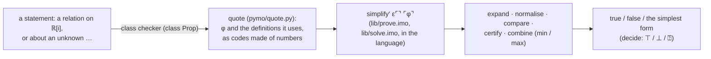

# The prover — relations on ℝ[i] decided by logic

An element of ℚ[i] is a finite object, and a relation between two of them is decided by evaluation (`docs/axioms.md`, Theorem 2).
An element of ℝ[i] is different: it is *defined logically* — by a series, a sum, a product, a function applied to an argument — and
the stream of its approximants never ends.  So a relation between elements of ℝ[i] is decided from their **definitions**, by
logic, as an algebra system decides an identity between expressions.  Without unknowns the answer is **true or false** — the
digits 1 and 0; a statement about unknowns (symbols declared and never defined) is simplified to its simplest form instead
(`docs/predicates.md`).  A relation is simplified whenever it is evaluated, or output, so nothing has to be asked for: the relations
are **predicates** — functions whose value is true, false or undetermined (`docs/predicates.md` §1).

```text
pi in \RR := sum(2, k in \QQ |-> k / (2 * k + 1))
e  in \RR := sum(1, k in \QQ |-> 1 / k)

pi + e - pi == e                      true      the ring normal form
exp(1) == e                           true      exp unfolds to Σ(1, k ↦ 1/k): the same series as e
4 * atan(1) == pi                     true      Euler's series for atan 1 has π's ratio k/(2k+1)
e * e == exp(2)                       true      exp a · exp b = exp (a + b)
sin(1/2)^2 + cos(1/2)^2 == 1          true      sine and cosine series are exponentials
exp(i/2) == cos(1/2) + i*sin(1/2)     true      Euler's formula
sqrt(3) * sqrt(2) == sqrt(6)          true      √a·√b = √(ab) for a, b ≥ 0
pi == e                               false     certified discs around the partial sums do not meet
pi lt 22/7                            true      … and decide the order
sqrt(8) == 2 * sqrt(2)                undetermined (no rule extracts square factors yet; the prover does not guess)
```

`examples/prove.hum.imo` prints these answers; `examples/prove.bin.imo` is the same program written with `1 0 . ( )` only, and
gives the same answers — the whole decision runs inside the language, on numbers.

## 1. Using it

* A relation between elements of ℝ or ℝ[i] — `==`, `!=` on ℝ[i]; `lt`, `leq`, `gt`, `geq` on ℝ — is a **statement**: its class is
  Prop (spec `Ω`) and its value is its simplest form — here `true` or `false` when a rule decides it, the relation itself otherwise.
  Combined with `and`, `or`, `not`, `implies`, `iff` it is one statement, simplified together.  (`==` on ℚ[i] stays evaluation;
  the class checker chooses by the classes.)
* Where a truth value is needed — a definition declared `Bool`, `if`, `showb` — a statement is converted by `decide`: ⊤ (proved),
  ⊥ (refuted), ⍰ (undetermined).  So `name in Bool := relation` decides the relation, exactly as before.
* Nothing asks for the simplification: a statement is simplified when it is evaluated, printed by `main`, or reached by an output
  request.  The earlier `reduce` no longer exists — a program that writes it gets "undeclared symbol reduce" — and `2 == 3` already is
  the statement false.
* Parts of φ that are ℚ[i] numbers or Booleans without a relation on ℝ[i] are **evaluated** — "the subset of ℚ[i] whose
  equality can be determined directly".
* A variable bound outside φ whose class is not a number (`x in \R |-> x + x == 2 * x`) is an **unknown**: the answer must hold
  for every x.  `x + x == 2 * x` is true and `x == x + 1` is false for every x; `x == 1` is undetermined.

## 2. How it works



**Codes.**  A term is written as data with five constructors: `𝔮ⁿ v` a value, `𝔮ˢ c` a symbol, `𝔮ᵃ f a` an application, `𝔮ˡ b` a
λ (de Bruijn), `𝔮ᵛ k` a bound variable.  A symbol is named by its **doc 1 code** — the bit string of `.B.` read as a base-(i−1)
numeral — so `⊕` is `(𝔮ˢ 1011011)`: in i-1 everything, terms included, is a number.  The compiler only spells: every statement φ
becomes `(simplify′ ε⌜⌝ ⌜φ⌝)`, where `ε⌜⌝` is one table, for the whole program, of `(code, ⌜definition⌝)` for the program's
symbols that the codes mention, for the prelude functions defined by series (`exp sin cos sinh cosh log atan`), and `⌜𝔲 k⌝` for
the unknowns (k the domain).
`pymo/mkprove.py` writes the codes the prover dispatches on into `lib/prove.imo` from doc 1 (the test-suite checks they agree).

## 3. The rules, and why each is sound

The meaning of an element of ℝ[i] is the limit of its stream.  Every rule below either keeps the stream itself (a pointwise
identity — then the limits agree too) or is a theorem about limits of convergent series.

| # | rule | in `lib/prove.imo` | why it is sound |
|:--|:--|:--|:--|
| 1 | **logical expansion**: a defined symbol is replaced by its definition, `((λ…) a …)` is β-reduced (at most 64 nested expansions, so recursive definitions stop) | `unfold`, `βs`, `⇓ᶜ`, `⇑ᶜ` | definitional |
| 2 | **ring normal form**: `⊕ ⊛ ⊖ᴿ ⊟ᴿ ∗ᴿ ⇡` are normalised to a polynomial with ℚ[i] coefficients over *atoms*; distinct atoms are treated as independent unknowns | `normR`, `⊞ᴾ ⊠ᴾ ⊖ᴾ ∗ᴾ` | the operations on ℝ[i] are pointwise, so a polynomial identity holds for every value of the atoms and for every index |
| 3 | **a series is its first term times a series**: Σ(t₀, ρ) = t₀ · Σ(1, ρ) | `Σᴾ` | every partial sum scales with t₀ |
| 4 | **isomorphism of series**: Σ(1, ρ₁) and Σ(1, ρ₂) are the same atom when ρ₁(k) = ρ₂(k) for every k ≥ 1 — checked by the polynomial identity n₁d₂ = n₂d₁ of their rational forms and, at the finitely many k ≤ Cauchy's bound of d₁d₂, by direct comparison | `ratQ`, `valid`, `≡ˢ` | equal ratios give equal terms (induction on k), hence equal partial sums: the same stream.  The rational form of ρ is itself checked against ρ's definition at every k below Cauchy's bound of the product of its divisors, so `x ÷ 0 = 0` cannot make it wrong |
| 5 | **exponential series**: Σ(1, c/k) = exp c;  Σ(1, q/(k² + k/2)) = sinh u / u and Σ(1, q/(k² − k/2)) = cosh u with u² = 4q, u ∈ ℚ(i) (exact square root `√ᑫ`); sinh, cosh are written with exp | `recog`, `sinhᴾ`, `coshᴾ` | the products of the ratios are cᵏ/k!, (4q)ᵏ/(2k+1)!, (4q)ᵏ/(2k)! — the power series of exp, sinh u/u, cosh u, which converge everywhere |
| 6 | **exp a · exp b = exp (a + b)**: a monomial carries one exponential with the sum of the parameters; exp 0 = 1 | `⊠ᵐ`, `expᴾ` | the functional equation of exp |
| 7 | **roots**: √c of a square of ℚ(i) is its root; (√c)² = c; √a·√b = √(ab) for real a, b ≥ 0 | `√ᑫ`, `simp′`, `√merge` | the principal root squares to its argument; for non-negative reals roots multiply |
| 8 | **certified discs**: a series whose ratio tends to \|L\| < 1 lies in the disc (S_M, \|t_M\|·r/(1 − r)) with r = (3 + \|L\|²)/4, for M beyond Cauchy's bound of r²\|d\|² − \|n\|²; √c (c ≥ 0) lies within 2⁻ⁿ of its element n; discs are added and multiplied (ball arithmetic, rounded outward to 2⁻ᴾ) | `prep`, `disc`, `certs`, `d⁺`, `d×`, `rnd²`, `up²` | the ratio test: \|tₖ\| ≤ \|t_M\| r^(k−M) beyond M; the prelude's √ is the floor of √(c·4ⁿ) over 2ⁿ |
| 9 | **deciding**: x = y is *proved* when the normal form of x − y is 0 and *refuted* when a disc of x − y excludes 0; x < y is proved or refuted when a disc of y − x lies right or left of 0 | `eqᴾ`, `sgnᴾ` | rules 2–8 |
| 10 | **logic**: three values ⋖ (false) < ≖ (not decided) < ⋗ (true); `and` = min, `or` = max, `not` reverses, `implies`, `iff` from them | `fo`, `∧³ ∨³ ¬³` | Kleene's strong three-valued logic: a decided answer never depends on an undecided part |

The precision schedule is 8 terms, then 24 (an undecided relation stops there).

## 4. The answer: true, false — or undetermined, never a guess

The rules compute one of ⋗ ≖ ⋖; `simplify′ ε⌜⌝ ⌜φ⌝` (`lib/solve.imo`) returns the simplest form: the
statement true, the statement false, or a simplified statement.  Printed as a Prop it is that statement; as a truth value
(`decide`) it is ⊤ (proved), ⊥ (refuted) or `⍰` (neither).  `⍰` is a value that absorbs its arguments, so an `if` on it is
undetermined too, and the output layer reports it as an error rather than print true or false (`i1.py` exits with status 1).

This third outcome cannot be removed.  Equality of computable reals is undecidable in general (`docs/axioms.md` §6): a stream
that is 0 until some machine stops is 0 if and only if the machine never stops.  What *can* grow is the set of rules — each rule is
an algorithm with its own proof, and adding rules shrinks the undetermined cases without ever making an answer wrong.

## 5. One system

The digits are the truth values: `⊤ = λx y. x` is the digit 1 and `⊥ = λx y. y` the digit 0 (`lib/logic.imo`).  So a truth value is a
number, and the operations that "join" coincide:

| map | what it does | law (all tested in the language, `tests/test_prove.py`) |
|:--|:--|:--|
| `ι` (`iverson`), a canonical coercion 𝔹 → ℕ | ⊤ ↦ 1, ⊥ ↦ 0 | ι(a or b) = max(ι a, ι b),  ι(a and b) = ι a · ι b = min(ι a, ι b) |
| `supp` ℕ → 𝔹 | n ↦ (n ≠ 0) | supp(m + n) = supp m or supp n,  supp(m · n) = supp m and supp n |
| sets `α → 𝔹` | a set is the test of membership | (A ∪ B)(x) = A x or B x |

The human notation spells them alike: `+` is `⊞ | ⊕ | ⊞𝔻 | ∨ | ∪`, `*` is `⊠ | ⊛ | ⊠𝔻 | ∧ | ∩`, `max` is `max | ∨ | ∪`, `min` is
`min | ∧ | ∩`, `or` is `∨ | ∪`, `and` is `∧ | ∩`.  On two truth values `+` is "or" (`true + true` is `true`, the Boolean semiring);
next to a number a truth value is the number 1 or 0 (`1 + true` is `2`).  Inside the prover, "and" and "or" are literally min and max.

## 6. Adding a rule

A rule is a few lines of `lib/prove.imo`: recognise a shape in a normal form (as `recog` recognises exp, sinh and cosh series) and
rewrite it into atoms that the rest already understands, or give an atom a certificate (as `encᵃ` does for √).  For example,
`log 2 + log 3 == log 6` is undetermined today; the natural rule recognises the log series (ratio y²(2k−1)/(2k+1), first term 2y,
value log((1 + y)/(1 − y))), factors the argument into primes and writes log x = Σ eₚ · log p — after which the identity is a
polynomial identity in the atoms log 2, log 3.  Then run `pymo/mkdoc1.py` (new symbols get new codes) and add the case to
`tests/test_prove.py`.

## 7. Limits

* **Coverage.**  Atoms that are not series of ratio a rational function of k (with ℚ[i] coefficients), roots, or exponentials are
  opaque: they take part in the ring normal form but have no certificate, so a relation that needs their value is undetermined.
  This includes `÷ᴿ` (pointwise division), `tan`, user streams built with `seq` or `iterate`, `⟐`, `∂`, `∫`.
* **Induction** is used inside rule 4 (equal ratios ⇒ equal streams); there is no general induction over user-defined recursive
  streams, and no quantifier over ℕ inside the prover yet.
* **Cost.**  Pymo is slow: a symbolic proof takes well under a second to two seconds, a certified separation a
  few seconds, and an undetermined answer can take most of a minute (the prover tries both precisions first).
