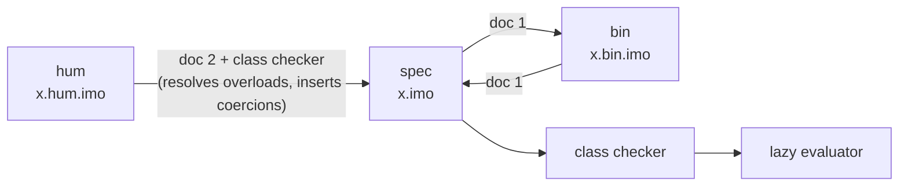

---

## 4. The three notation systems

i-1 has **three notation systems**.  They are spellings of one language: a program written in one can be mechanically re-spelled in another, and all three are loaded by the same reader.

| | **bin** (binary) | **spec** (specific) | **hum** (human) |
|:--|:--|:--|:--|
| Alphabet | exactly `1` `0` `.` space `(` `)` newline | unicode glyphs; one glyph per notion (`⊞`, `ℚ[i]`, `Σ`, `𝕛`, …) | ASCII / TeX-like words and macros (`+`, `geq`, `\Q`, `sum`, …) |
| Symbols | `.B.`, where B is a bit string | any name | any identifier or `\macro` |
| Purpose | the *axiomic* layer: what the language is | the layer the prelude is written in; precise, compact | the layer people write |
| Defined by | doc 1 `[spec sbl] := [bin sbl]` | — (reference notation) | doc 2 `[hum sbl] := [spec sbl] or [bin sbl]` |
| Types | explicit declarations (`...`) | explicit declarations (`∶`) | declared with `in`; overloads resolved by the class checker |
| File | `x.bin.imo` | `x.imo`, `x.spec.imo` | `x.hum.imo` |



The arrow from bin back to spec is exact: `spec → bin → spec` reproduces every statement of the prelude and the examples (tested).  hum → spec needs the class checker, because the class of the arguments decides which overload a human symbol means; there is deliberately no spec → hum direction.

### 4.1 Statements

A program is a sequence of *logical lines* (a newline inside parentheses does not end a line).  There are three kinds of statement, in every notation:

| Statement | spec | bin | hum |
|:--|:--|:--|:--|
| **declaration** — give a symbol a class | `name ∶ class` | `.name. ... class` | `name in Class := …` (declaration + definition together) |
| **definition** — give it a value | `name x y ≔ term` | `.name. .x. .y. .. term` | the right side of `:=` |
| **fact** — a statement about classes | `(⊆ A B)`, `(≣ A B)`, `(↪ f)` | the same, as an application of symbols | `A subseteq B` |

A definition is only accepted after a declaration of the same symbol ([§7](#7-classes-every-symbol-is-declared-first)).

### 4.2 Binary notation

**Characters.**  `1`  `0`  `.`  space  `(`  `)`  newline — nothing else.

**Tokens.**  A maximal run of `1 0 .` is one token; its shape decides what it is:

| Shape of the run | Token | Meaning |
|:--|:--|:--|
| bits, no point — `1011` | numeral | the Gaussian integer with these base-(i−1) digits (most significant first), as the ℚ[i] element *n / 1* |
| bits with one point — `1.01`, `.1` | numeral | `a.b` is the digits `ab` divided by (i − 1)^len(b): `0.1` = 1/(i − 1) |
| `.` alone | marker | `↦` (separates binders from the body of a lambda) |
| `..` alone | marker | `≔` (separates a definition's head from its body) |
| `...` alone | marker | `∶` (separates a symbol or binder from its class) |
| `.B.` — a point, one or more bits, a point | **symbol** | the symbol whose code is B, as assigned by [doc 1](#51-doc-1--spec-sbl--bin-sbl) |

Runs with other shapes (for example `..1..10.`) are errors, so tokens are always separated by a space or a parenthesis.

**Grammar.**

```ebnf
program     = { statement NEWLINE } ;
statement   = definition | declaration | fact ;
definition  = symbol { symbol } ".." term ;
declaration = symbol "..." class ;
fact        = "(" symbol { term } ")" ;
term        = numeral | symbol
            | "(" term { term } ")"                      (* application, curried *)
            | "(" binder { binder } "." term ")" ;       (* lambda *)
binder      = symbol [ "..." class ] ;
class       = symbol | "(" symbol class { class } ")" ;
numeral     = bits | bits "." bits | "." bits ;
symbol      = "." bits "." ;
bits        = ( "0" | "1" ) { "0" | "1" } ;
```

**Example.**  Logical negation and the first two definitions of the prelude, in spec and in bin (the bin lines are the real contents of `lib/prelude.bin.imo`):

{{SHOW:⊤ ⊥ ¬}}

### 4.3 Spec notation

Spec is bin with readable glyphs, plus three conveniences that the translator removes:

* **names**: any maximal run of characters other than whitespace, `(`, `)`, `0`, `1`, `.`, `'` and `"` — so `ℚ[i]`, `⊞ᶻ`, `𝔸ℝ[i]`, `κ′`, `exp` are names, while `x1` is the name `x` followed by the numeral `1`;
* **class arrows**: `A → B → C` is `(→ A (→ B C))`;
* **literals**: `'λ'` is a `Char`, `"text"` a `String` ([§8](#8-characters-and-strings)); escapes `\n \t \\ \" \'`;
* **comments**: everything after the name `⍝` up to the end of the line.

The reserved glyphs are `≔` (definition), `↦` (lambda), `∶` (class).  Class variables are `α β γ`.  Lambda binders **must** carry a class: `(ξ ∶ ℚ ↦ ÷ ξ 1100)`; definition parameters take their classes from the declaration.

### 4.4 Human notation

The human notation is the one examples are written in.  Its symbols are defined by doc 2 ([§5.2](#52-doc-2--hum-sbl--spec-sbl-or-bin-sbl)); its grammar is built into the reader.

**Statements**

```text
name in Class := expr                    -- declaration and definition together; `--` starts a comment
name(x, y) in A -> B -> C := expr        -- parameters take their classes from the declaration
A subseteq B                             -- subclass fact
```

**Expressions**

| Form | Example | Notes |
|:--|:--|:--|
| literals | `12`, `0.25`, `"text"`, `'c'`, `i` | decimal numbers are converted to base-(i−1) numerals (`0.25` is the fraction 25 / 100); `i` is the bin numeral `11` |
| application | `sum(1, k in \QQ \|-> 1 / k)` | `f(a, b)` is the curried application `(f a b)` |
| infix | `a + b`, `a - b`, `a * b`, `a / b`, `a ^ n`, `a div b`, `a mod b`, `a == b`, `a != b`, `a geq b`, `a leq b`, `a gt b`, `a lt b`, `a and b`, `a or b`, `p implies q`, `p iff q`, `s ++ t` | precedences are in the table below (they come from doc 2); `==`, `!=`, `lt` … between real or complex numbers are predicates, decided by logic ([§13](#13-predicates-relations-simplified-to-their-simplest-form)) |
| list | `[1, 2, 3]`, `[]` | `[a, b]` is `cons(a, cons(b, nil))` — so a printed list reads back |
| prefix | `-a`, `not p` | |
| lambda | `x in \Q \|-> x * x` | the binder's class is mandatory |
| ascription | `(e in \QQ)` | a *static* check that `e` is in the class (a widening coercion is inserted if needed); it is not a Boolean test |
| parentheses | `(a + b) * c` | |

**Classes** are written with doc 2's class names: `\NN \ZZ \QQ \RR \Z \Q \R \CC \D`, `Bool`, `Char`, `String`, `Digits`, and the constructors `List(A)`, `Stream(A)`, `Tree(A)`, `Alg(A)`, `Pair(A, B)`, `A -> B`.  Single-letter macros are the *[i]-extended* classes (`\Q` = ℚ[i], `\R` = ℝ[i] = `\CC`, `\Z` = ℤ[i]); doubled letters are the classical ones (`\QQ` = real rationals, `\RR`, `\NN`, `\ZZ`).

**Overloads.**  A human operator names a *set* of spec symbols.  `+` is `⊞ | ⊕ | ⊞𝔻 | ∨ | ∪` (numbers, lazy numbers, Cayley–Dickson trees, truth values, sets).  For `pi + e * i` the checker finds that `pi` and `e` are in ℝ and that `i` is the Gaussian integer 11, so it chooses `⊛` for `*` (inserting the coercion `⇡` on `i`) and `⊕` for `+`: exactly the spec line `z ≔ (⊕ π (⊛ 𝕖 (⇡ 11)))`.  The rule is: among the declarations that accept the arguments (allowing widening coercions), take the one with the fewest coercions, and among those the most specific; if no unique one exists the program is rejected with the list of candidates.

A selection of human statements and what they compile to (generated by running the compiler):

{{HUMTABLE}}

### 4.5 Files, extensions and mixing notations

| Extension | Default notation |
|:--|:--|
| `x.bin.imo` | bin |
| `x.hum.imo` | hum |
| `x.imo`, `x.spec.imo` | spec |
| `x.sbl` | program-local symbol table for a bin program (same line format as doc 1) |

A line consisting of `@bin`, `@spec` or `@hum` switches the notation for the lines that follow it (and a line `@out bin|spec|hum` chooses the output notation, [§12](#12-programs-main-and-the-output-notations)).  This is supported — and tested — but **not recommended**: a file that mixes systems is harder to read and to translate.  Keep one notation per file.

```text
@spec
π ∶ ℝ
π ≔ (Σ 1100 (k ∶ ℚ ↦ (÷ k (⊞ (⊠ 1100 k) 1))))
@hum
e in \RR := sum(1, k in \QQ |-> 1 / k)
z in \R := pi + e * i
```

Bin programs may use symbols that are not in doc 1 (names of your own definitions).  `i1.py translate … --to bin` allocates the next free codes and prints the *local table*, which you keep next to the program as `x.sbl`; the reader picks it up automatically.  Local codes never reuse a doc 1 code.
