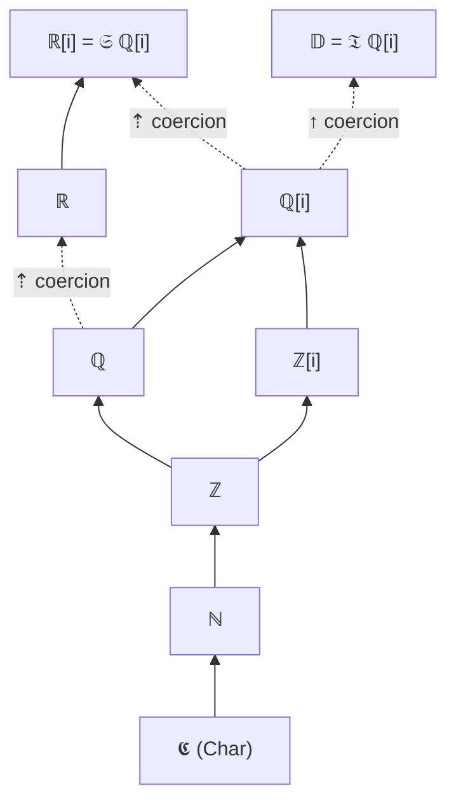

---

## 7. Classes: every symbol is declared first

> **The rule.**  Every value, variant and function must have its *class* (its domain → codomain) declared **before** it is defined or used.  A definition of an undeclared symbol, a use of an undeclared symbol, and a lambda binder without a class are all errors.

### 7.1 Declaring

| Notation | Declaration | Definition |
|:--|:--|:--|
| spec | `ϝ ∶ ℚ[i] → ℚ[i]` | `ϝ ξ ≔ (÷ 1 (⊞ ξ 1))` |
| hum | `f(n) in \Q -> \Q := 1 / (n + 1)` — one statement declares *and* defines | |
| bin | `.B. ... class` | `.B. .x. .. term` |

The same function in all three notations (generated by the translator; in the bin text the first line is the declaration, the second the definition):

{{TRIPLE:f(n) in \Q -> \Q := 1 / (n + 1)}}

The parameters of a definition get their classes from the arrows of its declaration; a definition may have fewer parameters than the declaration has arrows (the rest of the class is the class of the body).  Lambda binders carry their own class: `(ξ ∶ ℚ ↦ ÷ 1 ξ)` / `k in \QQ |-> 1 / k`.

### 7.2 The class language

Classes are *terms of the language itself*: atoms, and constructors applied to classes.  They are declared with the two built-in sorts `𝒦` (the sort of classes) and `𝒮` (the sort of statements):

```text
ℕ ∶ 𝒦            a class
𝔏 ∶ 𝒦 → 𝒦        a class constructor of one argument
→ ∶ 𝒦 → 𝒦 → 𝒦    the function class  A → B  (right associative)
⊆ ∶ 𝒦 → 𝒦 → 𝒮    a statement former
```

| Class | Meaning | Human |
|:--|:--|:--|
| `ℕ` `ℤ` `ℚ` `ℝ` | naturals, integers, real rationals, real numbers | `\NN` `\ZZ` `\QQ` `\RR` |
| `ℤ[i]` `ℚ[i]` `ℝ[i]` | Gaussian integers (**the foundation**), Gaussian rationals (pairs of Gaussian integers), lazy complex numbers | `\Z` `\Q` `\R` (= `\CC`) |
| `ℤ²` `𝕊²` | decoding keys for a binary string: an ordered pair of integers (the Gaussian integer a + b·i), a pair of strings (§6.6); a `ℤ[i]` becomes either by an automatic coercion that is the identity on the string | `Z2` `String2` |
| `𝔻` | the Cayley–Dickson tower over ℚ[i] | `\D` |
| `𝔹` `𝕮` `𝕊` | Booleans, characters, strings | `Bool` `Char` `String` |
| `𝔇` | digit strings (the representation of ℤ[i]) | `Digits` |
| `𝔏 A` `𝔖 A` `𝔗 A` `𝔄 A` `𝔓 A B` `A → B` | lists, streams, Cayley–Dickson trees, algebra records, pairs, functions | `List(A)` `Stream(A)` `Tree(A)` `Alg(A)` `Pair(A, B)` `A -> B` |

Class variables are `α β γ` (human: `alpha beta gamma`); in a declaration they are universally quantified, in the *body* of a definition they are rigid.

### 7.3 The class lattice



Solid arrows are **subclass facts** `(⊆ A B)`: a value of class A may be used wherever B is expected, at no cost.  Dotted arrows are **canonical coercions** `(↪ f)`: a declared function that is inserted automatically when it makes an argument fit.  Coercions only ever *widen*; there is no implicit narrowing (`𝔻 → ℚ[i]` and `ℝ[i] → ℝ` are errors), which is the class-level counterpart of "dimension never reduces".

Four **class equations** `(≣ A B)` are used: `𝔇 ≣ 𝔏 𝔹`, `𝕊 ≣ 𝔏 𝕮`, `ℝ[i] ≣ 𝔖 ℚ[i]`, `𝔻 ≣ 𝔗 ℚ[i]` (so a `String` *is* a list of characters, and ℝ[i] *is* the class of streams over ℚ[i]).  Error messages show classes with equations expanded, e.g. `(𝔖 ℚ[i])` for ℝ[i].

Subclassing between compound classes: `A → B` is contravariant in A and covariant in B; `𝔏`, `𝔖`, `𝔗`, `𝔓` are covariant; `𝔄` is invariant.

### 7.4 Overloading and coercions

A symbol may be declared several times; the declarations form an **overload set** (an intersection of classes).  The prelude declares `⊞` five times — on ℕ, ℤ, ℚ, ℤ[i], ℚ[i] — so that `1 + 1100` is a ℕ, `-3 + 1` a ℤ and `(1 + 2*i) * (3 - i)` a ℤ[i].  To resolve an application `(f a₁ … aₙ)` the checker

1. synthesises the class of every argument;
2. keeps the declarations whose parameter classes accept the arguments, where an argument may be widened by subclassing (free) or by one coercion (cost 1);
3. keeps those of minimal total cost, then those that are *most specific* (parameter classes below all other candidates');
4. fails with the candidate list if no unique declaration is left.

A human operator is an overload set across *symbols* (`+` ↦ `⊞`, `⊕`, `⊞𝔻`, `∨`, `∪`); the rule is the same.  Overloaded symbols must appear applied to arguments; as a bare value they are ambiguous and rejected.

### 7.5 What is checked and what is trusted

* **User programs** (everything outside `lib/`) are fully checked: every definition's body is synthesised and must fit its declared class; every identifier must be declared; every binder annotated; coercions are inserted where declared.
* **The prelude** (`lib/*.imo`, `lib/prelude.bin.imo`) is loaded **trusted**: its declarations are recorded as the classes of the standard symbols, but its *bodies are not type-checked* — they are untyped lambda terms (Church booleans, Scott lists, pairs as selectors) that no simple class system can express.  The signatures are therefore **assertions**, validated by the test-suites ([§16](#16-implementation-and-tests)), not proofs.
* The checker proves *class* correctness only.  It does not prove that a series converges or that a stream declared `ℝ` really has imaginary part 0 — see [§17](#17-status-limits-and-roadmap).

### 7.6 Error messages (as the checker prints them)

| Program | Message |
|:--|:--|
| `foo ≔ 1` | `foo is defined before it is declared:  write  foo ∶ <class>  first` |
| `bad ∶ ℕ` / `bad ≔ (⊞ 1 (⊖ 1))` | `bad: the body has class ℤ but ℕ was declared` |
| `x ∶ ℝ` / `x ≔ (⇡ 11)` | `x: the body has class (𝔖 ℚ[i]) but ℝ was declared` |
| `f ∶ ℚ → ℚ` / `f ≔ (ξ ↦ ξ)` | `f: binder ξ has no class: write (ξ ∶ class ↦ …)` |
| `n ∶ ℕ` / `n ≔ (⊞ 1 "a")` | `no declaration of ⊞ accepts (ℕ, 𝕊);  candidates: ⊞ ∶ ℕ → ℕ → ℕ, ⊞ ∶ ℤ → ℤ → ℤ, ⊞ ∶ ℚ → ℚ → ℚ, ⊞ ∶ ℤ[i] → ℤ[i] → ℤ[i], ⊞ ∶ ℚ[i] → ℚ[i] → ℚ[i]` |
| `q ∶ ℚ[i]` / `q ≔ 𝕛` | `q: the body has class 𝔻 but ℚ[i] was declared` |
| `b in \NN := 1 - 2` | `b: the body has class ℤ but ℕ was declared` |
| `g ∶ ℕ` / `g ξ ≔ 1` | `g has 1 parameters but its class ℕ has only 0` |

### 7.7 Your own classes

In spec (or bin) a program may declare new classes and facts:

```text
Foo ∶ 𝒦            ⍝ a new class
(⊆ Foo ℕ)          ⍝ every Foo is a natural number
foo ∶ Foo          ⍝ a (declared) constant of that class
bar ∶ ℕ
bar ≔ foo          ⍝ accepted: Foo widens to ℕ;   (foo ≔ 1100) would be rejected: ℕ is not a Foo
```

The human notation can state subclass facts between existing classes (`\NN subseteq \QQ`) but cannot yet declare a new class.

---

## 8. Characters and strings

`Char` and `String` are not primitives; like everything else they are built from ℚ[i].

| | Representation | Class facts |
|:--|:--|:--|
| **Char** `𝕮` | the Unicode **code point as a natural numeral** — `'A'` is 65, `'λ'` is 955 | `(⊆ 𝕮 ℕ)`: a `Char` widens to ℕ (and so to ℤ, ℚ, ℚ[i]); `ord ∶ 𝕮 → ℕ` |
| **String** `𝕊` | a lazy list of `Char`: `"hi"` = `(∷ 'h' (∷ 'i' ⊘))` | `(≣ 𝕊 (𝔏 𝕮))`: all list operations apply |

* **Literals** exist in spec and hum: `'λ'` (exactly one code point), `"text"`; escapes `\n \t \\ \" \'`.  Strings are sequences of *code points*, not UTF-8 bytes.  In the binary notation a literal is **expanded** to `(𝕔 numeral)` (`'A'` → `𝕔` of the numeral of 65, in base i − 1; `𝕔 ∶ ℕ → 𝕮` keeps the class) or to nested `∷` applications ending in `⊘`.
* **Operations in the prelude**: `⧺` (`++`) append, `ℓ` (`length`) → ℕ, `⫶` (`map`), `ord`; comparison of characters with `==` (via ℚ[i]).
* A `String` can be infinite (it is a lazy list); `length` of an infinite string does not terminate.
* `chr ∶ ℕ → 𝕮` is total: a number that is not a Unicode scalar value (above U+10FFFF, or a surrogate) gives U+FFFD.  `dec`, `showq`, `showc`, `decimals`, `unlines`, `join` turn numbers and lists into text ([§14](#14-standard-library-reference)).

The same string in the three notations (generated by the translator):

{{TRIPLE:greeting in String := "Hello, " ++ "λ"}}
`i1.py eval examples/hello.hum.imo greeting` prints `Hello, i-1 — λ`.
