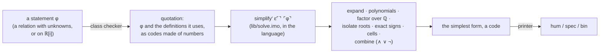

---

## 9. Evaluation model

The core of the language is an **untyped lambda calculus evaluated by need** (call-by-need: an argument is evaluated at most once, and only if it is used).  Classes, notations and literals all disappear before evaluation.

| Notion | Encoding |
|:--|:--|
| Boolean / digit | `⊤ = λx y. x`, `⊥ = λx y. y` — the digits `1` and `0` |
| pair | `⊗ a b = λz. z a b`; `◀`, `▶` apply the pair to `⊤`, `⊥` |
| list | Scott encoding: `∷ h t = λc n. c h t`, the empty list `⊘ = ⊥ = λc n. n` |
| Gaussian integer (`𝔇`, `ℤ[i]` digits) | a list of digits, least significant first; the empty list is 0 |
| ℚ[i] element | a pair of Gaussian integers (numerator, denominator) |
| numeral | the reader's expansion into the above (`1100` = `(⊗ (∷ ⊥ (∷ ⊥ (∷ ⊤ (∷ ⊤ ⊘)))) (∷ ⊤ ⊘))`) |
| algebra record | `⌘ add mul neg conj zero one`, a function that hands its six fields to a selector (`Ⓐ Ⓜ Ⓝ Ⓒ Ⓩ Ⓞ`) |
| stream | a list that never ends |

* **Definitions** are global and may be recursive; a global is evaluated at most once.  A definition `f x y ≔ t` abbreviates `f ≔ (x y ↦ t)`.
* **Application is curried**: `(f a b)` is `((f a) b)`.
* **Laziness is what makes ℝ[i] possible**: a stream such as `π` exists as a value although it has infinitely many elements; `stream_nth` / `i1.py eval … N` forces exactly the first N + 1 of them.
* **No runtime errors, no runtime classes.**  Classes are erased.  A user program that passes the checker cannot misuse the prelude's declared classes, and the operations it can reach are total (`x ÷ 0 = 0`, `x div 0 = 0`, `chr` of a non-character is U+FFFD).  The one exception is deliberate: a predicate may be *undetermined*, as a truth value it is `⍰`, and the printer reports that instead of printing a truth value ([§13](#13-predicates-relations-simplified-to-their-simplest-form)).
* **i-1 is interpreted.**  All three interpreters (Pymo, Haskimo and Rustimo, [§2.1](#21-three-interpreters-pymo-haskimo-and-rustimo)) take the source of a program every time it runs, check its classes, erase them, and evaluate the resulting lambda terms; no command produces an executable, a bytecode file or machine code for an i-1 program (`translate` only re-spells a program in another notation).  Inside, each interpreter first turns the lambda terms into something its host language runs directly — Python source, Haskell closures, code for a small abstract machine — so that nothing re-reads the terms while they run — an implementation technique, not a compiler for i-1.
* Pymo turns terms into Python source (one function per definition, saturated calls uncurried, closed sub-terms floated out as constants evaluated once) with memoised thunks, run in a thread with a very large stack (the recursion is deep: a numeral of n digits is a list n cells long).  One step on one digit costs about 10 µs.  Haskimo builds Haskell closures from the terms, lazily, one global at a time; call-by-need is Haskell's own laziness, closed sub-terms are floated out in the same way, and it is several times faster ([§16.5](#165-the-three-cores-and-the-shared-test-suite)).

---

## 10. Lazy complex numbers, series, the Cayley–Dickson tower, function spaces

### 10.1 ℝ[i], lazily

A real or complex number is a **stream of ℚ[i] elements** — its approximants.  The class is `ℝ[i] ≣ 𝔖 ℚ[i]`; the class of real numbers is `ℝ ≣ 𝔖 ℚ`, streams of real rationals, so `ℝ ⊆ ℝ[i]` follows from `ℚ ⊆ ℚ[i]`, and `Σ`, `exp`, `sin`, `cos`, `√`, `log`, `atan`, `⊕`, … with real arguments give an `ℝ`.

```text
𝕃 ∶ 𝔄 α → 𝔄 (𝔖 α)       lift an algebra to streams (all operations pointwise)
𝔸ℝ[i] = 𝕃 𝔸ℚ[i]          the algebra of lazy complex numbers
⇡ ∶ ℚ[i] → ℝ[i]          the constant stream  x, x, x, …           (↪ canonical coercion)
⊕ ⊛ ⊖ᴿ ∗ᴿ ⊟ᴿ            addition, multiplication, negation, conjugation, subtraction on ℝ and ℝ[i]
```

What a stream *means* is its limit when it converges.  The language **does not carry a Cauchy modulus**, so:

* it can say what the N-th approximant is, exactly, as a fraction;
* evaluating streams cannot decide whether two of them denote the same real number — so `==` and the order on ℝ[i] are not evaluated: they are decided from the *definitions* of the two sides by logic ([§13](#13-predicates-relations-simplified-to-their-simplest-form));
* convergence is an obligation of the author of the series (for π and e it is Euler's theorem, below).

### 10.2 Series, π and e

`Σ t₀ ρ` is the stream of partial sums of the series with terms `t₀`, `t₀·ρ(1)`, `t₀·ρ(1)·ρ(2)`, … — i.e. `t_k = t_{k−1} · ρ(k)`.  The partial sums are computed **exactly** with a common denominator (so no fraction is ever reduced or re-added from scratch).

```text
Σ ∶ ℚ → (ℚ → ℚ) → ℝ                 Σ ∶ ℚ[i] → (ℚ[i] → ℚ[i]) → ℝ[i]
```

The target uses two classical theorems:

| Theorem | Series | `t₀`, `ρ(k)` |
|:--|:--|:--|
| Euler's transformation of the Leibniz series | π/2 = Σₖ≥₀ k! / (2k+1)!! = 1 + 1/3 + 2/15 + … | for π: `t₀ = 2`, `ρ(k) = k / (2k + 1)` |
| the exponential series at 1 | e = Σₖ≥₀ 1/k! | `t₀ = 1`, `ρ(k) = 1 / k` |

and `π + e·i` is the pointwise sum of the π stream and the product of the e stream with the constant stream `⇡ 11` (*i* is the numeral `11`).  The test-suite checks that for N = 0 … 16 the N-th element equals the exact partial sum π_N + i·e_N (as fractions), and the CLI shows the convergence:

| N | Re z_N (→ π = 3.14159265359…) | Im z_N (→ e = 2.71828182846…) |
|--:|:--|:--|
| 4 | 3.0984126984 | 2.7083333333 |
| 8 | 3.1394696806 | 2.7182787698 |
| 12 | 3.1414796490 | 2.7182818283 |
| 16 | 3.1415863960 | 2.7182818285 |
| 30 | 3.1415926533 | 2.71828182846 |

The same driver gives the first analytic functions, each a one-line definition: `exp x = Σ 1 (k ↦ x / k)`, `sin x = Σ x (k ↦ −x² / ((2k)(2k+1)))`, `cos x = Σ 1 (k ↦ −x² / ((2k−1)(2k)))`, for real *and* Gaussian-rational arguments.  The tests compare their partial sums with exact fractions and with floating-point `sin(½)`, `cos(½)`; `exp(i/2)` computed in ℝ[i] lands on cos ½ + i sin ½ (0.87758256189 + 0.479425538604 i at N = 14), as Euler's formula says.  Numerically that is an illustration; `exp(i/2) == cos(1/2) + i*sin(1/2)` is **proved** by the prover ([§13](#13-predicates-relations-simplified-to-their-simplest-form)).  Further analytic functions (`√ log atan sinh cosh tan tanh`, a derivative `∂` and an integral `∫` as streams) are in [§14](#14-standard-library-reference).

### 10.3 The Cayley–Dickson tower

For any algebra `A` (a record with add, multiply, negate, conjugate, zero, one), `𝕋 A` is the algebra of **Cayley–Dickson trees** over `A`:

```text
leaf  ❀ a                 a tree of depth 0 — an element of A
node  ❁ a b  =  (a, b)    two trees; depth = 1 + max(depth a, depth b)

(a, b) + (c, d)  =  (a + c, b + d)
(a, b) · (c, d)  =  (a·c − d*·b ,  d·a + b·c*)
(a, b)*          =  (a*, −b)
```

* **Lifting is the only conversion between depths**: a tree that is too shallow is replaced by `(a, 0)` (`↥`), recursively.  Nothing in the language ever replaces `(a, 0)` by `a`: **a zero of depth 3 stays a zero of depth 3**, `x + (−x)` has the depth of `x`, and `1 + 0₂` has depth 2.  Values of different depths can be mixed freely (`j * k + 1`).
* **Over ℚ[i]** (the class `𝔻 = 𝔗 ℚ[i]`): depth 0 is ℚ[i], depth 1 the rational quaternions ℚ[i] ⊕ ℚ[i]·j (`𝕛 = (0, 1)`, `𝕜 = i·j = (0, i)`), depth 2 the octonions, depth 3 the sedenions, and so on without bound.  The dimension over ℚ is 2^(depth+1).
* **The algebraic properties that change with depth are visible, and tested in the language**:
  * depth 1 — associative but not commutative: `j² = −1`, `ij = k = −ji`, `k² = −1`;
  * depth 2 — not associative (`(e₁e₂)e₄ ≠ e₁(e₂e₄)`) but alternative (`(xx)y = x(xy)`), and no zero divisors among the sums `(eₐ ± e_b)(e_c ± e_d)`;
  * depth 3 — **zero divisors**: with the basis e₀ = 1, e₁ = *i*, e₂ = *j*, e₃ = *ij*, …, e_{2^d + n} = (0, eₙ), the product `(e₁ + e₁₀)(e₄ − e₁₅)` is `0` although both factors have norm² 2.  So the norm is not multiplicative from depth 3 on.
* **Names and notation.**  The whole tower is one class, `𝔻` (human `\D`; `𝔗 A` is the same construction over any class `A`), and its algebras are named by depth, not by letters: ℍ and 𝕆 are not symbols of the language, and the letter 𝕊 that mathematics uses for the sedenions is the class of strings here ([§8](#8-characters-and-strings)) — this document says *sedenions*.  A tree is written `node(a, b)` and `leaf(x)` in human notation (a number where a tree is expected becomes a leaf, so `node(i, 0)` is `node(leaf(i), leaf(0))`), `(❁ a b)` and `(❀ x)` in spec, and with the doc 1 codes of `❁` and `❀` in bin; the printer writes the same three spellings and what it prints reads back, and `eval` shows a tree as `⟨a, b⟩`.  There is no `==` on trees in the human notation yet (`≐ᵀ` is spec only): a zero is recognised by its printed form (the example below).
* **`𝕋` is generic**: `𝕋 𝔸ℝ[i]` is trees of lazy reals (a quaternion `(z, π)·(e, z)` is computed stream-wise and agrees with the exact partial sums), `𝕋 (𝔉 A)` is trees of functions, and `𝕋 (𝕋 A)` is a tower of towers.
* Equality of trees is `≐ᵀ` (up to lifting) given an equality on the base.

The sedenions in human notation, [`examples/sedenion.hum.imo`](examples/sedenion.hum.imo): the factors `x = e₁ + e₁₀` and `y = e₄ − e₁₅` have norm² 2 (`eval examples/sedenion.hum.imo x` shows them), and their product is the zero of depth 3.

```text
$ python3 pymo/i1.py examples/sedenion.hum.imo
{{RUNOUT:run examples/sedenion.hum.imo}}
```

```text
{{FILE:examples/sedenion.hum.imo}}```

### 10.4 Function spaces, including infinite-dimensional ones

```text
𝔉 ∶ 𝔄 α → 𝔄 (ℚ[i] → α)        the algebra of all functions ℚ[i] → A with pointwise operations
⟨⟩ ∶ 𝔄 α → (ℚ[i] → α) → (ℚ[i] → α) → 𝔖 α      ⟨f, g⟩_N = Σ_{n<N} conj(f n) · g n,  as the stream of partial sums
δ  ∶ 𝔄 α → ℚ[i] → ℚ[i] → α      standard basis vector:  δₘ(n) = 1 if n = m, else 0
```

* `𝔉 A` is an algebra record, so it can be used wherever an algebra is expected — as the base of `𝕋`, of `𝕃`, of another `𝔉`.
* It is **infinite-dimensional**: the vectors δ₀, δ₁, δ₂, … are orthonormal for ⟨ , ⟩ (tested for δ₂, δ₃).
* The inner product is a *stream*: its limit, if it exists, is the inner product of the ℓ² space.  Tests: for `ϝ(n) = 1/(n+1)` and `ϛ(n) = 1/(n+2)`, `⟨ϝ, ϛ⟩_N = N/(N+1)` exactly; `‖ϝ‖²_N = Σ_{n<N} 1/(n+1)²`, whose limit is π²/6.
* Coefficients may themselves be towers: the inner product of two quaternion-valued sequences is tested against an independent reference, as is the Cayley–Dickson product over `𝔉 𝔸ℚ[i]` (trees whose leaves are sequences).
* **Not encoded**: completeness (membership in ℓ²), norms as numbers, integration and measures, function domains other than ℚ[i].

---

## 11. The axioms of Q[i]: complete in every sense a computable system can be

"Complete" has four reasonable meanings.  [`docs/axioms.md`](docs/axioms.md) states and proves the answer for each, and
`tests/test_axioms.py` evaluates every law **in the language**.

| sense | question | answer |
|:--|:--|:--|
| **totality** | does every closed term denote an element? | **yes** — division is total (x ÷ 0 = 0) and every operation terminates |
| **closed decidability** | is every closed equation `s == t` (ℚ[i]) and inequation `s lt t` (ℚ) decided? | **yes** — by evaluation, in time polynomial in the number of digits |
| **normal forms** | does every element have exactly one representative? | **yes** — `⊜` (`canon`) gives the canonical z/m |
| **first-order completeness** | is every sentence *with quantifiers* decided? | **no — and no computable axiom system can do it** |

The last line is a theorem, not a missing feature: ℤ is definable in the first-order theory of ℚ (Julia Robinson, 1949) and of
every number field, ℚ(i) included (1959), so Gödel's incompleteness theorem applies; Hilbert's tenth problem is undecidable over
the ring ℤ[i] (Denef, 1975) and open over the field ℚ(i).  So ℚ[i] is complete in the strongest sense a computable system can
be: every closed sentence is decided and every element has one normal form.

The audit found six gaps and closed them:

| # | before | why it mattered | now |
|:--|:--|:--|:--|
| 1 | `÷` by 0 built a fraction with denominator 0 | `≐` was not an equivalence: 0/0 ≐ 1 and 0/0 ≐ 2 | **total division**, x ÷ 0 = 0 (a meadow, [§6.2](#6-numbers-base-i-1-the-gaussian-integers-and-the-gaussian-rationals-built-from-them)) |
| 2 | the order searched m = 0, 1, −1, 2, … | exponential in the number of digits (`4096 ⩾ 0`: 42 s) | the **sign automaton**, one pass ([§6.4](#64-order)): 0.01 s |
| 3 | conjugation recursed digit by digit | quadratic (11 s for 193 digits) | linear Re / Im by blocks of four digits |
| 4 | no exact division, gcd, remainder, floor | no canonical form: a value had many representations | `lib/arith.imo`: Hensel division, binary gcd, base-4 long division, Gaussian Euclid, `⊜` |
| 5 | the carry table was searched | slow | a generated decision tree (`pymo/mkcarry.py`) |
| 6 | subtraction was addition of a negation (5 additions) | slow | a serial subtractor with its own carries |

What *is* decidable beyond closed sentences — polynomial identities, linear systems, one equation in one unknown — is exactly what a
decision procedure can be written for, and that is how the prover ([§13](#13-predicates-relations-simplified-to-their-simplest-form)) is built: a
collection of rules for fragments, each sound, never one algorithm that claims to decide everything.

---

## 12. Programs: `main` and the output notations

### 12.1 The entry point

A file that defines **`main`** is a program; a file without one is a library.  `main` is an ordinary symbol (doc 1 gives it a code,
so a binary program has a `main` too), declared with its class like every other:

```text
$ python3 pymo/i1.py examples/main.hum.imo          (the same as  i1.py run examples/main.hum.imo)
{{RUNOUT:run examples/main.hum.imo}}
```

`examples/main.hum.imo`:

```text
{{FILE:examples/main.hum.imo}}```

No instruction is given to the implementation: what is printed is decided by the **class of `main`** —

| class of `main` | output |
|:--|:--|
| `String` (𝕊) | the text itself — the program formats its own output with `str`, `decimals`, `bits`, `unlines`, `join` (`lib/text.imo`) |
| `List(String)`, `Stream(String)` | one line per element (a stream: as many lines as `--n`) |
| anything else | the value as a **normal-form term** in the output notation, and a newline |

### 12.2 Normal forms, computed in the language

A printed value is a term that can be read back, in the same notation, as a term with the same value.  The normal forms are computed
**inside the language**: the canonical form `⊜` for bin and spec numbers, `showq` / `showc` (reduced real and imaginary parts, in
decimal) for hum, `decimals` for approximations.  Decimal digits are produced without any division: a numeral is read in blocks of 8
base-(i−1) digits (b⁸ = 16) and accumulated by Horner's rule on lists of decimal digits (`lib/text.imo`, tables generated by
`pymo/mkdec.py`).  The host only spells the digit strings it is handed.

### 12.3 The output notation, and the default

| priority | how | example |
|:--|:--|:--|
| 1 | command line | `i1.py run x.hum.imo --out spec` |
| 2 | a line `@out bin`, `@out spec` or `@out hum` in the program | |
| 3 | **default: the notation in which `main` is written** | a `.hum.imo` program prints hum, a `.bin.imo` program prints bin |

The default keeps every program closed under its own notation: what it prints can be pasted back into it.  The same value in the
three notations (`examples/point.hum.imo`):

```text
{{FILE:examples/point.hum.imo}}```

```text
$ python3 pymo/i1.py examples/point.hum.imo
{{RUNOUT:run examples/point.hum.imo}}
$ python3 pymo/i1.py examples/point.hum.imo --out spec
{{RUNOUT:run examples/point.hum.imo --out spec}}
$ python3 pymo/i1.py examples/point.hum.imo --out bin
{{RUNOUT:run examples/point.hum.imo --out bin}}
```

`(÷ 1111010 111001100)` is (1 + 7i)/10 in canonical form z/m: m = 10 is the least natural number that clears the denominator.  A Boolean prints as `true` / `false` (hum), `⊤` / `⊥` (spec), `.11001.` / `.11010.` (bin); a tree, a pair or a list prints
part by part.  If a Boolean that has to be printed is *undetermined* (§13.4), nothing is printed for it: `i1.py` reports it and exits
with status 1.

---

## 13. Predicates: relations simplified to their simplest form

A **predicate** is a function whose value is **true**, **false** or **undetermined**: the relations (`==  !=  lt  leq  gt  geq`), the
connectives (`and or not implies iff`) and every function a program declares with the codomain `Bool` or `Prop` are predicates.  Nothing
has to be asked for.  The output of the system is exactly the evaluated function or value, and a relation is **simplified to its simplest
form whenever it is evaluated** — an output request included — recursively, with operations on base-(i−1) numbers, until it cannot be
simplified any further.  The simplest forms include `true` and `false`: if the relation holds for every value of its unknowns (a
tautology) its value is **`true`**; if it holds for none (a contradiction) **`false`**; otherwise it is **undetermined** — it depends on
its unknowns, or no rule decides it — and what is output is the **simplest equivalent statement**, for one unknown its solution set
written out.  A relation between closed elements of ℚ[i] needs no simplifier: it is decided by evaluation (§11).  A relation that
involves ℝ[i] ∖ ℚ[i] (series, `exp`, π …) or an unknown is decided by logic, from the definitions.  There is no `reduce`: evaluating a
relation already simplifies it, so the operator was removed from the language (a program that writes it is rejected with *undeclared
symbol reduce*).

```text
$ python3 pymo/i1.py examples/predicates.hum.imo
{{RUNOUT:run examples/predicates.hum.imo}}
```

The program is [`examples/predicates.hum.imo`](examples/predicates.hum.imo):

```text
{{FILE:examples/predicates.hum.imo}}```

(`x^2 > 7 and x^3 < 27` is *not* the interval (−√7, √7): that is where x² < 7.  The statement holds for x < −√7, where x³ < −18 < 27,
and for √7 < x < 3.)  The same program prints in spec and in bin notation (`--out spec`, `--out bin`); every printed answer reads back in
the notation it is printed in.  The full account is [`docs/predicates.md`](docs/predicates.md); the engine is described in
[`docs/lib-solve.md`](docs/lib-solve.md); the rules for relations between closed real numbers are [`docs/prove.md`](docs/prove.md).

### 13.1 Unknowns, statements, simplest forms

* **Unknowns.**  A symbol that is declared and never defined is an *unknown*, and its class is its domain: `x in \RR` (no `:=`) declares
  x an unknown real.  The domains are ℂ (`\CC`, `\R`), ℝ (`\RR`), ℚ(i) (`\Q`), ℚ (`\QQ`), ℤ[i] (`\Z`), ℤ (`\ZZ`), ℕ (`\NN`).  An unknown has
  no value: a definition may mention it, but evaluating it as a number is a run-time error.
* **Statements** are the values of predicates, the class `Prop` (spec `Ω`).  A relation (`==  !=  lt  leq  gt  geq`) with an unknown on either side, or between
  elements of ℝ[i], has class `Prop`; `and or not implies iff` with a `Prop` operand combine into one statement (simplified together).
  A relation between closed ℚ[i] values stays a `Bool`, evaluated.  `Bool` ⊆ `Prop` through a canonical coercion (`prop`); where a
  `Bool` is required a statement becomes one by `decide` (true → ⊤, false → ⊥, anything else → undetermined).
* **Simplest forms.**  One unknown and polynomial relations with ℚ[i] coefficients: the *solution set*.  Over ℂ, ℚ(i), ℤ[i]: `x == a or
  x == b …` (sorted by (Re, Im)); over ℝ and ℚ: a union of points and intervals (`x lt a`, `a lt x and x lt b`, merged); over ℤ and
  ℕ: integer bounds (`-3 leq n and n leq 3`).  Roots are written exactly: a numeral in ℚ(i), `u + v*sqrt(d)` for a quadratic factor,
  `root(p, k)` — the k-th real root of the irreducible factor p, a coefficient list — for higher degrees.  Several unknowns: linear
  systems are solved by elimination, sums of squares decided (`x^2 + y^2 + 1 gt 0` is `true`, `x^2 + y^2 == 0` is `x == 0 and y == 0`),
  a complex unknown under `conj` is split into real and imaginary parts (`z*conj(z) + 1 == 0` is `false`); what remains is left as a
  relation `P rel c` in a normal form.  Connectives are flattened and absorbed (`not (x == a)` is `x != a`).

### 13.2 How it works



A term is quoted as **data made of numbers**: five constructors (a value, a symbol, an application, a λ, a bound variable), and a
symbol is named by its **doc 1 code** read as a base-(i−1) numeral — `⊕` is the number whose digits are its `.B.` code.  The
compiler only spells: a statement φ becomes `(simplify′ ε⌜⌝ ⌜φ⌝)`, where `ε⌜⌝` is one table of `(code, ⌜definition⌝)` for the symbols the
statement mentions (an unknown's entry is `⌜𝔲 k⌝`, k its domain).  Everything after that — expansion, terms as multivariate polynomials,
factorisation over ℚ, isolation of the real roots by Sturm sequences, exact signs of the other polynomials at the roots, the cells of
the line, merging — is `lib/solve.imo`, written in the language on top of `lib/poly.imo`; the host only reads digits back.  The printer
spells a code in the human notation (reverse doc 2, precedences) and, for spec and bin, reads that text again in the program's context.

### 13.3 The rules for relations between closed elements of ℝ[i]

| rule | what it does | why it is sound |
|:--|:--|:--|
| logical expansion | a defined symbol is replaced by its definition; λ-applications are β-reduced (bounded fuel, so recursion stops) | definitional |
| ring normal form | `+ − ·` and conjugation give a polynomial over *atoms*, with ℚ[i] coefficients; distinct atoms are independent unknowns | the operations are pointwise, so a polynomial identity holds at every index |
| isomorphism of series | Σ(t₀, ρ) = t₀·Σ(1, ρ); Σ(1, ρ₁) and Σ(1, ρ₂) are the same atom when ρ₁(k) = ρ₂(k) for all k ≥ 1 — a polynomial identity of their rational forms, plus direct checks below Cauchy's root bound | induction on k: equal ratios give the same stream |
| exponentials | Σ(1, c/k) is exp c; the sinh/cosh shapes are recognised (sin, cos via exp of i·x); exp a · exp b = exp(a + b), exp 0 = 1 | the power series of exp and its functional equation |
| roots | exact roots in ℚ(i); (√c)² = c; √a·√b = √(ab) for a, b ≥ 0 | properties of the principal root |
| certified discs | a series whose ratio tends to \|L\| < 1 lies in a disc around its partial sum, of radius from the ratio test; discs are added and multiplied (ball arithmetic, rounded outward) | the ratio test |
| decision | x = y is **proved** when the normal form of x − y is 0, **refuted** when a disc of x − y excludes 0; x < y likewise from a disc of y − x | the rules above |
| logic | three values false < undetermined < true; `and` = min, `or` = max, `not` reverses | Kleene's strong three-valued logic: a decided answer never depends on an undecided part |

For a statement with unknowns the rules above are applied to the closed part, and the unknowns are handled by the algebra of
§13.1: factorisation of the polynomial relations over ℚ (`polyfactor`: square-free decomposition, Zassenhaus with Hensel lifting),
**exact isolation** of the real roots (Sturm sequences, bisection), **exact signs** of every other polynomial at each root (a root of
the gcd with the square-free part, or a bisection until the sign is certain), the sign on each cell between roots by its own
evaluation, and the integer domains by floor and ceiling of the real solution.  Nothing in it is approximated.

### 13.4 True, false — or undetermined, never a guess

The value of a predicate is **true** (proved), **false** (refuted) or **undetermined**.  For a relation between closed elements of ℝ[i]
the third value is what is left when no rule decides it; as a truth value it is `⍰`, which absorbs whatever it is applied to, so an `if`
on it is undetermined too, and the printer reports it instead of printing true or false (`i1.py` exits with status 1).  For example
`sqrt(8) == 2 * sqrt(2)` is true but undetermined today: no rule extracts square factors yet.  A statement about unknowns that is
neither a tautology nor a contradiction is undetermined as well, but it is not left blank: its value is its simplest form (the solution
set), and only `decide` — the conversion to a `Bool` — turns it into `⍰`.

The third outcome of the closed relations cannot be removed: equality of computable reals is undecidable (a stream that is 0 until some
machine stops is 0 exactly when the machine never stops).  What can grow is the set of rules — each is an algorithm with its own proof,
and adding one shrinks the undetermined cases without ever making an answer wrong ([`docs/prove.md`](docs/prove.md) §6 shows how to add one).

### 13.5 One system

The digits are the truth values: `⊤ = λx y. x` is the digit 1 and `⊥ = λx y. y` the digit 0.  So a relation's answer is a number,
and the operations that join coincide:

| map | what it does | laws (all evaluated in the language by `tests/test_prove.py`) |
|:--|:--|:--|
| `iverson` (`ι`), the coercion 𝔹 → ℕ | ⊤ ↦ 1, ⊥ ↦ 0 | ι(a or b) = max(ι a, ι b);  ι(a and b) = ι a · ι b = min(ι a, ι b) |
| `supp` ℕ → 𝔹 | n ↦ (n ≠ 0) | supp(m + n) = supp m or supp n;  supp(m · n) = supp m and supp n |
| sets `α → 𝔹` | a set is its membership test | (A ∪ B)(x) = A x or B x |

The human notation spells them alike: `+` is `⊞ | ⊕ | ⊞𝔻 | ∨ | ∪`, `*` is `⊠ | ⊛ | ⊠𝔻 | ∧ | ∩`, `max` is `max | ∨ | ∪`, `min` is
`min | ∧ | ∩`.  On two truth values `+` is *or* (`true + true` is `true`: the Boolean semiring); next to a number a truth value is the
number 1 or 0 (`1 + true` is `2`).  Inside the prover, *and* and *or* are literally min and max.

### 13.6 Limits

* **Unknowns.**  The solution set is written out for one unknown and for the cases of §13.1 with several; a general system of
  polynomial relations in several unknowns is left as a relation `P rel c` (no Gröbner-based elimination in the simplifier; the
  Gröbner machinery of `lib/ring.imo` is a library, see §14).  Non-real roots of an irreducible factor of degree ≥ 3 are not written
  out: the factor's equation `p(x) == 0` stays.  Relations that are not polynomial in the unknown (`exp(x) == 1`, `sin(x) lt x`) stay.
* **Closed relations.**  Atoms that are not series with a rational ratio, roots or exponentials (`tan`, pointwise `÷ᴿ`, user streams
  built with `iterate`, derivatives, integrals) take part in the ring normal form but have no error bound, so a relation that needs their
  value is undetermined.  `log 2 + log 3 == log 6` is undetermined: the log rule is the next one to write.
* There is no general induction over user-defined recursive streams and no quantifier over ℕ inside a statement yet.
* Pymo is slow: a statement of the kinds above takes a fraction of a second to a few seconds (the program above
  prints in a few seconds), a certified separation of closed reals a few seconds, and an undetermined answer can take most of a minute.
