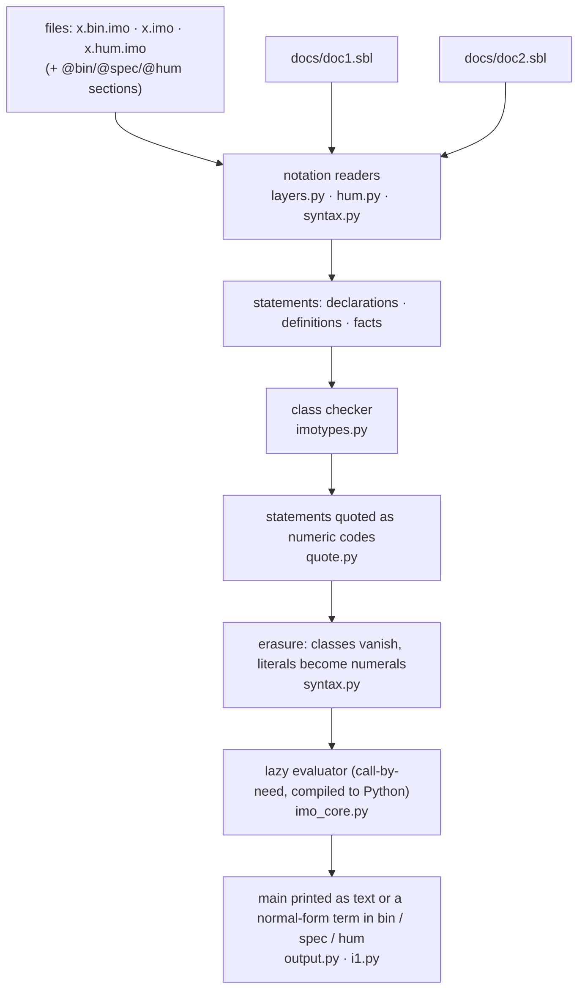

---

## 16. Implementation and tests

### 16.1 Pipeline



The diagram names the modules of Pymo; Haskimo and Rustimo have the same stages in the same order ([§16.5](#165-the-three-cores-and-the-shared-test-suite)).

### 16.2 Files

{{LOC}}

### 16.3 Test-suites

Twenty-three suites, each a plain script, and **shared by the three cores** ([§2.1](#21-three-interpreters-pymo-haskimo-and-rustimo)).  Nineteen use only the program-and-value API of `tests/harness.py` and run on Pymo, on Haskimo and on Rustimo alike: `python3 tests/test_poly.py` runs on Pymo, `python3 tests/test_poly.py --core haskimo` on Haskimo, `--core rustimo` on Rustimo (`tests/core_serve.py` starts `haskimo serve` or `rustimo serve`, and the suite decodes the digit strings, truth values and list and pair shapes that come back; every decision about a value is made by the evaluator of the core under test).  Four test the Python API of Pymo itself — its readers, its printer, its quoting — and run on Pymo only; what they check has command-line counterparts among the cases of `tests/conformance`, which run on all the cores ([§16.5](#165-the-three-cores-and-the-shared-test-suite)).  `python3 tests/run_suites.py` runs every suite on every core it supports.  On Pymo the test of the complex functions takes about 25 minutes on three cores (`python3 tests/test_complex.py --first` runs one case per function in 40 seconds); on Haskimo and on Rustimo about a minute.

| suite | cores | what it checks |
|:--|:--|:--|
| `tests/test_layers.py` | Pymo | notations, doc 1 / doc 2, translations and round trips, the class checker, Char/String, order, quantifiers, analysis |
| `tests/test_algebra.py` | Pymo, Haskimo, Rustimo | ℤ[i] and ℚ[i] arithmetic, the Cayley–Dickson tower, lazy ℝ[i], function spaces |
| `tests/test_axioms.py` | Pymo, Haskimo, Rustimo | the laws of [§11](#11-the-axioms-of-qi-complete-in-every-sense-a-computable-system-can-be): adder, subtractor, sign automaton, Re/Im, division, gcd, canonical form, field and meadow laws — evaluated in the language |
| `tests/test_classes.py` | Pymo, Haskimo, Rustimo | the class system of [§7](#7-classes-every-symbol-is-declared-first): the lattice of 137 classes against a model written from §7 (all 18 769 pairs), 119 160 probes of every overload set and generic declaration and 5 868 of the human operators, whose messages must be those all the cores printed (`tests/classes.golden.json`, written by `--bless` only if they agree) |
| `tests/test_lists.py` | Pymo, Haskimo, Rustimo | `lib/lists.imo` against Python oracles: folds, scans, searching, stable sorting, subsequences, permutations, combinations (350 checks; written as human-notation programs by `tests/langtest.py`) |
| `tests/test_strings.py` | Pymo, Haskimo, Rustimo | `lib/strings.imo`: character classes and case against Python's tables, splitting, searching, padding, bases, Roman numerals, edit distance (767 checks) |
| `tests/test_dict.py` | Pymo, Haskimo, Rustimo | `lib/dict.imo` against Python's dict, set, Counter, heapq and deque on random sequences of operations (1357 checks) |
| `tests/test_calendar.py` | Pymo (a sample), Haskimo, Rustimo | `lib/calendar.imo` against Python's `datetime` and `calendar`: day numbers, weekdays, the ISO calendar, Easter, date strings (900 checks) |
| `tests/test_graph.py` | Pymo (a sample), Haskimo, Rustimo | `lib/graph.imo` against Python implementations of the same algorithms on random graphs (444 checks) |
| `tests/test_stats.py` | Pymo (a sample), Haskimo, Rustimo | `lib/stats.imo` against Python's `fractions` and `statistics` on random lists (640 checks) |
| `tests/test_geom.py` | Pymo (a sample), Haskimo, Rustimo | `lib/geom.imo` against Python implementations with fractions, degenerate cases included (977 checks) |
| `tests/test_regex.py` | Pymo (a sample), Haskimo, Rustimo | `lib/regex.imo` against Python's `re` (full matches) and brute-force definitions (longest matches) on random patterns (496 checks) |
| `tests/test_encode.py` | Pymo (a sample), Haskimo, Rustimo | `lib/encode.imo` against Python's `base64`, `binascii`, `urllib.parse` and `zlib` and the textbook algorithms, invalid inputs included (1457 checks) |
| `tests/test_prng.py` | Pymo (a sample), Haskimo, Rustimo | `lib/prng.imo` against models in Python and known answers (195 checks) |
| `tests/test_combin.py` | Pymo (a sample), Haskimo, Rustimo | `lib/combin.imo` against `math.comb`, inclusion–exclusion, brute force over permutations and words, and restricted growth strings (575 checks) |
| `tests/test_theory.py` | Pymo (a sample), Haskimo, Rustimo | the theories of [`docs/lib-theory.md`](docs/lib-theory.md): the embedded theorems of the 23 packages, the mechanism of packages and their conflicts, curated statements with their exact verdicts, and random statements against exact Python oracles (truth tables, dictionary polynomials, Fractions, Fourier–Motzkin, principal minors, case-by-case expansion of abs/min/max, free reduction, vertices of the simplex, frozensets, finite topological spaces, linear forms) (1945 checks) |
| `tests/test_library.py` | Pymo, Haskimo, Rustimo | the library of [§14](#14-standard-library-reference) against exact Python references |
| `tests/test_output.py` | Pymo | `main`, the printer, the three output notations and their round trips |
| `tests/test_prove.py` | Pymo, Haskimo, Rustimo | predicates on ℝ[i]: every answer against the mathematical truth, undetermined instead of a guess, the all-binary program, the one-system laws |
| `tests/test_predicates.py` | Pymo | statements: unknowns, the class `Prop`, quotation, the coercions `prop` and `decide`, the printer in hum, spec and bin |
| `tests/test_solve.py` | Pymo, Haskimo, Rustimo | the simplifier: simplest forms for ℂ, ℝ, ℚ(i), ℚ, ℤ[i], ℤ, ℕ, several unknowns, `conj`/`re`/`im` splitting, hand-checked answers and a randomized comparison with exact arithmetic |
| `tests/test_poly.py` | Pymo, Haskimo, Rustimo | polynomials: ring operations, gcd, resultants, discriminants, Sturm sequences, isolated real roots, rational roots, factorisation over ℚ, interpolation |
| `tests/test_numtheory.py` | Pymo, Haskimo, Rustimo | number theory against independent Python computations (primes up to 3·10²⁴, factoring, congruences, arithmetic functions, partitions, Gaussian primes) |
| `tests/test_group.py` | Pymo, Haskimo, Rustimo | permutations and finite groups against brute force (closures, cosets, conjugacy classes, Sylow subgroups, subgroup lattices, isomorphism, Burnside) |
| `tests/test_linalg.py` | Pymo, Haskimo, Rustimo | exact linear algebra on random real and Gaussian matrices against independent fraction arithmetic (the four Penrose equations for `pinv`, P A = L U …) |
| `tests/test_complex.py` | Pymo, Haskimo, Rustimo | 396 cases of the complex functions at element N = 14–24 against `math`, `cmath` and series references (the contract: error ≤ 2⁻ᴺ) |
| `tests/test_ring.py` | Pymo, Haskimo, Rustimo | ℤ/n, ideals, quotient rings, multivariate arithmetic, the division algorithm and Gröbner bases against a dictionary-based reference |
| `tests/test_field.py` | Pymo, Haskimo, Rustimo | GF(p)[x], factorisation, GF(pⁿ), number fields and algebraic numbers against trial division, polynomial arithmetic and numerical roots |
| `tests/test_galois.py` | Pymo, Haskimo, Rustimo | Galois groups of 32 polynomials (names, orders, cycle types, subgroup lattice), unit groups, cyclotomic factors, Frobenius patterns |
| `tests/test_codec.py` | Pymo, Haskimo, Rustimo | types as decoding keys: `110101` as 1 − 6i, (1, −6), −1/6; pairs of integers as Gaussian integers; strings as numbers; the pair of strings as one 658-digit binary string |
| `tests/test_readme.py` | Pymo | the numbers and messages written *by hand* in this README (everything else here is generated by running the code) |

Their output at the time this README was generated:

```text
{{TESTLOG}}
```

Exactness is the point: every comparison is between **exact rationals** (Python `Fraction`) and the language's own fractions, or between two exact trees.  Floating point appears only as an independent check of a few expected answers (`math.sin`, `math.cos`, `math.pi`), never as the thing being tested.

### 16.4 Cost

Pymo's evaluator compiles lambda terms to Python; it is meant to be clear, not fast (about 10 µs per step on one digit).  Arithmetic does not reduce fractions as it goes, so sizes grow with N.

{{TIMES}}

### 16.5 The three cores and the shared test suite

The repository has three kinds of content ([§2.1](#21-three-interpreters-pymo-haskimo-and-rustimo)): the `.imo` files and system documents, the `.md` documents, and the test suite are **shared**; the rest is three **parallel cores**, `pymo/`, `haskimo/` and `rustimo/`.  Haskimo and Rustimo have a module for each module of Pymo, the same stages in the same order ([§16.1](#161-pipeline)), and no core is the reference: where they print different bytes, at least one of them is wrong, and what is right is decided by the documents and the tests, not by preferring a core.  Everything that is data is shared, not copied — doc 1, doc 2 and `lib/*.imo` are read by Pymo at run time and compiled into the Haskimo and Rustimo executables at build time (`haskimo/src/I1/EmbedTH.hs`, `rustimo/src/data.rs`), so there is one standard library.

| Pymo (Python, `pymo/`) | Haskimo (Haskell, `haskimo/src/I1/`) | Rustimo (Rust, `rustimo/src/`) | role |
|:--|:--|:--|:--|
| `base_b.py` | `Base.hs` | `base.rs`, `bigint.rs` | digit arithmetic of base i − 1, Python-compatible `repr` and `%g` for messages (Rustimo has a small big-integer type of its own: no crates) |
| `syntax.py` | `Syntax.hs` | `syntax.rs` | spec lexer and parser, class terms, pretty-printer, erasure to de Bruijn terms |
| `layers.py` | `Layers.hs` | `layers.rs` | binary lexer, doc 1, spec ↔ bin, file sections |
| `hum.py` | `Hum.hs` | `hum.rs` | doc 2, human lexer and Pratt parser |
| `imotypes.py` | `Types.hs` | `types.rs` | the class checker: overload sets, coercions, joins, statements (class errors are values, not exceptions) |
| `quote.py` | `Quote.hs` | `quote.rs` | statements as codes and the table of definitions |
| `imo_core.py` | `Core.hs` | `core.rs` | the evaluator: Pymo emits Python source; Haskimo builds closures with Haskell's own laziness; Rustimo compiles to flat-closure code for an explicit-stack machine with update frames, calls known global functions directly, builds partial applications at once, and compiles a library function when it is first needed; closed sub-terms are floated out in all three |
| `imo.py` | `Program.hs` | `program.rs` | loader: notations → statements → checker → evaluator |
| `output.py` | `Output.hs` | `output.rs` | the printer, the Speller, `main` and the output notations |
| `i1.py` | `haskimo/app/Main.hs` | `main.rs` | the command line |
| — | `EmbedTH.hs`, `Data.hs` | `data.rs`, `alloc.rs` | embed the system files into the executable (Rustimo also has a small-block allocator for the evaluator) |
| — | `Serve.hs` | `serve.rs` | `haskimo serve`, `rustimo serve`: a loaded program as a service, so that the library suites can run on them (`tests/core_serve.py` is the client of both) |

**Conformance.**  `python3 tests/conformance/run.py` runs the same command lines on any of the cores (`--impl pymo|haskimo|rustimo|all`) and compares standard output and exit status, byte for byte, with `tests/conformance/expected.json`.  The expected outputs are the bytes **on which all the cores agree**: `--bless` runs them all and records a case only if they print the same; a case on which they differ is listed and not recorded.  {{CONFORMANCE}}

**Native `.imo` tests, with no Python.**  The checks also exist as `.imo` programs that every core runs directly, the interpreters and the compiler alike.  `tests/imo/full/` (72 files, 9831 checks) and `tests/imo/small/` (33 files, 4057 checks: the sample that Pymo can afford) are
programs in the human notation that **check themselves**: `./i1 --impl compimo run tests/imo/full/encode-01.hum.imo` prints `PASS 150`, or `FAIL` and the labels of the checks that failed.  The expected values in them were computed once, by the independent Python oracles of the suites
(`LANGTEST_EMIT=tests/imo/full python3 tests/test_encode.py --core rustimo` writes the files of one suite), so that running the files needs nothing but a core.  `tests/run_imo.sh [--impl NAME,NAME] [--set full|small]` runs them, and
`tests/conformance/run.sh [--impl NAME,NAME] [--fast|--slow]` runs the conformance cases against the plain files of `tests/conformance/expected/` (`run.py --bless` and `run.py --export` write them from `expected.json`).  Both are POSIX shell scripts and run on
Pymo, Haskimo, Rustimo, Compimo, OCamimo, Schimo, Cimo and Rimo (`--impl rimo`, slow: `tests/conformance/run.sh --sample-lib 12`).

**What is not parallel.**  Three things.  The scripts that write the generated shared files (`pymo/mk*.py`, `pymo/numeral.py`, `pymo/setauthor.py`) exist once, in Python, because they import the modules of Pymo; Haskimo and Rustimo only read what they write.  Four of the eighteen suites of [§16.3](#163-test-suites) (`layers`, `output`, `predicates`, `readme`) test the Python API of Pymo and run on Pymo only: the readers, checker, quoting and printer of Haskimo and Rustimo are tested by the cases of `tests/conformance` (which include the programs that those four suites load) and, through the programs they load, by the other fourteen suites.  And the cores differ in speed, in memory and in the text of a crash of the host (a Python traceback, a `haskimo: ...` or `rustimo: ...` line); all exit with status 1.

{{HSTIMES}}

---

## 17. Status, limits and roadmap

### 17.1 What is implemented and tested  ✅

* Base-(i−1) numerals; exact ℤ[i] addition and subtraction by serial transducers with generated carry tables (exhaustively checked), multiplication, linear-time Re / Im / conjugation, the sign automaton; the field ℚ[i] with total division (`⊞ ⊟ ⊠ ⊖ ∗ ÷ ≐`, x ÷ 0 = 0); the order on ℚ.
* The axioms of ℚ[i] audited ([§11](#11-the-axioms-of-qi-complete-in-every-sense-a-computable-system-can-be)): exact division, gcd, division with remainder, the canonical form `⊜`, Gaussian Euclid — every law evaluated in the language.
* The three notations, doc 1 (append-only), doc 2, exact `spec ↔ bin` round trips, `hum → spec` with overload resolution and coercion insertion, mixed-notation files, local symbol tables; Char and String literals keep their class in bin.
* The declaration-first class checker: subclass facts, class equations, coercions, overload sets, polymorphism over `α β γ`, mandatory binder classes.
* Lazy ℝ[i], the exact series driver `Σ`, `π`, `e`, `π + e·i`, `exp`, `sin`, `cos`, `√`, `log`, `atan`, `sinh`, `cosh`, `tan`, `tanh`, derivative and integral streams.
* The Cayley–Dickson tower with lifting and no reduction, over ℚ[i], over lazy ℝ[i], over function spaces; quaternion, octonion and sedenion behaviour.
* Function spaces `𝔉`, inner products, standard basis; `Char`, `String`; bounded quantifiers; lists, sorting, digit-wise operations, linear algebra, sets ([§14](#14-standard-library-reference)).
* Programs with `main`; output as text or as a normal-form term in bin, spec or hum, with `--out` / `@out` and the notation of `main` as default ([§12](#12-programs-main-and-the-output-notations)).
* Predicates ([§13](#13-predicates-relations-simplified-to-their-simplest-form)): unknowns, the class `Prop`, the simplifier `lib/solve.imo` (simplest forms for one unknown over ℂ, ℝ, ℚ(i), ℚ, ℤ[i], ℤ, ℕ; linear systems, sums of squares and conjugation splitting for several), printed in all three notations.
* The mathematical library of [§14.1](#141-the-mathematical-library-by-area): complex functions, linear algebra, polynomials, number theory, groups, rings with Gröbner bases, finite and number fields, Galois groups of polynomials of degree ≤ 4.
* The prover: relations on ℝ[i] decided from definitions — expansion, ring normal form, isomorphism of series, exponential and root rules, certified discs, three-valued logic — run inside the language on numeric codes ([§13](#13-predicates-relations-simplified-to-their-simplest-form)); truth values as the numbers 1 and 0, and one overload family `+ or max ∪`.

### 17.2 Limits you should know about  ⚠️

| Area | Limit |
|:--|:--|
| **Trusted prelude** | The bodies of `lib/` are not class-checked and its signatures are assertions backed by tests, not proofs.  User code is fully checked *against* them. |
| **Reals** | A real/complex number is a stream without a Cauchy modulus.  Relations on ℝ / ℝ[i] are predicates decided by logic from the definitions, and some are **undetermined** (no rule applies yet); "this stream converges" is the author's obligation. |
| **Predicates on ℝ[i]** | Sound but incomplete — necessarily so ([§13.4](#134-true-false--or-undetermined-never-a-guess)).  No rule yet for logarithms, square factors under `√`, `tan`, pointwise division, derivatives and integrals; no general induction over user-defined streams.  An undetermined answer can take most of a minute. |
| **Fractions** | Arithmetic does not reduce fractions as it goes (the canonical form `⊜` is available and used for output), so stream elements grow quickly. |
| **Partial operations** | None on ℚ[i]: `÷`, `div`, `mod` are total (x ÷ 0 = 0).  `ℓ` of an infinite list diverges, as does printing an infinite `String`. |
| **Human notation** | A well-defined subset: statements `name in Class := expr` and `A subseteq B`; no mixfix operators, sub/superscripts, set-builder or pattern syntax; no user-declared classes (spec/bin only); one infix `-` and one prefix `-`; `x in Class` as an expression is a static ascription, **not** a Boolean membership test (use `member`). |
| **Quantifiers** | Only bounded quantifiers over lists (`forall`, `exists`, with `range(n)`).  Unbounded `∀ x ∈ ℕ` is undecidable and not provided; inside a predicate an outer variable is an unknown. |
| **Binary notation** | Bin is the axiomic layer, but the reader expands numerals into applications of the prelude symbols `⊗ ∷ ⊤ ⊥ ⊘`, so a bin program is meaningful only together with doc 1 (and its own `.sbl`), and there is no bin-level comment. |
| **Names** | One global namespace; redefinition is an error; no modules.  Names may not contain `0`, `1`, `.` or quotes (spec). |
| **Characters** | Strings are code points, no normalisation or encodings. |
| **Performance** | Pymo (Python): about 10 µs per digit step; very deep recursion on long numerals (the process uses a large-stack thread).  Haskimo and Rustimo ([§16.5](#165-the-three-cores-and-the-shared-test-suite)) run the same programs several times faster; Rustimo also starts in a few milliseconds and needs a tenth of Haskimo's memory. |
| **Not specified** | A formal semantics of the class system beyond the checker; a machine-checked proof of the lemmas of `docs/axioms.md` (they are proved on paper and tested exhaustively on short inputs). |

### 17.3 Roadmap  🛠

1. **More rules for the prover**: logarithms (recognise the log series, factor the argument, log x = Σ eₚ log p), square factors under `√`, algebraic numbers (minimal polynomials), quantifiers over ℕ by induction.
2. **Reals with moduli**: an optional class of streams paired with a convergence modulus, so that a user-defined stream gets a certificate too.
3. **Human notation**: user-declared classes, algebraic data declarations, mixfix and subscript notation driven from doc 2.
4. **Self-contained bin**: a `.sbl` header embedded in `.bin.imo` files; a compact header-less bin form.
5. **Checking the prelude**: a second, typed implementation of the kernel in which the signatures are *theorems* of the class system.
6. **A faster evaluator** (a graph reducer, or a C/Rust back end); fractions reduced lazily when they grow.

---

## 18. Extending the language

**A new notion with a spec symbol** (say a function `abs2 ∶ ℚ[i] → ℚ[i]` for z·z̄):

1. Add to a prelude file (append to a *later* file, or a new file listed last in `imo.PRELUDE` and `pymo/mkdoc1.py`, so existing doc 1 codes do not move):
   ```text
   abs2 ∶ ℚ[i] → ℚ[i]
   abs2 ξ ≔ (⊠ ξ (∗ ξ))
   ```
2. `python3 pymo/mkdoc1.py` — gives every new symbol the next free code in doc 1.
3. `python3 pymo/mkbin.py` — regenerates `lib/prelude.bin.imo` and the example `.bin.imo` files.
4. Add the human spelling to doc 2: `abs2 := abs2 ; value` (or an overload set with `|`).
5. `python3 pymo/mkref.py` — refreshes the generated tables; `python3 pymo/mkreadme.py` rebuilds this README.
6. Add a test next to the existing ones and run the suites.

Doc 1 is **append-only**: `pymo/mkdoc1.py` keeps every existing code and gives new symbols the next free codes, so a binary program written today keeps its meaning tomorrow.  If the new symbol is something the prover should dispatch on, add it to `pymo/mkprove.py` and run it (the codes in `lib/prove.imo` are generated from doc 1).  A new proof rule is described in [`docs/prove.md`](docs/prove.md) §6.  Doc 1 still holds the codes of the retired symbols `reduce` and `reduce′`: a released code is never reassigned, so they stay allocated and unused.

**A new notion with only a human symbol**: add one line to `docs/doc2.sbl` whose right-hand side is a bin numeral or bin symbol (`half := 0.1 ; literal` would not be valid — a literal's right-hand side must be a bin *numeral*, e.g. `i := 11`).

**A user program** needs none of this: write `x.hum.imo` (or `.imo`), declare, define, run `i1.py`.  For example `examples/norm.hum.imo`:

```text
{{FILE:examples/norm.hum.imo}}```

```text
$ python3 pymo/i1.py eval examples/norm.hum.imo v
{{RUNOUT:eval examples/norm.hum.imo v}}
```

---

## 19. FAQ

**Why base i − 1?**  It writes every Gaussian integer as a finite string over {0, 1} without a sign or a pair of parts, so "a number" and "a list of bits" are the same thing, and `i` is simply `11`.

**Why is `i` not defined?**  It does not need a definition: it is a numeral.  The digit string `11` has value 1·b + 1·b⁰ = (i − 1) + 1 = **i**.  Doc 2's `i := 11` merely gives that numeral a human spelling.

**Is equality of reals decidable?**  Not in general — no system can decide it.  On ℚ[i] `==` is evaluated and always answers.  On ℝ / ℝ[i] `==` is a predicate decided by logic from the definitions: it proves what its rules prove, refutes what certified bounds refute, and answers *undetermined* otherwise, never a guess ([§13](#13-predicates-relations-simplified-to-their-simplest-form)).

**Why is `x / 0` equal to 0?**  So that every term denotes something and `==` stays an equivalence: with "undefined" fractions 0/0 was equal to 1 and to 2.  This is the *meadow* convention (Bergstra and Tucker); every field law still holds where the field has an answer ([§11](#11-the-axioms-of-qi-complete-in-every-sense-a-computable-system-can-be)).

**Is `true + true` really `true`?**  Yes: on truth values `+` is *or* (the Boolean semiring), and `iverson(true) + iverson(true)` is 2.  Next to a number a truth value is the number 1 or 0, so `1 + true` is 2 ([§13.5](#135-one-system)).

**Do I need `main`?**  Only to run a file as a program.  A file without `main` is a library; `i1.py eval FILE NAME` still evaluates any symbol ([§12](#12-programs-main-and-the-output-notations)).

**What does "never reduces dimensions" mean precisely?**  Values only move *up* the Cayley–Dickson tower, by the inclusion a ↦ (a, 0); no operation maps (a, 0) back to a; zeros and results keep the depth they were built with; and the class system has no implicit narrowing.

**Why three notations?**  Binary is what the language *is* (the axiomic layer), unicode is what the standard library is written in (precise and compact), and the human layer is what people write.  Keeping them in separate files — and the translators mechanical — means a notation can be extended without touching the semantics.

**Can I write programs only in binary?**  Yes: `lib/prelude.bin.imo` + `examples/target.bin.imo` + `examples/target.sbl` is exactly that, and the test-suite runs it.  Writing it by hand is not recommended; write human or spec and let `i1.py translate … --to bin` produce it.

**Is it Turing complete?**  The evaluator is an untyped lambda calculus with recursive definitions, so the *evaluation core* is; the class checker restricts which user programs are accepted but does not forbid recursion.

**Why three cores?**  Because a language that has one interpreter is defined by its bugs, and with two nobody can say which one is wrong when they disagree.  Pymo (Python), Haskimo (Haskell) and Rustimo (Rust) are parallel: written to the same documents, run against the same shared test suite, and none is privileged — when they disagree, at least one of them is wrong, and the documents and the tests say which (with three, it is usually the one that disagrees with the other two).  Everything that is shared is plain data (`.imo` files, doc 1, doc 2): each core only reads it and evaluates lambda terms.  Haskimo and Rustimo are several times faster than Pymo and need no Python; Rustimo also starts in a few milliseconds and needs a fraction of the memory; Pymo needs no compiler.

**Is i-1 interpreted or compiled?**  Interpreted: Pymo, Haskimo and Rustimo read a program, check it and evaluate it each time it runs, and none of their commands writes an executable ([§9](#9-evaluation-model)).  Each turns the lambda terms into something its own host language runs directly before running them, which makes them faster than a plain term walker but does not make them compilers.

**Which core do I use?**  Any; `i1 --impl pymo|haskimo|rustimo|all` chooses ([§2.1](#21-three-interpreters-pymo-haskimo-and-rustimo)).  When you change the language, change the shared files (`lib/`, the documents, the tests) and then all the cores until all of them pass `python3 tests/conformance/run.py`.

---

## 20. Glossary

| Term | Meaning |
|:--|:--|
| **bin sbl** | a symbol of the binary notation: `.B.` with B a bit string |
| **spec sbl** | a symbol of the specific (unicode) notation |
| **hum sbl** | a symbol of the human notation |
| **numeral** | a bit string (optionally with one radix point) read in base i − 1; denotes an element of ℚ[i] |
| **class** | the language's word for type: an atom (`ℕ`, `ℚ[i]`) or a constructor applied to classes (`𝔏 𝕮`, `A → B`) |
| **overload set** | several declarations of one symbol (or several symbols behind one human symbol) |
| **coercion** | a declared function, inserted automatically, that widens a value to the class an argument needs (`⇡`, `↑`) |
| **prelude** | the standard library in `lib/`, loaded trusted |
| **Pymo / Haskimo / Rustimo** | the three parallel cores of i-1, interpreters of one specification: Pymo is written in Python (`pymo/`), Haskimo in Haskell (`haskimo/`), Rustimo in Rust (`rustimo/`); all read the same files and print the same bytes, and none is the reference ([§2.1](#21-three-interpreters-pymo-haskimo-and-rustimo)) |
| **conformance** | the property that a core prints, for every case of `tests/conformance`, the bytes on which all the cores agree ([§16.5](#165-the-three-cores-and-the-shared-test-suite)) |
| **local table** | a `.sbl` file giving codes to the symbols a bin program introduces itself |
| **stream / approximant** | an infinite list / its N-th element: an exact ℚ[i] element that approximates a real or complex number |
| **tree / depth** | a Cayley–Dickson value: a leaf, or a node (a, b) of two trees; depth 0 for a leaf |
| **algebra record** | `⌘ add mul neg conj zero one`: the operations of an algebra over some class |
| **trusted** | loaded without checking definition bodies; declarations are accepted as signatures |
| **meadow** | a field with a total inverse, 0⁻¹ = 0; ℚ[i] with x ÷ 0 = 0 |
| **canonical form** | `⊜ x` = z/m with m the least natural number such that m·x ∈ ℤ[i]; equal values have identical canonical forms |
| **main** | the entry point of a program; its class decides how it is printed |
| **output notation** | the notation a value is printed in: `--out`, else `@out`, else the notation of `main` |
| **predicate** | a function whose value is true, false or undetermined: the relations, the connectives, any function declared with codomain `Bool` or `Prop`; a relation is simplified to its simplest form whenever it is evaluated, output included |
| **simplest form** | the value a predicate is simplified to: `true`, `false`, or the simplest equivalent statement (for one unknown its solution set) |
| **quotation / code** | a term written as data made of numbers, symbols named by their doc 1 codes, so that the prover can inspect it |
| **atom** | an element of ℝ[i] that the ring normal form treats as an unknown (a series, a root, an exponential) |
| **certified disc** | a centre and a radius proved to contain the value of a series |
| **⍰ (undetermined)** | the third truth value of a predicate; absorbs what it is applied to, and is reported, never printed as true or false |
| **iverson / supp** | the maps 𝔹 → ℕ (⊤ ↦ 1, ⊥ ↦ 0) and ℕ → 𝔹 (n ↦ n ≠ 0) that make truth values and numbers one system |

---

## 21. Repository layout

```text
{{TREE}}
```

---

## 22. License

i-1 is under the **i-1 License** ([`LICENSE`](LICENSE), `SPDX-License-Identifier: LicenseRef-i-1-1.0`): a source-available license with a free
non-commercial track and a paid commercial track.

| | non-commercial use | commercial use |
|:--|:--|:--|
| how | free; nobody needs to ask | request a license by email to **yinhao.wang@outlook.com** ([`COMMERCIAL.md`](COMMERCIAL.md)) |
| price | free | paid, as agreed in writing |
| attribution | required, cannot be waived | waived for the licensee's own products and services |
| copyleft | strong: what you convey of i-1 or of a derivative is conveyed under the same license, with its source | strong, unchanged |

Commercial means: in or for a product or service offered for a fee, use by or for a for-profit organization in its business, use that produces
revenue.  Teaching, study, openly published research and the non-commercial tasks of schools, charities and public bodies are not.  A program
written in the i-1 language is covered only if it is distributed together with the Software or a part of it (for example the standard library);
a program distributed alone, and the text it prints, are not.  Contributions to the author carry the right to license them commercially
(section 6).  Because it restricts use to non-commercial purposes, this is **not** an OSI-approved open-source license; the source is open to
read, use, change and share for non-commercial purposes under the terms above.  The license text is the only thing that binds; this section is a summary.
